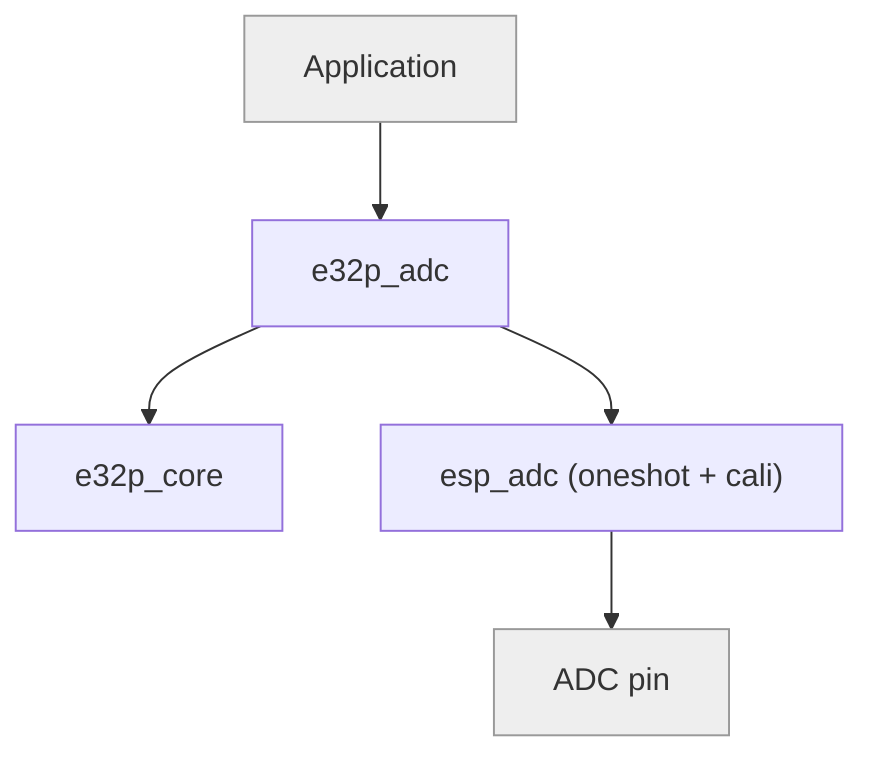
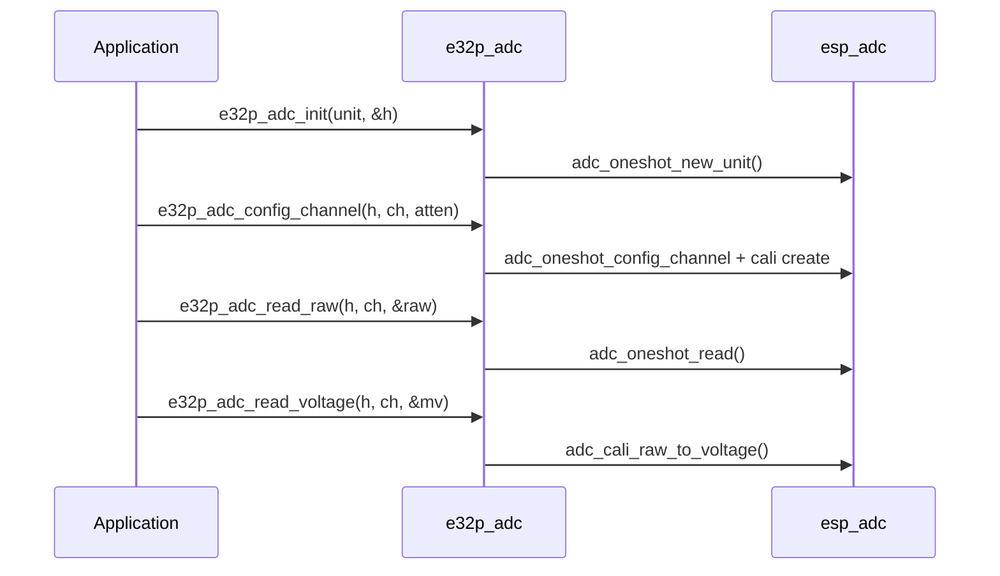

# e32p_adc — Design

> **ADC oneshot read with calibration.** Part of the ESP32 firmware platform
> (`e32p_` modules). Self-contained.

## 1. Overview

`e32p_adc` is an opaque-handle facade over the ESP-IDF `esp_adc` oneshot +
calibration APIs: **one handle per ADC unit**. Configure a channel's attenuation,
then read a raw count or a calibrated voltage (mV). Encapsulates the ESP32 gotcha
that **ADC2 is unusable while Wi-Fi is active**.

| Property | Value |
|----------|-------|
| Registration style | **opaque handle** (per ADC unit) |
| Kconfig symbol | `CONFIG_E32P_ADC_ENABLE` |
| Target guard | none |
| Public header | [`include/e32p_adc.h`](include/e32p_adc.h) |

## 2. External dependencies

| Direction | Depends on | Why |
|-----------|-----------|-----|
| Platform | `e32p_core` | error macros, `ESP_ERR_E32P_RESOURCE_CONFLICT` |
| ESP-IDF | `esp_adc` (`PRIV_REQUIRES`) | oneshot unit + calibration schemes |



## 3. Internal architecture

Each handle holds the oneshot unit and per-channel calibration handles.
`config_channel` sets attenuation + 12-bit width and, where the chip supports a
calibration scheme, creates the calibration handle used by `read_voltage`.

## 4. Key data structures

- **`e32p_adc_handle_t`** — opaque; wraps the oneshot unit + calibration state.
- **`e32p_adc_atten_t`** — `0DB / 2_5DB / 6DB / 12DB` (widest range ≈ 0–3.1 V).

## 5. Calling sequence



## 6. Concurrency & context

- Task context; per-handle. ADC1 is safe alongside Wi-Fi; **ADC2 is not** — a
  read on ADC2 while Wi-Fi is active returns `ESP_ERR_E32P_RESOURCE_CONFLICT`.

## 7. Error model

- `E32P_CHECK_ARG` → `ESP_ERR_INVALID_ARG` (unit not 1/2, NULL out).
- `ESP_ERR_E32P_RESOURCE_CONFLICT` — ADC2 read blocked by active Wi-Fi.
- `ESP_ERR_INVALID_STATE` from `read_voltage` when no calibration scheme is
  available on the chip (raw reads still work).

## 8. Cherry-pick

```
CONFIG_E32P_ADC_ENABLE=y
```

Requires `e32p_core`; privately requires `esp_adc`. Copy `components/e32p_adc/`
and `components/e32p_core/`.
