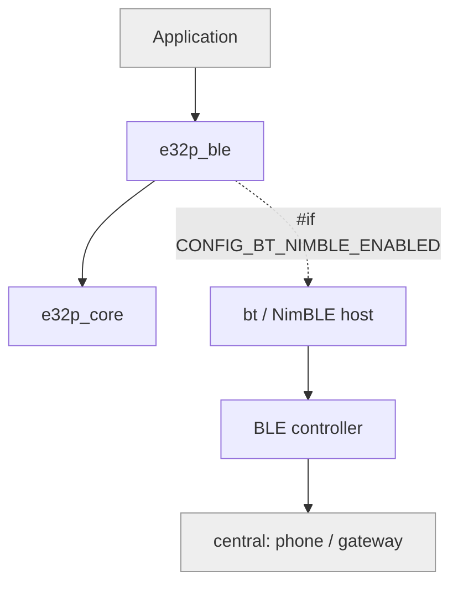

# e32p_ble — Design

> **BLE GATT peripheral over NimBLE.** Part of the ESP32 firmware platform
> (`e32p_` modules). This document describes the module's internals and external
> connections and is self-contained: it travels with the module when cherry-picked.

## 1. Overview

A BLE peripheral advertises, accepts a connection from a central (phone / gateway),
and exposes a GATT table of services and characteristics the central can read,
write, and subscribe to. This module wraps Apache NimBLE into a small facade: you
declare a device name, one primary service, and its characteristics, and get
callbacks for writes and connection state plus a `notify` to push values.

The advertising-payload assembly (a spec-defined byte layout) and UUID handling
are **pure** and unit-tested; the NimBLE plumbing is compiled only when the
Bluetooth host is enabled, so radio-free builds (and the test/HIL runners) don't
pull in the stack.

| Property | Value |
|----------|-------|
| Registration style | flat / singleton (one controller per chip) |
| Kconfig symbol | `CONFIG_E32P_BLE_ENABLE` (radio path also needs `CONFIG_BT_NIMBLE_ENABLED`) |
| Target guard | needs a BLE-capable target + the NimBLE host |
| Public header | [`include/e32p_ble.h`](include/e32p_ble.h) |

## 2. External dependencies

| Direction | Depends on | Why |
|-----------|-----------|-----|
| Platform | `e32p_core` | error macros, logging |
| ESP-IDF | `bt` (NimBLE) | controller + host — **private, and only when `CONFIG_BT_NIMBLE_ENABLED`** |



## 3. Internal architecture

Two layers in one file, separated by `#if CONFIG_BT_NIMBLE_ENABLED`. The pure
layer builds AD structures and UUIDs. The radio layer holds one static context
(connection handle, callbacks, and the per-characteristic value buffers + NimBLE
service/characteristic definition tables), and bridges NimBLE's GAP/GATT
callbacks to the module's callbacks.

```mermaid
flowchart TB
    subgraph e32p_ble
        pure[adv_build / uuid16 / uuid128]:::p
        subgraph radio["#if BT_NIMBLE"]
            init[init] --> ctx[(static ctx: conn, chars[], svc/chr defs)]
            init --> pure
            gap[gap_event] --> ctx
            gatt[gatt_access] --> ctx
            notify --> ctx
        end
    end
    ctx --> nimble[ble_gap_* / ble_gatts_*]
    classDef p fill:#eef,stroke:#88a;
```

## 4. Key data structures

- `e32p_ble_uuid_t` — 2- or 16-byte little-endian UUID.
- `e32p_ble_char_t` — a characteristic's UUID + property flags (READ/WRITE/NOTIFY).
- `e32p_ble_config_t` — device name, the service UUID, the characteristic table,
  and the write / connection callbacks.
- Internal `s` (static) — connection handle, callbacks, the pre-built advertising
  payload, and per-characteristic value buffers plus the NimBLE
  `ble_gatt_svc_def` / `ble_gatt_chr_def` tables (which must outlive registration,
  hence static).

## 5. Calling sequences

**Init → advertise → connect → write**
```mermaid
sequenceDiagram
    participant app as Application
    participant mod as e32p_ble
    participant nim as NimBLE
    participant cen as Central
    app->>mod: e32p_ble_init(cfg)
    mod->>mod: adv_build(); build svc/chr defs
    mod->>nim: nimble_port_init + gatts_add_svcs + freertos_init
    nim-->>mod: on_sync -> start advertising
    cen->>nim: connect
    nim-->>mod: gap_event CONNECT -> on_conn(true)
    cen->>nim: write characteristic
    nim-->>mod: gatt_access WRITE -> on_write(idx, data)
    app->>mod: e32p_ble_notify(idx, value)
    mod->>nim: ble_gatts_notify_custom
    nim-->>cen: notification
```

## 7. Concurrency & context

NimBLE runs a dedicated host task; the `on_write` / `on_conn` callbacks and the
GAP/GATT handlers all run **in that task** — keep them short and non-blocking,
and hand heavy work to another task. `e32p_ble_notify` / `set_value` are called
from the application task and touch the shared value buffers without a lock; for
this single-connection peripheral that is acceptable, but a multi-writer design
would need synchronization. `is_connected()` reads a single handle.

## 8. Error model

`esp_err_t` for the device API. `E32P_CHECK_ARG` (→ `ESP_ERR_INVALID_ARG`) guards
a NULL/oversized config, too many characteristics, and out-of-range indices;
`init` also returns `ESP_ERR_INVALID_ARG` if the advertising payload won't fit in
31 bytes. `notify` returns `ESP_ERR_INVALID_STATE` when no central is connected.
When the BLE host is not compiled in, every device function returns
`ESP_ERR_NOT_SUPPORTED`. The pure `adv_build` returns `-1` on overflow / bad args.

## 9. Cherry-pick

```
CONFIG_E32P_BLE_ENABLE=y
CONFIG_BT_ENABLED=y
CONFIG_BT_NIMBLE_ENABLED=y
```

Requires `e32p_core`; privately requires `bt` (NimBLE) when the host is enabled.
Copy `components/e32p_ble/` (plus `e32p_core`), enable the symbols, and give the
build a BLE-capable target.
