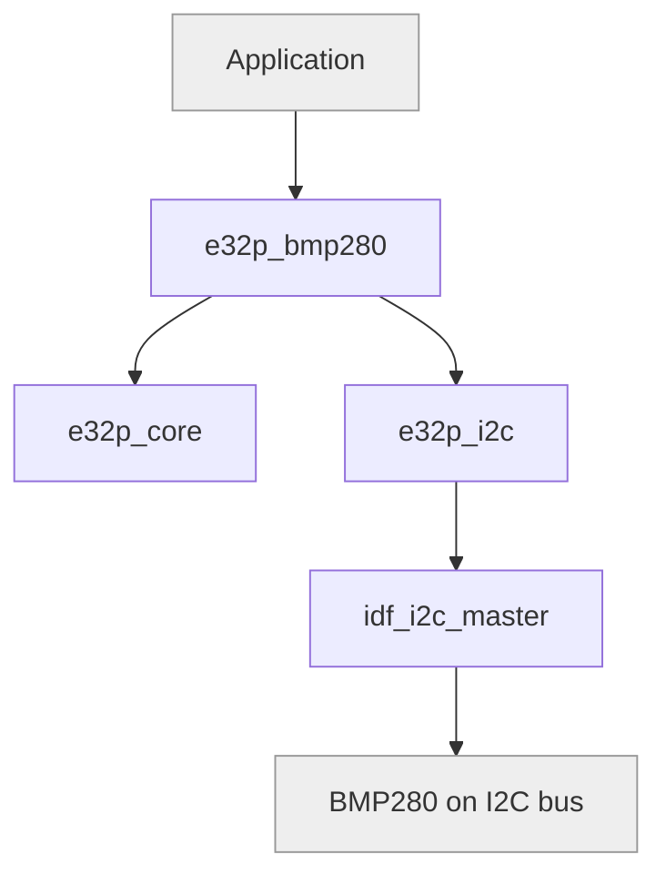
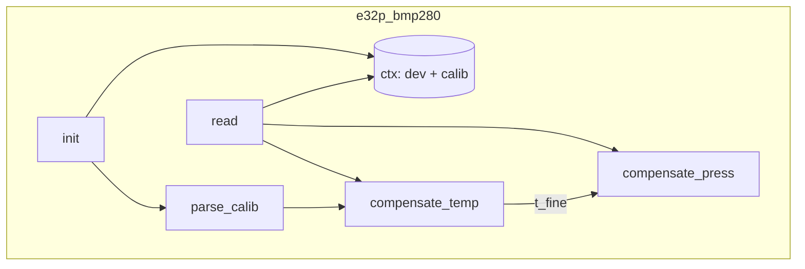
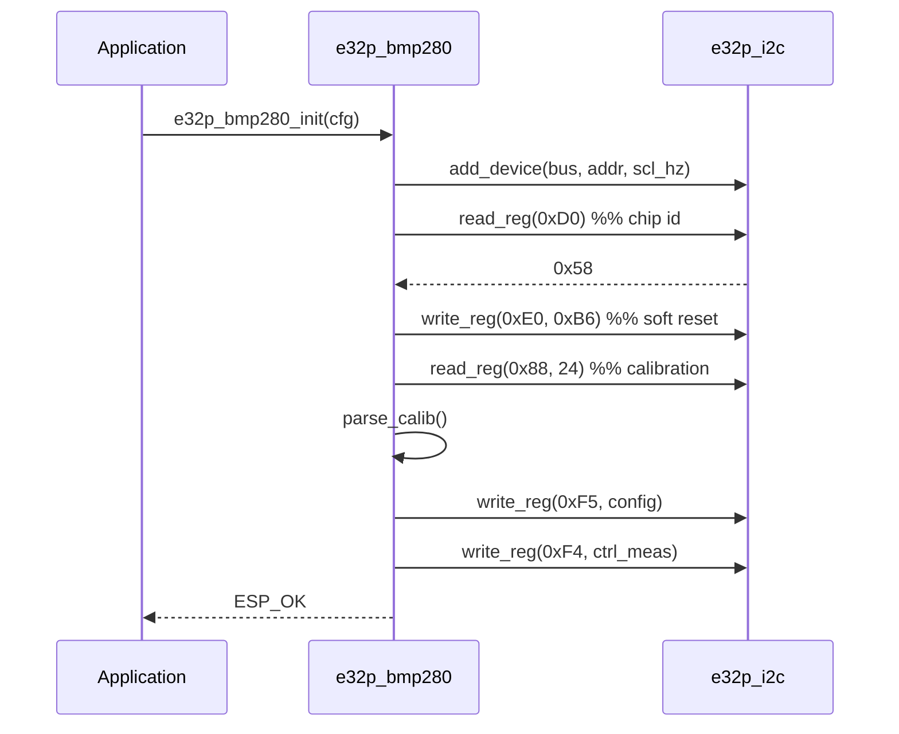
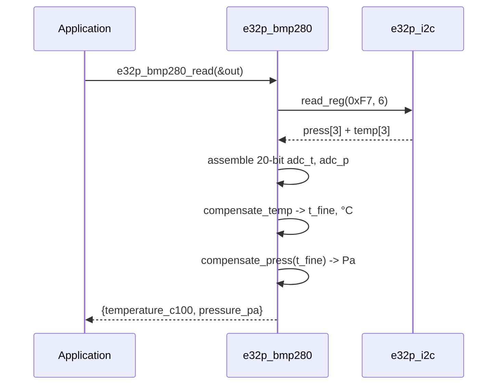

# e32p_bmp280 — Design

> **Bosch BMP280 pressure + temperature over I2C.** Part of the ESP32 firmware
> platform (`e32p_` modules). This document describes the module's internals and
> external connections and is self-contained: it travels with the module when
> cherry-picked.

## 1. Overview

The BMP280 reports raw 20-bit temperature and pressure that only become physical
values after applying the sensor's factory calibration through Bosch's
fixed-point compensation algorithm. This module reads the calibration once at
init, then converts each raw sample to 0.01 °C and pascals. It sits in the
device-driver layer on top of [`e32p_i2c`](../e32p_i2c).

The design deliberately separates the **pure math** (calibration parse +
compensation — no bus, deterministic) from the **thin I2C transport**, so the
part that is easy to get wrong is verified headless against the datasheet's
reference vector.

| Property | Value |
|----------|-------|
| Registration style | opaque-handle (one per sensor) |
| Kconfig symbol | `CONFIG_E32P_BMP280_ENABLE` |
| Target guard | none (any I2C-capable target) |
| Public header | [`include/e32p_bmp280.h`](include/e32p_bmp280.h) |

## 2. External dependencies

| Direction | Depends on | Why |
|-----------|-----------|-----|
| Platform | `e32p_core` | error macros, logging |
| Platform | `e32p_i2c` | bus/device handles + register transfers (in the public header) |
| ESP-IDF | `freertos` | `vTaskDelay` for the post-reset settle |
| Kconfig `select` | `E32P_I2C_ENABLE` | the transport must be compiled in |



## 3. Internal architecture

Two layers in one file. The pure layer is a set of free functions operating on a
caller-visible `calib_t`; the device layer is a small handle holding the I2C
device and a cached copy of the calibration.



`compensate_temp` produces `t_fine`, a shared intermediate the pressure
compensation needs — so temperature is always computed first.

## 4. Key data structures

- `e32p_bmp280_config_t` — bus handle, 7-bit address, per-device SCL clock, and
  the oversampling / filter / standby / mode knobs. `E32P_BMP280_CONFIG_DEFAULT`
  fills a normal-mode, filtered configuration.
- `e32p_bmp280_calib_t` — the 12 factory coefficients (T1–T3, P1–P9). Signedness
  matters: T1 and P1 are unsigned, the rest signed 16-bit.
- `e32p_bmp280_reading_t` — `{ temperature_c100, pressure_pa }`.
- `struct e32p_bmp280_ctx` — the I2C device handle plus the cached calibration.

## 5. Calling sequences

**Init**


**Read**


## 7. Concurrency & context

Runs entirely in the calling task; no internal task, ISR, or callback. Not
reentrant per handle — serialize calls to one sensor, or give each task its own
handle. The underlying `e32p_i2c` transfers are blocking with millisecond
timeouts. `init` sleeps ~5 ms (`vTaskDelay`) after the soft reset.

## 8. Error model

`esp_err_t` throughout. Argument checks use `E32P_CHECK_ARG`
(→ `ESP_ERR_INVALID_ARG`) for NULL config/out/bus and an out-of-range address.
A wrong or absent chip id returns `ESP_ERR_NOT_FOUND` (and the device is detached
and freed, so a failed init leaks nothing). All bus transfer errors pass through
unchanged. The pure `compensate_press` returns 0 if the calibration would divide
by zero (`dig_P1 == 0`), matching the datasheet's guard.

## 9. Cherry-pick

```
CONFIG_E32P_BMP280_ENABLE=y   # selects E32P_I2C_ENABLE
```

Requires `e32p_core` and `e32p_i2c`. Copy `components/e32p_bmp280/` (plus
`e32p_core` and `e32p_i2c`) and enable the symbol.
