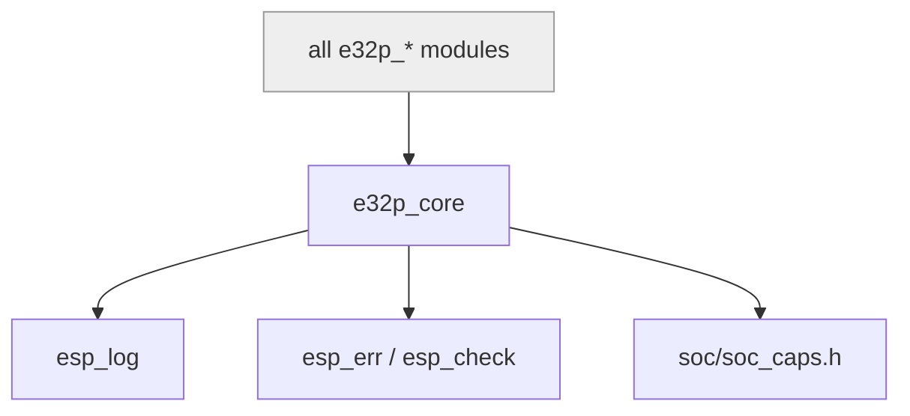
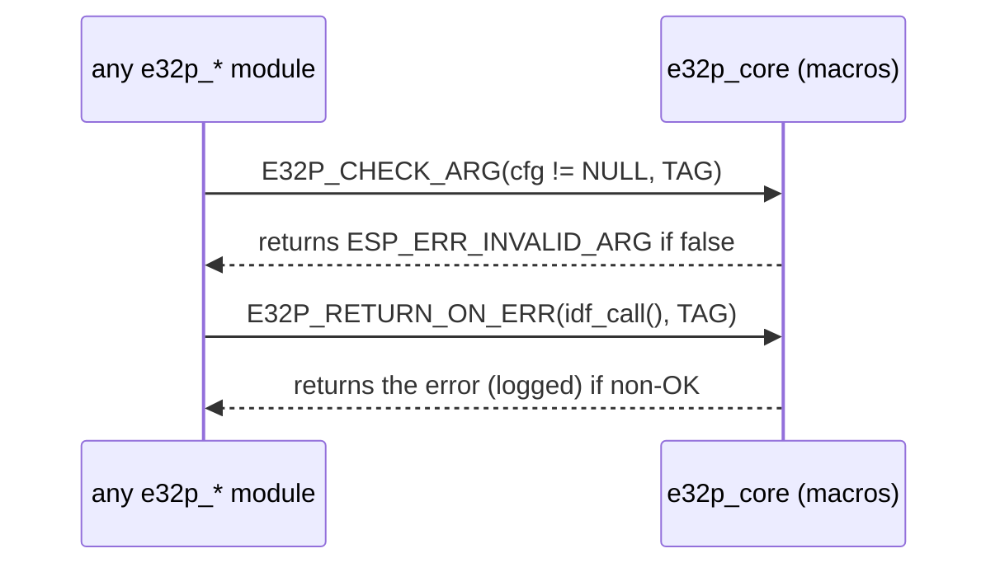

# e32p_core — Design

> **Foundation: shared conventions for every `e32p_` module.** Part of the ESP32
> firmware platform. Self-contained. This is the one component every other module
> depends on.

## 1. Overview

`e32p_core` is not a facade over hardware — it is the **common ground** all other
modules build on: the error convention (macros + a small custom code range),
guaranteed logging, a target-portability seam, and the platform version. It is
almost entirely headers; the only code is a version-string accessor.

| Property | Value |
|----------|-------|
| Registration style | header-library (one trivial `.c`) |
| Kconfig symbol | none — **always compiled** (unconditional component) |
| Kconfig options | `E32P_PIN_GUARDS` (default y); `E32P_PRODUCT_BUILD` (default n) — a marker only: it changes no behaviour; hidden `E32P_BENCH_FORBIDDEN` (no prompt) is on when the marker, `SECURE_BOOT` or `SECURE_FLASH_ENC_ENABLED` is on (fail-closed; `SECURE_SIGNED_APPS_*` is not a trigger); bench/demo projects and modules with bench-only options test it and `#error` when it is set (e.g. `tests/hil/agent`, `examples/26_ota_http`, `examples/28_secure_ota`) |
| Target guard | none |
| Public header | [`include/e32p_core.h`](include/e32p_core.h) (umbrella) |

## 2. External dependencies

| Direction | Depends on | Why |
|-----------|-----------|-----|
| ESP-IDF | `log` | `esp_log.h` re-exported so every module gets `ESP_LOGx` |
| ESP-IDF | `esp_common` | `esp_err.h`, `esp_check.h` |
| Consumers | **all** `e32p_*` modules | `REQUIRES e32p_core` |

## 3. What it provides

The umbrella `e32p_core.h` pulls in four headers:

- **`e32p_err.h`** — the error convention:
  - `ESP_ERR_E32P_*` codes (base `0x30000`): `NOT_INIT`, `ALREADY_INIT`,
    `UNSUPPORTED_ON_TARGET`, `RESOURCE_CONFLICT`, `PIN_RESERVED` — only for
    conditions ESP-IDF cannot express. Everything else reuses IDF codes.
  - Check macros wrapping `esp_check.h`: `E32P_RETURN_ON_ERR(expr, tag)`,
    `E32P_CHECK_ARG(cond, tag)` (→ `ESP_ERR_INVALID_ARG`),
    `E32P_RETURN_ON_FALSE(cond, err, tag, msg, …)`, `E32P_GOTO_ON_ERR(expr, tag, label)`.
- **`e32p_target.h`** — portability seam: `E32P_TARGET_NAME` and the rule that
  modules gate chip features on `SOC_*` capability macros / `depends on SOC_*`,
  never scattered `CONFIG_IDF_TARGET_*` ifdefs.
- **`e32p_version.h`** — `E32P_VERSION_*` and `e32p_version_string()`.
- **`esp_log.h`** — re-exported so any includer has logging.

## 4. Calling sequence

There is no lifecycle. Modules include the umbrella and use the macros inline:

## 5. Error model

This module *defines* the platform error model rather than raising errors itself.
Key rule (documented on the macros): do **not** wrap calls whose non-OK result is
an expected/benign outcome (e.g. an NVS read that may be `NOT_FOUND`) with
`E32P_RETURN_ON_ERR` — it logs at ERROR level; branch on those quietly instead.

## 6. Cherry-pick

Always included — every module `REQUIRES e32p_core`. When lifting any module into
another project, copy `components/e32p_core/` alongside it.
