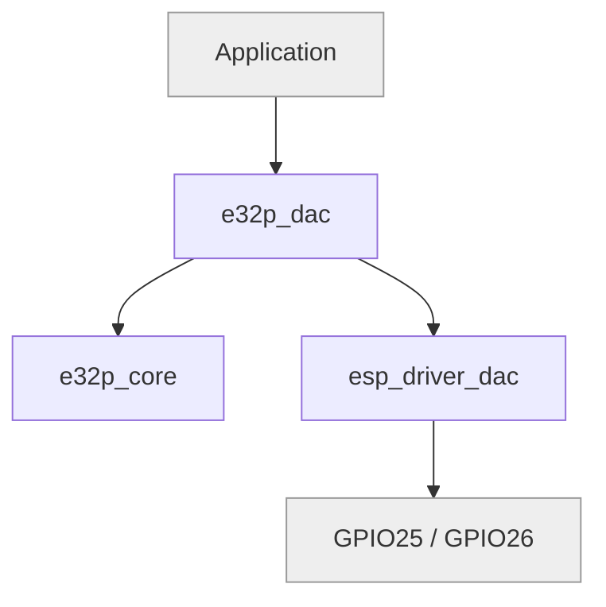
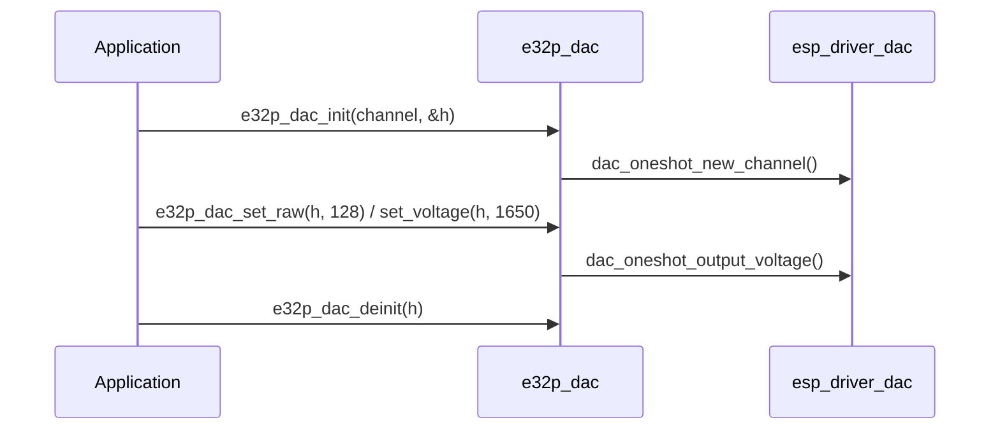

# e32p_dac — Design

> **8-bit DAC output.** Part of the ESP32 firmware platform (`e32p_` modules).
> Self-contained.

## 1. Overview

`e32p_dac` is an opaque-handle facade over `driver/dac_oneshot.h`. The ESP32 has
two 8-bit DAC channels — **ch0 = GPIO25, ch1 = GPIO26**. Set a raw level (0–255)
or an approximate voltage (mV, clamped).

| Property | Value |
|----------|-------|
| Registration style | **opaque handle** (per channel) |
| Kconfig symbol | `CONFIG_E32P_DAC_ENABLE` |
| Target guard | `depends on SOC_DAC_SUPPORTED` |
| Public header | [`include/e32p_dac.h`](include/e32p_dac.h) |

## 2. External dependencies

| Direction | Depends on | Why |
|-----------|-----------|-----|
| Platform | `e32p_core` | error macros |
| ESP-IDF | `esp_driver_dac` (`PRIV_REQUIRES`) | `driver/dac_oneshot.h` |



## 3. Internal architecture

Each handle wraps one `dac_oneshot_channel_handle_t`. `set_voltage` converts mV
to an 8-bit code (`value = mv * 255 / Vdd`, clamped) and calls `set_raw`.

## 4. Calling sequence



## 5. Error model

- `E32P_CHECK_ARG` → `ESP_ERR_INVALID_ARG` (channel not 0/1, NULL out/handle).
- Voltage input is clamped to ~0–3300 mV.
- Driver errors pass through.

## 6. Cherry-pick

```
CONFIG_E32P_DAC_ENABLE=y
```

Requires `e32p_core`; privately requires `esp_driver_dac`. Copy
`components/e32p_dac/` and `components/e32p_core/`. DAC is ESP32/ESP32-S2 only
(`SOC_DAC_SUPPORTED`).
