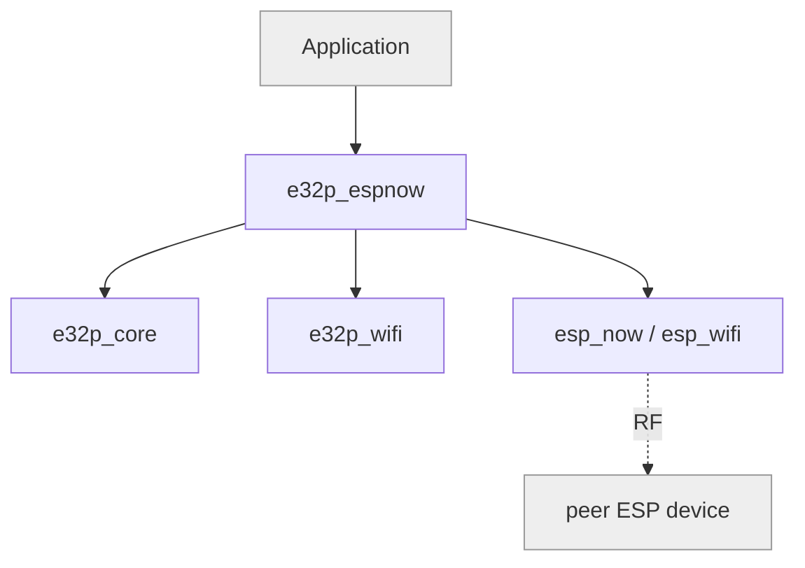
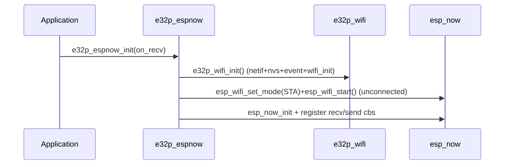
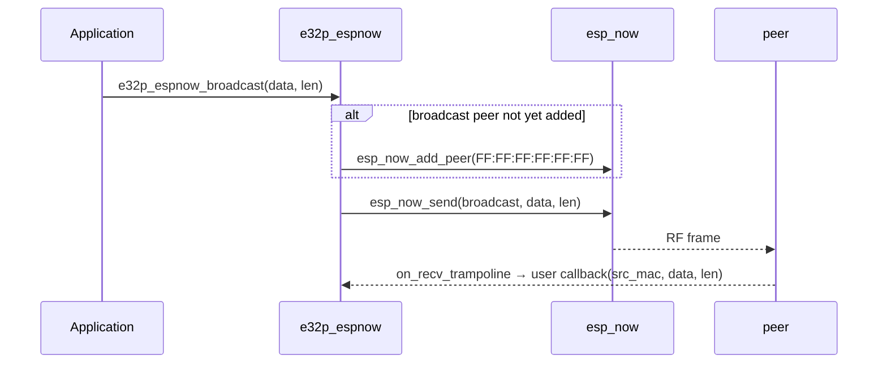

# e32p_espnow — Design

> **ESP-NOW peer-to-peer messaging.** Part of the ESP32 firmware platform
> (`e32p_` modules). Self-contained.

## 1. Overview

`e32p_espnow` wraps ESP-NOW: connectionless, router-free, IP-free messaging
between ESP devices. It brings the Wi-Fi radio up (STA mode, **unconnected**) via
`e32p_wifi`, registers peers, and sends unicast or broadcast (≤250 bytes). A
receive trampoline hides `esp_now` types from the callback. **Singleton**.

| Property | Value |
|----------|-------|
| Registration style | **singleton** |
| Kconfig symbol | `CONFIG_E32P_ESPNOW_ENABLE` (`select E32P_WIFI_ENABLE`) |
| Target guard | none |
| Public header | [`include/e32p_espnow.h`](include/e32p_espnow.h) |

## 2. External dependencies

| Direction | Depends on | Why |
|-----------|-----------|-----|
| Platform | `e32p_core` | error macros, `ESP_ERR_E32P_NOT_INIT` |
| Platform | `e32p_wifi` (`PRIV_REQUIRES`, `select`) | brings up the radio (STA, unconnected) |
| ESP-IDF | `esp_wifi` (`PRIV_REQUIRES`) | ESP-NOW lives in the Wi-Fi component |



Depends on `e32p_wifi` precisely so the radio comes up **without associating** to
an AP — that is why `e32p_wifi` has the `s_want_connect` gate.

## 3. Internal architecture

Static state: init flag, the user receive callback, and a "broadcast peer added"
flag. Two trampolines bridge to the ESP-IDF callbacks:
- **`on_recv_trampoline`** — converts `esp_now_recv_info_t` → `(src_mac, data,
  len)` so the user callback never sees `esp_now` types.
- **`on_send_cb`** — logs a warning on send failure.
- **`add_peer_internal`** — registers a peer on the current channel; treats
  `ESP_ERR_ESPNOW_EXIST` as success.

## 4. Key data structures

- **`e32p_espnow_recv_cb_t`** — `void(*)(const uint8_t src_mac[6], const uint8_t
  *data, int len)`, runs on the Wi-Fi task.

## 5. Calling sequences

**Init**


**Broadcast (auto-registers the broadcast peer)**


## 6. Concurrency & context

- The receive callback runs on the **Wi-Fi task** — keep it short, hand off heavy
  work via a queue.
- Singleton state; drive from one control path.

## 7. Error model

- `ESP_ERR_E32P_NOT_INIT` from `add_peer`/`send`/`broadcast` before `init`.
- `E32P_CHECK_ARG` → `ESP_ERR_INVALID_ARG` (NULL mac/data, `len` 0 or > 250).
- `esp_now` errors pass through; `ESP_ERR_ESPNOW_EXIST` on add-peer is folded to
  `ESP_OK`.

## 8. Cherry-pick

```
CONFIG_E32P_ESPNOW_ENABLE=y   # selects E32P_WIFI_ENABLE (→ NVS + EVENT)
```

Requires `e32p_core`; privately requires `e32p_wifi` + `esp_wifi`. Copy
`components/e32p_espnow/`, `e32p_wifi/`, `e32p_nvs/`, `e32p_event/`, `e32p_core/`.
Both devices must be on the same Wi-Fi channel.
