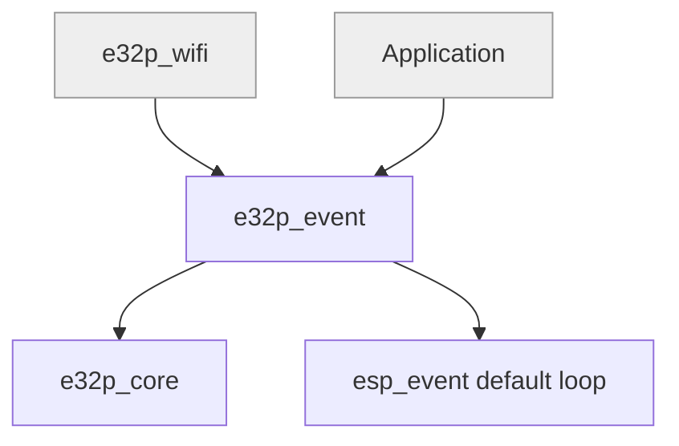
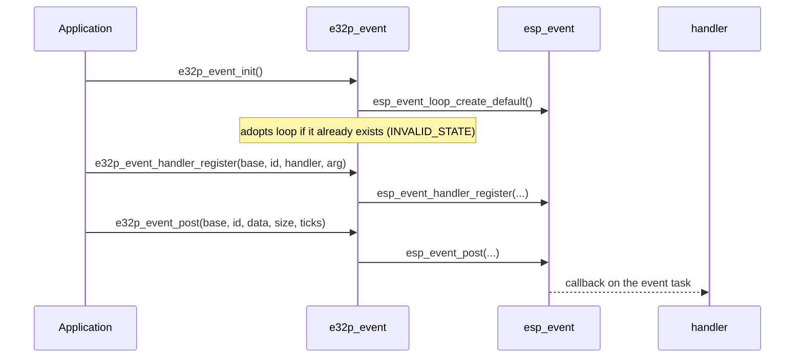

# e32p_event — Design

> **Default esp_event loop facade.** Part of the ESP32 firmware platform
> (`e32p_` modules). Self-contained.

## 1. Overview

`e32p_event` is a thin, idempotent facade over ESP-IDF's **default event loop**
(`esp_event`). It provides create/delete plus register/unregister/post. Init is
**idempotent** and adopts an already-existing default loop (e.g. one Wi-Fi
created), so multiple subsystems can each "ensure the loop is up" without
conflict. It is a **singleton** — one default loop per system.

| Property | Value |
|----------|-------|
| Registration style | **singleton** (one `s_running` flag) |
| Kconfig symbol | `CONFIG_E32P_EVENT_ENABLE` |
| Target guard | none |
| Public header | [`include/e32p_event.h`](include/e32p_event.h) |

## 2. External dependencies

| Direction | Depends on | Why |
|-----------|-----------|-----|
| Platform | `e32p_core` | error macros, logging |
| ESP-IDF | `esp_event` | the default loop, handlers, posting |
| Consumers | `e32p_wifi` (and app code) | Wi-Fi `select`s this to receive WIFI/IP events |



## 3. Internal architecture

A single static `s_running` flag tracks whether the default loop is up. `init`
tolerates `ESP_ERR_INVALID_STATE` from `esp_event_loop_create_default()` (loop
already exists) and adopts it. All other functions are 1:1 passthroughs with an
argument check on the handler pointer.

## 4. Calling sequence



## 5. Concurrency & context

- Handlers run on the **esp_event task**, not the caller's — keep them short and
  hand off heavy work via queues.
- `post` is safe from task context; `s_running` is not lock-guarded (init once).

## 6. Error model

- `E32P_CHECK_ARG` → `ESP_ERR_INVALID_ARG` for a NULL handler.
- `post` may return `ESP_ERR_TIMEOUT` if the loop queue is full within the wait.
- Other `esp_event` errors pass through.

## 7. Cherry-pick

```
CONFIG_E32P_EVENT_ENABLE=y
```

Requires `e32p_core`; requires the ESP-IDF `esp_event` component. Copy
`components/e32p_event/` and `components/e32p_core/`.
