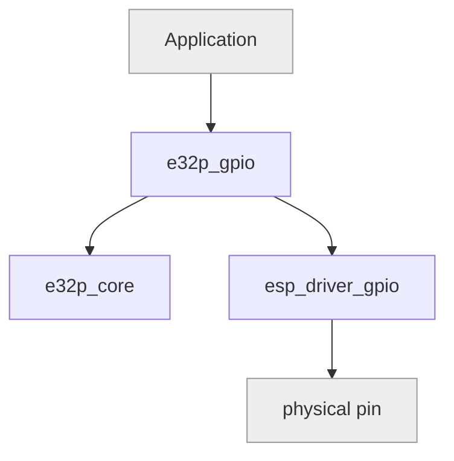
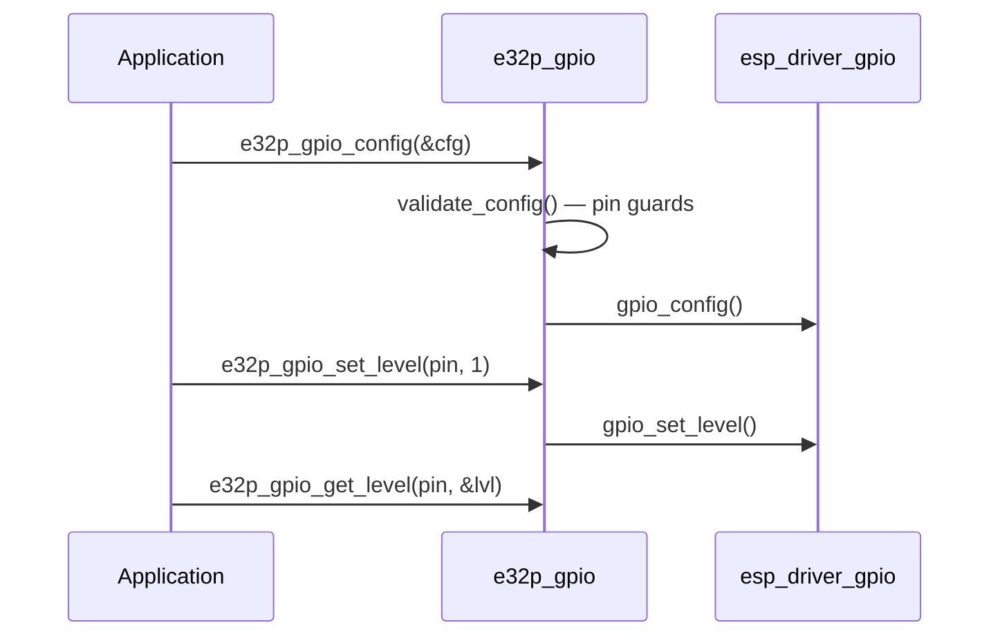
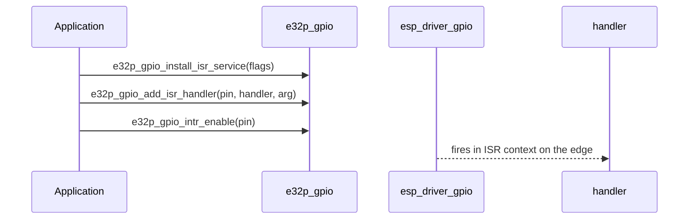

# e32p_gpio — Design

> **Digital GPIO with pin-safety guards.** Part of the ESP32 firmware platform
> (`e32p_` modules). Self-contained.

## 1. Overview

`e32p_gpio` is a per-pin facade over `driver/gpio.h`: configure direction / pull /
interrupt, set/get level, and attach per-pin ISR handlers via the shared GPIO ISR
service. It adds **WROOM-32 pin-safety guards** — refusing SPI-flash pins (6–11),
rejecting output on input-only pins (34–39), and warning on strapping pins. Pins
are global resources, so the module is **flat / stateless** (no handle).

| Property | Value |
|----------|-------|
| Registration style | **flat / stateless** |
| Kconfig symbol | `CONFIG_E32P_GPIO_ENABLE` |
| Target guard | none (guards are WROOM-32 pin facts) |
| Public header | [`include/e32p_gpio.h`](include/e32p_gpio.h) |

## 2. External dependencies

| Direction | Depends on | Why |
|-----------|-----------|-----|
| Platform | `e32p_core` | error macros, `ESP_ERR_E32P_PIN_RESERVED` |
| ESP-IDF | `esp_driver_gpio` (`PRIV_REQUIRES`) | `driver/gpio.h`, used only in the `.c` |



## 3. Internal architecture

Stateless. A `validate_config()` helper enforces the pin guards before any
`gpio_config()` call; the level/ISR functions are thin passthroughs. The GPIO ISR
**dispatch service** is a single shared install (`install_isr_service`), after
which per-pin handlers can be added/removed.

## 4. Key data structures

- **`e32p_gpio_config_t`** — `{ pin, mode, pull, intr }`, with
  `E32P_GPIO_CONFIG_DEFAULT()`.
- Enums: `e32p_gpio_mode_t` (INPUT / OUTPUT / OUTPUT_OD / INPUT_OUTPUT_OD),
  `e32p_gpio_pull_t`, `e32p_gpio_intr_t`.
- **`e32p_gpio_isr_t`** — `void(*)(void *arg)`, runs in interrupt context.

## 5. Calling sequences

**Plain I/O**


**Interrupts**


## 6. Concurrency & context

- Config/level/get are task-context.
- ISR handlers run in **interrupt context** — keep them short, non-blocking; use
  `IRAM_ATTR` if they must run with flash cache off; hand off work via a queue.

## 7. Error model

- `E32P_CHECK_ARG` → `ESP_ERR_INVALID_ARG` (NULL cfg, output on input-only pin,
  pull on a pull-less pin, non-output-capable pin driven).
- `ESP_ERR_E32P_PIN_RESERVED` when a SPI-flash pin (6–11) is used with guards on.
- Strapping pins (0, 2, 12, 15) are warned about, not blocked.
- `ESP_ERR_INVALID_STATE` if the ISR service is installed twice.

## 8. Cherry-pick

```
CONFIG_E32P_GPIO_ENABLE=y
```

Requires `e32p_core`; privately requires `esp_driver_gpio`. Copy
`components/e32p_gpio/` and `components/e32p_core/`.
