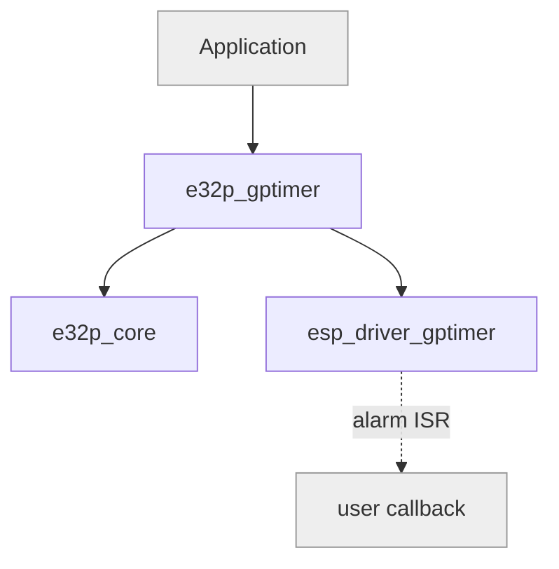
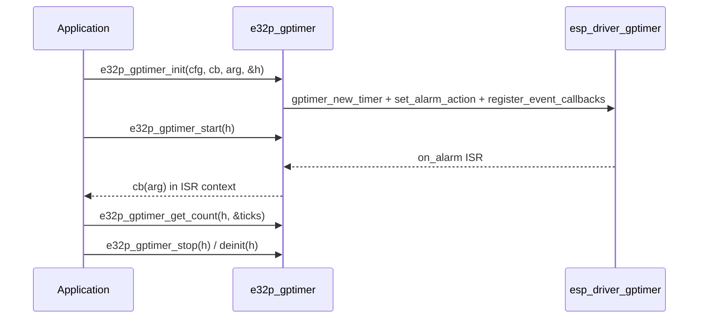

# e32p_gptimer — Design

> **General-purpose hardware timer with alarm.** Part of the ESP32 firmware
> platform (`e32p_` modules). Self-contained.

## 1. Overview

`e32p_gptimer` is an opaque-handle facade over `driver/gptimer.h`: a hardware
timer with a **periodic or one-shot alarm callback**. Configure the resolution
(ticks/second) and alarm period; the callback fires in ISR context. One handle
per timer.

| Property | Value |
|----------|-------|
| Registration style | **opaque handle** (per timer) |
| Kconfig symbol | `CONFIG_E32P_GPTIMER_ENABLE` |
| Target guard | none |
| Public header | [`include/e32p_gptimer.h`](include/e32p_gptimer.h) |

## 2. External dependencies

| Direction | Depends on | Why |
|-----------|-----------|-----|
| Platform | `e32p_core` | error macros |
| ESP-IDF | `esp_driver_gptimer` (`PRIV_REQUIRES`) | `driver/gptimer.h` |



## 3. Internal architecture

Each handle wraps a `gptimer_handle_t` and stores the user callback + arg. `init`
creates the timer, sets the alarm action (with `auto_reload` deciding periodic vs
one-shot), and registers an internal `on_alarm` trampoline that forwards to the
user callback. Created stopped — call `start()`.

## 4. Key data structures

- **`e32p_gptimer_config_t`** — `{ resolution_hz, alarm_period_ticks,
  auto_reload }` (e.g. `resolution_hz = 1000000` → 1 µs/tick).
- **`e32p_gptimer_cb_t`** — `void(*)(void *arg)`, runs in ISR context.

## 5. Calling sequence



## 6. Concurrency & context

- Lifecycle calls are task-context, per-handle.
- The alarm callback runs in **ISR context** — keep it short, no blocking; mark it
  `IRAM_ATTR` if it must run with flash cache off.

## 7. Error model

- `E32P_CHECK_ARG` → `ESP_ERR_INVALID_ARG` (NULL cfg, `resolution_hz == 0`, NULL
  out).
- Driver errors pass through.

## 8. Cherry-pick

```
CONFIG_E32P_GPTIMER_ENABLE=y
```

Requires `e32p_core`; privately requires `esp_driver_gptimer`. Copy
`components/e32p_gptimer/` and `components/e32p_core/`.
