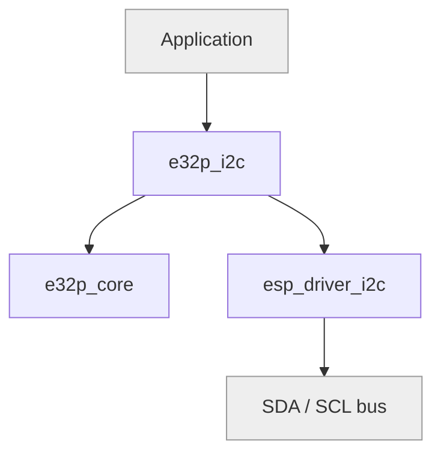
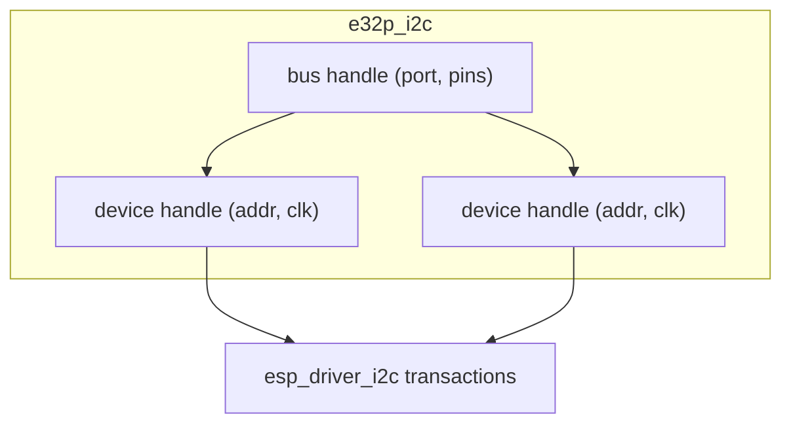
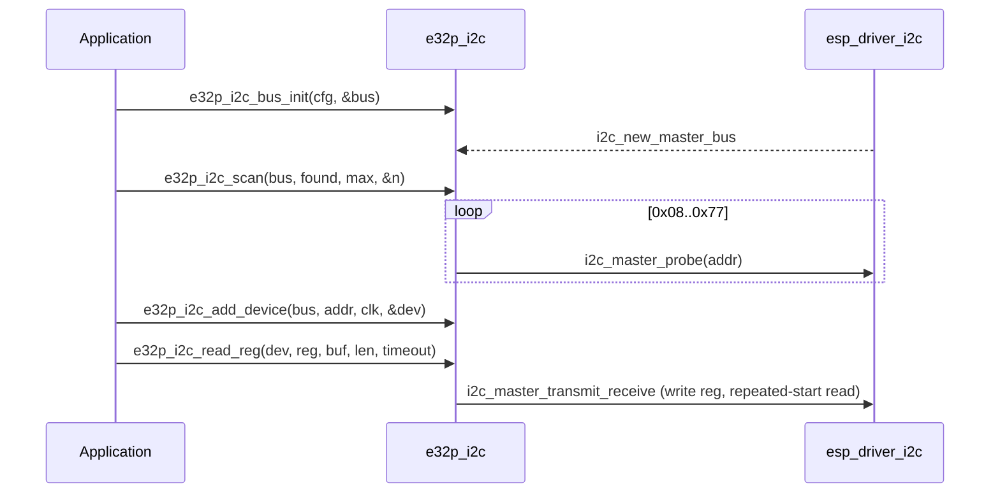

# e32p_i2c — Design

> **I²C master (bus + device model).** Part of the ESP32 firmware platform
> (`e32p_` modules). Self-contained.

## 1. Overview

`e32p_i2c` is a facade over the v5.x `driver/i2c_master.h`, which uses a
**two-level handle model**: a **bus** owns the port/pins; **devices** attach to a
bus (each with its own address + clock) and carry the transfers. Adds `probe`,
a `scan` of 0x08–0x77, and register read/write helpers.

| Property | Value |
|----------|-------|
| Registration style | **opaque handles** (bus + device) |
| Kconfig symbol | `CONFIG_E32P_I2C_ENABLE` |
| Target guard | none |
| Public header | [`include/e32p_i2c.h`](include/e32p_i2c.h) |

## 2. External dependencies

| Direction | Depends on | Why |
|-----------|-----------|-----|
| Platform | `e32p_core` | error macros |
| ESP-IDF | `esp_driver_i2c`, `esp_driver_gpio` (`PRIV_REQUIRES`) | I²C master + pin routing |



## 3. Internal architecture



A bus handle wraps `i2c_master_bus_handle_t`; each device wraps
`i2c_master_dev_handle_t`. Transfers go through the **device** handle;
`probe`/`scan` operate at the **bus** level. Register helpers are `write_read`
with a 1-byte register prefix (repeated start).

## 4. Key data structures

- **`e32p_i2c_bus_config_t`** — `{ port, sda_pin, scl_pin, enable_pullups }`.
- **`e32p_i2c_bus_handle_t`**, **`e32p_i2c_dev_handle_t`** — opaque.

## 5. Calling sequence



## 6. Concurrency & context

- Task context. The v5.x driver serializes transactions per bus; keep one owner
  per device handle or serialize externally.

## 7. Error model

- `E32P_CHECK_ARG` → `ESP_ERR_INVALID_ARG` (NULL cfg/bus/dev, bad port).
- `probe` → `ESP_ERR_NOT_FOUND` when no device ACKs.
- Transfer timeouts / NACKs surface as driver errors (`ESP_ERR_TIMEOUT`, etc.).

## 8. Cherry-pick

```
CONFIG_E32P_I2C_ENABLE=y
```

Requires `e32p_core`; privately requires `esp_driver_i2c` + `esp_driver_gpio`.
Copy `components/e32p_i2c/` and `components/e32p_core/`.
