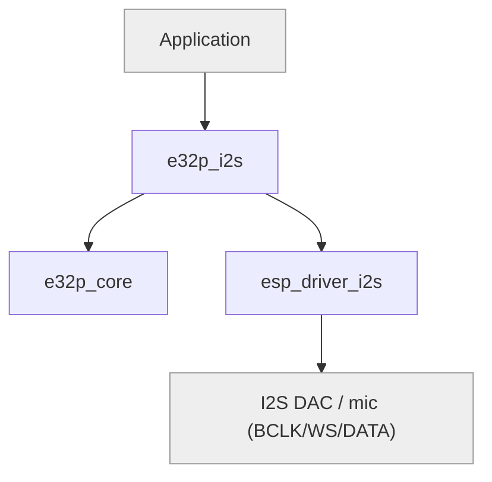
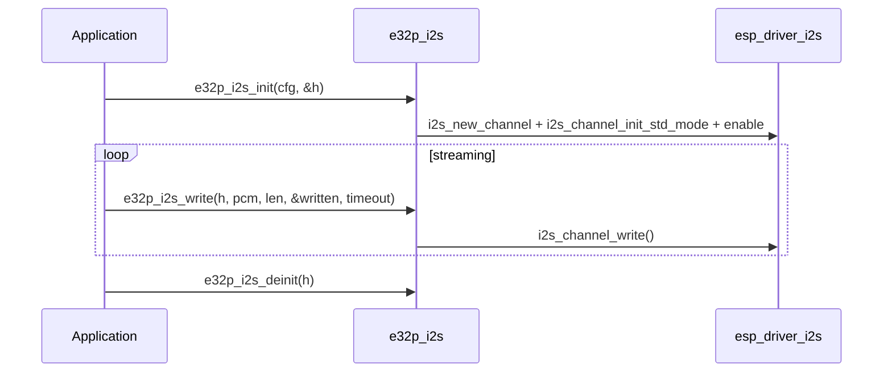

# e32p_i2s — Design

> **I²S standard-mode audio.** Part of the ESP32 firmware platform (`e32p_`
> modules). Self-contained.

## 1. Overview

`e32p_i2s` is an opaque-handle facade over `driver/i2s_std.h`: **one handle = one
channel**, either TX (playback) or RX (capture), in standard (Philips) format as
master. `write`/`read` move PCM samples through the driver's DMA.

| Property | Value |
|----------|-------|
| Registration style | **opaque handle** (per channel) |
| Kconfig symbol | `CONFIG_E32P_I2S_ENABLE` |
| Target guard | `depends on SOC_I2S_SUPPORTED` |
| Public header | [`include/e32p_i2s.h`](include/e32p_i2s.h) |

## 2. External dependencies

| Direction | Depends on | Why |
|-----------|-----------|-----|
| Platform | `e32p_core` | error macros, logging |
| ESP-IDF | `esp_driver_i2s` (`PRIV_REQUIRES`) | I²S standard-mode driver |



## 3. Internal architecture

Each handle wraps an `i2s_chan_handle_t` and remembers its direction. `init`
creates the channel (TX or RX slot of `i2s_new_channel`), builds the std config
(clock from sample rate, slot from bit width + mono/stereo, GPIO map), inits std
mode, and enables the channel. Data-bit-width and slot-mode are computed into
locals before the slot macro to avoid a `-Werror=int-in-bool-context` from
passing constant ternaries into it.

## 4. Key data structures

- **`e32p_i2s_config_t`** — `{ port, dir, bclk_gpio, ws_gpio, data_gpio,
  sample_rate, bits(16/32), stereo }`.
- **`e32p_i2s_dir_t`** — `TX` / `RX`.

## 5. Calling sequence



## 6. Concurrency & context

- Task context, per-handle. `write`/`read` block up to `timeout_ms` draining/
  filling the DMA. A TX master generates its own clock, so a `write` drains even
  with no external DAC connected.

## 7. Error model

- `E32P_CHECK_ARG` → `ESP_ERR_INVALID_ARG` (NULL cfg, `bits` not 16/32, port not
  0/1, `sample_rate == 0`).
- `ESP_ERR_INVALID_STATE` from `write` on an RX channel, or `read` on a TX
  channel.
- Driver / `ESP_ERR_NO_MEM` errors pass through.

## 8. Cherry-pick

```
CONFIG_E32P_I2S_ENABLE=y
```

Requires `e32p_core`; privately requires `esp_driver_i2s`. Copy
`components/e32p_i2s/` and `components/e32p_core/`. An external I²S DAC (playback)
or mic (capture) is needed for real audio.
