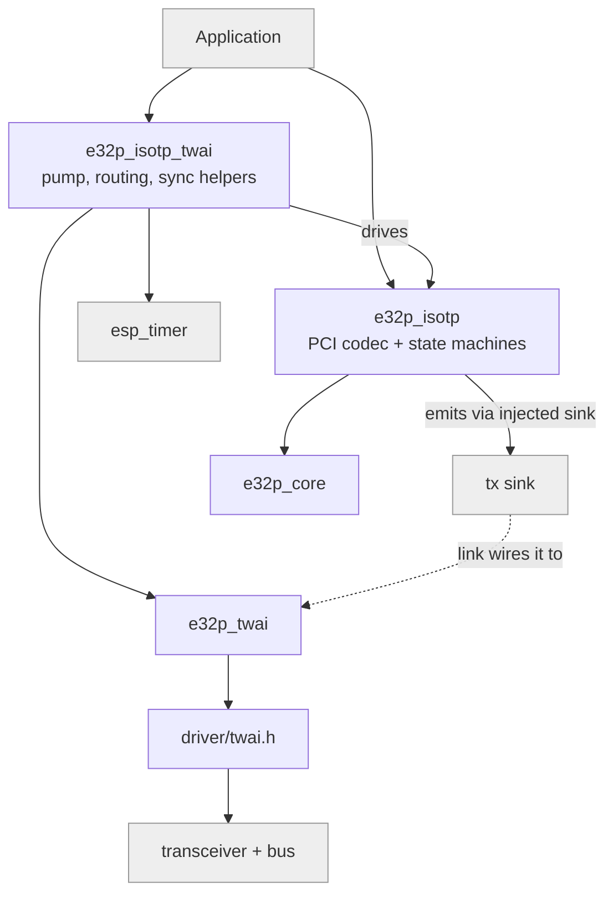
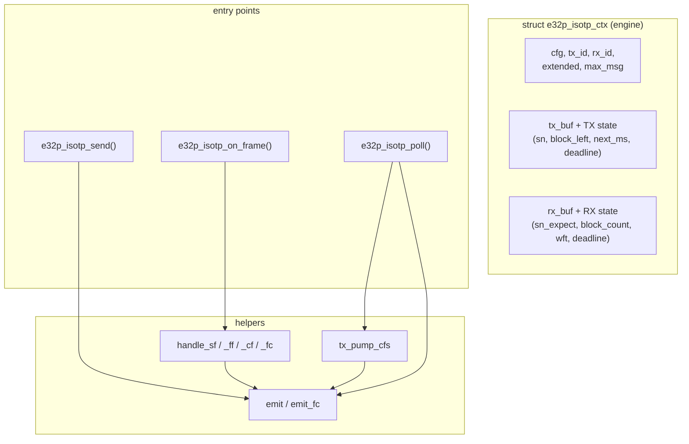
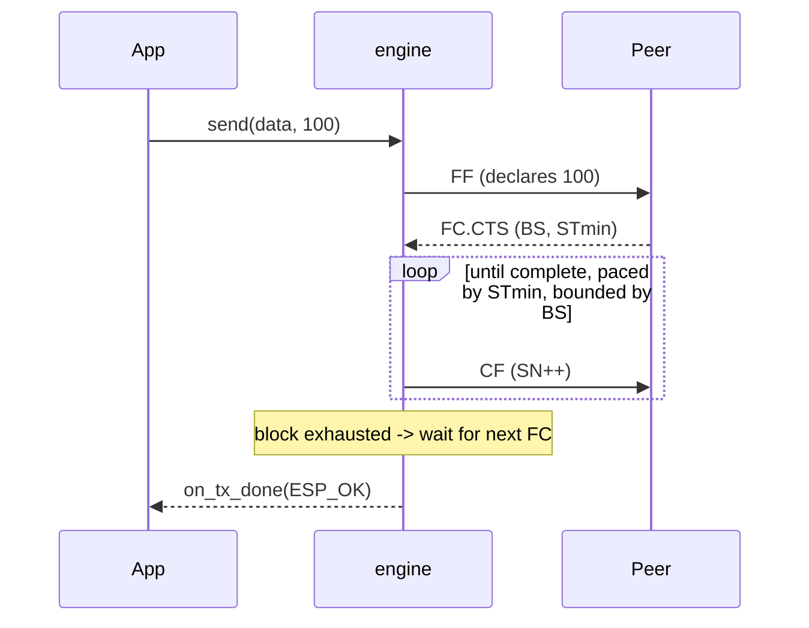

# e32p_isotp — Design

> **ISO 15765-2 transport engine.** Part of the ESP32 firmware platform (`e32p_`
> modules). Self-contained: describes the module's internals and its external
> connections, so it travels with the module when cherry-picked.

## 1. Overview

`e32p_isotp` segments and reassembles **1–4095 byte** payloads over classic CAN,
using the four ISO 15765-2 frame types: SingleFrame, FirstFrame, ConsecutiveFrame
and FlowControl. It is the transport layer beneath OBD-II (SAE J1979) and UDS
(ISO 14229-1).

**It is not SAE J1939-21 TP.** `e32p_j1939tp` implements BAM and RTS/CTS for
J1939; this is a different scheme with different addressing and different
consumers. The confusion is common enough to be worth stating twice.

The module is split so the protocol is testable without hardware:

- The **engine** takes outgoing frames through an **injected sink**, receives via
  `on_frame()`, and gets time from `poll(now_ms)`. No TWAI call, no task, no
  clock of its own.
- The **link** owns the single TWAI controller: one pump task, ID-based routing,
  and blocking helpers for callers that want them.

This is the same main-function-tick shape as AUTOSAR's CanTp, and the same shape
`e32p_j1939tp` already proves on both targets.

| Property | Value |
|----------|-------|
| Registration style | **opaque handle** (`e32p_isotp_handle_t`) per address pair; the link is a **singleton** |
| Kconfig symbol | `CONFIG_E32P_ISOTP_ENABLE` (`select E32P_TWAI_ENABLE`) |
| Target guard | `depends on SOC_TWAI_SUPPORTED` |
| Public headers | [`include/e32p_isotp.h`](include/e32p_isotp.h), [`include/e32p_isotp_twai.h`](include/e32p_isotp_twai.h) |

## 2. External dependencies

| Direction | Depends on | Why |
|-----------|-----------|-----|
| Platform | `e32p_core` | error macros, logging |
| Platform | `e32p_twai` (`REQUIRES`) | `e32p_twai_message_t` appears in the public header |
| Platform | `e32p_core/e32p_time.h` | `E32P_ASSERT_BLOCKING_MS` guards the pump block time |
| ESP-IDF | `esp_timer` (`PRIV_REQUIRES`) | the pump's millisecond clock; link half only |
| ESP-IDF | FreeRTOS | task, queue, recursive mutex; link half only |
| Kconfig `select` | `E32P_TWAI_ENABLE` | the link drives the controller |
| Consumers | Application | provides the sink (engine) or just the bus (link) |

The **engine** calls no driver at all — it only builds `e32p_twai_message_t`
values and hands them to the injected sink. That is why `e32p_twai` is a
`REQUIRES` (type visibility) rather than a `PRIV_REQUIRES` (call dependency).



### 2.1 A coupling worth naming

The bitrate and addressing **choice blocks live in this component's Kconfig**,
not in `e32p_twai` — even though bitrate is properly a controller property.

Two reasons survive scrutiny. Adding a bitrate *default* to `e32p_twai` would
give a shipped transport facade an opinion it has never had, and every existing
caller passes bitrate explicitly; a default nobody reads is dead weight, one
callers start reading is new coupling. And addressing mode is unambiguously an
ISO-TP concept, so splitting the two knobs across two menus would turn one
compile-time decision into two places to look.

The consequence is that the *first* consumer of `CONFIG_E32P_ISOTP_BITRATE_BPS`
is bench code that has nothing to do with ISO-TP — the HIL agent's J1939 tests,
which must come up at the swept rate for a rate sweep to mean anything. That is
absorbed by `HIL_CAN_BITRATE` in the bench's own `hil_pins.h`. It is a bench
coupling, not a component one: **`e32p_isotp` never reads either symbol.**

## 3. Internal architecture

One TX session plus one RX session per channel, both inside the handle. The link
holds a fixed array of channel records, keyed by receive ID.



### 3.1 Frame layout

```
SF   [0]=0x0L                    L   = 1..7 data length
FF   [0]=0x1H [1]=LL             HLL = 12-bit total length, 8..4095
CF   [0]=0x2S                    S   = sequence number, wraps 15->0
FC   [0]=0x3F [1]=BS [2]=STmin   F   = FlowStatus (CTS / WAIT / OVFLW)
```

`FF_DL == 0` selects the 32-bit escape form. That is out of scope in v1 and is
**rejected**, not silently misparsed as a zero length.

## 4. Key data structures

| Structure | Role |
|-----------|------|
| `e32p_isotp_config_t` | Addressing, flow control we *issue*, framing, timers, callbacks |
| `struct e32p_isotp_ctx` | The handle: resolved IDs, two buffers, TX and RX session state, last-polled time |
| `chan_t` (link) | Per-channel link record: engine handle, tx-done semaphore, sync receive pool, chained app callbacks |
| `s_link` (link) | Singleton: pump task handle, join semaphore, recursive mutex, channel array |

Buffers are allocated once in `init()` at `max_msg_bytes` each — **two per
channel**, TX and RX, which is what makes the concurrent-session contract free.

## 5. Calling sequences

### 5.1 Multi-frame send



### 5.2 Teardown (D-03)

```mermaid
sequenceDiagram
    participant App
    participant Link
    participant Pump
    App->>Link: e32p_isotp_twai_stop()
    Link->>Pump: stop_req = true
    Pump->>Pump: observes within one block period
    Pump->>Link: give(done)  [LAST action]
    Pump->>Pump: vTaskDelete(NULL)
    Link-->>App: ESP_OK (joined)
    App->>App: e32p_twai_stop(); e32p_twai_deinit()
```

The join is not tidiness. `e32p_twai_deinit()` uninstalls the driver, which
deletes the RX queue; a task still blocked in `xQueueReceive` on a deleted queue
is undefined behaviour. A lingering pump stealing frames from the next test is
the *benign* failure mode.

## 6. State machine

**TX:** `IDLE → (send, len>7) → WAIT_FC → (FC.CTS) → SENDING → …`

- `SENDING → WAIT_FC` when the block credit runs out.
- `WAIT_FC → IDLE` on N_Bs expiry (`ESP_ERR_TIMEOUT`) or `FC.OVFLW`
  (`ESP_ERR_NO_MEM`).
- `FC.WAIT` restarts N_Bs and holds in `WAIT_FC`.
- A payload of ≤ 7 bytes never leaves `IDLE` — one SF, done synchronously.

**RX:** `IDLE → (FF) → ASSEMBLING → (final CF) → IDLE`

- Out-of-order SN, or N_Cr expiry, discards the session silently — ISO 15765-2
  specifies abort, not a negative response.
- A new FF during `ASSEMBLING` restarts reassembly.
- Announced length above `max_msg_bytes` answers `FC.OVFLW` and stays `IDLE`.

**FC.WAIT owes a CTS.** When the receiver emits `FC.WAIT` at a block boundary it
sets `rx_wait_pending`, and the next `poll()` releases a `FC.CTS`. Without that
the sender sits in `WAIT_FC` until N_Bs and the transfer deadlocks — the engine
is always ready again by the next tick, so the WAIT is a pacing hint, not a real
stall.

**Consecutive Frames leave only from `poll()`.** `on_frame()` has no clock, so the
engine's `now_ms` there is still the last poll's. An earlier version sent the first
CF of a block straight from the FC handler and paced the rest from that old stamp,
so the next poll sent CF 2 right behind CF 1. A logic analyzer caught it on every
block: 12 µs apart with STmin 1 ms. Now the FC handler only arms the block, and the
next `poll()` sends. Pacing also adds 1 ms to STmin, because `now_ms` is truncated:
a CF sent at x.9 ms is stamped x.

## 7. Concurrency & context

**One TX session and one RX session may be active at once on a channel.** They
are independent state machines on different CAN IDs whose flow-control frames
travel in opposite directions, so they never contend. Two concurrent TX sessions
return `ESP_ERR_INVALID_STATE`; a second FF restarts reassembly. Phase 3's UDS
`0x78 responsePending` pattern depends on this — a request arriving while a
response sequence is still going out.

The **engine** is single-task by contract. The **link** enforces that with a
recursive mutex held across `poll()`, routing, and `send()`, so `send_sync` from
an application task is safe against the pump.

**Callbacks run in the pump task.** `e32p_isotp_send()` from inside one is fine —
it arms a session and returns. `e32p_isotp_twai_send_sync()` is not: it would
wait, inside the pump, for the pump to make progress. That is rejected with
`ESP_ERR_INVALID_STATE` rather than left to hang.

The pump blocks for `portTICK_PERIOD_MS` and is guarded by
`E32P_ASSERT_BLOCKING_MS`, so a tick-rate change that would turn the wait into a
spin fails the build instead. RX latency is unaffected by that block: `twai_receive`
waits on a queue filled from the RX ISR, so the pump wakes on the interrupt. The
block time only bounds how long an *idle* pump sleeps before servicing timers.

The burst drain after a wake is **bounded** by the RX queue depth. An unbounded
drain on a saturated bus would never return to `poll()` — which is what sends
flow control and services N_Bs / N_Cr.

## 8. Error model

| Code | Meaning |
|------|---------|
| `ESP_ERR_INVALID_ARG` | NULL argument, length 0 or above `max_msg_bytes`, bad config |
| `ESP_ERR_INVALID_STATE` | TX already active; link stopped or started twice; RX id already claimed; `send_sync` from the pump task; `recv_sync` on a server-mode channel |
| `ESP_ERR_NO_MEM` | Allocation failed; channel cap reached; peer answered `FC.OVFLW` |
| `ESP_ERR_TIMEOUT` | N_Bs or N_Cr expiry; blocking helper deadline; **pump failed to join** — do not deinit TWAI after this |
| `ESP_ERR_INVALID_SIZE` | `recv_sync` payload larger than the caller's buffer (`out_len` still reports the true size) |

Transfer outcomes arrive through `on_tx_done`, not as a return code — `send()`
only arms the session.

## 9. Cherry-pick

Copy `components/e32p_isotp/` alongside `e32p_core` and `e32p_twai`, set
`CONFIG_E32P_ISOTP_ENABLE=y`, and add `e32p_isotp` to the consumer's `REQUIRES`.

To take **only the protocol**, copy `src/e32p_isotp.c` and
`include/e32p_isotp.h`. Its sole ESP-IDF dependencies are `esp_err_t` and the
`E32P_*` argument macros, plus `e32p_twai_message_t` as a frame container — a
plain `{id, extended, len, data[8]}` struct that is trivial to substitute. The
engine will then run against any CAN driver you hand it a sink for, including a
host build: the unit suite does exactly that.
