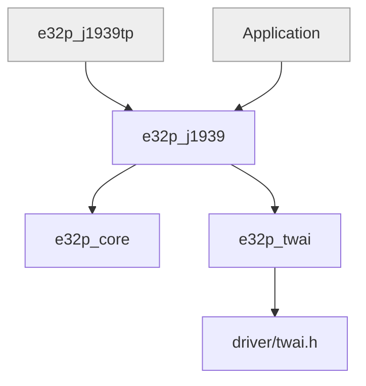
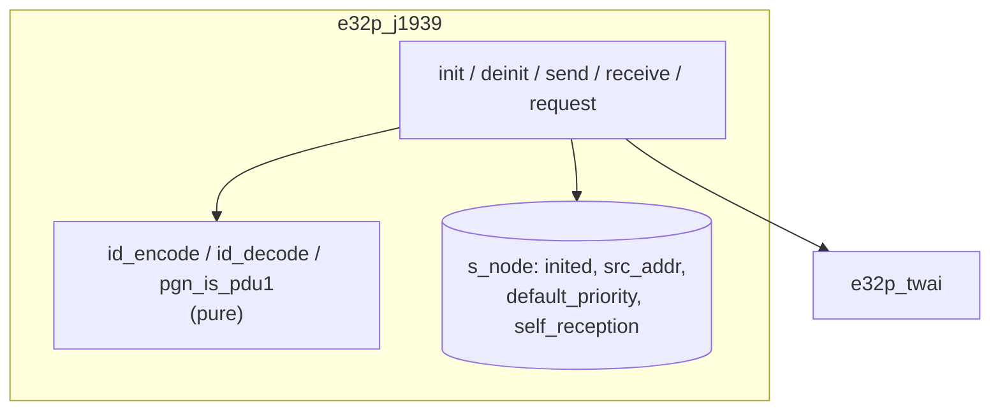
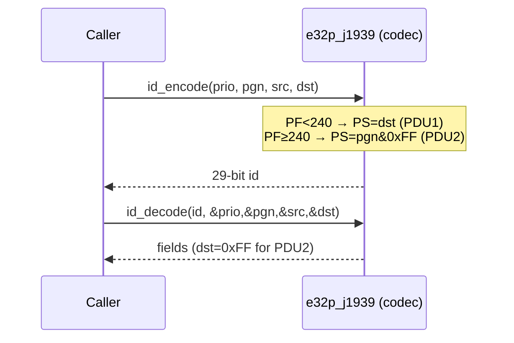
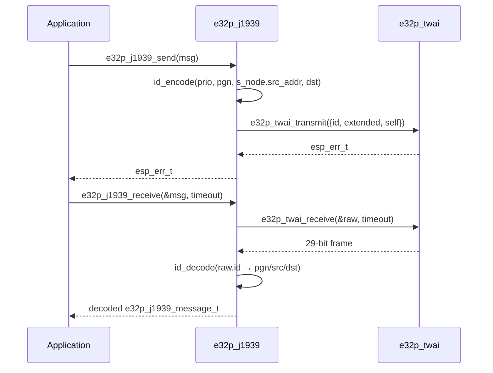

# e32p_j1939 — Design

> **SAE J1939 protocol/data layer.** Part of the ESP32 firmware platform
> (`e32p_` modules). Self-contained: describes the module's internals and its
> external connections, so it travels with the module when cherry-picked.

## 1. Overview

`e32p_j1939` turns raw 29-bit CAN frames (from [`e32p_twai`](../e32p_twai)) into
J1939 messages and back. Its heart is a **pure, hardware-independent codec** that
maps the 29-bit identifier ⇄ J1939 fields (priority, PGN, source, destination),
plus thin single-frame (≤8 byte) `send`/`receive` built on it. Multi-packet
messages (9–1785 bytes) are handled by [`e32p_j1939tp`](../e32p_j1939tp).

A J1939 node has one source address, so the module is a **singleton**: one static
node record holds the configured address. The bus configuration (pins, bitrate,
mode) stays in `e32p_twai` — the application inits and starts TWAI, then inits
this node.

| Property | Value |
|----------|-------|
| Registration style | **singleton** (one node address) |
| Kconfig symbol | `CONFIG_E32P_J1939_ENABLE` (`select E32P_TWAI_ENABLE`) |
| Target guard | `depends on SOC_TWAI_SUPPORTED` |
| Public header | [`include/e32p_j1939.h`](include/e32p_j1939.h) |

## 2. External dependencies

| Direction | Depends on | Why |
|-----------|-----------|-----|
| Platform | `e32p_core` | error macros, logging |
| Platform | `e32p_twai` (`PRIV_REQUIRES`) | `send`/`receive` transmit/receive frames |
| Kconfig `select` | `E32P_TWAI_ENABLE` | guarantees the TWAI sources are built |
| Consumers | `e32p_j1939tp` | uses the message type + PGN macros; its frame sink calls `e32p_j1939_send` |



> Note: `e32p_j1939tp` depends on this module for the **message type and PGN
> macros** (a compile dependency); at runtime its outgoing frames are routed to
> `e32p_j1939_send` by an injected sink the application wires up.

## 3. Internal architecture

Two independent halves: a **pure codec** (no state, no hardware) and a **thin
node** (singleton state + TWAI calls).



The codec is deliberately separable — it is what the unit tests exercise without
any bus, and what a consumer can call directly for full ID control.

### The 29-bit identifier

```
 28    26 25  24 23        16 15         8 7          0
+--------+---+---+------------+------------+-----------+
|Priority|EDP| DP| PDU Format |PDU Specific| Src Addr  |
+--------+---+---+------------+------------+-----------+
```

- **PDU1** (PF &lt; 240): destination-specific. `PS` = destination address, **not**
  part of the PGN.
- **PDU2** (PF ≥ 240): broadcast. `PS` = group extension, **part** of the PGN;
  destination is implicitly global (0xFF).

The PGN (18 bits) is `EDP·DP·PF·PS`, with `PS` forced to 0 for PDU1.

## 4. Key data structures

- **`e32p_j1939_message_t`** — `{ priority, pgn, src_addr, dst_addr, len,
  data[8] }`. Host-side view of a single frame. On `send`, `priority == 0xFF`
  means "use the configured default"; `src_addr` is filled on `receive`.
- **`e32p_j1939_config_t`** — `{ src_addr, default_priority, self_reception }`.
  The node's address, default TX priority, and whether to request self-reception
  (single-board loopback only).
- **Well-known constants** — addresses (`GLOBAL 0xFF`, `NULL 0xFE`) and PGNs
  (`TP_CM 60416`, `TP_DT 60160`, `REQUEST 59904`, `ADDR_CLAIMED 60928`) used by
  the TP/ACL layers.

## 5. Calling sequences

**Codec (pure — no hardware)**


**Single-frame send / receive**


`send` always uses the configured node SA as the source; for full control the
caller can use `id_encode` + `e32p_twai` directly. `e32p_j1939_request` is a
convenience that builds a Request-PGN (59904) frame and sends it.

## 6. Concurrency & context

- Task context only; single node record, no locks. Configure once at startup,
  then call `send`/`receive` from the CAN task.
- `receive` blocks up to `timeout_ms` in the underlying `e32p_twai_receive`.
- The codec functions are pure and reentrant (safe from any context).

## 7. Error model

- `E32P_CHECK_ARG` → `ESP_ERR_INVALID_ARG` for NULL args, `src_addr > 253`,
  `len > 8`.
- `ESP_ERR_INVALID_STATE` from `send`/`receive` before `init`.
- `ESP_ERR_INVALID_RESPONSE` from `receive` when a non-extended (11-bit) frame
  arrives — it is not decodable as J1939.
- Driver/`e32p_twai` errors (e.g. `ESP_ERR_TIMEOUT`) pass through.

## 8. Cherry-pick

```
CONFIG_E32P_J1939_ENABLE=y   # selects E32P_TWAI_ENABLE
```

Requires `e32p_core`; privately requires `e32p_twai`. Copy `components/e32p_j1939/`,
`components/e32p_twai/`, and `components/e32p_core/`; enable the symbol (which
pulls in TWAI). For multi-packet messages add `e32p_j1939tp`.
