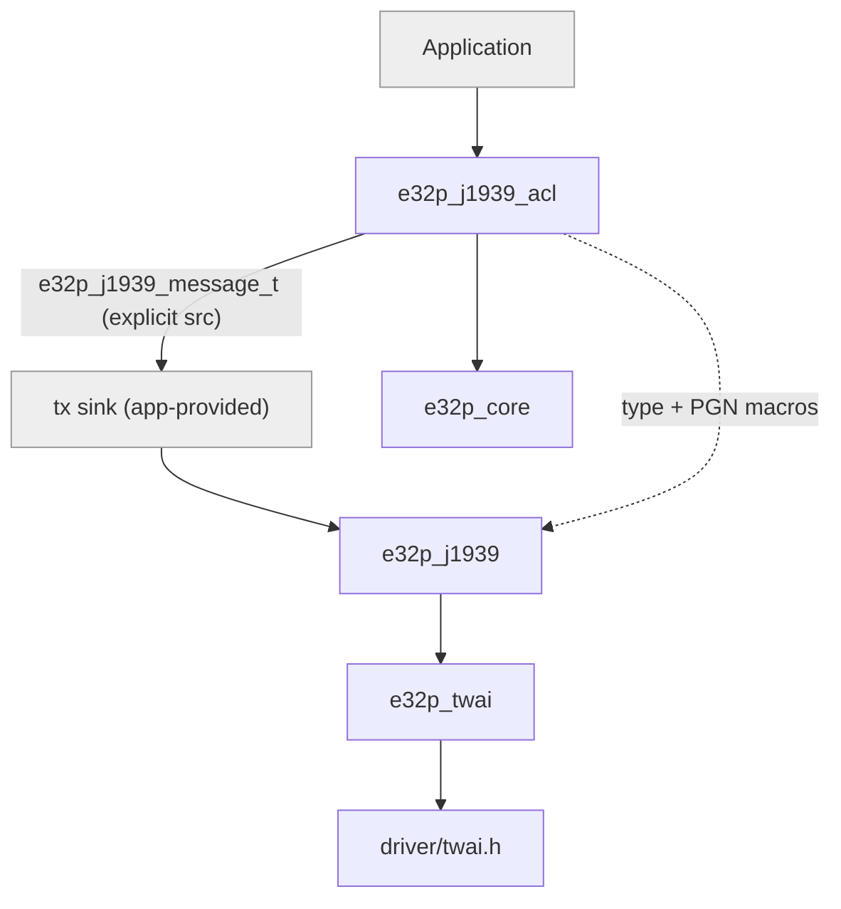
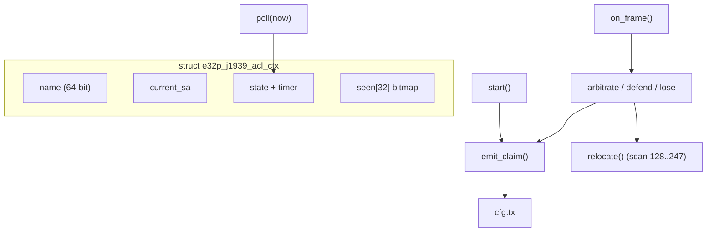
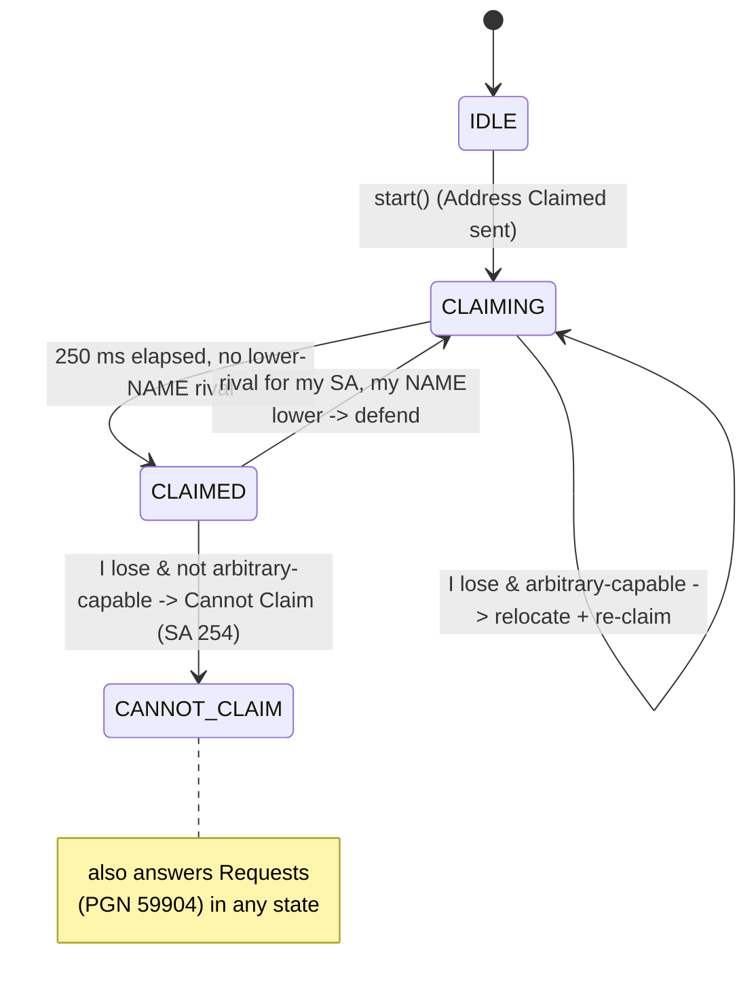
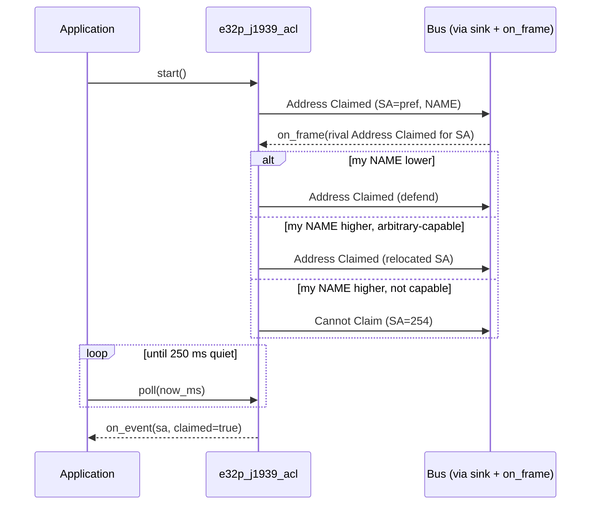

# e32p_j1939_acl — Design

> **SAE J1939-81 Address Claiming engine.** Part of the ESP32 firmware platform
> (`e32p_` modules). Self-contained: describes the module's internals and its
> external connections, so it travels with the module when cherry-picked.

## 1. Overview

`e32p_j1939_acl` establishes and defends a node's J1939 source address. It packs
the 64-bit **NAME**, broadcasts *Address Claimed* for a preferred address, and
resolves contention by NAME arbitration (**numerically lower NAME wins**). On a
lost claim it relocates (if arbitrary-address-capable) or falls back to the null
address and reports *Cannot Claim*. This is the network-management layer of the
CAN stack — it *supplies* the address that [`e32p_j1939`](../e32p_j1939) then uses.

Same bus- and clock-decoupled shape as [`e32p_j1939tp`](../e32p_j1939tp): frames
leave through an injected sink, time comes in via `poll(now_ms)` — so it is fully
headless-testable. **Opaque handle.**

| Property | Value |
|----------|-------|
| Registration style | **opaque handle** (`e32p_j1939_acl_handle_t`) |
| Kconfig symbol | `CONFIG_E32P_J1939_ACL_ENABLE` (`select E32P_J1939_ENABLE`) |
| Target guard | `depends on SOC_TWAI_SUPPORTED` |
| Public header | [`include/e32p_j1939_acl.h`](include/e32p_j1939_acl.h) |

## 2. External dependencies

| Direction | Depends on | Why |
|-----------|-----------|-----|
| Platform | `e32p_core` | error macros |
| Platform | `e32p_j1939` (`REQUIRES`) | `e32p_j1939_message_t` + PGN/address macros in the public header |
| Kconfig `select` | `E32P_J1939_ENABLE` | which in turn selects `E32P_TWAI_ENABLE` |
| Consumers | Application | provides the tx sink + result callback + poll loop; uses the won SA as the node address |

The engine never calls the send path itself — it builds `e32p_j1939_message_t`
values (with an **explicit** source address) and hands them to the injected sink.



## 3. Internal architecture

One handle holds the NAME, the current address, the claim state, the contention
timer, and a bitmap of addresses seen claimed by others (for relocation).



- **NAME codec** (`e32p_j1939_name_encode`/`decode`) is pure — the 64-bit value
  doubles as the arbitration key.
- **`seen[]`** records addresses others claim, so relocation skips them.
- The 250 ms contention timer is armed on the first `poll` after a claim (avoids
  a stale-clock false expiry, same lesson as TP).

## 4. Key data structures

- **`e32p_j1939_name_t`** — the eight NAME fields (arbitrary-address-capable,
  industry group, vehicle system[+instance], function[+instance], ECU instance,
  manufacturer code, identity number).
- **`e32p_j1939_acl_config_t`** — `{ name, preferred_sa, tx, on_event, user }`.
- Callbacks: `e32p_j1939_acl_tx_fn` (frame sink), `e32p_j1939_acl_evt_fn`
  (claim won / cannot-claim).

### NAME ordering & arbitration priority (gotcha)

The whole 64-bit NAME is the arbitration key and **arbitrary-address-capable is
its most-significant bit (bit 63)**. So that one flag dominates the compare: an
arbitrary-address-capable node always has a *higher* NAME — and therefore
*lower* arbitration priority — than an otherwise-identical fixed-address node.

That is deliberate, per J1939-81: a node willing to move yields to one that
isn't. The practical consequences:

- Two nodes contending for the same SA: if one is fixed-address and one is
  arbitrary-capable, the **fixed-address node wins** regardless of the rest of
  the NAME, and the arbitrary-capable node relocates.
- When you *want* a fixed-address node to lose (e.g. to exercise the
  Cannot-Claim path), the winner must also be fixed-address with a lower
  identity number — you can't out-prioritise it with an arbitrary-capable node.
  (This exact mix-up produced a false test failure during bring-up; the engine
  was correct, the test scenario was backwards.)

## 5. State machine



## 6. Calling sequence



## 7. Concurrency & context

- Single task (app serialises `start`/`on_frame`/`poll`); no internal locking.
- `poll(now_ms)` requires a monotonic millisecond clock. The `on_event` callback
  fires synchronously inside `poll`/`on_frame`.
- The `tx` sink must not re-enter the engine synchronously — queue frames (the
  real path does, through the TWAI queue).

## 8. Error model

- `E32P_CHECK_ARG` → `ESP_ERR_INVALID_ARG` (NULL cfg/tx, `preferred_sa > 253`,
  NULL frame).
- `ESP_ERR_NO_MEM` from `init` if the context cannot be allocated.
- Claim outcome is reported through `on_event` (won address, or SA 254 on
  cannot-claim); `current_sa`/`is_claimed` can be polled instead.

## 9. Cherry-pick

```
CONFIG_E32P_J1939_ACL_ENABLE=y   # selects E32P_J1939_ENABLE -> E32P_TWAI_ENABLE
```

Requires `e32p_core` and `e32p_j1939`. Copy `components/e32p_j1939_acl/`,
`e32p_j1939/`, `e32p_twai/`, `e32p_core/`; wire the `tx` sink to build a frame
from the message's explicit `src_addr` (`e32p_j1939_id_encode` → `e32p_twai`).
