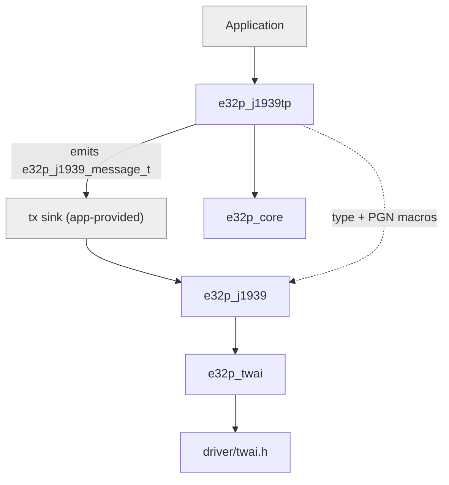
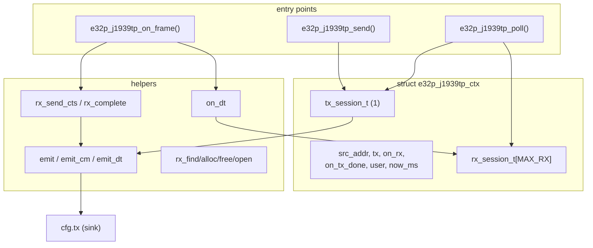
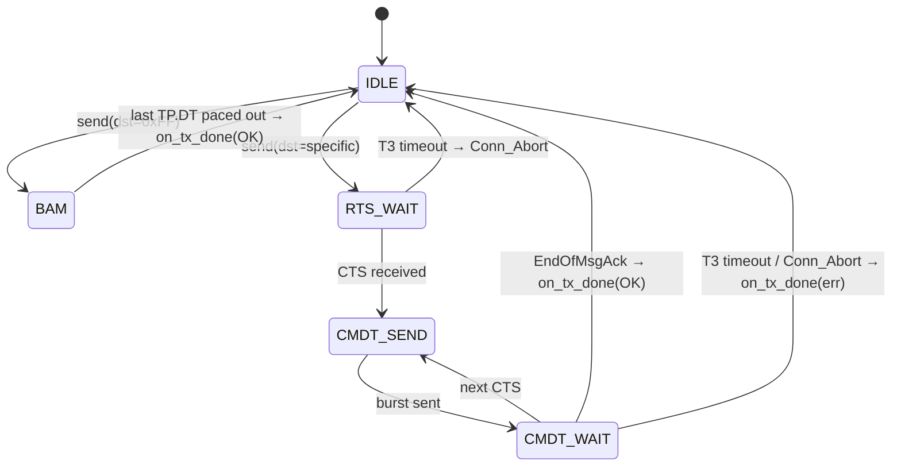
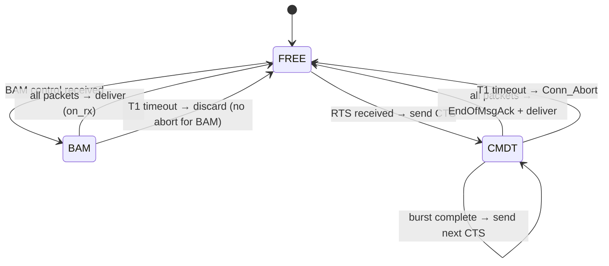
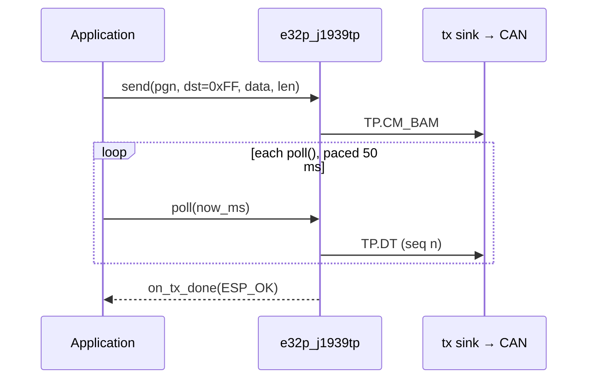
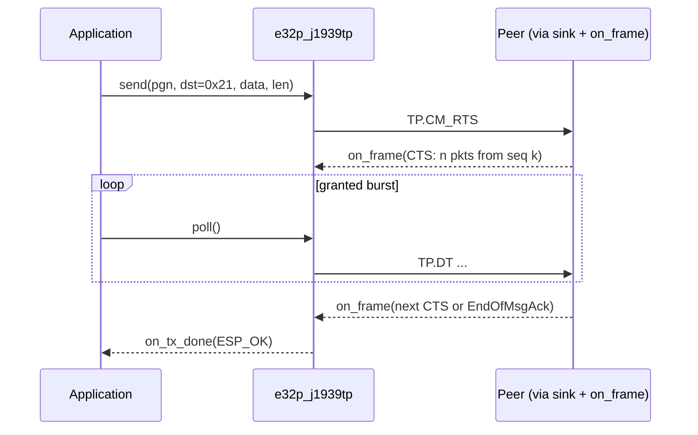
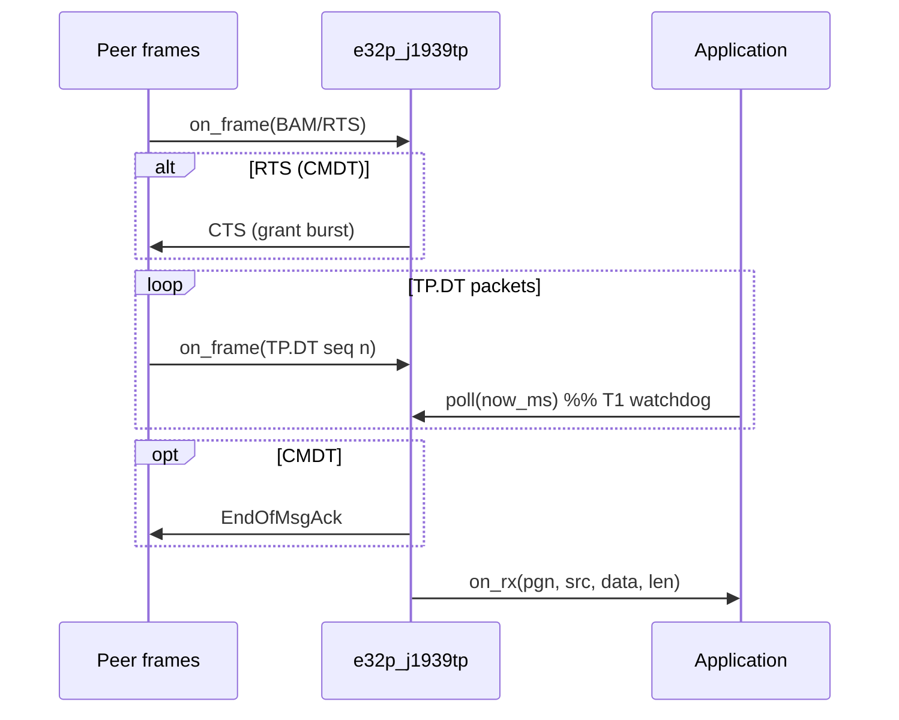

# e32p_j1939tp — Design

> **SAE J1939-21 Transport Protocol engine.** Part of the ESP32 firmware
> platform (`e32p_` modules). Self-contained: describes the module's internals
> and its external connections, so it travels with the module when cherry-picked.

## 1. Overview

`e32p_j1939tp` segments and reassembles J1939 messages of **9–1785 bytes** —
larger than a single 8-byte CAN frame — using the two J1939-21 mechanisms:

- **BAM** (Broadcast Announce Message) — broadcast, no flow control.
- **RTS/CTS** (connection mode) — destination-specific, with flow control and an
  end-of-message acknowledgement.

Both directions (TX and RX) are supported.

The engine is deliberately decoupled from the bus and the clock, which is what
makes it **fully unit-testable headless**:

- Outgoing frames leave through an **injected sink** callback (the app wires it
  to `e32p_j1939_send`; a test wires it to a capture or to another engine).
- Time is **passed in** via `poll(now_ms)`, which services timers and paces
  packets.

This is the same main-function-tick shape as AUTOSAR's J1939Tp. The module is an
**opaque handle** so multiple engines can coexist (two in a loopback test, or a
distinct engine per logical node).

| Property | Value |
|----------|-------|
| Registration style | **opaque handle** (`e32p_j1939tp_handle_t`) |
| Kconfig symbol | `CONFIG_E32P_J1939TP_ENABLE` (`select E32P_J1939_ENABLE`) |
| Target guard | `depends on SOC_TWAI_SUPPORTED` |
| Public header | [`include/e32p_j1939tp.h`](include/e32p_j1939tp.h) |

## 2. External dependencies

| Direction | Depends on | Why |
|-----------|-----------|-----|
| Platform | `e32p_core` | error macros, logging |
| Platform | `e32p_j1939` (`REQUIRES`) | `e32p_j1939_message_t` + PGN/address macros in the public header |
| Kconfig `select` | `E32P_J1939_ENABLE` | which in turn selects `E32P_TWAI_ENABLE` |
| Consumers | Application | provides the tx sink + rx/tx-done callbacks and the poll loop |

Note the engine itself does **not** call `e32p_j1939_send` or the TWAI driver —
it only builds `e32p_j1939_message_t` values and hands them to the injected sink.
That is why there is no `PRIV_REQUIRES` on the send path.



## 3. Internal architecture

One **TX session** plus a small **pool of RX sessions** (keyed by source
address), all inside the handle. Helper functions build/emit the wire frames and
manage session state; `poll()` and `on_frame()` drive the state machines.



- **`emit()`** builds an `e32p_j1939_message_t` (priority 7, TP.CM/TP.DT PGN,
  node SA as source) and calls the injected sink.
- **`now_ms`** caches the last `poll()` timestamp; `on_frame()` stamps session
  timers with it (see §6, Concurrency — the timing contract).
- The RX pool size (`E32P_J1939TP_MAX_RX_SESSIONS`, default 2) and per-session
  buffer size (`E32P_J1939TP_MAX_MSG_BYTES`, default 1785) are Kconfig-tunable.

## 4. Key data structures

- **`e32p_j1939tp_config_t`** — `{ src_addr, tx, on_rx, on_tx_done, user }`. The
  node address and the three callbacks (frame sink, completed-message, TX-done).
- **`tx_session_t`** — the single outbound transfer: state, PGN, priority, dst,
  payload buffer + length, total/next packet, CMDT burst counter, BAM pacing and
  wait timers.
- **`rx_session_t`** — one inbound transfer: kind (BAM/CMDT), source, PGN,
  declared size, a 256-bit received bitmap, received count, CMDT burst bookkeeping,
  and the T1 progress timer.
- Callback typedefs: `e32p_j1939tp_tx_fn`, `e32p_j1939tp_rx_fn`,
  `e32p_j1939tp_txdone_fn`.

## 5. Wire protocol

TP.CM (PGN 60416) control frames and TP.DT (PGN 60160) data frames, priority 7:

| Frame | b0 | b1–2 | b3 | b4 | b5–7 |
|-------|----|------|----|----|------|
| BAM (0x20) | 0x20 | size | #pkts | 0xFF | PGN |
| RTS (0x10) | 0x10 | size | #pkts | max/CTS (0xFF=∞) | PGN |
| CTS (0x11) | 0x11 | #pkts this burst (0=wait) | next seq | 0xFF 0xFF | PGN |
| EndOfMsgAck (0x13) | 0x13 | size | #pkts | 0xFF | PGN |
| Conn_Abort (0xFF) | 0xFF | reason | 0xFF 0xFF 0xFF | — | PGN |
| TP.DT | seq (1..255) | 7 data bytes (last padded 0xFF) | | | |

Timers: **T1 = 750 ms** (receiver inter-packet), **T3 = 1250 ms** (sender wait
for CTS/EndOfMsgAck), **BAM pacing = 50 ms**. Max 255 packets × 7 = 1785 bytes.

## 6. State machines

### TX session


### RX session


## 7. Calling sequences

**BAM transmit** (broadcast, no flow control)


**RTS/CTS transmit** (connection mode)


**Receive & reassemble**


## 8. Concurrency & context — the timing contract

- **Single task.** The application must serialise `send`, `on_frame`, and `poll`
  in one loop; the handle has no internal locking.
- **Monotonic clock.** `poll(now_ms)` must receive a monotonically increasing
  millisecond timestamp (e.g. `esp_timer_get_time() / 1000`).
- **Poll in the same loop as on_frame.** Session timers are stamped with the last
  `poll()` time cached in `now_ms`. If a frame is delivered after a long
  *un-polled* gap, a freshly-opened session can appear to have already timed out.
  The correct loop refreshes both engines' clocks (poll) **before** delivering
  frames:
  ```c
  now = esp_timer_get_time()/1000;
  e32p_j1939tp_poll(tp, now);      // refresh clock first
  while (e32p_j1939_receive(&m,0)==ESP_OK) e32p_j1939tp_on_frame(tp,&m);
  ```
  (A real CAN task polls continuously, so this is the natural shape; the pitfall
  only appears with artificial idle gaps — it cost one debug cycle and is now
  documented on `on_frame` in the header.)
- Callbacks (`tx`, `on_rx`, `on_tx_done`) fire **synchronously** inside `send`,
  `on_frame`, or `poll`. The `tx` sink must not re-enter the engine directly —
  queue frames instead (which is what the real path does through the TWAI queue).

## 9. Error model

- `E32P_CHECK_ARG` → `ESP_ERR_INVALID_ARG` for NULL cfg/tx/on_rx, bad SA,
  `len < 9` or `> MAX_MSG_BYTES`.
- `ESP_ERR_INVALID_STATE` from `send` when a TX session is already active.
- Inbound `TP.CM` is not trusted. A BAM or RTS is accepted only if the size is
  9..`MAX_MSG_BYTES` and the packet count equals `ceil(size / 7)`. This is the
  same size rule `send` uses. A bad BAM is dropped silently. A bad RTS gets a
  `Conn_Abort` (reason "resources"). `on_dt` also ignores any packet that would
  start at or past the declared size.
- `ESP_ERR_NO_MEM` from `init` if session buffers cannot be allocated.
- Transfer outcomes are reported through `on_tx_done`: `ESP_OK` (EndOfMsgAck /
  BAM complete), `ESP_ERR_TIMEOUT` (T3), or `ESP_FAIL` (received Conn_Abort).
- Receiver timeouts (T1) abort a CMDT session with a `Conn_Abort` (reason
  "timeout"); BAM sessions are silently discarded (the protocol has no BAM abort).

## 10. Cherry-pick

```
CONFIG_E32P_J1939TP_ENABLE=y   # selects E32P_J1939_ENABLE → E32P_TWAI_ENABLE
```

Requires `e32p_core` and `e32p_j1939`. Copy `components/e32p_j1939tp/`,
`components/e32p_j1939/`, `components/e32p_twai/`, and `components/e32p_core/`;
enable the symbol. Wire the `tx` sink to `e32p_j1939_send` and feed received
frames to `on_frame` (see the module `README.md` for the glue code).
