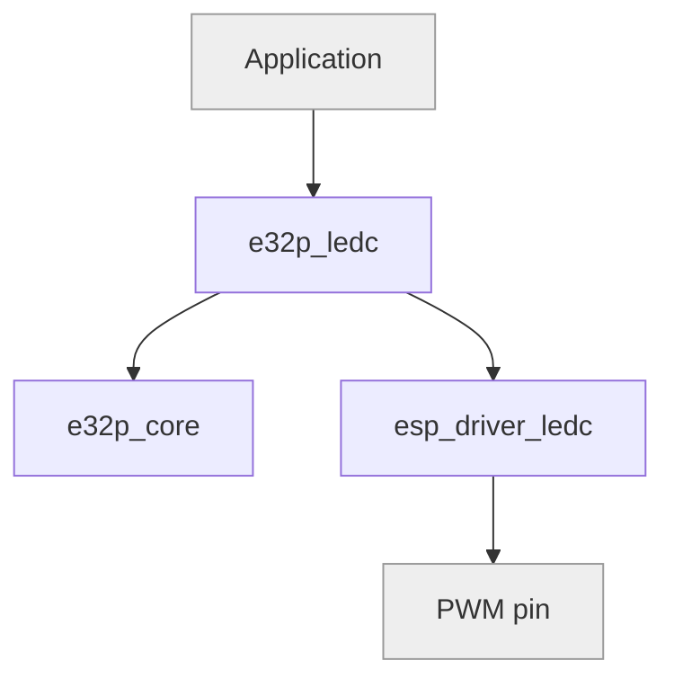
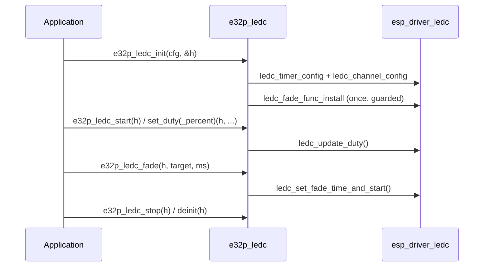

# e32p_ledc — Design

> **LEDC PWM channel with hardware fade.** Part of the ESP32 firmware platform
> (`e32p_` modules). Self-contained.

## 1. Overview

`e32p_ledc` is an opaque-handle facade over `driver/ledc.h`: **one handle = one
PWM channel**. It covers the lifecycle (init / start / stop / deinit), duty
control (raw and percentage, clamped), a **hardware fade** to a target duty over a
duration, and a status snapshot.

| Property | Value |
|----------|-------|
| Registration style | **opaque handle** (`e32p_ledc_handle_t`) |
| Kconfig symbol | `CONFIG_E32P_LEDC_ENABLE` |
| Target guard | `depends on SOC_LEDC_SUPPORTED` |
| Public header | [`include/e32p_ledc.h`](include/e32p_ledc.h) |

## 2. External dependencies

| Direction | Depends on | Why |
|-----------|-----------|-----|
| Platform | `e32p_core` | error macros, logging |
| ESP-IDF | `esp_driver_ledc`, `esp_driver_gpio` (`PRIV_REQUIRES`) | LEDC timer/channel + GPIO output |



## 3. Internal architecture

Each handle wraps a LEDC timer + channel and caches the resolution/duty for the
status snapshot. The hardware **fade service** is installed once, guarded by a
static flag so repeated `init`s don't re-install it (installing twice is a driver
error).

## 4. Key data structures

- **`e32p_ledc_config_t`** — `{ pin, freq_hz, duty_resolution_bits, channel,
  timer, high_speed, initial_duty }`, with `E32P_LEDC_CONFIG_DEFAULT()`.
- **`e32p_ledc_status_t`** — `{ running, duty, max_duty, freq_hz }`.

## 5. Calling sequence



## 6. Concurrency & context

- Task context; per-handle state, no locks (one owner per channel).
- The fade completes in hardware; the call returns immediately (non-blocking).

## 7. Error model

- `E32P_CHECK_ARG` → `ESP_ERR_INVALID_ARG` (NULL cfg, invalid pin, resolution
  out of `1..SOC_LEDC_TIMER_BIT_WIDTH`).
- The driver rejects impossible freq×resolution combinations (returns the driver
  error from `init`).
- Duty and percent inputs are clamped to `max_duty` / 100.

## 8. Cherry-pick

```
CONFIG_E32P_LEDC_ENABLE=y
```

Requires `e32p_core`; privately requires `esp_driver_ledc` + `esp_driver_gpio`.
Copy `components/e32p_ledc/` and `components/e32p_core/`.
