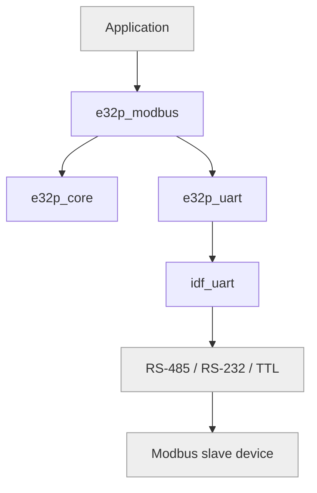
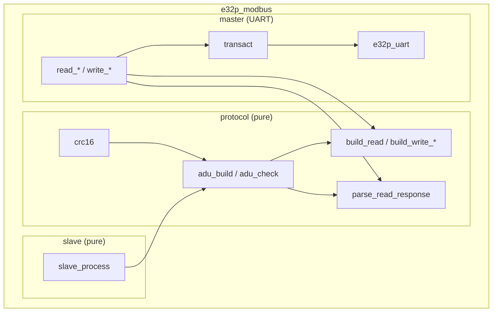

# e32p_modbus — Design

> **Modbus RTU master over UART, with a pure protocol core and slave handler.**
> Part of the ESP32 firmware platform (`e32p_` modules). This document describes
> the module's internals and external connections and is self-contained: it
> travels with the module when cherry-picked.

## 1. Overview

Modbus RTU is the workhorse of industrial serial communication: a master polls
slaves (PLCs, meters, drives) by reading and writing 16-bit registers, framed on
the wire as `[unit][function][data][CRC-16]` with 3.5-character idle gaps between
frames. This module implements a **master** for the four common function codes and
factors the wire logic into pure, testable functions — plus a pure **slave**
handler so a whole exchange can run with no bus at all.

| Property | Value |
|----------|-------|
| Registration style | opaque-handle (master); pure functions (protocol/slave) |
| Kconfig symbol | `CONFIG_E32P_MODBUS_ENABLE` |
| Target guard | none |
| Public header | [`include/e32p_modbus.h`](include/e32p_modbus.h) |

## 2. External dependencies

| Direction | Depends on | Why |
|-----------|-----------|-----|
| Platform | `e32p_core` | error macros, logging |
| Platform | `e32p_uart` | serial transport + parity/stop enums (in the public header) |
| Kconfig `select` | `E32P_UART_ENABLE` | the transport must be compiled in |



## 3. Internal architecture

Three stacked layers. The master builds a request with the protocol layer, sends
it via `transact`, and parses the reply — the same protocol layer a slave uses in
reverse through `slave_process`.



## 4. Key data structures

- `e32p_modbus_master_config_t` — UART port/pins, baud, parity, stop bits, and the
  per-transaction `response_timeout_ms`. `E32P_MODBUS_MASTER_CONFIG_DEFAULT` is
  uart1 / 9600 / 8E1 / 500 ms.
- `e32p_modbus_slave_t` — the register model: a mutable `holding` bank
  (0x03/0x06/0x10) and a read-only `input` bank (0x04), plus the unit `address`.
- `e32p_modbus_exception_t` — the standard exception codes.
- `struct e32p_modbus_master_ctx` — the UART handle, timeout, and the last
  exception code.

## 5. Calling sequences

**Master read (0x03)**
```mermaid
sequenceDiagram
    participant app as Application
    participant m as e32p_modbus (master)
    participant u as e32p_uart
    participant s as Slave
    app->>m: read_holding_registers(slave, addr, count, out)
    m->>m: build_read -> request ADU (+CRC)
    m->>u: flush_input; write(request)
    u->>s: request frame
    s-->>u: response frame
    m->>u: read 2 header bytes, then the rest by length
    m->>m: parse_read_response (CRC, slave, func / exception)
    m-->>app: ESP_OK + registers, or error / exception
```

**Slave process (pure, in-firmware or test)**
```mermaid
sequenceDiagram
    participant caller as UART RX / test
    participant s as slave_process
    caller->>s: (model, request ADU)
    s->>s: check CRC + addressing
    s->>s: dispatch func; read/write the register bank
    s-->>caller: response ADU (or exception, or 0 = ignore)
```

## 6. Framing & the deterministic read

An RTU frame has no length field; receivers normally detect the end by a 3.5-char
idle gap. Because the **master already knows what it asked**, this module reads a
deterministic number of bytes instead of timing gaps: read the 2-byte header, then
either 3 more bytes (an exception reply is always 5 bytes, flagged by the
function's high bit `0x80`) or the exact remaining length of the expected reply
(`5 + 2·count` for a read, 8 for a write). This is simpler and robust against
inter-character jitter. Every frame is CRC-checked before use.

## 7. Concurrency & context

The master runs in the calling task and blocks for up to `response_timeout_ms`
per transaction. It is not reentrant per handle — serialize calls to one master
(one bus = one master anyway). The pure protocol and `slave_process` functions
are reentrant and allocate nothing on the heap.

## 8. Error model

`esp_err_t` for the master. `E32P_CHECK_ARG` (→ `ESP_ERR_INVALID_ARG`) guards NULL
handle/out, register counts out of range, and a unit id > 247. A missing or short
reply is `ESP_ERR_TIMEOUT`; a bad CRC is `ESP_ERR_INVALID_CRC`; a slave error
reply is `ESP_ERR_INVALID_RESPONSE` with the code in `last_exception()`. The pure
builders return the ADU length or `-1` (bad args / small buffer); `slave_process`
returns the response length, `0` (not addressed / broadcast — no reply), or `-1`
(bad CRC / malformed).

## 9. Cherry-pick

```
CONFIG_E32P_MODBUS_ENABLE=y   # selects E32P_UART_ENABLE
```

Requires `e32p_core` and `e32p_uart`. Copy `components/e32p_modbus/` (plus
`e32p_core` and `e32p_uart`) and enable the symbol.
