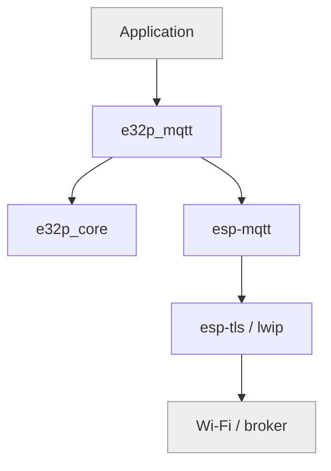
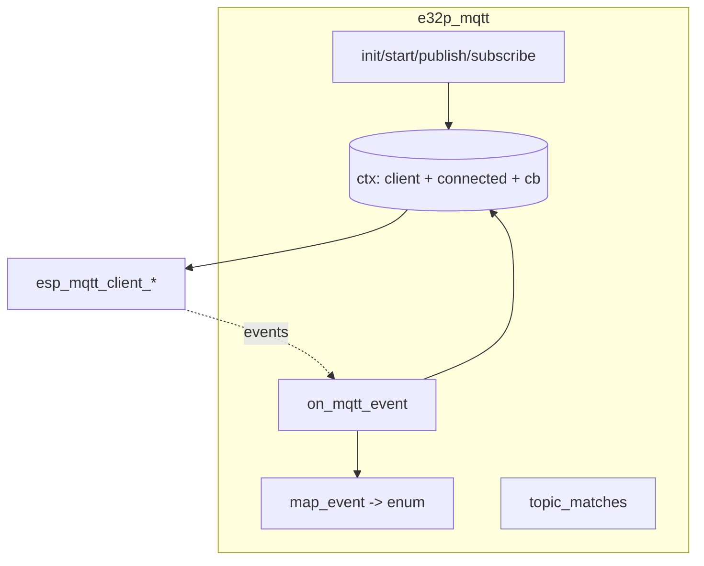
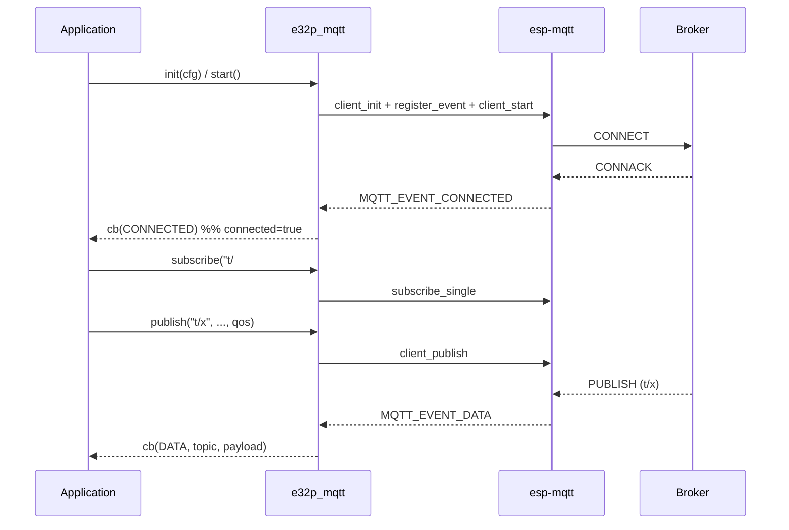
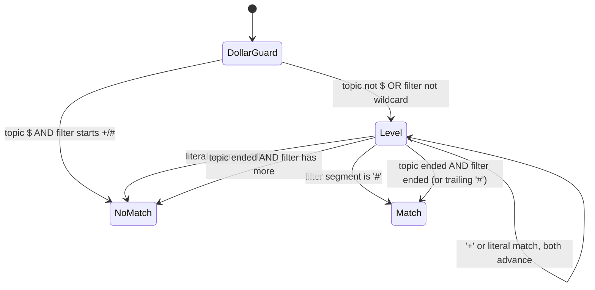

# e32p_mqtt — Design

> **MQTT v3.1.1 client facade over esp-mqtt.** Part of the ESP32 firmware
> platform (`e32p_` modules). This document describes the module's internals and
> external connections and is self-contained: it travels with the module when
> cherry-picked.

## 1. Overview

MQTT is the default application protocol for IoT telemetry: a device connects to
a broker, publishes to topics, and subscribes to topic filters. ESP-IDF ships
`esp-mqtt`, an event-driven client. This module wraps it so application code sees
a small handle, a single event callback with a compact enum, and `esp_err_t`
returns with argument checks — and hides `mqtt_client.h` from consumers.

The one piece of real logic (as opposed to passthrough) is **topic-filter
matching**, which is a pure function and the module's headless-tested core.

| Property | Value |
|----------|-------|
| Registration style | opaque-handle (one per client) |
| Kconfig symbol | `CONFIG_E32P_MQTT_ENABLE` |
| Target guard | none (needs a netif at runtime, not at build) |
| Public header | [`include/e32p_mqtt.h`](include/e32p_mqtt.h) |

## 2. External dependencies

| Direction | Depends on | Why |
|-----------|-----------|-----|
| Platform | `e32p_core` | error macros, logging |
| ESP-IDF | `mqtt` (esp-mqtt) | the underlying client (private, `.c` only) |
| ESP-IDF | `esp_event` | event base/id types in the handler (private) |
| Runtime (not a build dep) | a netif + IP (e.g. `e32p_wifi`) + a broker | transport |



## 3. Internal architecture

A thin handle wraps the esp-mqtt client, a cached connection flag, and the user
callback. esp-mqtt delivers events on its own task to a single internal handler,
which updates the flag and translates each event into the compact
`e32p_mqtt_event_t`. The topic matcher is standalone and touches none of this.



## 4. Key data structures

- `e32p_mqtt_config_t` — broker URI, optional client id / credentials / keepalive,
  and the user callback + context. Strings are borrowed (esp-mqtt copies at init).
- `e32p_mqtt_event_t` — `{ type, topic, topic_len, data, data_len, msg_id, retain }`;
  the pointers are valid only during the callback. `retain` (DATA) is esp-mqtt's
  retained flag for the message.
- `e32p_mqtt_event_type_t` — a compact event enum mapped from esp-mqtt ids.
- `struct e32p_mqtt_ctx` — the esp-mqtt client handle, the callback + user
  pointer, and a `volatile bool connected`.

## 5. Calling sequences

**Connect + subscribe + publish**


## 6. Topic-matching algorithm

`e32p_mqtt_topic_matches` walks the filter and topic one level at a time:



`+` matches exactly one level (empty levels included); `#` must be last and also
matches the parent (`sport/#` matches `sport`); a filter starting with a wildcard
never matches a `$`-prefixed topic.

## 7. Concurrency & context

esp-mqtt runs its own task; the user callback fires **in that task**, so it must
be short and non-blocking — hand heavy work to another task via a queue.
`is_connected()` reads a `volatile bool` updated on CONNECTED/DISCONNECTED. The
public operations are safe to call from application tasks (esp-mqtt serializes
internally). The pure helpers are reentrant and lock-free.

## 8. Error model

`esp_err_t` throughout. `E32P_CHECK_ARG` (→ `ESP_ERR_INVALID_ARG`) guards NULL
handle/topic/config, a NULL broker URI, and a QoS outside 0–2. `publish` /
`subscribe` / `unsubscribe` return `ESP_FAIL` when esp-mqtt reports a negative
message id (e.g. a full outbox or a disconnected client); the id is still passed
back via `out_msg_id`. Transport/protocol failures surface as
`E32P_MQTT_EVENT_ERROR` through the callback, not as a return code.

## 9. Cherry-pick

```
CONFIG_E32P_MQTT_ENABLE=y
```

Requires `e32p_core`; privately requires `mqtt` (esp-mqtt) and `esp_event`. Copy
`components/e32p_mqtt/` (plus `e32p_core`), enable the symbol, and give the app a
network path (e.g. `e32p_wifi`) before calling `e32p_mqtt_start()`.
