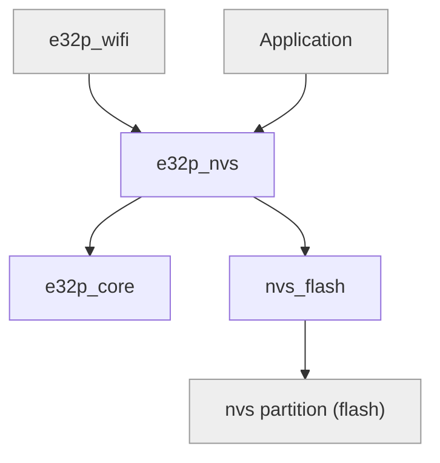
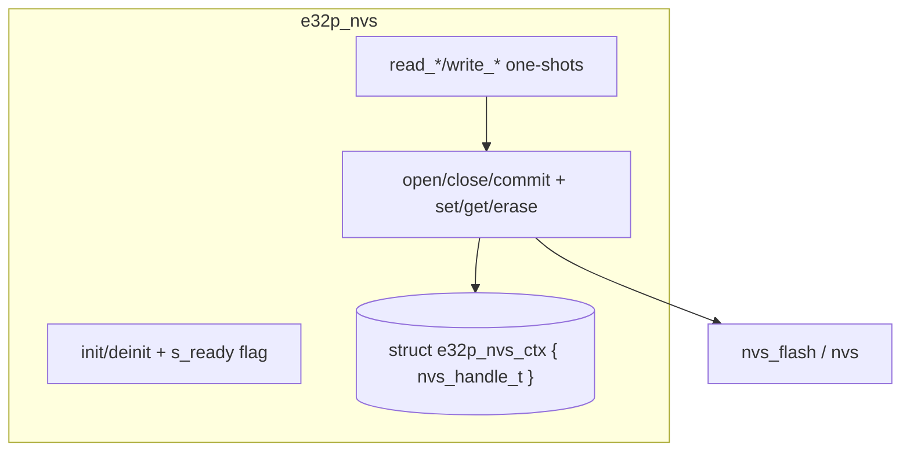
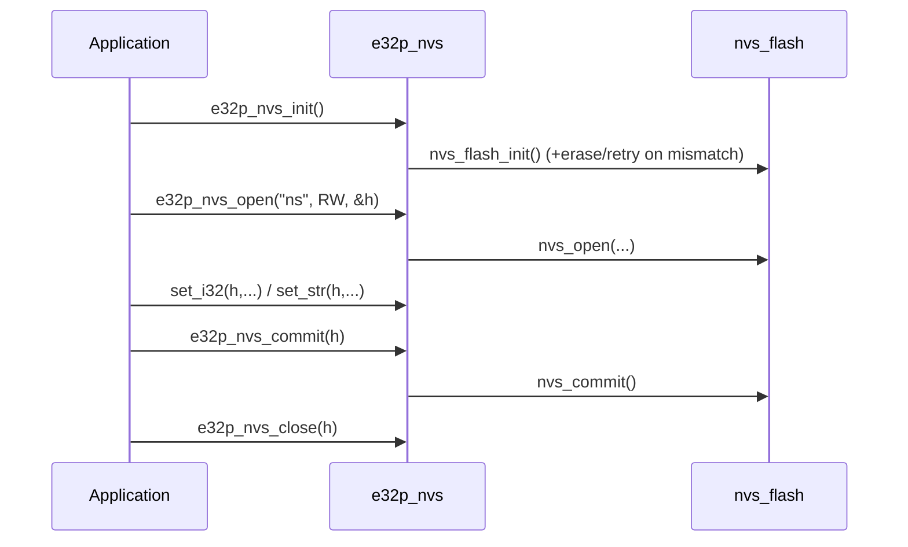
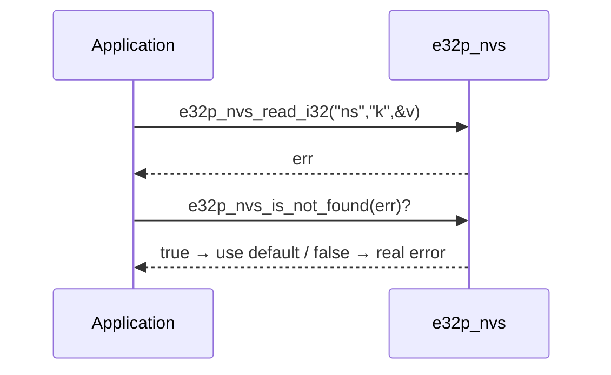

# e32p_nvs — Design

> **Non-Volatile Storage (NVS) facade.** Part of the ESP32 firmware platform
> (`e32p_` modules). Self-contained.

## 1. Overview

`e32p_nvs` wraps ESP-IDF `nvs_flash` with three things: a **singleton subsystem
init** (auto-erase-and-retry on a version/space mismatch), a **per-namespace
opaque handle** for efficient batched read/write/commit, and **one-shot helpers**
(`read_i32`/`write_str`/…) that open→op→commit→close in a single call. A
`e32p_nvs_is_not_found()` predicate lets callers branch on a missing key without
including `<nvs.h>`.

| Property | Value |
|----------|-------|
| Registration style | **singleton init + opaque handle** (per namespace) |
| Kconfig symbol | `CONFIG_E32P_NVS_ENABLE` |
| Target guard | none |
| Public header | [`include/e32p_nvs.h`](include/e32p_nvs.h) |

## 2. External dependencies

| Direction | Depends on | Why |
|-----------|-----------|-----|
| Platform | `e32p_core` | error macros, logging, `ESP_ERR_E32P_NOT_INIT` |
| ESP-IDF | `nvs_flash` | `nvs_flash_*`, `nvs_*` |
| Consumers | `e32p_wifi` (and app code) | Wi-Fi `select`s NVS for its calibration/config store |



## 3. Internal architecture



- **`s_ready`** guards the subsystem; `open` returns `ESP_ERR_E32P_NOT_INIT` if
  `init` was not called.
- Each `open` allocates a small `ctx` wrapping the raw `nvs_handle_t`.
- One-shots are built **on** the handle API; the read variants open the namespace
  *quietly* so a missing namespace surfaces as `NVS_NOT_FOUND` (a normal "no value
  yet"), not a logged error.

## 4. Key data structures

- **`e32p_nvs_handle_t`** — opaque; wraps one `nvs_handle_t` bound to a namespace.
- **`e32p_nvs_mode_t`** — `READONLY` / `READWRITE`.

## 5. Calling sequences

**Batched (handle) writes**


**One-shot read (with missing-key branch)**


## 6. Concurrency & context

- Task context. `s_ready` is set once at init (not lock-guarded).
- A handle is not thread-safe for concurrent use across tasks; open per-task or
  serialize.

## 7. Error model

- `ESP_ERR_E32P_NOT_INIT` from `open` before `init`.
- `E32P_CHECK_ARG` → `ESP_ERR_INVALID_ARG` for NULL namespace/key/out/handle.
- `ESP_ERR_NO_MEM` if the handle context cannot be allocated.
- `ESP_ERR_NVS_NOT_FOUND` (query via `e32p_nvs_is_not_found`) and
  `ESP_ERR_NVS_INVALID_LENGTH` (string buffer too small) pass through from reads.

## 8. Cherry-pick

```
CONFIG_E32P_NVS_ENABLE=y
```

Requires `e32p_core`; requires the ESP-IDF `nvs_flash` component. Copy
`components/e32p_nvs/` and `components/e32p_core/`. A custom partition table with
an `nvs` partition is needed (the platform's `partitions.csv` has one).
