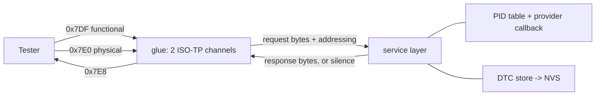
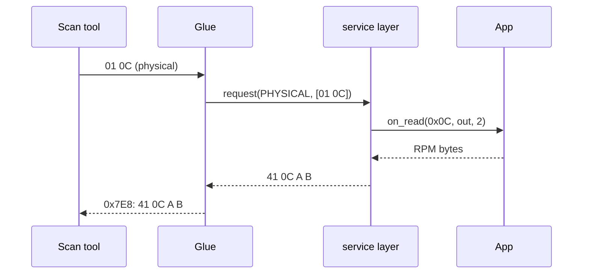
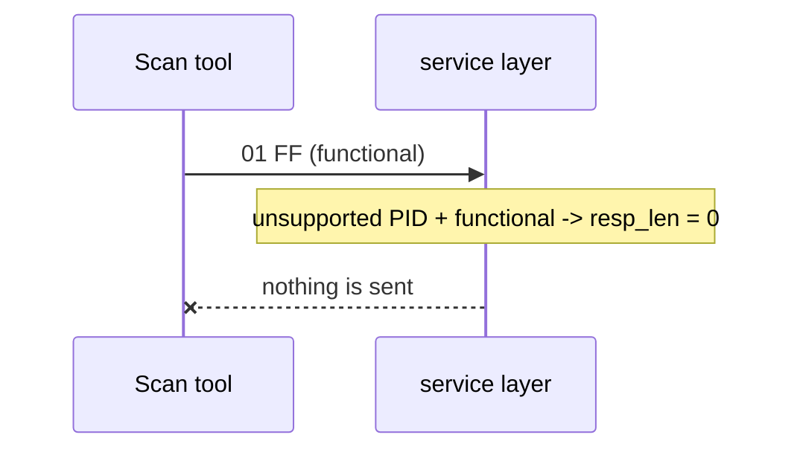

# e32p_obd2 — Design

> Status: the service layer is complete (ticket slice 2.2); the transport glue is
> slice 2.3, so nothing here is on a CAN bus yet.

## 1. Overview

`e32p_obd2` answers OBD-II requests as an ECU would: current data, freeze frame,
stored and pending trouble codes, clear, and vehicle information. It sits on
`e32p_isotp`, which carries requests and responses that do not fit in one CAN
frame (the VIN, or a list of codes).

The layer is split so that everything interesting is pure:

| Layer | Owns | Needs |
|-------|------|-------|
| Services | PID table, supported-PID bitmasks, DTC store, response building | nothing |
| Glue (slice 2.3) | two ISO-TP channels, request routing, sending replies | `e32p_isotp` |

A request goes in, a response comes out, and the caller decides what to do with
it. There is no task, no clock and no CAN ID anywhere in the service layer, so a
Unity case can drive every service on a PC or on the target in microseconds.

## 2. External dependencies

| Depends on | Why |
|------------|-----|
| `e32p_core` | error codes and the argument-check macros |
| `e32p_isotp` (private) | the glue only; the service layer never sees it |
| `e32p_nvs` (private) | the DTC store, so codes survive a power cycle |

## 3. Internal architecture

Two channels, not one: a functional and a physical request can be in flight at
the same time, and each ISO-TP channel owns one reassembly buffer.

## 4. Key data structures

| Type | Role |
|------|------|
| `e32p_obd2_pid_t` | one table row: PID number and how many data bytes it answers with |
| `e32p_obd2_config_t` | table, value provider, VIN, OBD standard byte, NVS namespace |
| `struct e32p_obd2_ctx` | the config, the derived PID bitmask, the DTC array, the freeze frame |

The PID bitmask is **derived** from the table at init (ticket D-07). Hand-written
bitmasks are the classic OBD bug: a scan tool asks for a PID the ECU advertised
and gets a negative response.

## 5. Calling sequences

### 5.1 Reading a live value

### 5.2 A functional request this ECU cannot answer

The same request sent physically answers `7F 01 12`. That asymmetry is
ISO 15765-4: a broadcast must not draw an error from every ECU on the bus.

## 6. State machine

The service layer has none — it is a function. The only state that persists
between requests is the DTC store, which changes on `dtc_set`, on mode `0x04`,
and at init when it is read back from NVS.

Inside that store, two things are worth stating plainly:

- **The first code freezes the frame.** A later code does not replace it, and
  mode `0x02` PID `0x02` names the code that did, which is how a technician tells
  which fault the snapshot belongs to.
- **Codes are persisted, the snapshot is not.** Codes are facts that survive a
  power cycle. The snapshot is a set of live sensor values; restoring it after a
  reset would be inventing history, so mode `0x02` reports "not supported" until
  a new code appears.

## 7. Concurrency & context

One handle is driven from one task: the ISO-TP pump, which is also where the
value provider runs. The provider must not block, because the pump is what sends
flow control and services the transport's timers.

Two channels feed the same handle. They are serialised by that single pump task,
so no lock is needed inside the layer.

## 8. Error model

| Code | Meaning |
|------|---------|
| `ESP_OK` | request handled; check `resp_len` — 0 means send nothing |
| `ESP_ERR_INVALID_ARG` | null handle or buffer, or a response buffer below `E32P_OBD2_RESP_MAX` |
| `ESP_ERR_NO_MEM` | out of memory at init, or the DTC store is full |

A negative response is not an error: the request was handled, and the answer is
`7F <service> <code>`. Codes used: `0x11` unknown service, `0x12` unsupported
PID, `0x13` malformed length.

## 9. Cherry-pick

Copy `components/e32p_obd2/` with `e32p_isotp`, `e32p_twai`, `e32p_nvs` and
`e32p_core`. Set `CONFIG_E32P_OBD2_ENABLE=y`. The service layer alone needs no
CAN peripheral at all, which is what makes it portable to a bench test on a PC.
