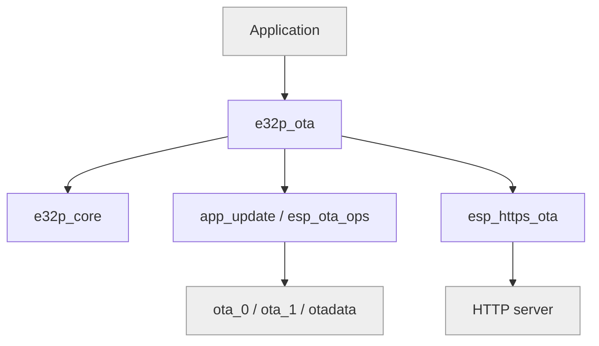
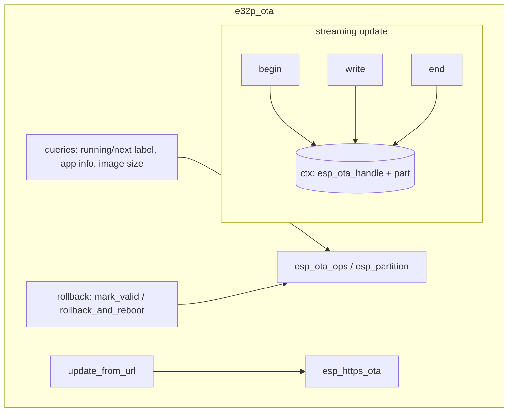
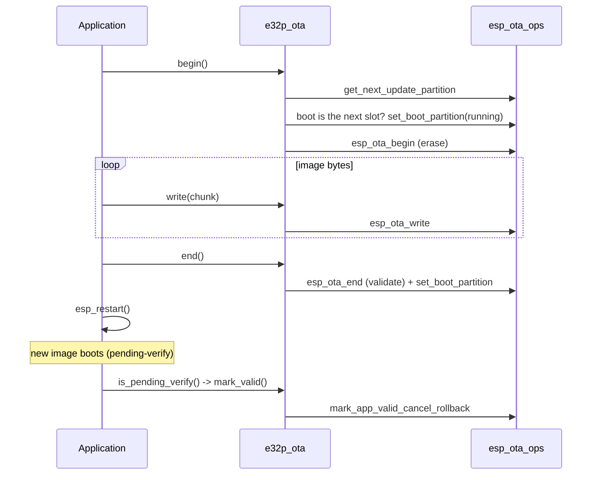

# e32p_ota — Design

> **Over-the-air firmware update over esp_ota_ops + esp_https_ota.** Part of the
> ESP32 firmware platform (`e32p_` modules). This document describes the module's
> internals and external connections and is self-contained: it travels with the
> module when cherry-picked.

## 1. Overview

A field-updatable device keeps two app slots (`ota_0`/`ota_1`) and an `otadata`
partition that records which one to boot. An update writes a new image into the
*inactive* slot, validates it, and flips `otadata`; if the new image misbehaves,
the bootloader rolls back. This module wraps that flow: offline **queries**
(what's running, where the next update goes), **rollback** control, a **streaming**
writer for an image from any source, and a one-call **URL pull**.

| Property | Value |
|----------|-------|
| Registration style | flat queries + opaque handle for a streaming update |
| Kconfig symbol | `CONFIG_E32P_OTA_ENABLE` |
| Target guard | none (needs an OTA partition table at runtime) |
| Public header | [`include/e32p_ota.h`](include/e32p_ota.h) |

## 2. External dependencies

| Direction | Depends on | Why |
|-----------|-----------|-----|
| Platform | `e32p_core` | error macros, logging |
| ESP-IDF | `app_update` | `esp_ota_ops` — begin/write/end, boot partition, rollback |
| ESP-IDF | `esp_https_ota`, `esp_http_client` | the URL pull |
| ESP-IDF | `esp_partition`, `esp_app_format` | read the running image header + app desc |
| ESP-IDF | `mbedtls` | `esp_crt_bundle_attach` — the CA bundle that verifies an https server |
| Runtime (not a build dep) | OTA partition table; a netif for URL pull | |



## 3. Internal architecture

Mostly passthrough to `esp_ota_ops`, with two pieces of real logic: computing the
running image size from its header, and a tiny handle that pairs the esp_ota write
handle with its destination partition so `end` can set the boot partition.



## 4. Key data structures

- `e32p_ota_app_info_t` — project / version / idf_version / date / time / sha256,
  copied out of `esp_app_get_description()`.
- `struct e32p_ota_ctx` — the `esp_ota_handle_t` plus the destination
  `esp_partition_t*`, so `end` knows which slot to make bootable.

## 5. Calling sequences

**Streaming update + confirm (the safe pattern)**


## 6. The image-size computation

`running_image_size` walks the running partition's flash image: read the
`esp_image_header_t` (magic `0xE9`), then each of its `segment_count`
`esp_image_segment_header_t`s (adding `data_len` each), then the 1-byte checksum,
16-byte-align, and add 32 bytes if a SHA-256 is appended. This yields the exact
image length — used by the `25_ota` demo to copy only the real image (not the
whole 1.5 MB slot) when cloning itself into the other partition.

## 7. Concurrency & context

Queries and rollback calls run in the caller's task and are cheap. A streaming
update is a single-owner sequence (`begin`…`write`…`end`) — don't interleave two.
Starting a new update cancels a staged image that has not booted yet: after `end`
the next slot is the boot target, so `begin` first calls
`esp_ota_set_boot_partition(running)` and only then erases. If that call fails,
`begin` returns its error and erases nothing. Without this, an update that never
completed would leave otadata naming a half-written slot, and the bootloader (hash
check only, no Secure Boot) would boot it. In IDF v5.3.1 that call rewrites otadata
with state NEW when `CONFIG_BOOTLOADER_APP_ROLLBACK_ENABLE=y` (`set_new_state_otadata`),
which the bootloader would turn into pending-verify. So with rollback on, the cancel
then calls `esp_ota_mark_app_valid_cancel_rollback()`, which sets the new entry VALID,
and returns that error if it fails (nothing is erased yet). The running image stays
valid. This is safe because the cancel runs only when boot names the other slot, and
`esp_ota_begin` refuses to stage anything while the running image is pending verify.
Anti-rollback is off in every config of this workspace. If the boot partition cannot
be read, the cancel returns `ESP_ERR_NOT_FOUND` (fail closed); with no target slot it
returns `ESP_OK`.
Every consumer of `begin` in this workspace (examples 25 and 33) already confirms at boot;
example 28 stages an image only on an unexpected accept and reverts it at once.
`update_from_url()` goes through `esp_https_ota`, which picks the same slot
(`esp_ota_get_next_update_partition(NULL)`, IDF v5.3.1 `esp_https_ota_begin`) and
erases it in the first `esp_https_ota_perform()`. It runs the same cancel step
(`cancel_staged_update`) before `esp_https_ota_begin`, so both update paths cancel a
staged image that has not booted yet. If the cancel fails, the pull returns its error
before any network call. The cancel happens even if the download later fails.
`esp_ota_write` blocks on flash erase/write. `rollback_and_reboot` and a post-`end`
`esp_restart` do not return.
`update_from_url()` runs the TLS handshake and the download on the caller's stack, with
no stack check; it only logs the caller's free stack (`uxTaskGetStackHighWaterMark`,
bytes) at DEBUG level when it starts. Requirement: 8 KB recommended, at least 6 KB.
Measured on the bench (ESP32, HIL agent main task of 8192 B). The high-water mark, read
after the call, is the minimum free stack, so used = 8192 - free: 3756 B used (4436 B
free) for a TLS handshake with the image rejected, and 3900 B / 4012 B used (4292 B /
4180 B free) for two full https downloads staged into the spare slot.

## 8. Error model

`esp_err_t` throughout. `E32P_CHECK_ARG` (→ `ESP_ERR_INVALID_ARG`) guards NULL
handle/out/url. `begin` returns `ESP_ERR_NOT_FOUND` when the partition table has
no free OTA slot; `end` returns `ESP_ERR_OTA_VALIDATE_FAILED` if the written image
is corrupt (the boot partition is left untouched, so a failed update cannot brick
the device). The URL pull passes through `esp_https_ota` errors, except two it adds
when plain http is not allowed: `ESP_ERR_INVALID_ARG` for a URL that does not start
with `https://`, and `ESP_ERR_INVALID_RESPONSE` for a redirect to a connection
without TLS. Query getters
return NULL / `ESP_FAIL` rather than crashing when there is no OTA data.

## 8.1 Security model (read before production)

OTA is a code-execution path, so its trust story matters as much as its
correctness. This module keeps the transport simple but verifies the server:

- **`update_from_url()` verifies an `https://` server against the ESP-IDF CA
  bundle** (`crt_bundle_attach = esp_crt_bundle_attach`; needs
  `CONFIG_MBEDTLS_CERTIFICATE_BUNDLE=y`). If the certificate does not chain to a
  bundled root CA, the call fails and no image bytes are written. `http://` works only with
  `CONFIG_ESP_HTTPS_OTA_ALLOW_HTTP=y` and is **unauthenticated + unencrypted — bench
  use only** (a MITM can push malicious firmware).
- **With that option off, plain http is refused at run time, in two places.** The IDF
  does not do this for us: it reads the option only when no server verification is
  configured, and the CA bundle is always configured here, so the transport follows
  the URL scheme and redirects are followed without a scheme check. So (1) a URL that
  does not start with `https://` (compared without case) returns
  `ESP_ERR_INVALID_ARG` before any IDF call; (2) the module runs the same
  begin / perform / finish steps as `esp_https_ota()` and watches every connection
  through the http client event `HTTP_EVENT_ON_CONNECTED`. If any connection (also one
  opened after a redirect) is not TLS, it calls `esp_https_ota_abort()` and returns
  `ESP_ERR_INVALID_RESPONSE`, so a redirect that opens a connection without TLS is
  refused. Flash is first written inside the first `esp_https_ota_perform()`, so
  nothing has been written at that point. Do not put credentials or tokens in the
  URL: it is logged, and a redirect to `http://` is refused only after the plain
  request has been sent.
- **Limits of the CA check.** An https pull needs about 8 KB of stack in the calling
  task (TLS handshake). The full bundle trusts every public root CA, so it proves the
  host named in the URL, not who chose the URL or the image; a product can build a
  bundle with its own CA only (`CONFIG_MBEDTLS_CERTIFICATE_BUNDLE_DEFAULT_NONE` plus
  `CONFIG_MBEDTLS_CUSTOM_CERTIFICATE_BUNDLE`). Certificate dates are checked only with
  `CONFIG_MBEDTLS_HAVE_TIME_DATE=y` and a set clock (off in all configurations in this
  workspace). With the bundle option off the module does not compile.
- **A product build refuses the bench settings.** A compile-time check in
  `e32p_ota.c` stops the build if `CONFIG_E32P_BENCH_FORBIDDEN` is set (product
  marker, Secure Boot or Flash Encryption) together with
  `CONFIG_ESP_HTTPS_OTA_ALLOW_HTTP`, `CONFIG_ESP_TLS_INSECURE` or
  `CONFIG_ESP_TLS_SKIP_SERVER_CERT_VERIFY`. A second check stops the build if
  `CONFIG_E32P_BENCH_FORBIDDEN` is set and `CONFIG_SECURE_SIGNED_ON_UPDATE` is not (the
  IDF sets that symbol for Secure Boot and for signed-on-update without Secure Boot).
  A product must verify image signatures; the CA check does not do that. A third check
  stops the build if `CONFIG_E32P_PRODUCT_BUILD` is set and `CONFIG_SECURE_BOOT` is not.
  It closes the gap in the second check: the bench "signed apps, no Secure Boot" option
  also sets `CONFIG_SECURE_SIGNED_ON_UPDATE`, but it trusts throwaway bench ECDSA keys.
  On the ESP32 Secure Boot v2 uses RSA, so those keys cannot sign a product image.
- **Image authenticity** is a separate concern: without **Secure Boot v2** nothing
  verifies the image's origin at boot, so a tampered binary in an OTA slot would
  run. Production builds should enable Secure Boot (and Flash Encryption if the
  image is confidential).
- **What the module already gives you:** `end` validates the image's structural
  integrity before flipping the boot partition, and rollback (§5) recovers a
  device that boots a bad-but-valid image. Neither replaces signing. The CA bundle
  proves the server, not the image. See the module README's "Security & production hardening" table.

## 9. Cherry-pick

```
CONFIG_E32P_OTA_ENABLE=y
```

Requires `e32p_core`; privately requires `app_update`, `esp_https_ota`,
`esp_http_client`, `esp_partition`, `esp_app_format`, `mbedtls`. Copy `components/e32p_ota/`
(plus `e32p_core`), enable the symbol, and use an OTA partition table.
