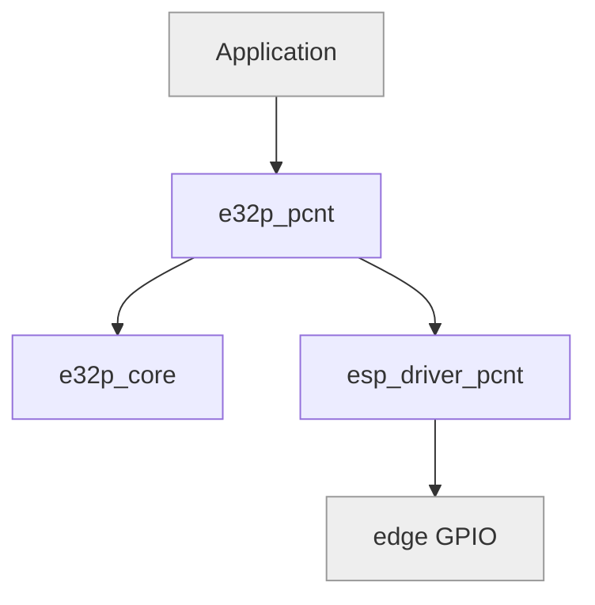
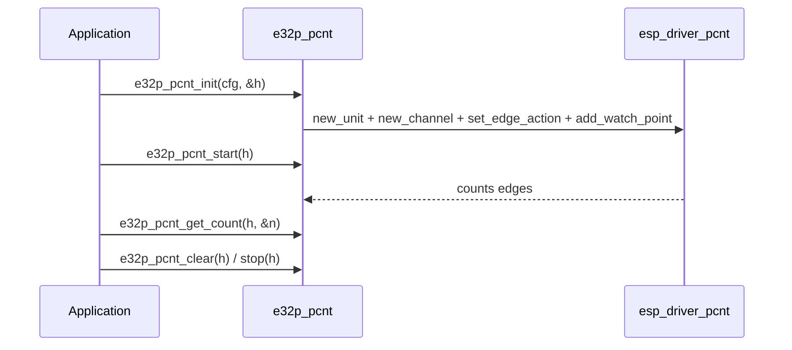

# e32p_pcnt — Design

> **Pulse counter.** Part of the ESP32 firmware platform (`e32p_` modules).
> Self-contained.

## 1. Overview

`e32p_pcnt` is an opaque-handle facade over the v5.x `driver/pulse_cnt.h`: **one
handle = one PCNT unit** counting rising and/or falling edges on a GPIO, with
high/low watch-points. A test-mode `io_loop_back` flag routes the pin's own
output back to its input so `gpio_set_level()` generates counts with no external
signal.

| Property | Value |
|----------|-------|
| Registration style | **opaque handle** (per PCNT unit) |
| Kconfig symbol | `CONFIG_E32P_PCNT_ENABLE` |
| Target guard | `depends on SOC_PCNT_SUPPORTED` |
| Public header | [`include/e32p_pcnt.h`](include/e32p_pcnt.h) |

## 2. External dependencies

| Direction | Depends on | Why |
|-----------|-----------|-----|
| Platform | `e32p_core` | error macros |
| ESP-IDF | `esp_driver_pcnt`, `esp_driver_gpio` (`PRIV_REQUIRES`) | pulse counter + GPIO loop-back |



## 3. Internal architecture

Each handle creates a PCNT **unit** plus one **edge channel**. `init` sets the
channel's edge actions from `count_rising`/`count_falling`, applies the
high/low limits as watch-points, and (if `io_loop_back`) enables the GPIO
input-output loopback. The unit is created stopped — call `start()`.

## 4. Key data structures

- **`e32p_pcnt_config_t`** — `{ edge_gpio, high_limit, low_limit, count_rising,
  count_falling, io_loop_back }` (ESP32 limits ±32767/−32768).

## 5. Calling sequence



## 6. Error model

- `E32P_CHECK_ARG` → `ESP_ERR_INVALID_ARG` (NULL cfg, neither edge selected,
  NULL out).
- Driver errors pass through (e.g. limits out of the SoC range).

## 7. Cherry-pick

```
CONFIG_E32P_PCNT_ENABLE=y
```

Requires `e32p_core`; privately requires `esp_driver_pcnt` + `esp_driver_gpio`.
Copy `components/e32p_pcnt/` and `components/e32p_core/`.
