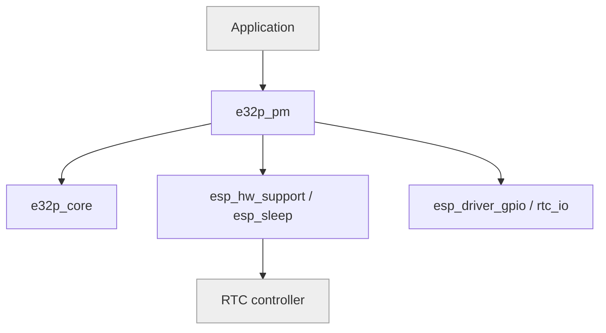
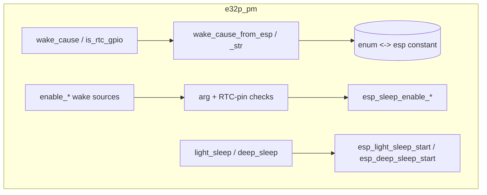
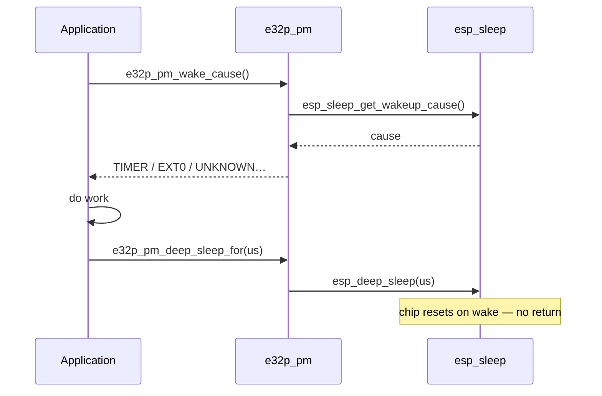
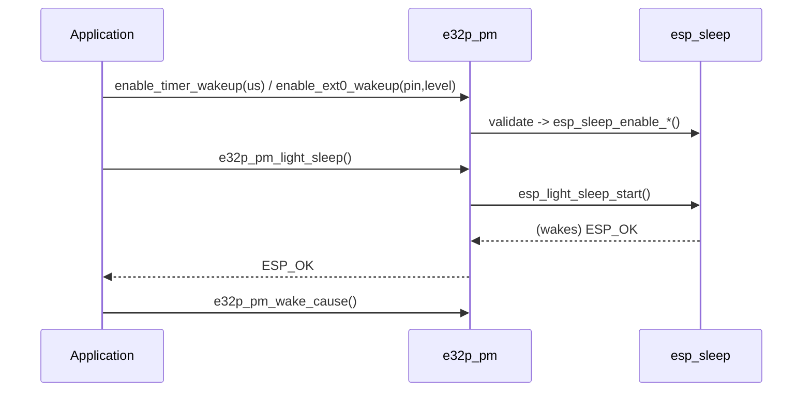

# e32p_pm — Design

> **Low-power sleep and wake-source facade over `esp_sleep`.** Part of the ESP32
> firmware platform (`e32p_` modules). This document describes the module's
> internals and external connections and is self-contained: it travels with the
> module when cherry-picked.

## 1. Overview

Battery-powered firmware spends most of its life asleep, waking on a timer or a
pin to do a little work and sleeping again. ESP-IDF exposes this through
`esp_sleep`, a flat global API with per-source enable calls and a single
`esp_sleep_get_wakeup_cause()`. This module wraps it with argument validation
(RTC-capable pins, non-zero timer, non-empty mask), a friendly wake-cause enum,
and clear light-vs-deep entry points.

| Property | Value |
|----------|-------|
| Registration style | flat / stateless (sleep is a global resource) |
| Kconfig symbol | `CONFIG_E32P_PM_ENABLE` |
| Target guard | none (all ESP32 variants sleep; pin sets differ) |
| Public header | [`include/e32p_pm.h`](include/e32p_pm.h) |

## 2. External dependencies

| Direction | Depends on | Why |
|-----------|-----------|-----|
| Platform | `e32p_core` | error macros, logging |
| ESP-IDF | `esp_hw_support` | `esp_sleep.h` (in the public header) + sleep entry |
| ESP-IDF | `esp_driver_gpio` | `rtc_gpio_is_valid_gpio`, `gpio_wakeup_enable` (private) |
| Kconfig `select` | none | no other e32p module required |



## 3. Internal architecture

No state of its own. Each public function is either a **pure** transform
(wake-cause enum ↔ esp constant, name string) or a **validated passthrough** to
`esp_sleep` / `rtc_io`. Validation is the only logic: RTC-pin checks for
ext0/ext1, level and mask checks, and a non-zero timer.



## 4. Key data structures

- `e32p_pm_wake_cause_t` — a compact wake-cause enum (`UNKNOWN, TIMER, EXT0, EXT1,
  TOUCH, GPIO, UART, ULP`); `UNKNOWN` also covers a cold boot / external reset.
- `e32p_pm_ext1_mode_t` — `ALL_LOW` / `ANY_HIGH`, mapped to
  `esp_sleep_ext1_wakeup_mode_t`.

## 5. Calling sequences

**Deep-sleep duty cycle**


**Light sleep (returns)**


## 7. Concurrency & context

Runs in the calling task. `esp_sleep` is global state, so wake-source config is
not per-task — treat it as a single owner (typically the app's main flow).
`e32p_pm_light_sleep()` blocks until a wake source fires; `e32p_pm_deep_sleep*()`
never returns. Do any final logging before calling deep sleep (the demo delays
briefly to flush the UART).

## 8. Error model

`esp_err_t` throughout. `E32P_CHECK_ARG` (→ `ESP_ERR_INVALID_ARG`) rejects a zero
timer, a non-RTC pin for ext0, an empty ext1 mask, an invalid GPIO, and a level
other than 0/1. Everything else is a direct passthrough of the `esp_sleep` /
`rtc_io` return code. The pure helpers cannot fail — an unrecognized esp cause
maps to `E32P_PM_WAKE_UNKNOWN` and `_str` always returns a valid string.

## 9. Cherry-pick

```
CONFIG_E32P_PM_ENABLE=y
```

Requires `e32p_core` and `esp_hw_support`; privately requires `esp_driver_gpio`.
Copy `components/e32p_pm/` (plus `e32p_core`) and enable the symbol. No other
e32p modules needed.
