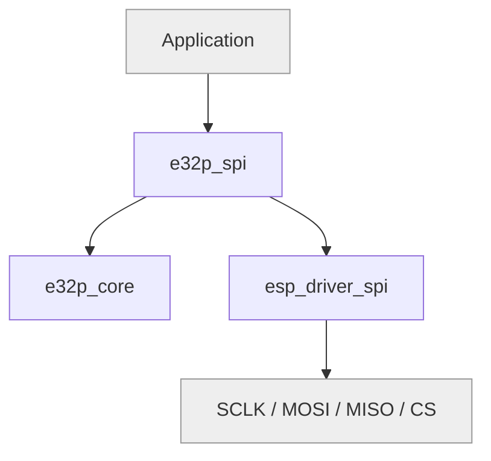
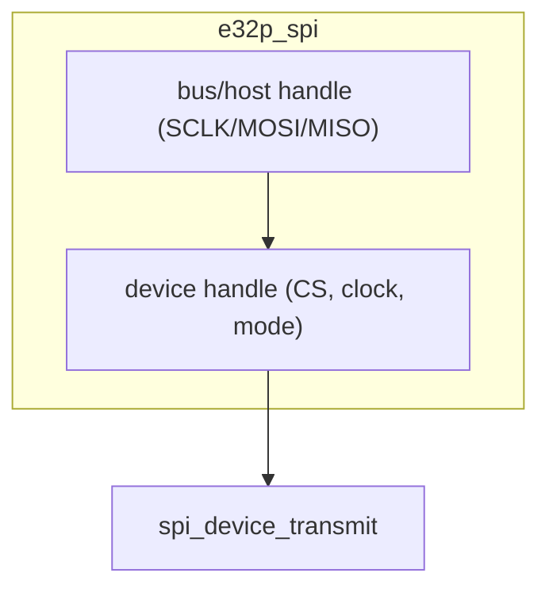
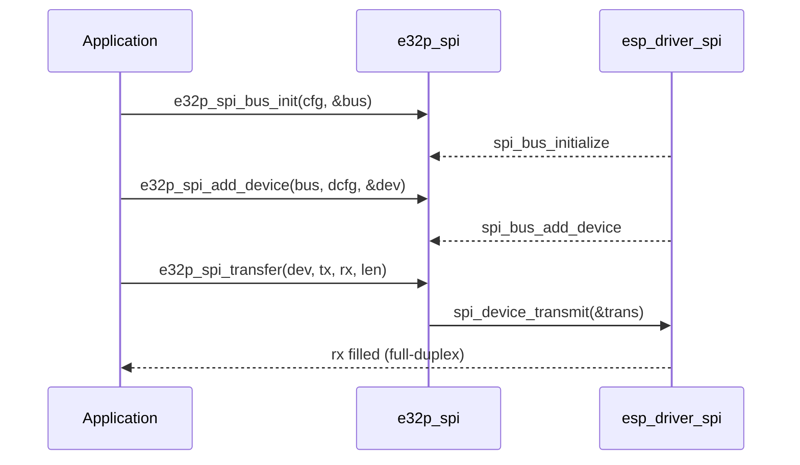

# e32p_spi — Design

> **SPI master (bus + device model).** Part of the ESP32 firmware platform
> (`e32p_` modules). Self-contained.

## 1. Overview

`e32p_spi` is a facade over `driver/spi_master.h` with the same **two-level
model** as I²C: a **bus (host)** owns SCLK/MOSI/MISO; **devices** attach with
their own CS / clock / SPI mode and carry the transfers. Supports full-duplex
`transfer`, plus one-way `write`/`read`.

| Property | Value |
|----------|-------|
| Registration style | **opaque handles** (bus + device) |
| Kconfig symbol | `CONFIG_E32P_SPI_ENABLE` |
| Target guard | none |
| Public header | [`include/e32p_spi.h`](include/e32p_spi.h) |

## 2. External dependencies

| Direction | Depends on | Why |
|-----------|-----------|-----|
| Platform | `e32p_core` | error macros |
| ESP-IDF | `esp_driver_spi`, `esp_driver_gpio` (`PRIV_REQUIRES`) | SPI master + pin routing |



## 3. Internal architecture



A bus wraps the initialized host (`host` 2=HSPI or 3=VSPI — SPI1 is flash); each
device wraps a `spi_device_handle_t`. `transfer` builds a `spi_transaction_t`
with `tx`/`rx` pointers (either may be NULL for one-way).

## 4. Key data structures

- **`e32p_spi_bus_config_t`** — `{ host, sclk_pin, mosi_pin, miso_pin,
  max_transfer_sz }` (`miso_pin = -1` for write-only).
- **`e32p_spi_dev_config_t`** — `{ cs_pin, clock_hz, mode, queue_size }`.

## 5. Calling sequence



## 6. Concurrency & context

- Task context. The driver queues transactions per device (`queue_size`); one
  owner per device handle.

## 7. Error model

- `E32P_CHECK_ARG` → `ESP_ERR_INVALID_ARG` (NULL cfg/bus/dev, host not 2/3).
- Driver errors pass through.

## 8. Cherry-pick

```
CONFIG_E32P_SPI_ENABLE=y
```

Requires `e32p_core`; privately requires `esp_driver_spi` + `esp_driver_gpio`.
Copy `components/e32p_spi/` and `components/e32p_core/`.
