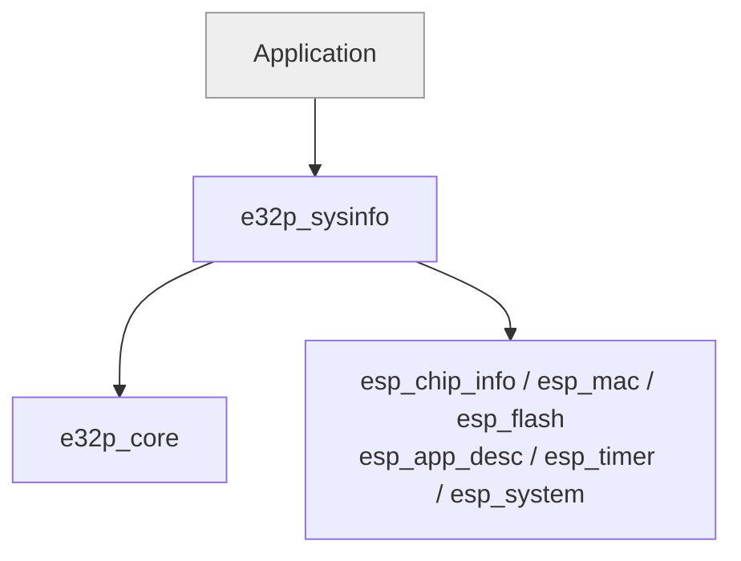
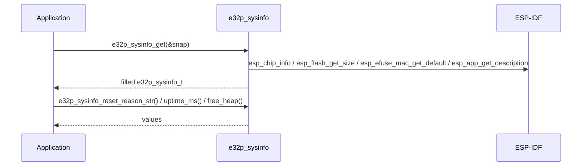

# e32p_sysinfo — Design

> **Read-only system introspection.** Part of the ESP32 firmware platform
> (`e32p_` modules). Self-contained.

## 1. Overview

`e32p_sysinfo` gathers chip/app identity, reset reason, heap, and uptime into a
uniform API. It is **stateless** — no init, every function just reads live system
state. Useful for boot banners, diagnostics, and health logging.

| Property | Value |
|----------|-------|
| Registration style | **flat / stateless** (no handle, no init) |
| Kconfig symbol | `CONFIG_E32P_SYSINFO_ENABLE` |
| Target guard | none |
| Public header | [`include/e32p_sysinfo.h`](include/e32p_sysinfo.h) |

## 2. External dependencies

| Direction | Depends on | Why |
|-----------|-----------|-----|
| Platform | `e32p_core` | error macros, logging |
| ESP-IDF | `esp_system`, `esp_hw_support`, `esp_app_format`, `esp_timer` | chip info, MAC, flash size, app desc, reset reason, uptime |



## 3. Internal architecture

No state. Two small mapping helpers translate ESP-IDF enums into portable ones:
`chip_model_str()` (`esp_chip_model_t` → name) and the reset-reason mapping
(`esp_reset_reason()` → `e32p_reset_reason_t` → string). `e32p_sysinfo_get()`
fills the snapshot struct; the scalar getters and `e32p_sysinfo_log()` read
directly.

## 4. Key data structures

- **`e32p_sysinfo_t`** — `{ chip_model, cores, revision, flash_size_bytes,
  mac[6], idf_version, app_name, app_version }`. `revision` is encoded
  `major*100 + minor` (100 = v1.0).
- **`e32p_reset_reason_t`** — portable reset-cause enum (POWERON, SW, PANIC,
  INT_WDT, TASK_WDT, BROWNOUT, DEEPSLEEP, OTHER, UNKNOWN).

## 5. Calling sequence



## 6. Error model

- `E32P_CHECK_ARG` → `ESP_ERR_INVALID_ARG` if the `get` output pointer is NULL.
- Scalar getters cannot fail (return the value directly). `get` best-effort fills
  the snapshot; unavailable fields are left zeroed.

## 7. Cherry-pick

```
CONFIG_E32P_SYSINFO_ENABLE=y
```

Requires `e32p_core`. Copy `components/e32p_sysinfo/` and `components/e32p_core/`.
No other `e32p_` modules needed.
