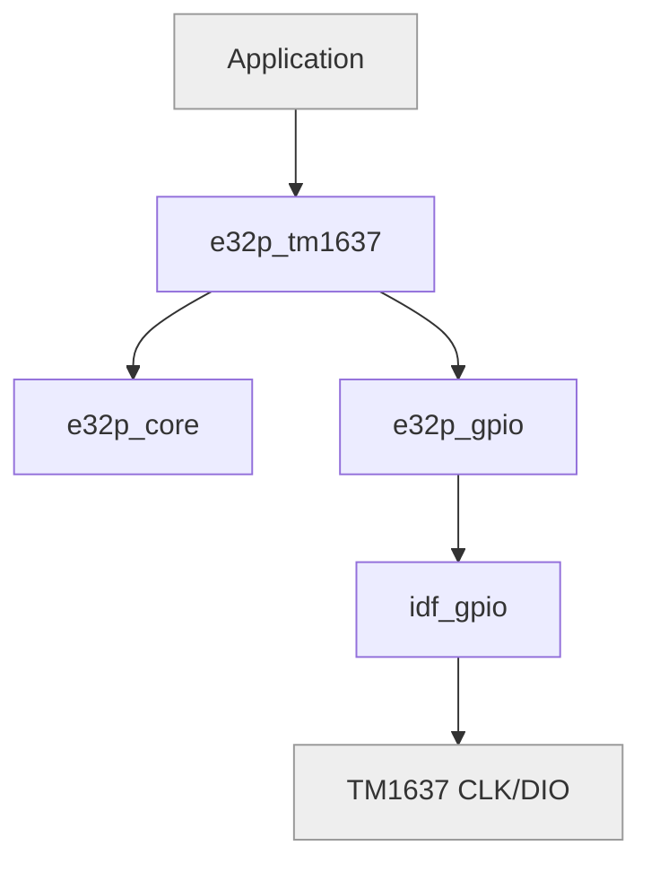
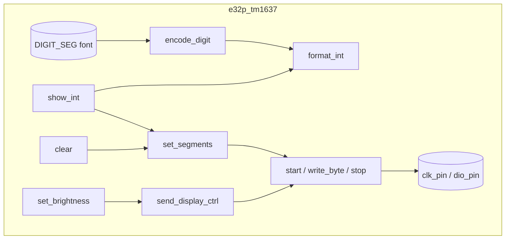
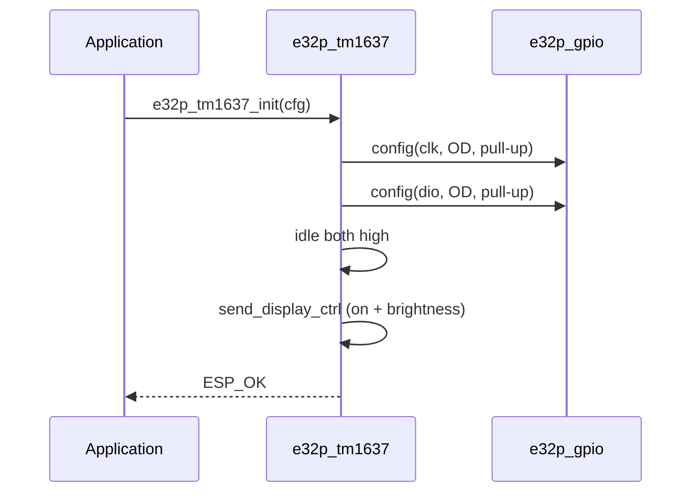

# e32p_tm1637 — Design

> **TM1637 4-digit 7-segment display over a bit-banged 2-wire bus.** Part of the
> ESP32 firmware platform (`e32p_` modules). This document describes the module's
> internals and external connections and is self-contained: it travels with the
> module when cherry-picked.

## 1. Overview

The TM1637 drives a 4-digit 7-segment display and is written over a two-wire
serial link that *resembles* I2C — start/stop conditions and a per-byte ACK — but
has **no device address** and shifts data **LSB-first**. Those two differences
mean the ESP32's I2C peripheral can't talk to it, so this module bit-bangs the
protocol over two open-drain GPIOs through [`e32p_gpio`](../e32p_gpio).

As with the other drivers, the awkward-to-verify logic (the 7-segment font and
the integer-to-digits layout) is kept **pure** and unit-tested; only the transport
touches hardware.

| Property | Value |
|----------|-------|
| Registration style | opaque-handle (one per display) |
| Kconfig symbol | `CONFIG_E32P_TM1637_ENABLE` |
| Target guard | none (any two GPIOs) |
| Public header | [`include/e32p_tm1637.h`](include/e32p_tm1637.h) |

## 2. External dependencies

| Direction | Depends on | Why |
|-----------|-----------|-----|
| Platform | `e32p_core` | error macros, logging (in the public header) |
| Platform | `e32p_gpio` | pin config + level get/set (private, `.c` only) |
| ESP-IDF | `esp_rom` | `esp_rom_delay_us` for the bit-bang timing |
| Kconfig `select` | `E32P_GPIO_ENABLE` | the transport must be compiled in |



## 3. Internal architecture

A font table and pure formatter sit above a tiny bit-bang layer
(`start`/`stop`/`write_byte`) that the public display operations compose.



## 4. Key data structures

- `e32p_tm1637_config_t` — `{ clk_pin, dio_pin, brightness }`.
- `struct e32p_tm1637_ctx` — the two pin numbers and the current brightness
  (re-asserted on every write via the display-control command).
- `DIGIT_SEG[16]` — the 0–F 7-segment font. `E32P_TM1637_SEG_MINUS` (0x40) and
  `E32P_TM1637_SEG_COLON` (0x80) are the sign and colon bits.

## 5. Calling sequences

**Init**


**Show a number**
```mermaid
sequenceDiagram
    participant app as Application
    participant mod as e32p_tm1637
    app->>mod: e32p_tm1637_show_int(1205, colon)
    mod->>mod: format_int -> 4 segment bytes
    mod->>mod: start; write 0x40 (data cmd); stop
    mod->>mod: start; write 0xC0 (addr); write 4 bytes; stop
    mod->>mod: start; write 0x88|brightness; stop
    mod-->>app: ESP_OK
```

## 7. Concurrency & context

Runs in the calling task; no internal task, ISR, or callback. Not reentrant per
handle — serialize writes to one display. The transfers are CPU-bound busy-waits
(~5 µs/edge); a full 4-digit update is a few hundred microseconds. The bit timing
is not interrupt-protected, so a preempting ISR can only *stretch* an edge — the
TM1637 tolerates a slow clock, so this is safe (no critical section is taken, to
keep the driver simple and non-blocking to other tasks).

## 8. Error model

`esp_err_t` throughout. `E32P_CHECK_ARG` (→ `ESP_ERR_INVALID_ARG`) guards NULL
handles/config, brightness > 7, and out-of-range segment positions. `format_int`
returns `ESP_ERR_INVALID_ARG` when the value (with an optional sign) doesn't fit
in four digits. Pin-configuration errors from `e32p_gpio` pass through (a failed
`init` frees the context). The transport ignores the TM1637 ACK bit — cheap
modules don't always drive it, and a display has no recoverable failure mode.

## 9. Cherry-pick

```
CONFIG_E32P_TM1637_ENABLE=y   # selects E32P_GPIO_ENABLE
```

Requires `e32p_core`; privately requires `e32p_gpio` and `esp_rom`. Copy
`components/e32p_tm1637/` (plus `e32p_core` and `e32p_gpio`) and enable the symbol.
