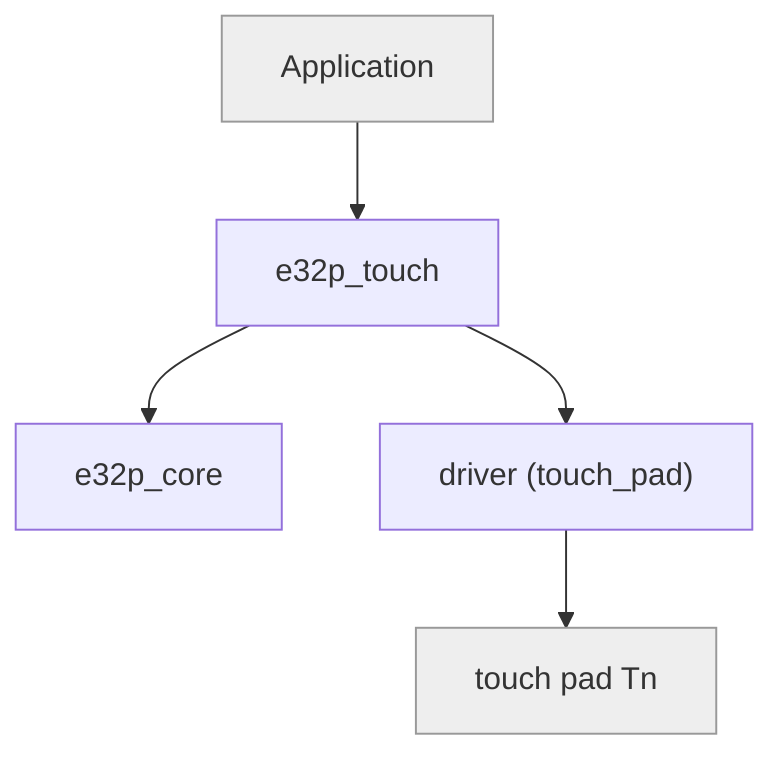
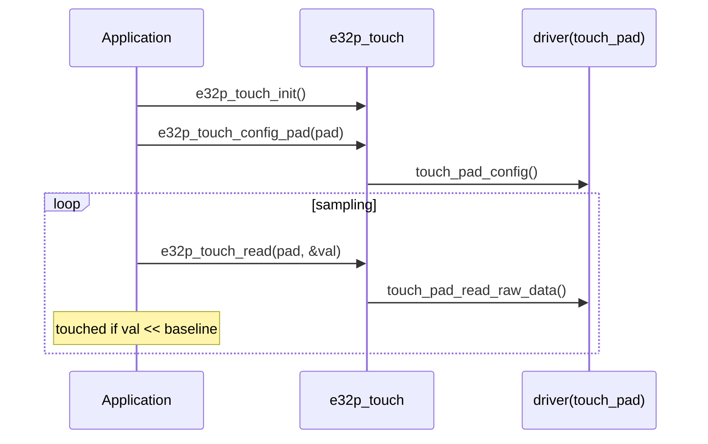

# e32p_touch — Design

> **Capacitive touch pads.** Part of the ESP32 firmware platform (`e32p_`
> modules). Self-contained.

## 1. Overview

`e32p_touch` wraps the ESP32 touch-sensor peripheral: init the subsystem,
configure a pad (channel), read its raw capacitance value. The "is it touched?"
decision is left to the application — on the ESP32 the raw value **drops** when
touched, so compare against an untouched baseline. **Singleton** (one touch
controller); init is idempotent.

| Property | Value |
|----------|-------|
| Registration style | **singleton** (idempotent init) |
| Kconfig symbol | `CONFIG_E32P_TOUCH_ENABLE` |
| Target guard | `depends on SOC_TOUCH_SENSOR_SUPPORTED` |
| Public header | [`include/e32p_touch.h`](include/e32p_touch.h) |

## 2. External dependencies

| Direction | Depends on | Why |
|-----------|-----------|-----|
| Platform | `e32p_core` | error macros, `ESP_ERR_E32P_NOT_INIT` |
| ESP-IDF | `driver` (`PRIV_REQUIRES`) | the touch sensor is one of the peripherals still in the legacy `driver` component |



## 3. Internal architecture

Stateless beyond an init flag. `config_pad` maps a channel `0..9` (T0..T9, each a
fixed GPIO) into the driver and enables it; `read` returns the raw discharge
counter. Channel→GPIO map: T0=GPIO4, T1=GPIO0, T2=GPIO2, T3=GPIO15, T4=GPIO13,
T5=GPIO12, T6=GPIO14, T7=GPIO27, T8=GPIO33, T9=GPIO32.

## 4. Calling sequence



## 5. Error model

- `ESP_ERR_E32P_NOT_INIT` from `config_pad`/`read` before `init`.
- `E32P_CHECK_ARG` → `ESP_ERR_INVALID_ARG` (pad out of 0..9, NULL out).
- Driver errors pass through.

## 6. Cherry-pick

```
CONFIG_E32P_TOUCH_ENABLE=y
```

Requires `e32p_core`; privately requires the legacy `driver` component. Copy
`components/e32p_touch/` and `components/e32p_core/`. ESP32/S2/S3 only
(`SOC_TOUCH_SENSOR_SUPPORTED`).
