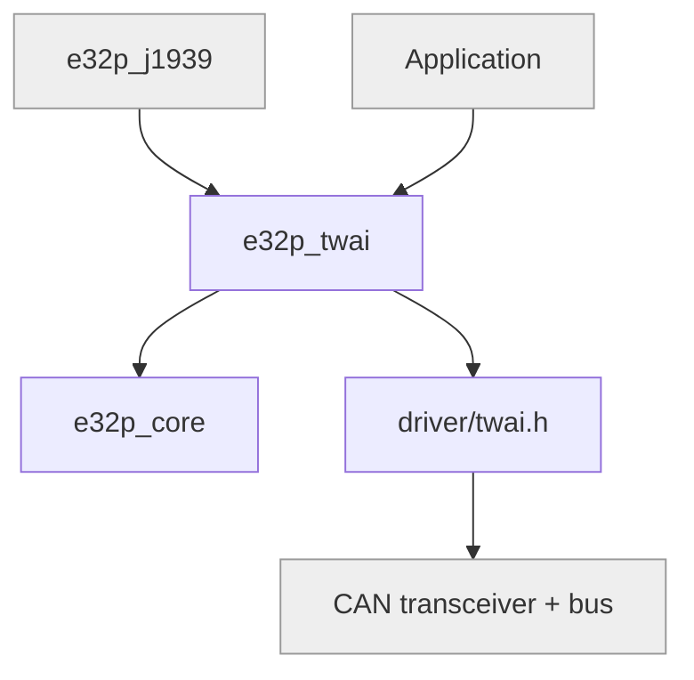
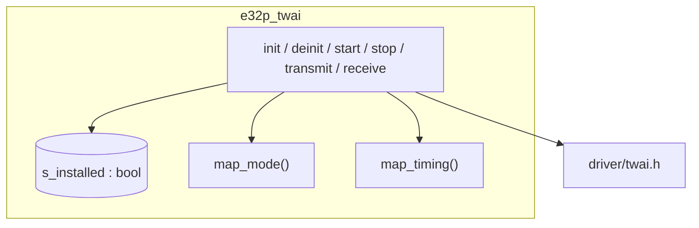
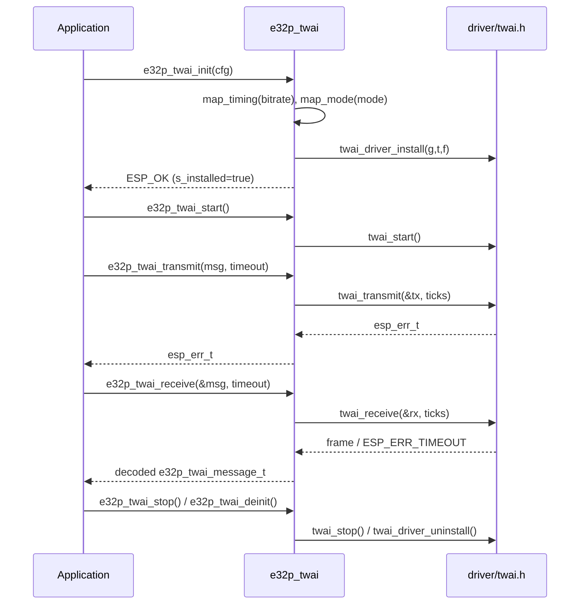
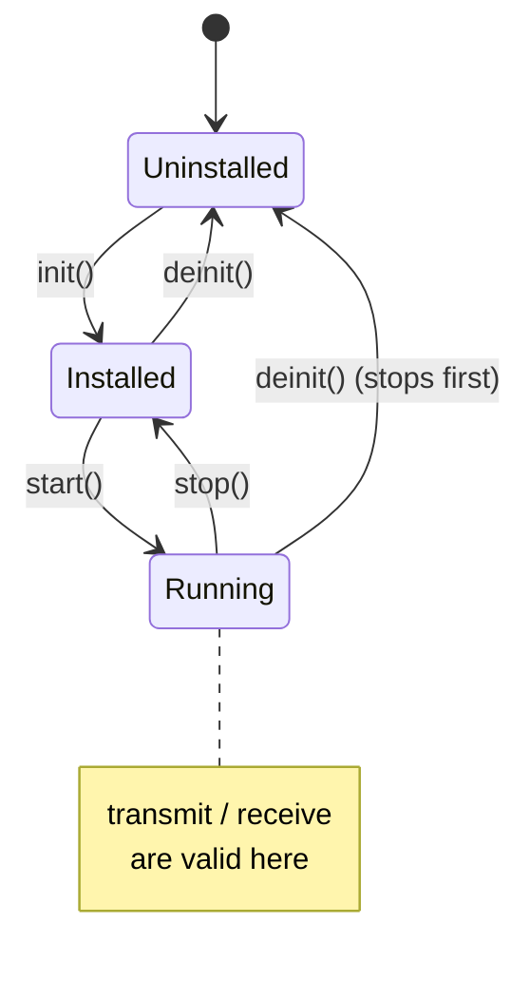

# e32p_twai — Design

> **CAN 2.0 (TWAI) controller facade.** Part of the ESP32 firmware platform
> (`e32p_` modules). Self-contained: describes the module's internals and its
> external connections, so it travels with the module when cherry-picked.

## 1. Overview

`e32p_twai` is a thin facade over the ESP-IDF **TWAI** driver (`driver/twai.h`) —
the ESP32's CAN 2.0 controller. It reduces install / start / transmit / receive /
stop to a small, checked API with a plain message struct. The ESP32 has **one**
TWAI peripheral, so the module is a **singleton**: no handle, a single static
"installed" flag guards the lifecycle.

It is the physical/data-link layer under the J1939 stack ([`e32p_j1939`](../e32p_j1939),
[`e32p_j1939tp`](../e32p_j1939tp)) but is fully usable on its own for raw CAN.

| Property | Value |
|----------|-------|
| Registration style | **singleton** (one CAN controller) |
| Kconfig symbol | `CONFIG_E32P_TWAI_ENABLE` |
| Target guard | `depends on SOC_TWAI_SUPPORTED` |
| Public header | [`include/e32p_twai.h`](include/e32p_twai.h) |

## 2. External dependencies

| Direction | Depends on | Why |
|-----------|-----------|-----|
| Platform | `e32p_core` | `E32P_CHECK_ARG` / `E32P_RETURN_ON_*`, logging, error codes |
| ESP-IDF | `driver` (`PRIV_REQUIRES`) | `driver/twai.h` — TWAI lives in the legacy `driver` component (not split into an `esp_driver_*`) |
| ESP-IDF | `freertos` | `pdMS_TO_TICKS` for timeouts |
| Consumers | `e32p_j1939` | sends/receives 29-bit frames through this facade |



A real bus needs an external transceiver (e.g. SN65HVD230). For a wire-only test,
`NO_ACK` mode plus a `self` frame and a TX→RX jumper gives a local loopback.

## 3. Internal architecture

The module is stateless except for one flag. Two pure helpers translate the
platform's config enums/values into ESP-IDF driver config structs; the API
functions are thin wrappers around the `twai_*` driver calls.



- **`s_installed`** — guards against double-install and use-before-init.
- **`map_mode()`** — `e32p_twai_mode_t` → `twai_mode_t` (NORMAL / NO_ACK /
  LISTEN_ONLY).
- **`map_timing()`** — bitrate → `twai_timing_config_t`, accepting only the four
  standard rates (125/250/500/1000 kbit/s); anything else → `ESP_ERR_INVALID_ARG`.
- The filter is fixed to accept-all (`TWAI_FILTER_CONFIG_ACCEPT_ALL`).

## 4. Key data structures

- **`e32p_twai_config_t`** — `{ tx_gpio, rx_gpio, bitrate_bps, mode }`. Bus
  wiring, speed, and controller mode.
- **`e32p_twai_message_t`** — `{ id, extended, self, len, data[8] }`. `id` is
  11-bit or 29-bit (`extended`); `self` requests self-reception (self-test);
  `len` is 0..8.
- **`e32p_twai_mode_t`** — `NORMAL` (needs transceiver + peers), `NO_ACK`
  (self-test: TX/RX own frames, no ACK required), `LISTEN_ONLY` (never drives
  the bus).

## 5. Calling sequences

**Install → run → transmit / receive → teardown**


`transmit` maps the platform message to a `twai_message_t`, setting the `EXTD`
and `SELF` flags; `receive` does the inverse, clamping the length to 8.

## 6. Lifecycle state



`transmit`/`receive` require `s_installed`; they return `ESP_ERR_E32P_NOT_INIT`
otherwise. (The controller must also be `Running` for frames to move on the bus;
that state is owned by the ESP-IDF driver.)

## 7. Concurrency & context

- Task context only; no ISR entry points.
- The ESP-IDF TWAI driver serialises its own queues, so `transmit`/`receive` are
  safe to call from different tasks. `e32p_twai` adds **no** locks and does not
  guard `s_installed` against concurrent `init`/`deinit` — treat lifecycle calls
  as single-threaded (the normal pattern: init once at startup).
- `transmit`/`receive` block up to their `timeout_ms` (converted to ticks).

## 8. Error model

- `E32P_CHECK_ARG` → `ESP_ERR_INVALID_ARG` for NULL cfg/msg, `len > 8`, negative
  GPIOs, or an unsupported bitrate.
- `ESP_ERR_INVALID_STATE` from `init` if already installed.
- `ESP_ERR_E32P_NOT_INIT` from `start`/`stop`/`transmit`/`receive` before `init`.
- All `twai_*` driver errors pass through unchanged (e.g. `ESP_ERR_TIMEOUT` when
  no frame is available within the timeout, queue-full on transmit).

**Notable behaviour:** in `NO_ACK` self-test mode without a transceiver or a
TX→RX jumper, transmitted frames are not looped back and the controller
retransmits on the resulting bit error, eventually stalling the TX queue — this
is expected, not a fault (see `docs/TEST_PLAN.md`, B-16).

## 9. Cherry-pick

```
CONFIG_E32P_TWAI_ENABLE=y
```

Requires `e32p_core`; privately requires the ESP-IDF `driver` component. Copy
`components/e32p_twai/` and `components/e32p_core/`, enable the symbol. No other
`e32p_` modules needed.
