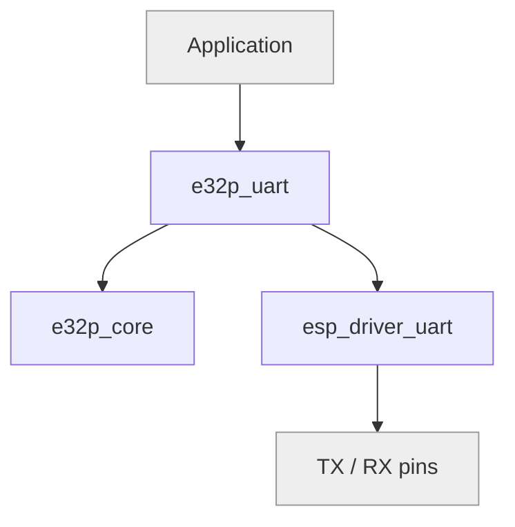
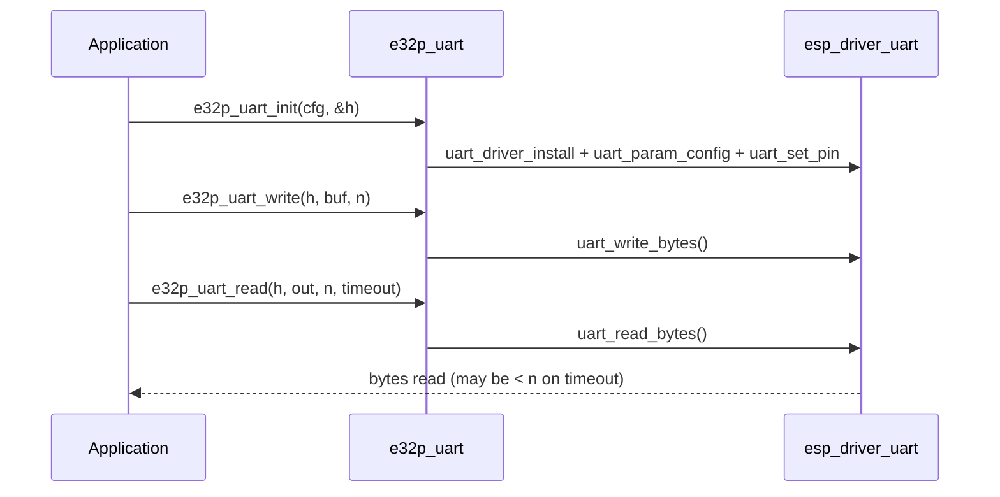

# e32p_uart — Design

> **UART port facade.** Part of the ESP32 firmware platform (`e32p_` modules).
> Self-contained.

## 1. Overview

`e32p_uart` is an opaque-handle facade over `driver/uart.h`: **one handle = one
UART port**. Configure baud/format/pins with a driver RX ring buffer, then
blocking `write`/`read`, plus `available`, `flush_input`, and an internal
**TX→RX loopback** self-test (no external wiring).

| Property | Value |
|----------|-------|
| Registration style | **opaque handle** (per port) |
| Kconfig symbol | `CONFIG_E32P_UART_ENABLE` |
| Target guard | none |
| Public header | [`include/e32p_uart.h`](include/e32p_uart.h) |

## 2. External dependencies

| Direction | Depends on | Why |
|-----------|-----------|-----|
| Platform | `e32p_core` | error macros |
| ESP-IDF | `esp_driver_uart`, `esp_driver_gpio` (`PRIV_REQUIRES`) | UART driver + pin routing |



## 3. Internal architecture

Each handle stores the port number; the driver owns the RX ring buffer. `init`
installs the driver, applies the line format, and sets the pins. Port 0 is the
console and is not used here (ports 1/2).

## 4. Key data structures

- **`e32p_uart_config_t`** — `{ port, tx_pin, rx_pin, baud_rate, data_bits,
  parity, stop_bits, rx_buffer_size }`, with `E32P_UART_CONFIG_DEFAULT()`
  (115200 8N1, 256-byte RX).

## 5. Calling sequence



## 6. Concurrency & context

- Task context, per-handle. `write` blocks until queued to the TX FIFO; `read`
  blocks up to `timeout_ms`.

## 7. Error model

- `init`/`config` calls: `ESP_ERR_INVALID_ARG` for a NULL cfg or an out-of-range
  port; `ESP_ERR_NO_MEM` / driver errors otherwise.
- `write`/`read` return the byte count, or **-1** on error (not an `esp_err_t`).

## 8. Cherry-pick

```
CONFIG_E32P_UART_ENABLE=y
```

Requires `e32p_core`; privately requires `esp_driver_uart` + `esp_driver_gpio`.
Copy `components/e32p_uart/` and `components/e32p_core/`.
