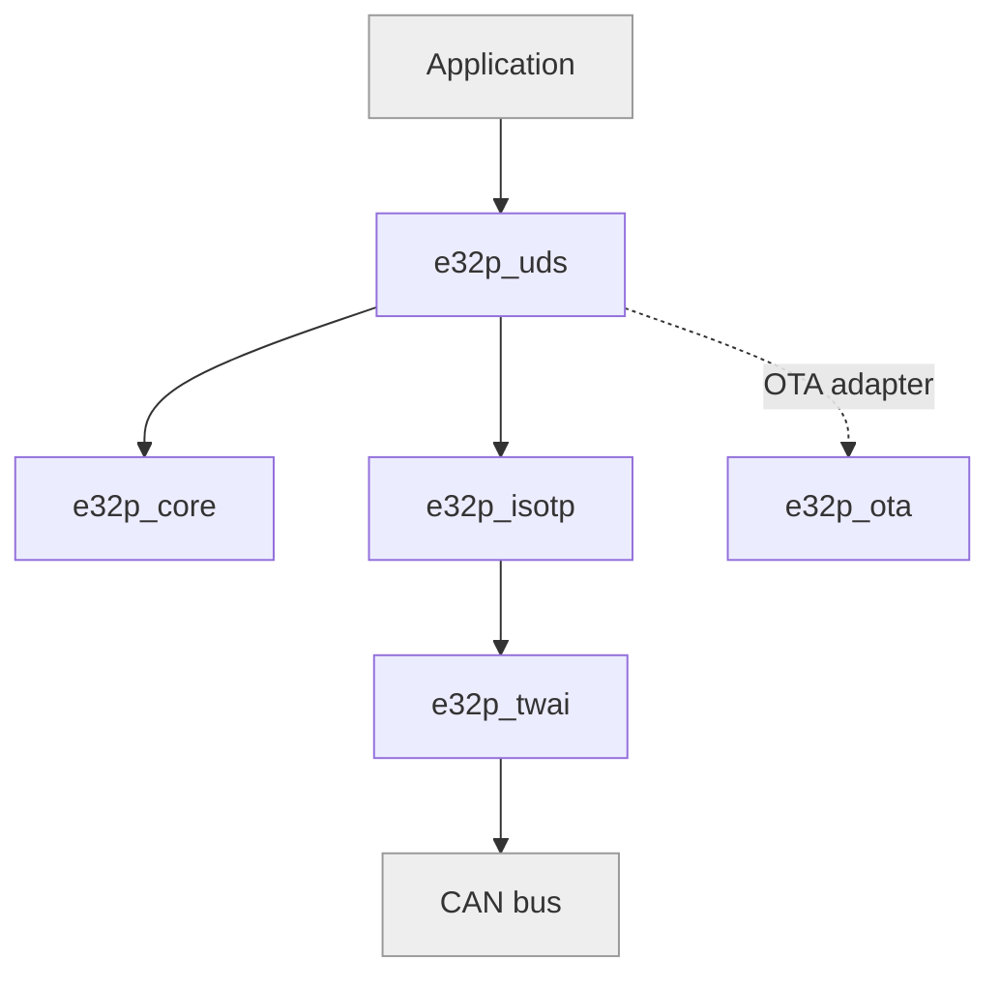
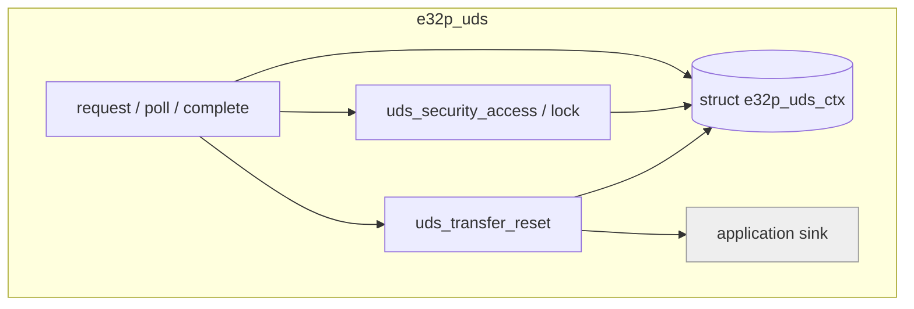
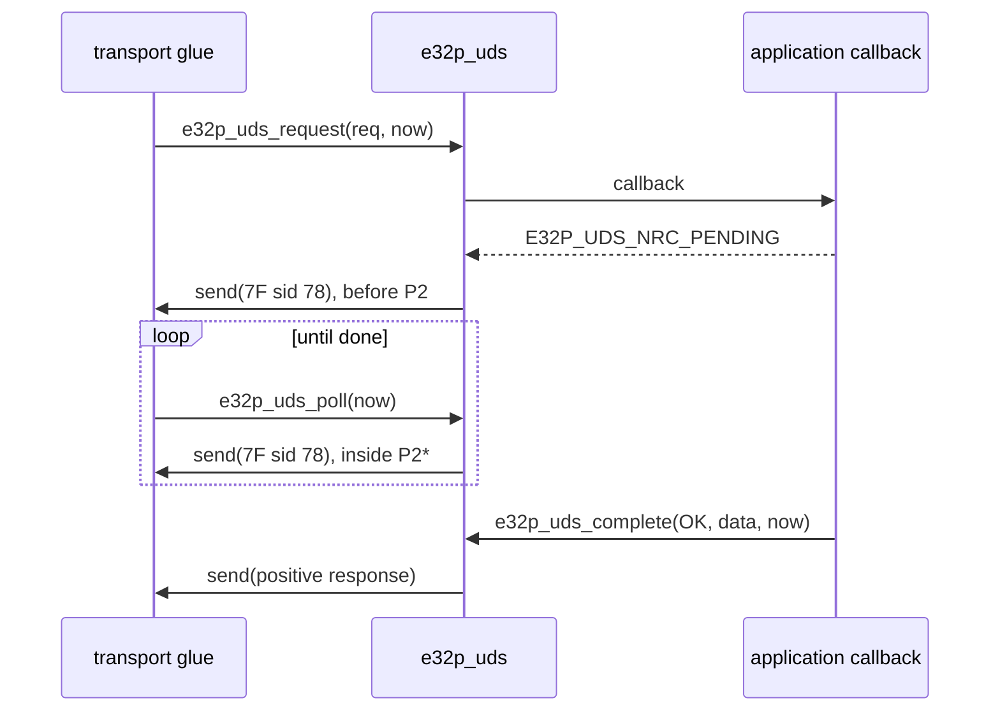
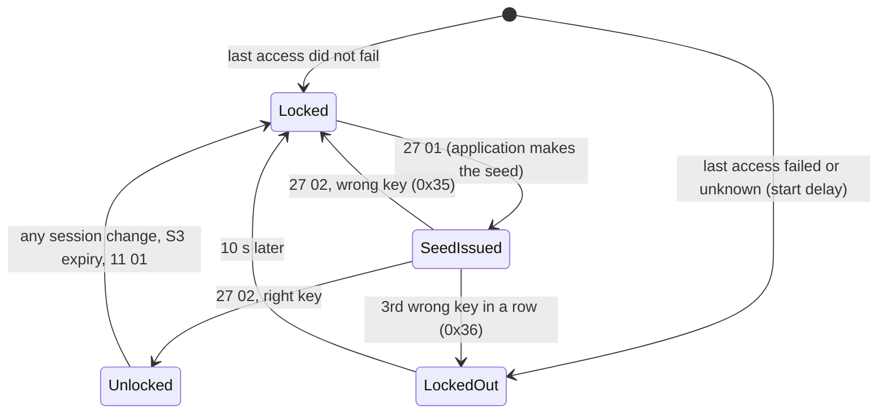
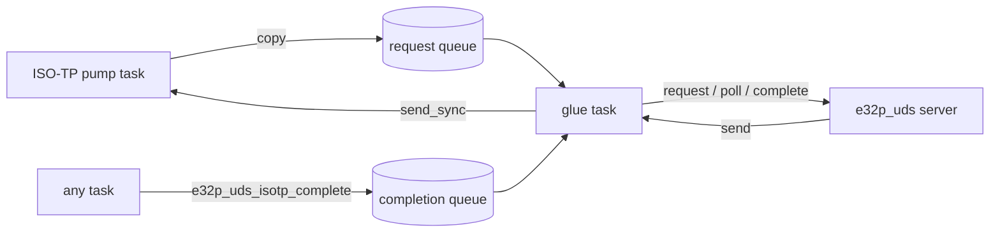

# e32p_uds — Design

> **An ISO 14229-1 UDS server with injected time.** Part of the ESP32 firmware platform
> (`e32p_` modules). This document describes the module's internals and external
> connections and is self-contained: it travels with the module when cherry-picked.
>
> **Status: Phase 3 done (2026-10-07).** Sections describe the code as it stands.

## 1. Overview

A UDS server: it takes reassembled diagnostic requests and answers them as an ECU
would. It sits above the ISO-TP transport and below the application, and owns no task,
timer or bus — requests, time and outgoing messages all pass through the API, so the
whole protocol, timing included, runs on the Unity runner with a virtual clock.

| Property | Value |
|----------|-------|
| Registration style | opaque-handle (one `struct e32p_uds_ctx` per server) |
| Kconfig symbol | `CONFIG_E32P_UDS_ENABLE` |
| Target guard | `SOC_TWAI_SUPPORTED` (inherited from the CAN stack) |
| Public header | [`include/e32p_uds.h`](include/e32p_uds.h) |

## 2. External dependencies

| Direction | Depends on | Why |
|-----------|-----------|-----|
| Platform | `e32p_core` | error macros in the public header |
| Platform | `e32p_isotp` (private) | the bus glue |
| Platform | `e32p_ota` (private) | the reflash adapter, built with `CONFIG_E32P_OTA_ENABLE` |
| Kconfig `select` | `E32P_ISOTP_ENABLE` | the server is useless without a transport |



## 3. Internal architecture

Five source files share one context struct through `src/e32p_uds_priv.h`:
`e32p_uds_dtc.c` owns `0x19` / `0x14` and `e32p_uds_routine.c` owns `0x31`, besides the
three below.
`e32p_uds.c` owns dispatch, sessions and timing; `e32p_uds_security.c` owns `0x27`; `e32p_uds_transfer.c` owns the download services and the sink (slice 3.4).

Dispatch is table-driven. `k_services[]` gives each service its sessions, whether it
needs security, its sub-functions (each with its own sessions and security), a
`configured` predicate — a service whose callbacks were not supplied is "not
supported" — and its handler. `preconditions()` walks the ISO 14229-1 check order
against that table before any handler runs, so handlers only do what is specific to
their service.



## 4. Key data structures

`struct e32p_uds_ctx` holds a copy of the config, the active session, the time of the
last request (the S3 timeout runs from it, slice 3.1), the security state (unlocked,
seed issued, failed attempts, delay end — slice 3.2), the transfer state (active, bytes
expected and received, next block counter — slice 3.4) and a 256-byte response buffer.

The DTC provider is a pure enumerator — `count()` and `at(index)` — and the matching rule
lives in `e32p_uds_dtc.c`: a code matches when its status AND the request mask AND the
availability mask is non-zero, and its reported status is masked with the availability
mask. Keeping the rule in the server means one tested implementation, and lets `19 0A`
list codes whose status is 0.

## 5. Calling sequences

The contract every later slice keeps: a request may be answered at once, or — when a
callback returns `E32P_UDS_NRC_PENDING` — first with `0x78` and later with the real
answer.



Slice 3.0 implements only the first step: every request is answered "service not
supported", physically, or with silence when it was a broadcast.

## 6. State machine

```mermaid
stateDiagram-v2
    [*] --> Default
    Default --> Extended: 10 03
    Default --> Programming: 10 02
    Extended --> Programming: 10 02
    Programming --> Extended: 10 03
    Extended --> Default: 10 01, S3 expiry, or 11 01
    Programming --> Default: 10 01, S3 expiry, or 11 01
```

Every transition — including into the session the server is already in — locks
security and abandons any transfer. S3 (5 s by default) runs only outside the default
session; any request restarts it, and it is checked both in `poll()` and at the start
of every request, so a request that arrives after the timeout is answered in the
default session even if `poll()` was late. `0x11` sends its response first, then
returns the server to the default session, then calls the reset callback — the state a
reset leaves the ECU in, whether or not the callback reboots.

### Security access (0x27)



A seed answers exactly one key. While locked out, seed requests answer `0x37`. The
wrong-key count and the lockout are kept across session changes — only the unlock and
any outstanding seed are dropped — so switching sessions cannot reset a brute-force
attempt. The lockout ends lazily: it is checked against the request's time, so no
`poll()` is needed for it.

**The delay after a start.** A reset or power cycle must not wipe out
a lockout. The draft standard says: if the server cannot tell whether the last access
failed, the delay runs after start-up; if it can tell, and the last access failed, the
delay runs too. The server keeps its state in RAM, so the application helps with two
optional hooks in `e32p_uds_config_t`, in the style of `on_seed` and `on_key`:

| Hook | Contract |
|------|----------|
| `bool on_sec_load(void *user)` | Called once, from `e32p_uds_init()`. Returns the saved "last access failed" flag. Return `true` if the flag is unreadable. A *missing* flag may be reported as `false` only when "missing" can only mean that no access has failed since the device's storage was initialised: that holds when wiping the storage also removes the secret the keys come from. If a wipe could leave the secret in place, return `true` for a missing flag too. An integration without hooks runs the delay after every start. The HIL companion does **not** meet the rule: its secret is a public, compiled-in test fixture that is rewritten at every boot, so a missing flag only follows a fresh NVS. That is an accepted exception for a test fixture. |
| `bool on_sec_store(bool failed, void *user)` | Called in the request, when the value changes or the saved value is unknown: `true` after a wrong key, `false` after a right key. Returns `true` if the value was saved. A failed save makes the saved value unknown (the write may have landed anyway), so the next outcome saves again. The flag is lost if a reset comes before a later save succeeds; this design accepts that (a design that saves before judging the key would close it). Keep it short (one NVS write). |

Both hooks are set, or neither: `e32p_uds_init()` refuses a config with only one of them
(`ESP_ERR_INVALID_ARG`).

At start the delay is armed when there is no `on_sec_load`, or when it returns `true`.
Only a `false` from `on_sec_load` is trusted as the stored value: a `true` may mean the
flag could not be read, so the server treats the stored value as unknown and the first
wrong key saves `true` again.
While the delay runs, a seed request answers `0x37`, just like the lockout. The delay is
`E32P_UDS_SECURITY_DELAY_MS` (10 s) and begins at the first time value the server is
given — the clock restarts at every boot, so a saved time would mean nothing. This
assumes that `on_reset` really reboots: a reset callback that returns without
rebooting leaves the server running, and the delay is not armed again. The
wrong-key count stays in RAM; only the one-bit flag is saved. With no hooks the server
behaves safely but pays 10 s after every start. Example: the HIL companion saves the
flag in NVS (`hil_uds` / `sec_fail`).

The delay can be kept running from the bus. When `on_reset` is set, `0x11` ECUReset needs
no security, so a bus node can force a reset more often than every 10 s and the delay
never ends. Without `on_reset` the server does not offer `0x11`. With
hooks it first needs one wrong key to set the flag; without hooks it needs none. This
costs availability only, and the delay ends 10 s after the node stops.

**Busy and unknown services.** While a request is pending, a service this
server does not offer still answers `0x11` (and stays silent on a functional request), as
it does when idle. Only a service it does offer gets `0x21` (busy).

### Finishing later, and committing state

A handler builds its positive-response echo, names a *finish* step, and calls the
application. The engine runs the finish step with the outcome — immediately, or at
`e32p_uds_complete()` when the callback answered PENDING — and only then sends the
answer. Every state change a request makes (block counter, byte count, download
state) lives in a finish step, so a failure, early or late, never half-applies.

While pending: `0x78` at once and every 80 % of `P2*`; `0x21` to any other supported
service except a silent `3E 80` (an unsupported service stays `0x11`); S3 held; `0x10` at the pending cap. The final answer is sent
even under suppressPosRsp.

### Download

```mermaid
stateDiagram-v2
    [*] --> Idle
    Idle --> Starting: 34, sink begin() called
    Starting --> Active: begin OK
    Starting --> Idle: begin refused
    Active --> Active: 36, counter n (n+1 next; a repeat of n is re-acknowledged)
    Active --> Idle: 37, end() OK
    Active --> Idle: 37 rejected, session change, S3, reset - sink aborted
    Starting --> Idle: pending cap - sink aborted
```

### On the bus



The glue task is the server's only caller, so the server needs no lock. It wakes on a
request or every poll period (5 ms), drains completions, and polls. Answers go out with
`send_sync`, the one send the ISO-TP link allows outside its pump task; it returns once
the transfer is done, so the reset callback always runs after its `51 01` has left the
transport. The OTA adapter's erase and validation run in short-lived workers that
report through the completion queue.

The physical channel's Flow Control asks for STmin `rx_stmin_ms`, 0 unless set, with the
engine's block size of 8. Measured in slice 3.8: at a 1 ms STmin a tester sent one frame
every ~1.75 ms and a 290 KB reflash took 77 s; with no gap it took 9.8 s, and example 33
on an ESP32 took 8-frame bursts at 1 Mbit without a bus error. Block size 8 still bounds
each burst, well inside the 32-deep TWAI receive queue the examples configure.

## 7. Concurrency & context

None inside the server. It is not thread-safe: the caller must serialise `request`,
`poll` and `complete` on one handle — the bus glue does that by running all three from
its one task, and offers `e32p_uds_isotp_complete()` for other tasks. Callbacks run in the caller's context and must not call back into the
server.

## 8. Error model

API functions return `esp_err_t`: `ESP_ERR_INVALID_ARG` for bad arguments,
`ESP_ERR_NO_MEM` from `init`, `ESP_ERR_INVALID_STATE` from `complete` when nothing is
pending. Protocol errors are not API errors — a negative response is still a
response, and the call returns `ESP_OK`. Callbacks report through `e32p_uds_nrc_t`.

## 9. Cherry-pick

Copy `components/e32p_uds` with `e32p_core` (and `e32p_isotp` once the glue lands).
Enable `CONFIG_E32P_UDS_ENABLE`. With the symbol off the component compiles to nothing.

## Appendix A. Deviations from ISO 14229-1

Known places where this server differs from the standard, or where the local copy of
the text cannot settle it. The local text is the 2004 draft (ISO/DIS 14229-1); the 2013
edition is not at hand. Decision: keep all of them, and write them down here.
Status for rows (a) to (h) and (j): **kept on purpose**. Row (i): **an open question for the
owner**.

| | What the server does | Draft clause | Note |
|---|----------------------|--------------|------|
| (a) | `10 03` is accepted in the programming session | 8.2.2.2 Table 26 (programming session is left only by `11`, `10 01` or S3) | Not checked against the 2013 text. Of all the rows, this is the clearest conflict with a draft "shall". The owner keeps it. |
| (b) | `34` with a size larger than the sink answers `0x70` | 13.2.4 Table 363 (`0x31`, memorySize not valid) | **Likely to change** once the 2013 text is available. |
| (c) | `37` before all bytes arrived answers `0x24` | 13.5.4 Table 378 (`0x22`, programming process not completed) | **Likely to change** once the 2013 text is available. |
| (d) | `36` with more bytes than announced answers `0x71`, transfer kept | Annex A.1, `0x71` (halted due to some fault); 13.4.4 Table 373 | The transfer stays active after the answer. |
| (e) | `0x14` response too long, checked against the 256-byte response buffer | Annex A.1 (`0x14` is reserved in the draft) | Not the transport limit. Reachable in example 33 with `22 F190` repeated 14 times. |
| (f) | A broadcast `0x7E` / `0x7F` answer is also suppressed | 6.5.4 lists only `0x11`, `0x12`, `0x31` | The draft does not mention these two. |
| (g) | `10` answer carries P2 in ms and P2* in 10 ms units | 8.2.3 (sessionParameterRecord is data-link dependent) | `udsoncan` accepts it. |
| (h) | `31 02` (stop routine) is not offered | 12.2 (optional sub-function); 12.2.2.2 Table 347 | Optional in the standard. No action. |
| (i) | While a request is pending, a functional request for a supported service whose checks would give `0x12` or `0x31` gets `0x21` instead of silence | Table 5 cases 4 and 8 (`0x12`), Table 7 case 4 (`0x31`), 6.5.4 | Pre-existing. The busy path also answers `0x21` where row (f) would be silent (`0x7E` / `0x7F`). Pinned by a Unity case (`10 04`, functional). Status: documented, an open question for the owner. Not checked against the 2013 text (draft text only). |
| (j) | `37` answers `0x72` (after `0x78`) when the image fails its final check (damaged, unsigned, or signed with another key). The download ends, the old image keeps booting, and `31 01 FF01` then reports `01` | 13.5.4 Table 378 (lists only `0x13`, `0x22`, `0x24`); Annex A.1 (`0x72` is an erase or program error) | No listed code fits, and `0x22` is the draft's code for "not all bytes yet" (row (c)). Status: kept. Not checked against the 2013 text. The NRC does not say which check failed. |

Also noted, not changed: `27 02` during a lockout or the start delay answers `0x24` (no
seed was issued), not `0x37`; `19 0A` in example 33 lists stored codes only; `0x10` changes the session
before its answer is sent.
