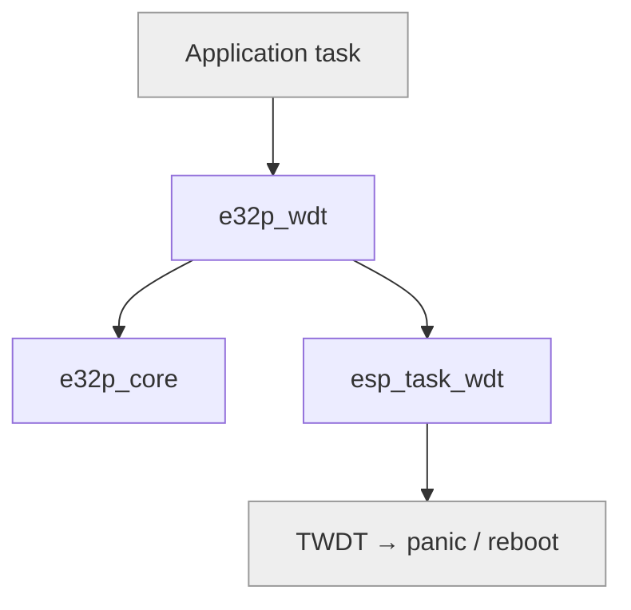
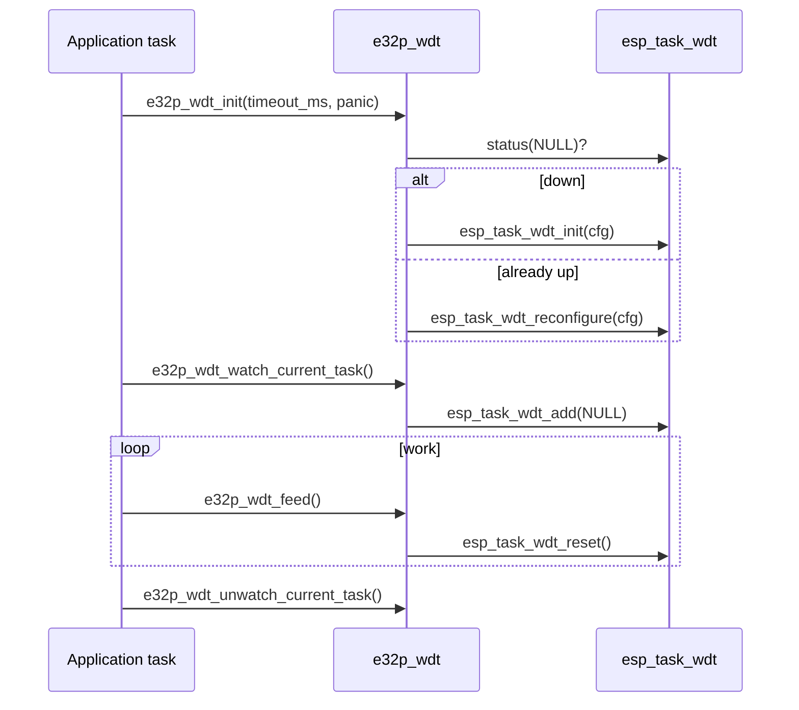

# e32p_wdt — Design

> **Task Watchdog Timer (TWDT) facade.** Part of the ESP32 firmware platform
> (`e32p_` modules). Self-contained.

## 1. Overview

`e32p_wdt` wraps the ESP-IDF **Task Watchdog Timer**: configure the timeout and
panic policy, then subscribe/unsubscribe the calling task and feed it. Init is
**idempotent** — if the system already started the TWDT (via
`CONFIG_ESP_TASK_WDT_INIT`), it *reconfigures* instead of erroring. Singleton
(one system TWDT).

| Property | Value |
|----------|-------|
| Registration style | **singleton** (one system TWDT) |
| Kconfig symbol | `CONFIG_E32P_WDT_ENABLE` |
| Target guard | none |
| Public header | [`include/e32p_wdt.h`](include/e32p_wdt.h) |

## 2. External dependencies

| Direction | Depends on | Why |
|-----------|-----------|-----|
| Platform | `e32p_core` | error macros, logging |
| ESP-IDF | `esp_system` (`esp_task_wdt.h`) | the Task WDT |



## 3. Internal architecture

Stateless wrapper. The only subtlety is init: rather than calling
`esp_task_wdt_init()` and catching its self-logged error when the TWDT is already
up, it **probes state first** — `esp_task_wdt_status(NULL) == ESP_ERR_INVALID_STATE`
means "down" → `init`; otherwise → `reconfigure`. `idle_core_mask = 0` so only
explicitly subscribed tasks are watched.

## 4. Calling sequence



## 5. Concurrency & context

- `watch` / `feed` / `unwatch` act on the **calling task** (`NULL` = current).
  Call them from the task being guarded.
- Missing a `feed` before `timeout_ms` triggers a warning, or a panic + reboot if
  `panic_on_timeout` was set.

## 6. Error model

- Driver errors pass through via `E32P_RETURN_ON_ERR`.
- `deinit` treats `ESP_ERR_INVALID_STATE` (not initialized) as success; it fails
  if tasks are still subscribed — unwatch them first.

## 7. Cherry-pick

```
CONFIG_E32P_WDT_ENABLE=y
```

Requires `e32p_core`. Copy `components/e32p_wdt/` and `components/e32p_core/`.
