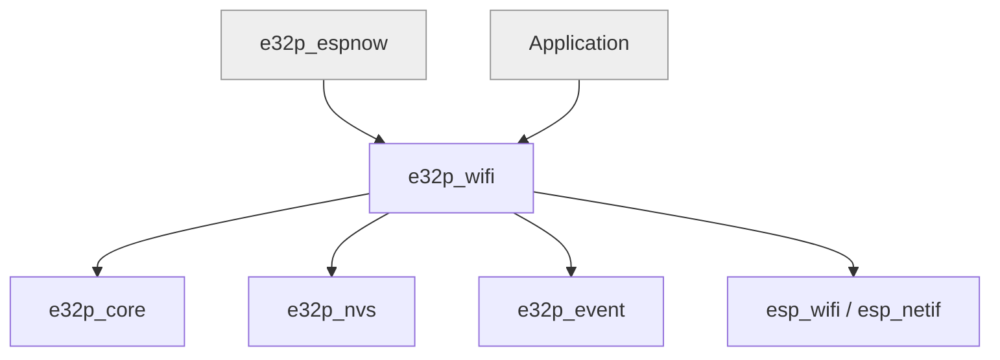
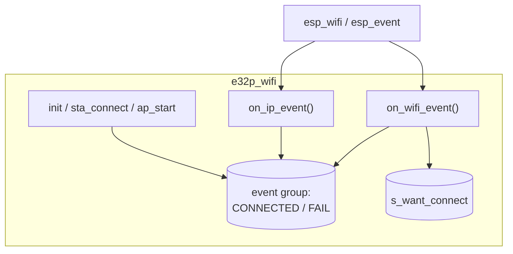
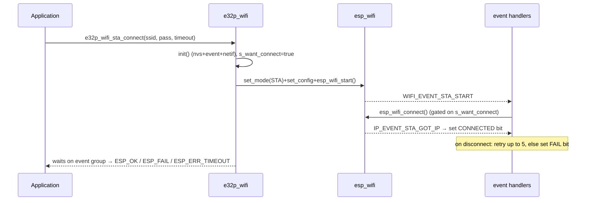
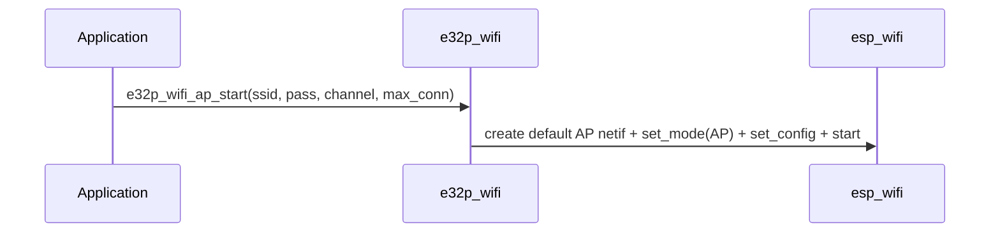
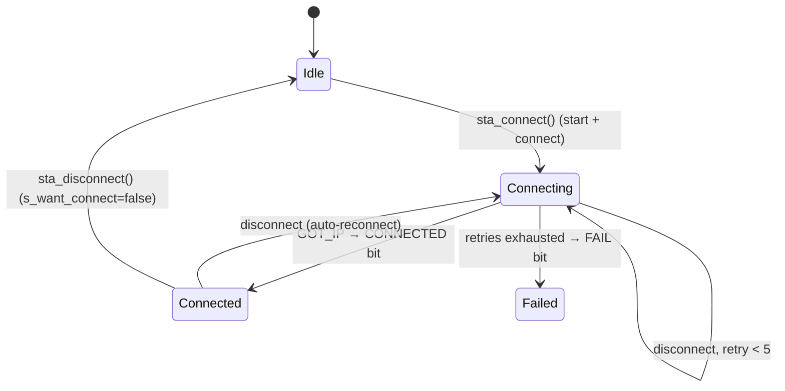

# e32p_wifi — Design

> **Wi-Fi Station + SoftAP facade.** Part of the ESP32 firmware platform
> (`e32p_` modules). Self-contained.

## 1. Overview

`e32p_wifi` brings up Station or SoftAP mode in a few calls, hiding the netif +
default-event-loop + NVS + driver plumbing and the event-driven connection
handshake. The public API is free of `esp_wifi` types. **Singleton**; `init`
is idempotent and pulls up its own dependencies (`e32p_nvs`, `e32p_event`).

| Property | Value |
|----------|-------|
| Registration style | **singleton** (one Wi-Fi stack) |
| Kconfig symbol | `CONFIG_E32P_WIFI_ENABLE` (`select E32P_NVS_ENABLE`, `E32P_EVENT_ENABLE`) |
| Target guard | none |
| Public header | [`include/e32p_wifi.h`](include/e32p_wifi.h) |

## 2. External dependencies

| Direction | Depends on | Why |
|-----------|-----------|-----|
| Platform | `e32p_core` | error macros, logging |
| Platform | `e32p_nvs` (`PRIV_REQUIRES`, `select`) | Wi-Fi stores calibration/config in NVS |
| Platform | `e32p_event` (`PRIV_REQUIRES`, `select`) | default loop for WIFI/IP events |
| ESP-IDF | `esp_wifi`, `esp_netif` (`PRIV_REQUIRES`) | the Wi-Fi driver + network interface |
| Consumers | `e32p_espnow` | `select`s Wi-Fi to bring the radio up |



## 3. Internal architecture

Static state: an init flag, a FreeRTOS **event group** (CONNECTED/FAIL bits), the
STA and AP netif pointers, a retry counter, a connected flag + cached IP string,
and a **`s_want_connect`** gate. Two event handlers drive the STA connection:



The **`s_want_connect` gate** is the key subtlety: `WIFI_EVENT_STA_START`
auto-associates only when `sta_connect` asked for it. This lets `e32p_espnow`
start the radio (STA mode) *without* the handler trying to join a stored AP.

## 4. Calling sequences

**Station connect (blocking on the event group)**


**SoftAP**


## 5. State (STA connection)



## 6. Concurrency & context

- Event handlers run on the **esp_event task**; they set event-group bits and a
  `volatile s_connected` flag.
- `sta_connect` blocks the caller on the event group up to `timeout_ms`.
- Singleton state is not lock-guarded — drive Wi-Fi from one control path.

## 7. Error model

- `E32P_CHECK_ARG` → `ESP_ERR_INVALID_ARG` (NULL SSID; AP channel 1–13; max_conn
  1–10; IP buffer < 16).
- `sta_connect` → `ESP_OK` (got IP), `ESP_FAIL` (auth/no-AP after 5 retries), or
  `ESP_ERR_TIMEOUT`.
- `get_ip`/`get_rssi` → `ESP_ERR_INVALID_STATE` when not connected.

## 8. Cherry-pick

```
CONFIG_E32P_WIFI_ENABLE=y   # selects E32P_NVS_ENABLE + E32P_EVENT_ENABLE
```

Requires `e32p_core`; privately requires `e32p_nvs`, `e32p_event`, `esp_wifi`,
`esp_netif`. Copy `components/e32p_wifi/`, `e32p_nvs/`, `e32p_event/`,
`e32p_core/`. No Wi-Fi credentials are hardcoded — pass them at runtime (e.g. from
menuconfig/NVS).
