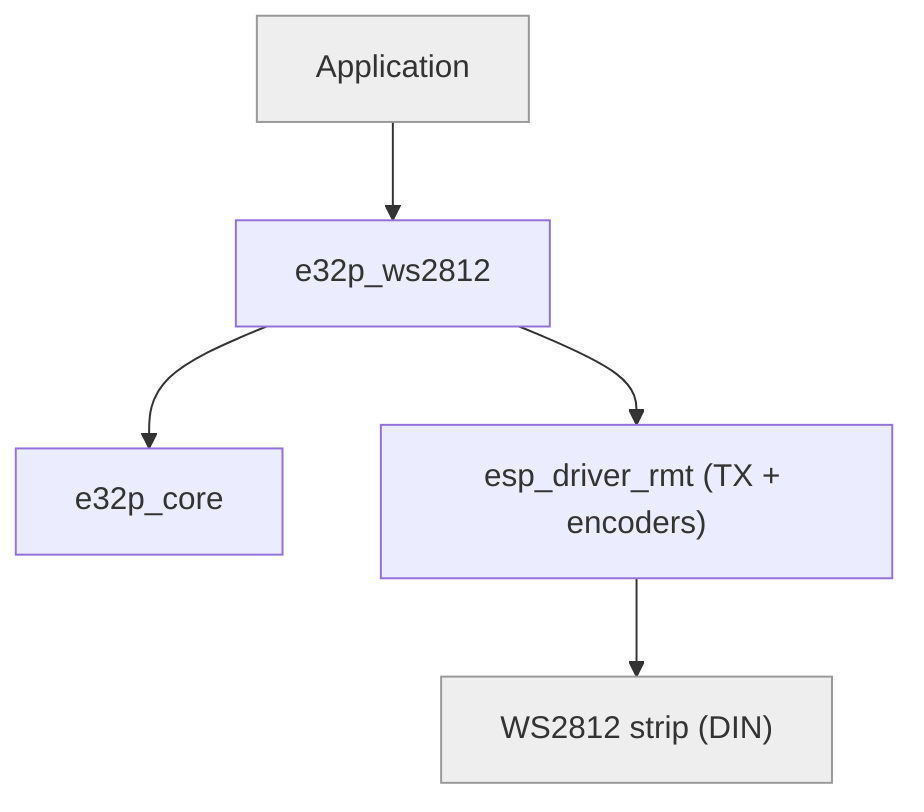
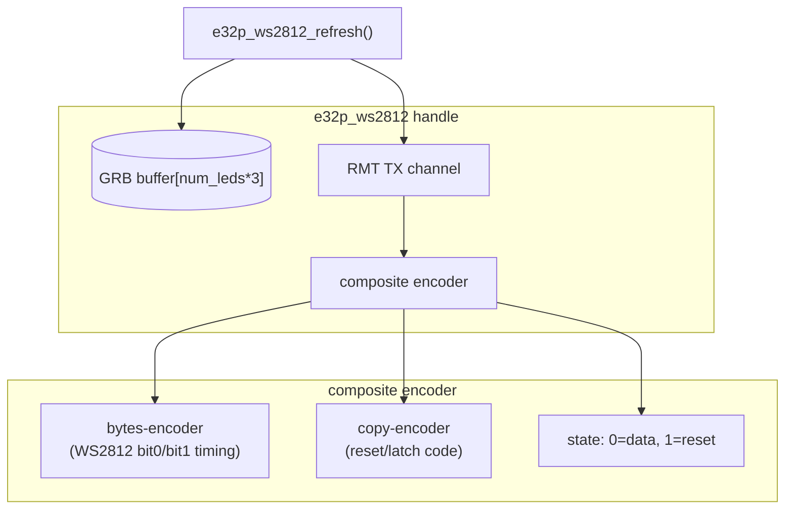
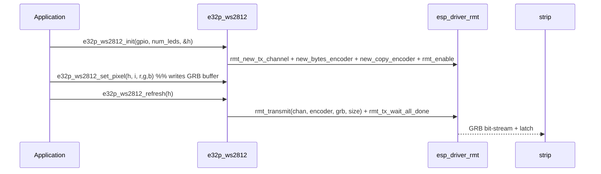

# e32p_ws2812 — Design

> **WS2812 / NeoPixel driver over RMT.** Part of the ESP32 firmware platform
> (`e32p_` modules). Self-contained.

## 1. Overview

`e32p_ws2812` drives WS2812/NeoPixel addressable-LED strips using the **RMT**
peripheral. You stage pixel colors in an internal buffer, then `refresh()` clocks
the whole strip out in one RMT transaction (a bytes-encoded GRB stream followed
by the WS2812 reset/latch pulse). Opaque handle — one per strip.

The RMT peripheral generates the precise ~1.25 µs/bit WS2812 line code in
hardware, so the CPU is free during transmission.

| Property | Value |
|----------|-------|
| Registration style | **opaque handle** (per strip) |
| Kconfig symbol | `CONFIG_E32P_WS2812_ENABLE` |
| Target guard | `depends on SOC_RMT_SUPPORTED` |
| Public header | [`include/e32p_ws2812.h`](include/e32p_ws2812.h) |

## 2. External dependencies

| Direction | Depends on | Why |
|-----------|-----------|-----|
| Platform | `e32p_core` | error macros, logging |
| ESP-IDF | `esp_driver_rmt` (`PRIV_REQUIRES`) | RMT TX channel + encoder API |



## 3. Internal architecture

Each handle owns an RMT TX channel, a **composite encoder**, and a `num_leds*3`
GRB byte buffer. The encoder (embedded static helper, modeled on the ESP-IDF
`rmt/led_strip` example) is itself two encoders plus a small state machine:



- Bit timing at 10 MHz resolution: bit0 = 0.3 µs high / 0.9 µs low, bit1 = 0.9 µs
  high / 0.3 µs low; reset ≥ 50 µs low.
- The encoder emits the GRB data (state 0), then the reset code (state 1), then
  reports complete — one atomic frame per `refresh`.

## 4. Key data structures

- **`e32p_ws2812_handle_t`** — opaque; RMT channel + encoder + GRB buffer +
  `num_leds`.

## 5. Calling sequences

**Init + refresh**


`set_pixel`/`clear` touch only RAM; the strip changes only on `refresh`, which
also waits for the latch — so a frame is atomic.

## 6. Concurrency & context

- Task context, per-handle. `refresh` blocks until the RMT transaction completes
  (`rmt_tx_wait_all_done` with an infinite wait).
- Works on a bare board: `init`/`refresh` succeed with nothing attached — the RMT
  engine still clocks the frame out (useful to prove the path before wiring LEDs).

## 7. Error model

- `E32P_CHECK_ARG` → `ESP_ERR_INVALID_ARG` (`num_leds < 1`, `gpio < 0`,
  out-of-range pixel index, NULL handle).
- `ESP_ERR_NO_MEM` if the context/buffer or an encoder cannot be allocated (the
  `init` cleanup ladder frees whatever was created).
- RMT driver errors from `refresh` pass through.

## 8. Cherry-pick

```
CONFIG_E32P_WS2812_ENABLE=y
```

Requires `e32p_core`; privately requires `esp_driver_rmt`. Copy
`components/e32p_ws2812/` and `components/e32p_core/`. Wire DIN→data GPIO, +5 V,
common GND (a level shifter on DIN is the robust choice for long runs).
