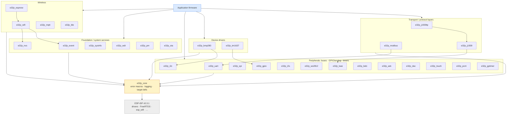
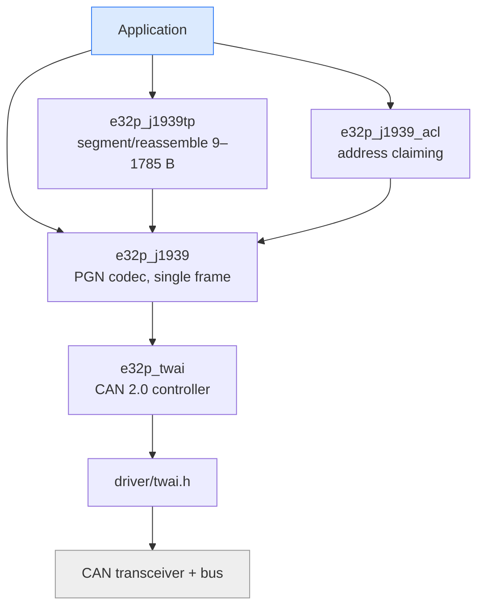
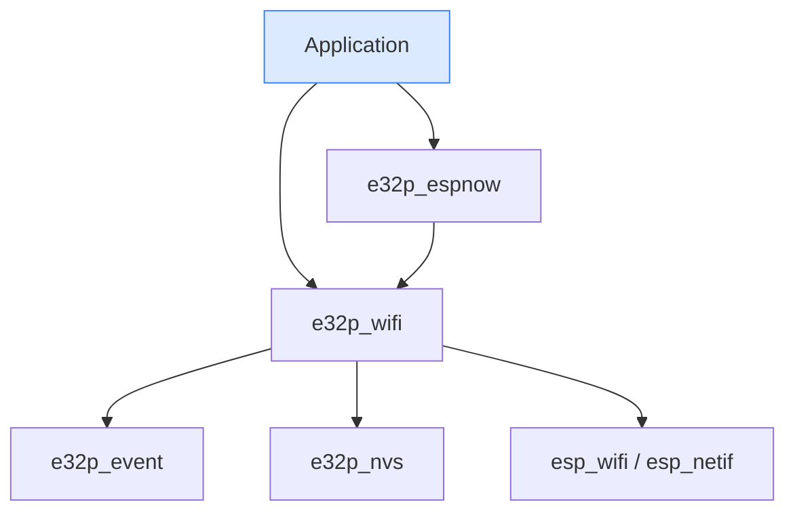
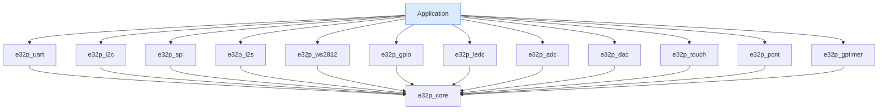
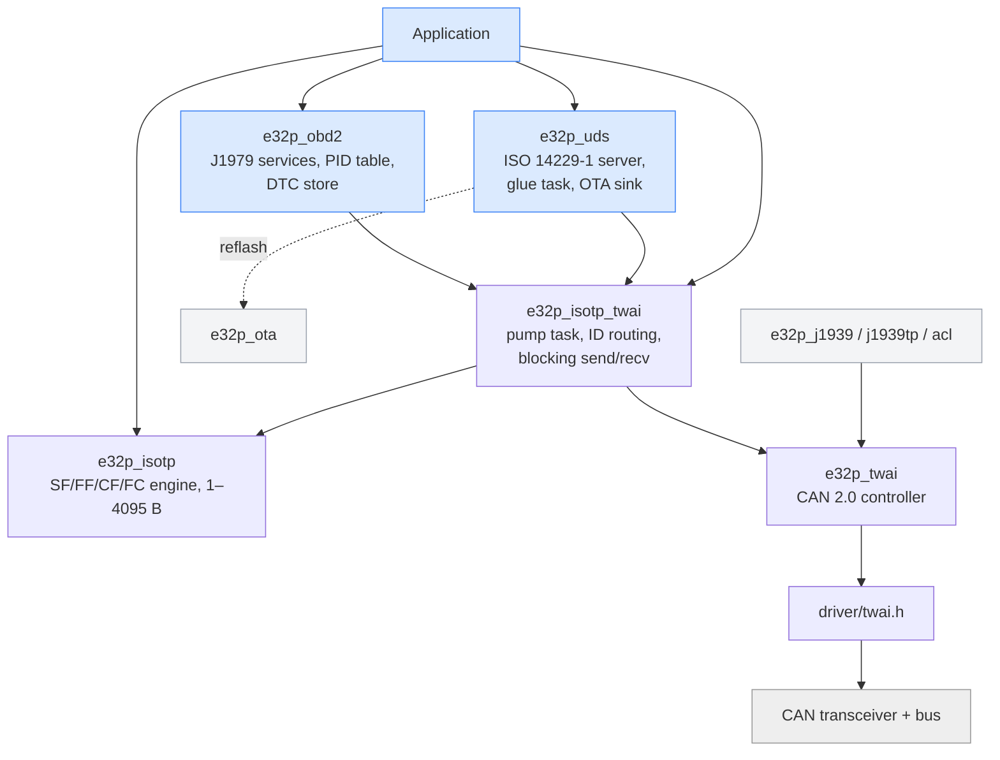
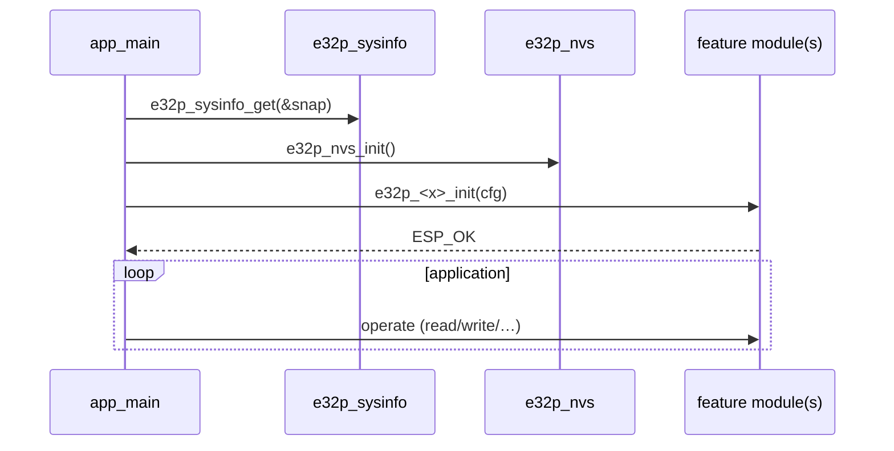
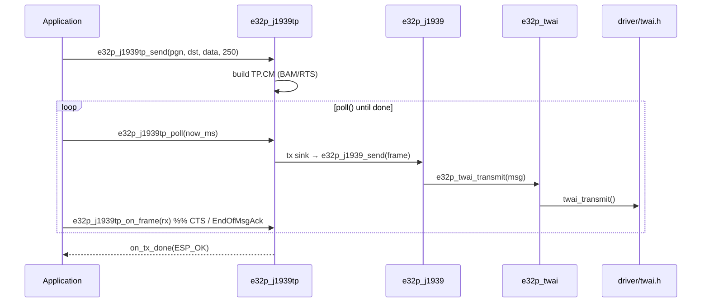
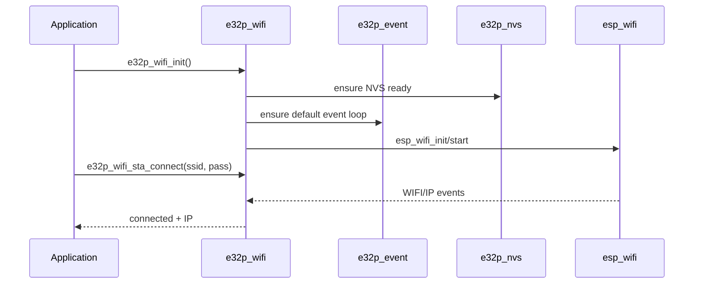

# ESP32 Platform — Architecture

A modular ESP32 (ESP-IDF v5.3.1) firmware platform. Each hardware capability and
protocol is a **thin, independently cherry-pickable component** named `e32p_*`,
so a project pulls in only what it needs and builds application code on top.

This document is the whole-system view: the layering, the conventions that make
the modules composable, per-feature connection maps, and cross-module calling
sequences. Each module additionally has its own `DESIGN.md` (internals) and
`README.md` (API reference).

---

## 1. Design goals

| Goal | How it is achieved |
|------|--------------------|
| **Modular / granular** | one `e32p_*` component per capability; no god-modules |
| **Cherry-pickable** | each component compiles in only when its `CONFIG_E32P_*_ENABLE` is set (conditional `SRCS`); dependencies pulled automatically via Kconfig `select` |
| **Easy to build on** | thin facades over ESP-IDF with a uniform API shape and error model |
| **Portable-ready** | target-specific behaviour gated behind `SOC_*` macros / `depends on` |
| **Bulletproof** | every module ships an on-target Unity suite; protocol logic is unit-tested headless |

The platform targets the ESP32-WROOM-32 today but is structured so a second
target (S2/S3/C3/C6) is a matter of `SOC_*` guards, not rewrites.

---

## 2. Layered architecture



Everything depends on **`e32p_core`** (the only unconditional component): error
macros, logging, and target definitions. Nothing else is mandatory — a project
enables the leaves it wants and the `select` graph pulls the rest.

---

## 3. Module catalog

Each module name links to its detailed `DESIGN.md`.

| Module | Group | Purpose | Selects (beyond core) |
|--------|-------|---------|-----------------------|
| [`e32p_core`](../components/e32p_core/DESIGN.md) | Foundation | error macros, logging, target/version defs | — |
| [`e32p_event`](../components/e32p_event/DESIGN.md) | Foundation | default esp_event loop, register/post | — |
| [`e32p_nvs`](../components/e32p_nvs/DESIGN.md) | Foundation | NVS key/value (handles + one-shots) | — |
| [`e32p_sysinfo`](../components/e32p_sysinfo/DESIGN.md) | Foundation | chip/heap/reset-reason/uptime snapshot | — |
| [`e32p_wdt`](../components/e32p_wdt/DESIGN.md) | Foundation | task watchdog config/feed | — |
| [`e32p_pm`](../components/e32p_pm/DESIGN.md) | Foundation | low-power sleep + wake sources | — |
| [`e32p_ota`](../components/e32p_ota/DESIGN.md) | Foundation | OTA update (slots, rollback, HTTP pull) | — |
| [`e32p_gpio`](../components/e32p_gpio/DESIGN.md) | GPIO/analog | digital I/O with pin guards | — |
| [`e32p_ledc`](../components/e32p_ledc/DESIGN.md) | GPIO/analog | LEDC PWM + hardware fade | — |
| [`e32p_adc`](../components/e32p_adc/DESIGN.md) | GPIO/analog | ADC oneshot read | — |
| [`e32p_dac`](../components/e32p_dac/DESIGN.md) | GPIO/analog | 8-bit DAC output | — |
| [`e32p_touch`](../components/e32p_touch/DESIGN.md) | GPIO/analog | capacitive touch pads | — |
| [`e32p_pcnt`](../components/e32p_pcnt/DESIGN.md) | GPIO/analog | pulse counter | — |
| [`e32p_gptimer`](../components/e32p_gptimer/DESIGN.md) | Timers | general-purpose timer + alarm | — |
| [`e32p_uart`](../components/e32p_uart/DESIGN.md) | Buses | UART async read/write | — |
| [`e32p_i2c`](../components/e32p_i2c/DESIGN.md) | Buses | I²C master (bus + device) | — |
| [`e32p_spi`](../components/e32p_spi/DESIGN.md) | Buses | SPI master (bus + device) | — |
| [`e32p_twai`](../components/e32p_twai/DESIGN.md) | Buses | CAN 2.0 (TWAI) controller | — |
| [`e32p_i2s`](../components/e32p_i2s/DESIGN.md) | Buses | I²S standard-mode audio | — |
| [`e32p_ws2812`](../components/e32p_ws2812/DESIGN.md) | Buses | WS2812/NeoPixel over RMT | — |
| [`e32p_wifi`](../components/e32p_wifi/DESIGN.md) | Wireless | Wi-Fi STA/AP | `nvs`, `event` |
| [`e32p_espnow`](../components/e32p_espnow/DESIGN.md) | Wireless | ESP-NOW send/broadcast | `wifi` |
| [`e32p_mqtt`](../components/e32p_mqtt/DESIGN.md) | Wireless | MQTT v3.1.1 client (esp-mqtt) | — |
| [`e32p_ble`](../components/e32p_ble/DESIGN.md) | Wireless | BLE GATT peripheral (NimBLE) | — |
| [`e32p_j1939`](../components/e32p_j1939/DESIGN.md) | CAN protocol | SAE J1939 codec + single-frame | `twai` |
| [`e32p_j1939tp`](../components/e32p_j1939tp/DESIGN.md) | CAN transport | J1939-21 Transport Protocol (BAM + RTS/CTS) | `j1939` |
| [`e32p_j1939_acl`](../components/e32p_j1939_acl/DESIGN.md) | CAN net-mgmt | J1939-81 address claiming (NAME arbitration) | `j1939` |
| [`e32p_isotp`](../components/e32p_isotp/DESIGN.md) | CAN transport | ISO 15765-2 (ISO-TP): SF/FF/CF/FC, 1–4095 B; pure engine + TWAI link | `twai` |
| [`e32p_obd2`](../components/e32p_obd2/DESIGN.md) | CAN diagnostics | SAE J1979 / ISO 15765-4 OBD-II server: modes 0x01/0x02/0x03/0x04/0x07/0x09, DTC store | `isotp` |
| [`e32p_uds`](../components/e32p_uds/DESIGN.md) | CAN diagnostics | ISO 14229-1 UDS server: sessions, security access, DIDs, trouble codes, routines, download with `0x78`; bus glue and OTA reflash adapter | `isotp`, `ota` |
| [`e32p_modbus`](../components/e32p_modbus/DESIGN.md) | Serial protocol | Modbus RTU master + protocol/slave core | `uart` |
| [`e32p_bmp280`](../components/e32p_bmp280/DESIGN.md) | Devices | BMP280 pressure/temperature sensor (I²C) | `i2c` |
| [`e32p_tm1637`](../components/e32p_tm1637/DESIGN.md) | Devices | TM1637 4-digit 7-segment display (2-wire) | `gpio` |

### 3.1 Flagship application — industrial edge gateway

The catalog above is the parts bin; [`examples/29_edge_gateway`](../examples/29_edge_gateway/README.md)
is what they build. It is an **application** (not a module) that composes ~14 of
them into a product with a full lifecycle:

```
provision (BLE) → acquire (J1939/CAN | sim) → normalize → report (MQTT)
   → be controlled (MQTT cmd) → update (secure OTA) → repeat
```

Two design patterns from it are worth reusing:

- **Mode-by-boot radio split.** BLE (provisioning) and Wi-Fi (operation) run in
  separate boots with a reboot between, so the two radios never contend for RAM
  on the WROOM-32 — instead of software coexistence, the app uses time separation.
- **Swappable field source.** A tiny `gw_source` interface (`start` + `poll`)
  has a `sim` backend (no hardware) and a `j1939` backend (real CAN, `LISTEN_ONLY`).
  Everything downstream is written against the interface, so the physical bus
  drops in with a one-line change — the whole cloud/OTA/provisioning path is
  demonstrable before the transceiver is even in hand.

---

## 4. Cross-cutting conventions

These are what make the platform composable. Every module obeys them.

### 4.1 Cherry-pick by conditional SRCS
A component's requirements are always declared, but its **sources compile only
when enabled**, so an unused module costs nothing:

```cmake
set(srcs "")
if(CONFIG_E32P_TWAI_ENABLE)
    list(APPEND srcs "src/e32p_twai.c")
endif()
idf_component_register(SRCS ${srcs} INCLUDE_DIRS "include"
                       REQUIRES "e32p_core" PRIV_REQUIRES "driver")
```

`REQUIRES` (public-header deps) vs `PRIV_REQUIRES` (used only in the `.c`) is
respected throughout — it keeps transitive include cost down.

### 4.2 Inter-module dependencies via Kconfig `select`
When one module needs another, it `select`s it, so enabling the leaf pulls the
whole chain and the linker finds every symbol:

```
config E32P_J1939TP_ENABLE
    bool "Enable e32p_j1939tp"
    select E32P_J1939_ENABLE   # which in turn selects E32P_TWAI_ENABLE
```

Enabling `E32P_J1939TP_ENABLE` alone brings in `j1939` → `twai` → the driver.

### 4.3 Error model
- Public functions return `esp_err_t`. ESP-IDF errors pass through unchanged.
- Argument checks use `E32P_CHECK_ARG` (→ `ESP_ERR_INVALID_ARG`) and
  `E32P_RETURN_ON_FALSE`; both log via a per-module `TAG`.
- Platform-specific conditions IDF cannot express use `ESP_ERR_E32P_*`
  (base `0x30000`): `NOT_INIT`, `ALREADY_INIT`, `UNSUPPORTED_ON_TARGET`,
  `RESOURCE_CONFLICT`, `PIN_RESERVED`.

### 4.4 Registration styles
Three shapes, chosen per module:
- **flat / stateless** — no handle, e.g. `e32p_gpio`, `e32p_sysinfo`.
- **singleton** — one instance of a single hardware block, e.g. `e32p_twai`
  (one CAN controller), `e32p_event`.
- **opaque handle** — per-instance `struct e32p_<x>_ctx *`, e.g. `e32p_ledc`,
  `e32p_j1939tp`.

### 4.5 Naming & style
`snake_case` functions/vars, `UPPER_SNAKE_CASE` macros, `_t` typedefs, per-module
`e32p_<x>_` prefix, Doxygen on public APIs, one job per function.

---

## 5. Feature maps

How modules combine for the common feature areas.

### 5.1 CAN / J1939 stack
The deepest layering in the platform: raw frames → protocol → transport.



### 5.2 Wireless


### 5.3 Buses & GPIO/analog
Independent facades over the ESP-IDF v5.x split drivers; each stands alone on
`e32p_core`.



### 5.4 CAN diagnostics stack
ISO-TP sits directly on `e32p_twai`, beside the J1939 chain rather than on top of it.
`e32p_obd2` and `e32p_uds` sit on `e32p_isotp` (Phases 2 and 3 of the diagnostics
ticket, both done).



- **One controller, one bitrate, two stacks.** J1939 uses 29-bit IDs only. ISO-TP uses
  11-bit IDs, or 29-bit normal-fixed IDs with PF `0xDA`/`0xDB` — the PGNs SAE J1939-73
  reserves for ISO 15765-2. An application can therefore route every frame by its ID
  alone; `tests/hil/agent/main/hil_diag.h` does exactly that on the HIL companion.
- **The engine is pure.** Frames leave through an injected sink and time arrives through
  `poll(now_ms)`, so the whole protocol is unit-tested with no board. The link owns the
  clock and the one pump task, and must be stopped before TWAI is uninstalled.
- **The server never speaks first.** `e32p_obd2` is a pure request/response engine: it
  returns the bytes to send, or a length of zero meaning stay silent — which is how
  ISO 15765-4 requires an unsupported PID to be treated when it arrives on the
  functional (broadcast) address. A functional request is answered from the ECU's own
  response ID, so only the physical channel ever transmits.
- **UDS may answer late, but never silently.** Work that takes longer than `P2` (50 ms) —
  an erase, an image check — answers `0x78` "please wait" first and finishes later,
  from any task. The bus glue runs the server in a task of its own; the OTA adapter
  writes a downloaded image into the other firmware slot. One trouble-code store can
  serve both OBD-II and UDS through a provider interface.
- Detail: [`e32p_isotp/DESIGN.md`](../components/e32p_isotp/DESIGN.md),
  [`e32p_obd2/DESIGN.md`](../components/e32p_obd2/DESIGN.md) and
  [`e32p_uds/DESIGN.md`](../components/e32p_uds/DESIGN.md). Plan and
  decisions: [`tickets/diagnostics-stack.md`](tickets/diagnostics-stack.md).

---

## 6. Cross-module calling sequences

High-level flows across module boundaries. Intra-module detail lives in each
module's `DESIGN.md`.

### 6.1 Typical application bring-up


### 6.2 Sending a large J1939 message (end-to-end)
Shows the transport → protocol → controller descent. The app drives the TP
engine with a poll loop; the engine emits frames through an injected sink wired
to `e32p_j1939_send`.



### 6.3 Wi-Fi station connect


---

## 7. Build, test & flash

- **Build system:** ESP-IDF v5.3.1 CMake. Each example is a standalone project
  that pulls the platform via `EXTRA_COMPONENT_DIRS = ../../components`.
- **Cherry-pick:** enable the modules an app needs in its `sdkconfig.defaults`
  (e.g. `CONFIG_E32P_J1939TP_ENABLE=y`); `select` handles the rest.
- **On-target tests:** `tests/unit_runner` builds every module's Unity suite
  (`TEST_COMPONENTS`) and runs them via `unity_run_all_tests()`. Protocol logic
  (J1939 codec, TP state machines) is proven headless — no bus required. See
  [`TEST_PLAN.md`](TEST_PLAN.md).
- **Partitions:** 4 MB dual-OTA (`partitions.csv`).
- Build/flash/monitor is driven by the VS Code tasks in `main.code-workspace`
  or `idf.py -C <project> -p <COM> build flash monitor`.

---

## 8. Repository layout

```
esp32_platform/
├── components/            # the e32p_* modules (one dir each)
│   └── e32p_<x>/
│       ├── include/       # public header(s)
│       ├── src/           # implementation
│       ├── test/          # Unity suite
│       ├── CMakeLists.txt # conditional SRCS + requirements
│       ├── Kconfig        # CONFIG_E32P_<X>_ENABLE (+ selects)
│       ├── README.md      # API / usage reference
│       └── DESIGN.md      # internals (architecture, sequences)
├── examples/              # one runnable demo per module (00_… 18_…)
├── tests/unit_runner/     # aggregate on-target Unity runner
├── docs/
│   ├── ARCHITECTURE.md    # this document
│   ├── MODULE_TEMPLATE.md # skeleton for each module's DESIGN.md
│   └── TEST_PLAN.md       # living test plan / results
└── partitions.csv         # 4 MB dual-OTA layout
```

---

## 9. Where to go next

- Using a module → its `README.md`.
- Understanding a module's internals → its `DESIGN.md`.
- Writing a new module's `DESIGN.md` → copy `docs/MODULE_TEMPLATE.md`.
- Test status / how to verify on hardware → `docs/TEST_PLAN.md`.
