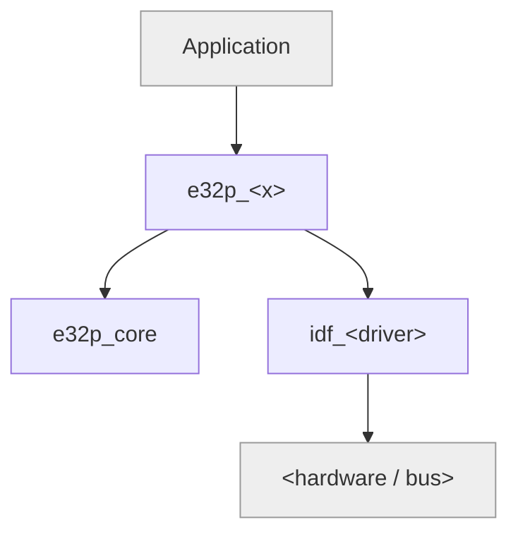
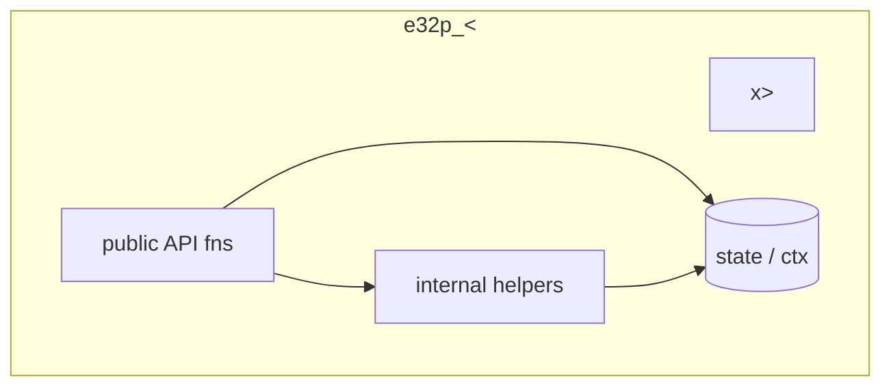
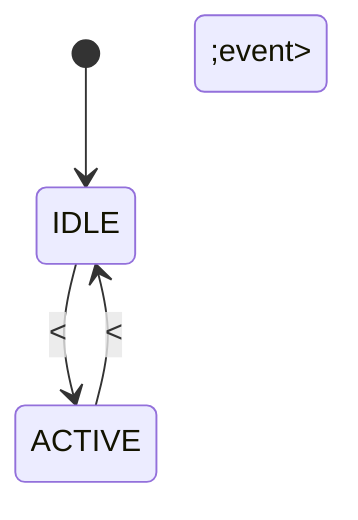

<!--
  MODULE_TEMPLATE.md — the skeleton every module's DESIGN.md follows.

  HOW TO USE
  ----------
  1. Copy this file to components/e32p_<x>/DESIGN.md.
  2. Replace every <placeholder> and fill each section from the ACTUAL code
     (headers + .c), not from memory. Every claim must be backed by the source.
  3. DESIGN.md is the "how it works" doc; README.md stays the "how to use" /
     API reference. Do not duplicate the full API here — link to the header.
  4. Keep it SELF-CONTAINED: a client may receive this module (code + README +
     DESIGN) on its own. Never write "see the platform ARCHITECTURE doc" for
     something a standalone reader needs — state it here.
  5. Scale the depth to the module (see "Scaling" at the bottom). A thin facade
     is 1 page; a stateful protocol module is several. Omit sections that do
     not apply (say nothing rather than writing "N/A" everywhere).

  DIAGRAM CONVENTIONS (keep these consistent across all modules)
  --------------------------------------------------------------
  - Use Mermaid fenced blocks (```mermaid). They render on GitHub and in VS Code
    (Markdown Preview Mermaid Support), and in published artifacts.
  - Dependency / connection graphs: `flowchart TB` (top = callers, bottom =
    callees). The documented module is one node; the app is above, ESP-IDF /
    other e32p modules below.
  - Calling sequences: `sequenceDiagram`. Participants left→right = caller to
    lowest dependency. Show return values only when they matter.
  - State machines: `stateDiagram-v2`.
  - Node id convention: lowercase module names (`e32p_twai`), `app` for the
    application, `idf_<x>` for ESP-IDF components, `hw` for hardware/bus.
-->

# e32p_&lt;x&gt; — Design

> **&lt;One-line purpose.&gt;** Part of the ESP32 firmware platform (`e32p_` modules).
> This document describes the module's internals and external connections and is
> self-contained: it travels with the module when cherry-picked.

## 1. Overview

&lt;2–4 sentences: what the module does and the problem it solves. Which layer it
sits in and what it is built on. Its **registration style** — one of:
*flat/stateless* (no handle, global state), *opaque-handle* (per-instance
context), or *singleton* (one instance, no handle). Target support (`SOC_*`
guard), if any.&gt;

| Property | Value |
|----------|-------|
| Registration style | &lt;flat / opaque-handle / singleton&gt; |
| Kconfig symbol | `CONFIG_E32P_<X>_ENABLE` |
| Target guard | `&lt;SOC_… / none&gt;` |
| Public header | [`include/e32p_<x>.h`](include/e32p_<x>.h) |

## 2. External dependencies

&lt;What the module needs, and who uses it. Keep the table and the diagram in sync
with the CMakeLists `REQUIRES`/`PRIV_REQUIRES` and the Kconfig `select`.&gt;

| Direction | Depends on | Why |
|-----------|-----------|-----|
| Platform | `e32p_core` | error macros, logging, target defs |
| Platform | `&lt;other e32p module / none&gt;` | &lt;reason&gt; |
| ESP-IDF | `&lt;esp_driver_x / driver / …&gt;` | &lt;reason&gt; |
| Kconfig `select` | `&lt;E32P_<DEP>_ENABLE / none&gt;` | &lt;reason&gt; |



## 3. Internal architecture

&lt;The pieces the module is built from: the state it keeps (static singleton
variables or a per-handle `struct`), helper functions, lookup tables, buffers.
One short paragraph, then a diagram of how the internal parts relate. Thin
facades can collapse this to a sentence.&gt;



## 4. Key data structures

&lt;The config struct, the handle/context, and important enums/types. A few field
notes each — not a full dump; the header has the authoritative definitions.&gt;

- `e32p_<x>_config_t` — &lt;what it configures&gt;
- `e32p_<x>_handle_t` / internal `struct e32p_<x>_ctx` — &lt;what it holds&gt;
- &lt;key enums / message types&gt;

## 5. Calling sequences

&lt;One `sequenceDiagram` per important flow — at minimum init and the primary
operation; add teardown / error paths if non-trivial. Show calls between this
module's functions and out to its dependencies.&gt;

**Init**
```mermaid
sequenceDiagram
    participant app as Application
    participant mod as e32p_&lt;x&gt;
    participant idf as idf_&lt;driver&gt;
    app->>mod: e32p_<x>_init(cfg)
    mod->>idf: &lt;driver install/config&gt;
    idf-->>mod: esp_err_t
    mod-->>app: ESP_OK / error
```

**&lt;Primary operation&gt;**
```mermaid
sequenceDiagram
    participant app as Application
    participant mod as e32p_&lt;x&gt;
    participant idf as idf_&lt;driver&gt;
    app->>mod: e32p_<x>_&lt;op&gt;(...)
    mod->>idf: &lt;driver call&gt;
    idf-->>mod: result
    mod-->>app: esp_err_t
```

## 6. State machine

&lt;Only if the module is stateful (protocol engines, connection managers). Omit
for stateless facades.&gt;



## 7. Concurrency & context

&lt;Which task/ISR the code runs in. Reentrancy and thread-safety (e.g. "single
task, no locks" or "ISR-safe"). Blocking behaviour and timeouts. Note any
callbacks and the context they fire in.&gt;

## 8. Error model

&lt;How the module reports errors: `esp_err_t` passthrough from ESP-IDF, argument
checks via `E32P_CHECK_ARG` (→ `ESP_ERR_INVALID_ARG`), and any `ESP_ERR_E32P_*`
codes it raises. List the notable failure modes and how they surface.&gt;

## 9. Cherry-pick

&lt;How to lift this module into another project standalone.&gt;

```
CONFIG_E32P_<X>_ENABLE=y   # &lt;and any selected deps&gt;
```

Requires `e32p_core`&lt;, other e32p modules&gt;; privately requires `&lt;esp_driver_x&gt;`.
Copy `components/e32p_<x>/` (and its `e32p_` dependencies); enable the symbol.

---

<!--
  SCALING GUIDE (delete this comment block in the real DESIGN.md)
  --------------------------------------------------------------
  Thin facade (e32p_gpio, e32p_dac, e32p_wdt, e32p_sysinfo, …):
    Sections 1, 2, 5 (one sequence), 8, 9. Half a page to a page. No state
    machine, minimal internal-architecture diagram.
  Medium (e32p_i2c, e32p_spi, e32p_uart, e32p_ledc, e32p_wifi, …):
    Add 3, 4, 7. One or two sequences.
  Complex / stateful (e32p_j1939tp, e32p_j1939, e32p_twai, e32p_espnow):
    All sections including 6 (state machine) and multiple sequences.
-->
