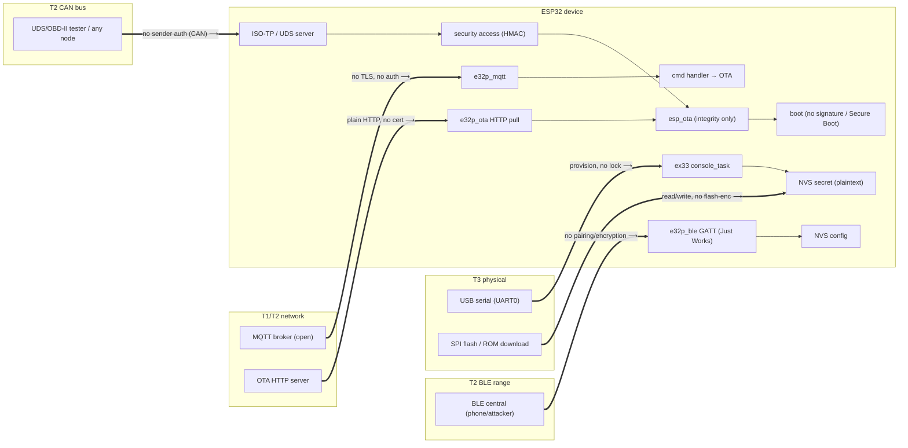

# Security audit — esp32_platform — full audit, 2026-10-07

> **Status: NOT signed off.** This report records weaknesses and the evidence for them. It
> does not certify anything as secure, audited-complete, or production-ready. The audit list
> in `docs/SECURITY_HARDENING.md` stays **NOT DONE** until the project owner decides
> otherwise.
>
> **Handle with care.** This report names exploitable weaknesses. Treat it as internal until
> the Critical and High findings are resolved; do not attach it to a public repo or a client
> hand-off as-is.

---

## 1. Executive summary (plain English)

The platform is a strong bench and teaching codebase. The individual modules are tidy, the
UDS diagnostic server's internal logic is careful and well tested, and the input parsers are
mostly well bounded. The weaknesses are not in the clever code — they are in trust: the
device has no way to tell *who* sent it new firmware or commands, and none of the chip's
protection features are turned on.

The three things to fix first:

1. **Firmware is not signed.** Both update paths — over the air (Wi-Fi/HTTP) and over the
   CAN bus (UDS) — check only that an image is *well-formed*, not that *you* built it. Anyone
   who can reach the update path can install their own firmware. Signed images
   (`28_secure_ota` already shows how) close this.
2. **The update and command paths have no authentication around them.** The edge-gateway
   accepts an "update now, from this URL" command over an open, unencrypted MQTT connection;
   the UDS secret that guards the CAN reflash can be rewritten by anyone with a USB cable,
   because the provisioning command ships in every build with no lock.
3. **No chip-level protection is enabled, on any build or either bench board.** Flash is
   unencrypted, Secure Boot is off, the UDS secret and Wi-Fi password sit in plaintext flash,
   and the UART download mode is open. A few minutes of physical access reads every secret or
   replaces the firmware.

None of this is surprising for a bench platform, and the project already says so in
`docs/SECURITY_HARDENING.md`. This audit confirms it against the code and the two boards, and
turns the open list into specific, located findings. The bench-only test material
(`UDS_TEST_SECRET`, plain-HTTP OTA in the HIL agent, the throwaway signing key) is correctly
labelled but is **not yet gated** so that it cannot wander into a product build — that is a
real finding (SEC-10), not a cosmetic one.

**Verdict: BLOCKING.** The baseline's must-not-skip point (the UDS secret over USB) has open
findings, and several Critical/High items are confirmed. See §6.

---

## 2. Scope

- **Project:** `C:\Users\aleks\Work\esp32_platform`, ESP-IDF v5.3.1 (pinned at
  `C:\Espressif\frameworks\esp-idf-v5.3.1`). Not a git repository.
- **Reviewed:** all `components/e32p_*` (UDS, ISO-TP, OBD-II, OTA, TWAI, J1939/TP, MQTT, BLE,
  Wi-Fi, ESP-NOW, NVS, Modbus and the rest); `examples/` with emphasis on `33_uds_server`,
  `29_edge_gateway`, `26_ota_http`, `28_secure_ota`; the HIL agent firmware
  (`tests/hil/agent`); host tooling (`examples/33_uds_server/tools/uds_client.py`,
  `tests/hil/host/*.py`); `partitions.csv`; and every `sdkconfig*` / `sdkconfig.defaults*`
  overlay per build variant.
- **Build variants examined (generated `sdkconfig`, not just defaults):** 40+ example and test
  configs. The security-relevant ones: `33_uds_server` `sdkconfig.bench` (ESP32, RAM sink),
  `sdkconfig.ota1m` / `sdkconfig.ota1m_b` (ESP32, real OTA reflash); HIL agent `sdkconfig`
  (ESP32 DUT) and `sdkconfig.esp32s3` (S3 companion); `29_edge_gateway`, `26_ota_http`,
  `28_secure_ota`.
- **Boards (bench):** DUT on COM5 — chip **ESP32-D0WD-V3 revision v3.1** (esptool, 2026-10-07;
  note: newer silicon than the `CLAUDE.md` text, which still says rev v1.0). Companion on COM7
  — **ESP32-S3 (QFN56) revision v0.2**. CANable (slcan) on COM8, left closed.
- **Dynamic testing:** read-only only, as authorized — `espefuse.py summary` on COM5 and COM7
  (resets into bootloader; both boards were returned to their running app and confirmed
  `@EVT READY`). No flashing, no eFuse writes, no crafted CAN/UDS frames, no HIL suite.
- **Adversary tiers in scope:** T1 (remote/network), T2 (adjacent — same Wi-Fi/LAN, BLE
  range, CAN bus), T3 (cheap physical — USB cable, UART header, SPI-flash clip). T4
  (glitching/decap) noted where silicon-relevant, not tested. The product context is not
  fixed, so findings are rated against a *plausible product* built from these modules, and the
  bench-only status of a setting is called out where it applies.
- **Static review** throughout; the only dynamic action was the two read-only eFuse reads.

---

## 3. Method

Phases per the security-auditor definition: scope and baseline (§2, §8); threat model (§4);
attack-surface inventory (§5); domain review tracing each attacker-reachable input to its sink;
validate and rate; blind verification of every Critical/High CONFIRMED finding by an
independent sub-agent given only the claim, scenario, and cited excerpts (§6 `blind-check`
lines).

Commands actually run:

- `espefuse.py -p COM5 summary` and `espefuse.py -p COM7 summary` (read-only chip state).
- `esptool.py -p COM5 chip_id` / `esptool.py -p COM7 read_mac` to return each board to its app,
  plus a serial read confirming `@EVT READY role=DUT` / `role=COMPANION`.
- Local scripts (scratchpad) that fingerprint secret-bearing values **by SHA-256 prefix only**
  and list the file names that contain them — no secret value was printed, stored, or searched
  for on the web.
- Config extraction across all `sdkconfig*`; Kconfig/API/eFuse symbols verified in the pinned
  IDF tree; advisories verified against the Espressif advisory index and MITRE.

Standards mapped: CWE per finding; ISO 14229-1 (UDS) and ISO/SAE 21434 (automotive, for the
CAN/UDS surface); ETSI EN 303 645 (consumer IoT, for Wi-Fi/BLE/MQTT/OTA); OWASP IoT Top 10.

---

## 4. Threat model

**Assets.** The UDS security-access secret (`33_uds_server`, NVS); Wi-Fi credentials and MQTT
broker config; the firmware itself (integrity, and IP); the device's function (a reflash can
replace it entirely); the fleet (if one secret unlocks many devices).

**Adversary tiers.** T1 remote, T2 adjacent (CAN bus, same LAN/Wi-Fi, BLE range), T3 cheap
physical (USB/UART/SPI-flash clip). T4 noted for ESP32 silicon only.

**Trust boundaries (data-flow).**

Every `==>` edge crosses a trust boundary with no authentication or confidentiality at the
crossing. STRIDE on the crossings: **Spoofing** (no sender auth on CAN, MQTT, BLE, OTA source),
**Tampering** (unsigned firmware, plaintext NVS/flash), **Information disclosure** (plaintext
flash and NVS, credentials in build artefacts), **Elevation** (rewrite the UDS secret over USB,
or push firmware). Repudiation and DoS are secondary here.

**Assumptions.** Product context unknown → rated against a plausible product. Classic CAN has
no sender authentication by design; that is a property of the bus, so the finding is about what
*gates each service*, not about CAN itself.

---

## 5. Attack-surface inventory

| Interface | Entry point (`file:symbol`) | Tier | Auth at the boundary | Review |
|---|---|---|---|---|
| USB serial console (ex33) | `33_uds_server/main/main.c:console_task` | T3 | none | full |
| USB serial console (HIL) | `tests/hil/agent/main/hil_agent.c:hil_agent_dispatch` | T3 | none (bench) | partial |
| UDS over CAN (ISO-TP) | `components/e32p_uds/src/e32p_uds.c:e32p_uds_request` ← `e32p_uds_isotp.c:on_physical/on_functional` | T2 | security access (0x27) for a subset | full |
| UDS security access | `e32p_uds_security.c`; app `33_uds_server/main.c:check_key/make_seed` | T2 | HMAC-SHA256, 4-byte seed/key | full |
| UDS reflash sink | `e32p_uds_ota.c`; `components/e32p_ota/src/e32p_ota.c:e32p_ota_end` | T2 | integrity only (no signature) | full |
| OBD-II over CAN | `components/e32p_obd2/src/e32p_obd2.c:e32p_obd2_request` | T2 | none (by design) | partial |
| ISO-TP reassembly | `components/e32p_isotp/src/e32p_isotp.c:handle_ff/handle_cf` | T2 | n/a | full |
| J1939 Transport Protocol RX | `components/e32p_j1939tp/src/e32p_j1939tp.c:on_dt/rx_open` | T2 | none | full |
| Modbus RTU slave | `components/e32p_modbus/src/e32p_modbus.c:e32p_modbus_slave_process` | T2/T3 | none (by protocol) | partial |
| MQTT command topic | `29_edge_gateway/main/main.c:on_mqtt/handle_cmd` | T1/T2 | none; no TLS | full |
| OTA from URL | `e32p_ota.c:e32p_ota_update_from_url`; `26_ota_http/main.c`, `29/main.c` | T1/T2 | none; plain HTTP, no cert | full |
| BLE GATT provisioning | `components/e32p_ble/src/e32p_ble.c:gatt_access`; `29/gw_provision.c:on_write` | T2 | Just Works, chars unencrypted | full |
| Wi-Fi STA | `components/e32p_wifi/src/e32p_wifi.c:e32p_wifi_sta_connect` | T2 | WPA2-PSK / open | partial |
| ESP-NOW | `components/e32p_espnow/src/e32p_espnow.c` | T2 | none (encrypt=false) | partial |
| NVS (secret, creds, config) | `components/e32p_nvs`, `33/main.c:load_secret`, `29/gw_config.c` | T3 | plaintext (no flash/NVS enc) | partial |
| ROM UART download / JTAG | eFuse state (COM5/COM7) | T3/T4 | open | full (read) |
| Host: provisioning tool | `33_uds_server/tools/uds_client.py` | — | file on PC | full |
| Host: HIL harness | `tests/hil/host/*.py` | — | bench LAN | partial |

---

## 6. Findings summary

| ID | Title | Severity | Status | CWE | Component |
|---|---|---|---|---|---|
| SEC-01 | Remote MQTT command triggers unsigned firmware update over plain HTTP | Critical | CONFIRMED | CWE-306, CWE-494 | 29_edge_gateway, e32p_ota, e32p_mqtt |
| SEC-02 | UDS reflash installs any well-formed (unsigned) image | High | CONFIRMED | CWE-347 | e32p_uds_ota, e32p_ota, 33_uds_server |
| SEC-03 | UDS secret re-provisionable over USB console in every build, unlocked | High | CONFIRMED | CWE-284, CWE-306 | 33_uds_server |
| SEC-04 | No Secure Boot / Flash Encryption / NVS encryption on any variant or board | High | CONFIRMED | CWE-1191, CWE-312 | platform / sdkconfig / eFuse |
| SEC-05 | Unauthenticated BLE provisioning; MQTT `reset` re-opens it | High | CONFIRMED | CWE-306, CWE-319 | 29_edge_gateway, e32p_ble |
| SEC-06 | J1939 TP reassembly: size vs packet-count mismatch → out-of-bounds write | High | CONFIRMED | CWE-787, CWE-191 | e32p_j1939tp |
| SEC-07 | e32p_ota HTTP pull has no server-verification path; plain HTTP is the only mode | High | CONFIRMED | CWE-295, CWE-494 | e32p_ota, 26_ota_http |
| SEC-08 | Bench Wi-Fi PSK committed in Kconfig and baked into firmware binaries | Medium | CONFIRMED | CWE-798 | 12/23/26/29, main.code-workspace |
| SEC-09 | ROM UART download mode open; full flash readout/rewrite over USB | Medium | CONFIRMED | CWE-1191, CWE-312 | both boards (eFuse) |
| SEC-10 | Bench-only test material not gated against a product build | Medium | CONFIRMED | CWE-489, CWE-321 | HIL agent, 28_secure_ota |
| SEC-11 | UDS seed uses pseudo-random RNG (RF off) on ESP32 | Medium | PLAUSIBLE | CWE-330, CWE-338 | 33_uds_server, hil_diag |
| SEC-12 | UDS lockout is RAM-only and brute-force bounded weakly | Low | CONFIRMED | CWE-307 | e32p_uds_security |
| SEC-13 | ESP32 silicon fault-injection exposure (if T4 in scope) | Low | CONFIRMED | CWE-1247 | ESP32-D0WD-V3 |
| SEC-14 | Host HIL services bind on all interfaces; credentials on the command line | Low | CONFIRMED | CWE-200, CWE-214 | tests/hil/host |

---

## 7. Findings

### SEC-01 · Remote MQTT command triggers unsigned firmware update over plain HTTP
severity: Critical · status: CONFIRMED · CVSS:3.1/AV:N/AC:L/PR:N/UI:N/S:U/C:H/I:H/A:H (9.8) · CWE-306, CWE-494
tier: T1/T2 · component: 29_edge_gateway + e32p_ota + e32p_mqtt · variants: `29_edge_gateway/sdkconfig`
location: `29_edge_gateway/main/main.c:on_mqtt (~:149)`, `handle_cmd (~:133)`, `run_gateway (~:254)`; `components/e32p_mqtt/src/e32p_mqtt.c:e32p_mqtt_init (~:134)`; `components/e32p_ota/src/e32p_ota.c:e32p_ota_update_from_url (~:168)`
description: The gateway subscribes to its command topic and, on an `ota <url>` message,
pulls and installs firmware from that URL. The broker connection carries no TLS and no
credentials (`e32p_mqtt_init` sets only URI/client-id; the gateway passes neither username nor
password), so any party that can reach the broker can publish the command. The pulled image is
verified for integrity only (no signature — see SEC-02), and the pull itself does not verify
the server (SEC-07). The result is remote, unauthenticated code replacement.
attack scenario: A party able to publish to the broker (open broker on the LAN; the README
demonstrates anonymous `mosquitto_pub`) sends an update command naming a server it controls;
the device fetches and boots that image. Capability needed: network reach to the broker. No
credential, no physical access.
evidence: `handle_cmd` branch `"ota"` copies the URL and sets `s_ota`; the main loop calls
`e32p_ota_update_from_url(s_ota_url, 0)` and on success `esp_restart()`. `e32p_mqtt_config_t`
in `main.c:227` has no username/password; `29_edge_gateway/sdkconfig:942`
`CONFIG_ESP_HTTPS_OTA_ALLOW_HTTP=y`; `:312-313` secure-boot/signed-apps "is not set". README
shows credential-free publishing to `gw/gw-01/cmd`.
impact: Full, remote, persistent code execution on any gateway reachable from the broker — a
fleet-wide compromise if the broker is shared. T1 if the broker is internet-exposed.
recommendation: (preferred) require all three together before this can ship: MQTT over TLS with
server-certificate verification **and** client authentication (username/password or mutual
TLS); signed OTA images (SEC-02); and authorize the `ota` command (e.g. signed command, or
accept the URL only from an authenticated control plane). (acceptable interim) disable the
remote `ota` command in any build that is not a bench demo. ⚠ Shipping hardening (Secure Boot)
involves eFuse burns — practise on a sacrificial board.
verification: integration test — publish an `ota` command without credentials and confirm it is
refused; serve an unsigned image over the update path and confirm `esp_ota_end` rejects it once
signing is on.
blind-check: SUPPORTED.
references: ESP-IDF OTA / `esp_https_ota` server-verification docs; `docs/SECURITY_HARDENING.md`
Layer 1; ETSI EN 303 645 §5.3 (software updates signed), §5.1 (no universal default access).

### SEC-02 · UDS reflash installs any well-formed (unsigned) image
severity: High · status: CONFIRMED · CVSS:3.1/AV:A/AC:L/PR:L/UI:N/S:U/C:H/I:H/A:H (8.0) · CWE-347
tier: T2 · component: e32p_uds_ota + e32p_ota + 33_uds_server · variants: `sdkconfig.ota1m`, `sdkconfig.ota1m_b`
location: `components/e32p_uds/src/e32p_uds_ota.c:validate_worker (~:66)`; `components/e32p_ota/src/e32p_ota.c:e32p_ota_end (~:143)`
description: The UDS download sink validates the received image with `esp_ota_end` and then
sets it bootable. `esp_ota_end` checks the image's SHA/structure — integrity — not authenticity.
With security access unlocked, a tester can install any correctly built ESP-IDF image. Signed
apps are off in the OTA variants.
attack scenario: A CAN-bus party holding the security-access key (shared/leaked secret, or via
SEC-03) performs the standard programming sequence with their own image; the device boots it.
evidence: `validate_worker` → `e32p_ota_end`; `e32p_ota_end` runs `esp_ota_end` then
`esp_ota_set_boot_partition` with no signature gate. `sdkconfig.ota1m:312`
`# CONFIG_SECURE_SIGNED_APPS_NO_SECURE_BOOT is not set`. The project confirmed this empirically:
`docs/tickets/diagnostics-stack.md` slice 3.8 (~:1922) — "It does not check who built the image:
a well-formed image from anyone is accepted."
impact: Persistent code execution on a device reachable on the bus, given the key. One shared
secret extends this to every device that shares it.
recommendation: enable signed OTA (`CONFIG_SECURE_SIGNED_APPS_NO_SECURE_BOOT=y` +
`_SIGNED_ON_UPDATE`, scheme per chip rev) so `esp_ota_end` verifies the signature; add Secure
Boot v2 on production hardware for boot-time enforcement. This is baseline item 3.
verification: reflash a correctly built but differently signed image and confirm transfer-exit
fails once signing is on; the already-proven corrupted-image rejection stays.
blind-check: SUPPORTED.
references: ESP-IDF Secure Boot v2 / signed apps; ISO 14229-1 (security access is
authorization, not authenticity of content); ISO/SAE 21434 (secure update).

### SEC-03 · UDS secret re-provisionable over USB console in every build, no lock
severity: High · status: CONFIRMED · CVSS:3.1/AV:P/AC:L/PR:N/UI:N/S:U/C:H/I:H/A:H (6.8) · CWE-284, CWE-306
tier: T3 · component: 33_uds_server · variants: `sdkconfig.bench`, `sdkconfig.ota1m`, `sdkconfig.ota1m_b` (all define `CONFIG_EX33_CONSOLE_PROVISIONING 1`)
location: `33_uds_server/main/main.c:console_task (~:104)`, `app_main (~:483)`; `Kconfig.projbuild` `EX33_CONSOLE_PROVISIONING default y`
description: `console_task` reads `provision <64 hex>` lines on UART0 and writes the
security-access secret to NVS and RAM. There is no authentication, no one-time lock, and no
check that a secret already exists — it can be rewritten at any time. The provisioning feature
is compiled into all three current builds (confirmed in each `build_*/config/sdkconfig.h`). This
is baseline item 1, the must-not-skip point. The code *is* careful in the small: it never echoes
the secret and zeroes its buffers; the weakness is the trust model, not the handling.
attack scenario: A party with brief USB access sets a secret of their choosing, which gives them
the security-access key, which (with SEC-02) gives them the reflash.
evidence: `console_task` matches `"provision "`, calls `parse_secret` + `e32p_nvs_write_str`,
then `memcpy(s_secret,...)`, `s_have_secret = true`; no guard. `app_main` installs it under
`#if CONFIG_EX33_CONSOLE_PROVISIONING`. The Kconfig help text itself says "a production build
must not include this ... Turn this off (or lock it)".
impact: Single-device compromise from cheap physical access; the door to SEC-02. The
secret-replacement step works in **every** build; the end-to-end "boot attacker firmware"
outcome then needs an OTA-sink build (`build_ota1m` / `_b`) — the RAM-sink default/bench build
stops at a security unlock and a RAM-only download. Fleet impact if the same secret is used
across devices.
recommendation: (preferred) remove the provisioning command from any non-bench build (a Kconfig
that is `default n` and a build-time `#error` if it is set together with a release/signed
config); if provisioning must stay, make it one-time (refuse once a secret exists) or
authenticated. Pair with SEC-04 so the stored secret is not readable from flash regardless.
verification: build a "release" config and confirm the provisioning task is absent (symbol
undefined) and that a second `provision` is refused when one-time mode is chosen.
blind-check: SUPPORTED.
references: `docs/SECURITY_HARDENING.md` audit item 1; ETSI EN 303 645 §5.1, §5.6
(minimize exposed interfaces).

### SEC-04 · No Secure Boot / Flash Encryption / NVS encryption on any variant or board
severity: High · status: CONFIRMED · CVSS:3.1/AV:P/AC:L/PR:N/UI:N/S:U/C:H/I:H/A:H (6.8) · CWE-1191, CWE-312
tier: T3 · component: platform-wide · variants: all
location: every generated `sdkconfig` (e.g. `33_uds_server/sdkconfig.ota1m:312-314, :771-772`);
eFuse reads `scratchpad/efuse_com5.txt`, `efuse_com7.txt` (2026-10-07); `components/e32p_nvs/src/e32p_nvs.c:e32p_nvs_init (~:18)`
description: Across all 40+ build variants, Secure Boot, Flash Encryption and NVS encryption are
off. NVS is therefore plaintext — it holds the `33_uds_server` UDS secret (as a 64-char hex
string, namespace `ex33` key `secret`) and the gateway's Wi-Fi credentials. The eFuse reads
confirm both boards are virgin: DUT (ESP32-D0WD-V3 **rev v3.1**) has `ABS_DONE_0/1` false,
`FLASH_CRYPT_CNT` 0, `JTAG_DISABLE` false, key blocks zero; the S3 companion has
`SECURE_BOOT_EN` false, `SPI_BOOT_CRYPT_CNT` disabled, download and JTAG enabled. **Config
pitfall:** all ESP32 builds set `CONFIG_ESP32_REV_MIN_FULL=0`, which (per the pinned IDF
`bootloader/Kconfig.projbuild:524-528`) makes RSA Secure Boot v2 and the ROM-download-mode
lockdown *unavailable to the build* even though the bench DUT is actually rev v3.1 silicon that
would support them. On ESP32, NVS encryption additionally requires Flash Encryption (no HMAC
peripheral — `nvs_flash/Kconfig:3-6`).
attack scenario: With a USB cable or a SPI-flash clip, read the flash image and recover the UDS
secret and Wi-Fi password from NVS, or write a new image. No secret needed.
evidence: config lines and eFuse summaries as located above; `e32p_nvs_init` calls plain
`nvs_flash_init()`; `partitions.csv` has no `nvs_keys` partition.
impact: Any secret in flash is readable with cheap physical access; firmware is replaceable and
readable. Fleet-wide if the secret is shared.
recommendation: for a product, raise `CONFIG_ESP32_REV_MIN_FULL` to match the silicon (≥300 for
rev 3), then enable Secure Boot v2 + Flash Encryption (Release) + NVS encryption, tested on a
sacrificial board. ⚠ These burn eFuses and are irreversible — never on a bench board you want
to keep; automate in production. Until then, treat anything in flash as public and keep
per-device secrets (SEC-03).
verification: on a sacrificial board, confirm `espefuse.py summary` shows the burned digests and
that a plaintext reflash is refused; confirm `esp_flash_encryption_enabled()` in-app.
blind-check: SUPPORTED.
references: ESP-IDF Secure Boot v2, Flash Encryption, NVS Encryption; `docs/SECURITY_HARDENING.md`
Layers 2-3; Espressif AR2020-001 / AR2022-003 (fault-injection context, SEC-13).

### SEC-05 · Unauthenticated BLE provisioning; MQTT `reset` re-opens it
severity: High · status: CONFIRMED · CVSS:3.1/AV:A/AC:L/PR:N/UI:N/S:U/C:H/I:H/A:L (8.3) · CWE-306, CWE-319
tier: T2 · component: 29_edge_gateway + e32p_ble · variants: `29_edge_gateway/sdkconfig`
location: `components/e32p_ble/src/e32p_ble.c:gatt_access (~:189)`, char flags `(~:224)`, SM cfg `(~:277)`; `29_edge_gateway/main/gw_provision.c:on_write`; `main.c:312, :248`
description: While unprovisioned, the gateway exposes GATT write characteristics for SSID,
Wi-Fi password, broker URI, id and "apply". The characteristics are plain writable (no
`BLE_GATT_CHR_F_*_ENC/_AUTHEN`), and the security manager is Just Works (`sm_io_cap`
NO_INPUT_OUTPUT, `sm_mitm 0`) — so there is no proof-of-possession and no MITM protection on the
writes. "apply" saves and reboots into whatever network/broker was written. The MQTT `reset`
command (itself unauthenticated, SEC-01) erases config and returns a provisioned device to this
state.
attack scenario: A party in BLE range configures the device onto infrastructure they control
(then reaches SEC-01's command path); a passive listener can also capture the legitimate owner's
Wi-Fi password, because the write need not be encrypted.
evidence: characteristic flags set only READ/WRITE/NOTIFY; SM config is Just Works; `on_write`
copies each field and `CH_APPLY` → `gw_config_save` → `esp_restart`; `main.c` routes the MQTT
`reset` verb to `gw_config_erase` + restart.
impact: Device onboarded to an attacker's network/broker; disclosure of the owner's Wi-Fi
password to a BLE sniffer; chains into SEC-01. Two scope nuances (from blind verification): the
full path needs the device *unprovisioned*, so in the **current local** gateway build the
non-empty fallback Wi-Fi creds (SEC-08) mark it provisioned and BLE provisioning is never
reached — the path is open in a **default** build (empty fallback, the shipped Kconfig default)
and after an MQTT `reset`. Passive password sniffing works only when the central does **not**
pair; a central that pairs gets LE Secure Connections (`sm_sc=1`), which defeats passive
sniffing — but nothing *forces* pairing, so an unpaired write is still accepted in the clear.
recommendation: use protected provisioning — either ESP-IDF's `wifi_provisioning` with
protocomm security 2 (SRP6a, a per-device PoP), or at minimum require bonded, encrypted,
MITM-protected pairing (`BLE_GATT_CHR_F_WRITE_ENC | _AUTHEN`, SM with MITM and a passkey/OOB) so
the write channel is confidential and authenticated; gate the MQTT `reset` behind the same
authentication as SEC-01.
verification: confirm an unbonded central cannot write the provisioning characteristics and that
a sniffer cannot read the password during onboarding.
blind-check: SUPPORTED.
references: ESP-IDF unified provisioning / protocomm security 2; NimBLE SM;
ETSI EN 303 645 §5.1, §5.5.

### SEC-06 · J1939 TP reassembly: size vs packet-count mismatch → out-of-bounds write
severity: High · status: CONFIRMED (full code trace; not triggered live) · CVSS:3.1/AV:A/AC:L/PR:N/UI:N/S:U/C:L/I:H/A:H (8.2) · CWE-787, CWE-191
tier: T2 · component: e32p_j1939tp · variants: HIL agent (`CONFIG_E32P_J1939TP_ENABLE=y`), `18_j1939tp_bam`
location: `components/e32p_j1939tp/src/e32p_j1939tp.c:rx_open (~:195)`, BAM/RTS accept `(~:369, ~:377)`, `on_dt (~:326)`
description: On a connection announcement (BAM `0x20` or RTS `0x10`), the receiver takes the
total byte size from `cm[1..2]` and the packet count from `cm[3]` independently, and validates
only `size > TP_MAX_MSG` and `packets == 0`. These two fields are not cross-checked for
consistency. In `on_dt`, a data packet is accepted when its sequence number is within
`total_packets`, and the copy length is computed as
`n = (off + 7 <= size) ? 7 : (size - off)`, with `off = (seq-1)*7`. If a sender declares a small
`size` but a `total_packets` large enough that a valid sequence number yields `off > size`, then
`size - off` underflows (unsigned) to a large value and `memcpy(&r->buf[off], …, n)` writes far
past the `malloc(TP_MAX_MSG)` buffer.
attack scenario: A CAN-bus node sends a BAM with a small declared size but a packet count whose
later sequence numbers exceed that size, then a data packet at such a sequence number. The copy
length underflows. Reachable on the HIL companion, which routes every received TP frame into the
reassembler, and on any product that feeds bus frames to this engine. (Correction: the
`18_j1939tp_bam` example is **not** a path — it is an in-process loopback between two engines, not
bus-fed; an earlier draft wrongly cited it.) The out-of-bounds write itself was not triggered on
hardware this run (crafted CAN frames were out of scope); the path is confirmed by a complete code
trace and the deterministic unsigned underflow (`size - off` with `off > size`).
evidence: `rx_open` assigns `r->size`/`r->total_packets` from the CM bytes; the two accept paths
check only `size > TP_MAX_MSG || total_packets == 0`; `on_dt` bounds `seq` against
`total_packets` but derives `n` from `size - off` without checking `off < size`.
impact: Heap out-of-bounds write from any bus node — crash (DoS of a safety-relevant function)
at least, memory corruption at worst.
recommendation: in `rx_open`/the accept paths, reject the session unless
`total_packets == ceil(size / 7)` (and `size >= 1`); defensively, in `on_dt` skip the copy when
`off >= r->size`. Add a Unity case with a mismatched size/packet CM followed by an out-of-range
data packet.
verification: Unity test on the reassembler with the inconsistent CM; confirm the session is
rejected and no copy occurs. (Then the finding can move to CONFIRMED or be closed.)
blind-check: SUPPORTED — independent full-hop code trace confirmed every step (and corrected the
`18_j1939tp_bam` reachability claim, folded in above). CONFIRMED on the complete source→sink
trace; the Unity case in `verification` both proves the overflow and guards the fix.
references: SAE J1939-21 (TP.CM / TP.DT); CWE-787, CWE-191.

### SEC-07 · e32p_ota HTTP pull has no server-verification path; plain HTTP is the only working mode
severity: High · status: CONFIRMED · CVSS:3.1/AV:A/AC:H/PR:N/UI:N/S:U/C:H/I:H/A:H (7.5) · CWE-295, CWE-494
tier: T1/T2 · component: e32p_ota + 26_ota_http · variants: `26_ota_http/sdkconfig`, `29_edge_gateway/sdkconfig`, HIL agent
location: `components/e32p_ota/src/e32p_ota.c:e32p_ota_update_from_url (~:168)`; `26_ota_http/main/main.c:93`; `26_ota_http/main/Kconfig.projbuild` (`EXAMPLE_OTA_URL` default `http://…`)
description: `e32p_ota_update_from_url` builds an `esp_http_client_config_t` with no
`crt_bundle_attach` / `cert_pem` (the line is commented out), so an `https://` URL fails closed
(`esp_https_ota` → "No option for server verification"), and every consumer sets
`CONFIG_ESP_HTTPS_OTA_ALLOW_HTTP=y` and uses plain HTTP. Combined with no image signing (SEC-02),
an on-path network attacker can substitute firmware. The module's own comment documents this as
a deliberate, test-only simplification — but nothing enforces that it stays test-only.
attack scenario: On the same LAN, redirect the OTA host (ARP/DNS spoofing) and serve a
substitute image when the device pulls its configured URL.
evidence: config struct lacks a verification field; IDF `esp_https_ota.c:268-276` continues only
because `ALLOW_HTTP` is set; `esp-tls` rejects verification-less HTTPS unless `SKIP_SERVER_CERT`.
`26_ota_http` defaults to an `http://` URL; `ALLOW_HTTP=y` in `26`, `29`, and all HIL variants.
impact: Firmware replacement by an on-path attacker; no credential needed, only network
position.
recommendation: add a verification path to `e32p_ota_update_from_url` (accept a CA bundle / set
`crt_bundle_attach = esp_crt_bundle_attach`, enable `CONFIG_MBEDTLS_CERTIFICATE_BUNDLE`), require
`https://` in product builds, and set `CONFIG_ESP_HTTPS_OTA_ALLOW_HTTP` off with a build-time
guard; combine with signed images (SEC-02).
verification: confirm an `https://` OTA succeeds against a verified server and that `http://` is
refused when `ALLOW_HTTP` is off.
blind-check: SUPPORTED.
references: ESP-IDF `esp_https_ota` / `esp_crt_bundle`; `docs/SECURITY_HARDENING.md` Layer 1.

### SEC-08 · Bench Wi-Fi PSK committed in Kconfig and baked into firmware binaries
severity: Medium · status: CONFIRMED · CVSS:3.1/AV:L/AC:L/PR:N/UI:N/S:U/C:H/I:N/A:N (6.2) · CWE-798
tier: T3 (local artefacts) · component: 12/23/26/29 + workspace · variants: those examples' `sdkconfig`
location: `12_wifi_sta/sdkconfig`, `23_mqtt/sdkconfig`, `26_ota_http/sdkconfig`,
`29_edge_gateway/sdkconfig` (and `.old`); `C:\Users\aleks\Work\main.code-workspace:456`
description: A real Wi-Fi SSID and PSK (the bench network) are stored as Kconfig string values
and therefore compiled into the firmware images and build config. The same PSK also appears as a
literal `--wifi-pass` argument in a VS Code task in `main.code-workspace`, and in the session
transcripts/file-history under `~/.claude`. A Kconfig credential lands in plaintext in both
`sdkconfig` and the image. (Value cited by SHA-256 prefix only; not reproduced here.)
attack scenario: Anyone who obtains a `.bin`/`.elf`, the `sdkconfig`, or the workspace file reads
the Wi-Fi PSK — e.g. if the firmware or repo is shared, or a device's flash is read (SEC-04).
evidence: scanner (names and SHA-256 prefix only) found the PSK in those four `sdkconfig` files,
in `wifi_sta.bin/.elf`, `mqtt.bin/.elf`, `ota_http.bin/.elf`, `edge_gateway.bin/.elf` and their
`build/config`, and in `main.code-workspace`. Gateway code comments say creds are "testing only"
and should live in local `sdkconfig` — but the workspace file is committed-style shared config.
impact: Disclosure of the bench network PSK to anyone with an artefact. Not a product secret, but
a real credential, and the pattern (Kconfig credentials) would leak a product's creds the same
way.
recommendation: rotate the bench PSK now that it is in shared artefacts; keep credentials out of
Kconfig/source — use runtime provisioning (NVS, as the gateway already does) or a git-ignored
header; make the VS Code task prompt for the password (the `wifiPass` input marked
`"password": true` already exists — use it in the task command instead of the literal). Add
`sdkconfig`, `*.bin`, `*.elf` and `main.code-workspace` credentials to the hygiene checklist.
verification: grep built artefacts for the PSK and confirm absence after the change.
blind-check: n/a (Medium).
references: ETSI EN 303 645 §5.4 (securely store sensitive parameters); CWE-798.

### SEC-09 · ROM UART download mode open; full flash readout/rewrite over USB
severity: Medium · status: CONFIRMED · CVSS:3.1/AV:P/AC:L/PR:N/UI:N/S:U/C:H/I:H/A:H (6.8) · CWE-1191, CWE-312
tier: T3 · component: both boards · variants: eFuse state
location: `scratchpad/efuse_com5.txt` (DUT), `scratchpad/efuse_com7.txt` (companion), 2026-10-07
description: On both boards the UART/ROM download mode is enabled and unprotected
(`UART_DOWNLOAD_DIS` false on the ESP32; `DIS_DOWNLOAD_MODE` / `ENABLE_SECURITY_DOWNLOAD` false,
JTAG and USB-JTAG enabled on the S3). With flash unencrypted (SEC-04), download mode reads or
rewrites the whole flash. This is correct for a bench board; it is a finding the moment such a
board is treated as a product. On the ESP32 builds, the secure ROM-download-mode option is also
unavailable because the build targets rev 0 (SEC-04 config pitfall).
attack scenario: Brief USB access + esptool reads the flash (recovering NVS secrets, SEC-04) or
writes a new image.
evidence: eFuse summaries as located; combined with SEC-04's plaintext flash.
impact: Complete read/write of device contents from cheap physical access.
recommendation: a product build enables Flash Encryption + Secure Boot (SEC-04) and then sets
the secure/disabled ROM-download-mode option; do **not** burn these on the bench boards.
verification: on a sacrificial board, confirm download mode is disabled/secured after the burns.
blind-check: n/a (Medium).
references: ESP-IDF ROM download mode (`SECURE_UART_ROM_DL_MODE`); Espressif AR2022-004 (S3 USB
download).

### SEC-10 · Bench-only test material not gated against a product build
severity: Medium · status: CONFIRMED · CVSS:3.1/AV:L/AC:L/PR:N/UI:N/S:U/C:H/I:H/A:N (6.5) · CWE-489, CWE-321
tier: mixed · component: HIL agent, 28_secure_ota · variants: HIL `sdkconfig`/`.esp32s3`, `28_secure_ota`
location: `tests/hil/agent/main/hil_diag.c:UDS_TEST_SECRET (~:110)`; HIL `sdkconfig:736`
`CONFIG_ESP_HTTPS_OTA_ALLOW_HTTP=y`; `28_secure_ota/secure_boot_signing_key.pem`
description: Deliberate bench material is clearly labelled, which is good — but labelling is not a
gate. (a) The HIL agent carries a fixed in-source UDS secret `UDS_TEST_SECRET` written to NVS at
boot; (b) `CONFIG_ESP_HTTPS_OTA_ALLOW_HTTP=y` is set in the HIL agent and defaults; (c)
`28_secure_ota` ships a throwaway ECDSA signing key (`.pem`, 227 bytes, correctly git-ignored via
`*.pem` and documented as a TEST key). Nothing prevents any of these from being carried into a
build that someone later treats as a product — there is no build-time `#error` when a test secret
or `ALLOW_HTTP` meets a release/signed config, and no separate-component boundary. The security
definition rates such material on its *gating*: here the gating is documentation only.
attack scenario: A future "product" build reuses the HIL agent or its defaults, inheriting the
known secret and plain-HTTP OTA; or the throwaway signing key is mistaken for a real one.
evidence: `UDS_TEST_SECRET` in source and written in `uds_peer_init`; `ALLOW_HTTP=y` in HIL
config and `sdkconfig.defaults`; `28_secure_ota/.gitignore` = `*.pem` (key not committed, good);
key present on disk, fingerprinted by SHA-256 prefix only.
impact: A known/default secret or insecure transport silently reaching a shipped build — a
classic way bench shortcuts become product vulnerabilities.
recommendation: add a build-time guard — e.g. a header that `#error`s when a test secret or
`ALLOW_HTTP` is set together with a release marker (`CONFIG_SECURE_SIGNED_APPS_*` or a project
`CONFIG_*_PRODUCTION`); keep test secrets in the test tree only (they already are); keep the
`*.pem` git-ignore and regenerate real keys in a signing service. The documentation is already
correct; this is about enforcing it.
verification: attempt a release-flagged build with a test secret/`ALLOW_HTTP` set and confirm it
fails to compile.
blind-check: n/a (Medium).
references: `docs/SECURITY_HARDENING.md` audit item 4; CWE-489 (active debug code), CWE-321
(hard-coded crypto key).

### SEC-11 · UDS seed uses pseudo-random RNG (RF off) on ESP32
severity: Medium · status: PLAUSIBLE · CVSS:3.1/AV:A/AC:H/PR:N/UI:N/S:U/C:L/I:H/A:N (5.3) · CWE-330, CWE-338
tier: T2 · component: 33_uds_server, hil_diag · variants: ex33, HIL
location: `33_uds_server/main/main.c:make_seed (~:202)`; `tests/hil/agent/main/hil_diag.c:uds_make_seed (~:346)`
description: The security-access seed is drawn with `esp_fill_random`. Per the pinned IDF docs
(`api-reference/system/random.rst:11-21`), `esp_random` is a true RNG only with the RF subsystem
on or after `bootloader_random_enable()`; otherwise it is "pseudo-random only," and on the plain
ESP32 the always-on secondary entropy source the S-series has is absent (the doc's secondary
-entropy note is `.. only:: not esp32`). `33_uds_server` runs CAN only, with Wi-Fi/BT off and no
`bootloader_random_enable()`, so its seeds come from the pseudo-random path. A predictable seed
weakens the HMAC challenge-response (an attacker who can predict the seed can precompute a key if
they ever learn the secret, or mount offline analysis). Not proven predictable here (would need a
measured seed sequence across resets — a dynamic test), hence PLAUSIBLE.
attack scenario: If seeds are predictable, the challenge-response degrades toward a static
secret, easing replay/precomputation once any key exchange is observed.
evidence: `make_seed`/`uds_make_seed` call `esp_fill_random`; neither app enables RF or the
bootloader entropy source before use; IDF doc text as cited.
impact: Weakened security-access challenge; combined with a 4-byte seed/key (small), the margin
is thin.
recommendation: call `bootloader_random_enable()` before generating seeds (and disable it before
any ADC/RF use), or seed an mbedTLS CTR-DRBG from a hardware-RNG seed taken while entropy is
available; consider a longer seed/key than 4 bytes for the threat model (baseline item 2).
verification: capture many seeds across resets and run a basic randomness check; confirm entropy
source enabled.
blind-check: n/a (Medium/PLAUSIBLE).
references: ESP-IDF "Random Number Generation"; `docs/SECURITY_HARDENING.md` item 2; CWE-338.

### SEC-12 · UDS lockout is RAM-only and brute-force bounded weakly
severity: Low · status: CONFIRMED · CVSS:3.1/AV:A/AC:H/PR:N/UI:N/S:U/C:L/I:L/A:N (3.1) · CWE-307
tier: T2 · component: e32p_uds_security · variants: ex33, HIL
location: `components/e32p_uds/src/e32p_uds_security.c:send_key (~:70)`, `request_seed (~:40)`; `e32p_uds_priv.h:uds_security_t`
description: The design is mostly sound — three wrong keys start a 10 s lockout, and the attempt
counter and lockout survive session changes (the plan deviation is correct). Two residual points:
(a) the counter and lockout live only in the RAM context, so a reset or power-cycle clears them,
allowing unlimited guesses at reboot speed — and `0x11` ECUReset is unsecured and allowed in any
session, so an attacker can force the reset themselves; (b) seed requests are not themselves
counted or rate-limited. With a 4-byte key the 10 s-per-3-tries throttle is the main barrier, and
a reboot removes it. On the HIL companion, `0x11` really reboots.
attack scenario: Guess three keys, trigger `0x11` (or power-cycle), repeat — the throttle never
accumulates.
evidence: `uds_security_t` fields are plain RAM in the context (`calloc`'d at init); `0x11` in
the service table is `E32P_UDS_IN_ANY, secured=false`; `send_key` resets `failed_attempts` to 0
when the lockout starts.
impact: Brute force of a 4-byte key is bounded mainly by reboot time; low on its own, but it
compounds SEC-02/03.
recommendation: persist the attempt counter / lockout across resets (NVS), or require the key
space and seed entropy (SEC-11) to make guessing infeasible regardless; consider restricting
`0x11` to a session/secured, per product policy.
verification: Unity/HIL test that a reset does not clear the lockout once persisted.
blind-check: n/a (Low).
references: ISO 14229-1 §security access; CWE-307.

### SEC-13 · ESP32 silicon fault-injection exposure (if T4 in scope)
severity: Low · status: CONFIRMED (silicon fact) · CVSS:3.1/AV:P/AC:H/PR:N/UI:N/S:U/C:H/I:H/A:N (5.3) · CWE-1247
tier: T4 · component: ESP32-D0WD-V3 (DUT), ESP32-S3 (companion) · variants: n/a
description: Context for whenever SEC-04's protections are eventually enabled. The original ESP32
glitch issues (CVE-2019-17391 — read-protected eFuse readout via a power glitch after reset;
CVE-2019-15894 — Secure Boot v1 digest bypass) are fixed only in rev 3 silicon; the bench DUT is
rev **v3.1**, so those specific issues do not apply to it. However, Espressif has later
fault-injection/side-channel advisories that *do* reach rev 3 and the S-series: AR2022-003 (ESP32
v3.0 AES core via SCA/BBI), AR2023-005 (EMFI bypass of Secure Boot v2 / Flash Encryption via ROM
download), AR2026-005 (ESP32-S3 AES key recovery via voltage fault injection). These matter only
after Secure Boot / Flash Encryption are relied on, and only against a T4 attacker.
attack scenario: A well-resourced attacker with the device in hand uses glitching/EMFI to extract
keys or bypass secure boot — relevant only once those features are enabled and relied upon.
evidence: eFuse reads confirm the silicon revisions; advisories verified at the Espressif advisory
index and MITRE (2026-10-07).
impact: Key extraction / secure-boot bypass under advanced physical attack.
recommendation: if T4 is in the product's threat model, prefer the chips/revisions and
countermeasures Espressif names in the relevant advisories, enable anti-rollback and key
revocation, and follow the advisory mitigations; otherwise record T4 as accepted/out of scope.
blind-check: n/a (Low).
references: CVE-2019-17391, CVE-2019-15894; Espressif AR2020-001, AR2022-003, AR2023-005,
AR2026-005.

### SEC-14 · Host HIL services bind on all interfaces; credentials on the command line
severity: Low · status: CONFIRMED · CVSS:3.1/AV:A/AC:L/PR:N/UI:N/S:U/C:L/I:L/A:N (4.3) · CWE-200, CWE-214
tier: T2 (bench LAN) · component: tests/hil/host · variants: n/a
location: `tests/hil/host/test_net_mqtt.py:55-58`, `test_net_ota.py:32`, `conftest.py:40,165`
description: Bench-only, but worth noting: the MQTT network test starts a mosquitto with
`listener 1883 0.0.0.0` and `allow_anonymous true`, and the OTA test serves firmware from an HTTP
server bound to `0.0.0.0` — both reachable from the whole LAN while the test runs. The Wi-Fi
password is passed as a `--wifi-pass` CLI argument (visible in process listings / shell history;
this is the same value as SEC-08). `uds_client.py` itself is clean (uses `secrets.token_bytes`,
no `shell=True`/`eval`/`pickle`). HIL host requirements are version-floored (`>=`) rather than
pinned.
attack scenario: During a test run, another host on the LAN connects to the anonymous broker or
the OTA server; or reads the PSK from a process listing on the test PC.
evidence: the `0.0.0.0` binds and `allow_anonymous true` as located; `--wifi-pass` option in
`conftest.py`; `requirements.txt` uses `>=`.
impact: Transient LAN exposure of a test broker/firmware server and of the bench PSK; low, and
bench-scoped.
recommendation: bind the test broker/HTTP server to loopback or the DUT-facing interface only;
pass the Wi-Fi password via an environment variable or prompt rather than a CLI argument; pin the
host requirements (a lockfile) for reproducibility and supply-chain clarity.
blind-check: n/a (Low).
references: CWE-200, CWE-214.

---

### 6.1 Blind verification note

Every Critical/High finding (SEC-01..07) was put to an independent verifier sub-agent given only
the claim, the attack scenario, and the cited excerpts — not the auditor's reasoning. All seven
came back **SUPPORTED**, with three scope corrections that are folded into the findings above and
change no verdict: (a) SEC-03's reflash end-state works only in the OTA-sink builds, not every
build (secret replacement works everywhere); (b) SEC-06's `18_j1939tp_bam` reachability was wrong
(that example is an in-process loopback) — reachability stands via the HIL companion and any
bus-fed product; (c) SEC-05's full path needs an unprovisioned device (empty fallback creds, the
default) and passive sniffing needs an unpaired central. SEC-06 is CONFIRMED on its complete
code trace; its overflow was not triggered live (crafted CAN frames out of scope), so its Unity
case is both proof and guard. Verdicts are on each finding's `blind-check` line.

---

## 8. Platform security posture (per build variant)

Legend: ✓ enabled · ✗ disabled · — not applicable. "Product recommendation" is for a shipped
device, not the bench.

| Setting | ex33 ota1m (ESP32) | HIL agent (ESP32) | HIL S3 | ex29 gateway | Product recommendation |
|---|---|---|---|---|---|
| Secure Boot | ✗ | ✗ | ✗ | ✗ | ✓ v2 (needs rev≥3 / S3) |
| Signed OTA (no SB) | ✗ | ✗ | ✗ | ✗ | ✓ (SEC-02) |
| Flash Encryption | ✗ | ✗ | ✗ | ✗ | ✓ Release |
| NVS Encryption | ✗ (needs FE) | ✗ | ✗ | ✗ | ✓ (after FE) |
| ROM UART DL lockdown | ✗ (rev0 build) | ✗ | ✗ | ✗ | ✓ (after SB/FE) |
| Anti-rollback | ✗ | — | — | ✗ | ✓ |
| `ALLOW_HTTP` OTA | — | ✓ (bench) | ✓ (bench) | ✓ | ✗ |
| TLS server verify (MQTT/OTA) | — | ✗ | ✗ | ✗ | ✓ |
| `ESP32_REV_MIN_FULL` | 0 | 0 | — | 0 | ≥300 to match rev-3 silicon |
| Panic GDBStub | ✗ | ✗ | ✗ | ✗ | ✗ (good) |
| Core dump | none | none | none | none | none (good) |
| Stack protector | none | none | none | none | strong (hardening) |
| Memory protection | — (ESP32) | — | ✓ (S3) | — | ✓ where supported |
| Log level | 3 (info) | 3 | 3 | 3 | ≤1 for a product (leak) |

eFuse state (read 2026-10-07): **DUT COM5** ESP32-D0WD-V3 **rev v3.1** — Secure Boot off,
`FLASH_CRYPT_CNT` 0, JTAG enabled, UART download enabled, key blocks blank. **Companion COM7**
ESP32-S3 v0.2 — Secure Boot off, flash-encrypt disabled, download + JTAG + USB-JTAG enabled, key
purposes USER. Both virgin — nothing burned. Both returned to the running HIL agent and confirmed
`@EVT READY`.

---

## 9. Baseline disposition (`docs/SECURITY_HARDENING.md` audit list)

| # | Baseline point | Disposition |
|---|---|---|
| 1 (must-not-skip) | UDS secret provisioned over USB console | **Open — SEC-03** (provisioning in every build, no lock/auth) + **SEC-04** (NVS plaintext) + **SEC-02** (what the secret ultimately gates). The trust boundary is physical USB access, as documented; the findings make it concrete and give the fixes. |
| 2 | UDS seed/key strength (4-byte, HMAC, lockout, entropy) | **Open — SEC-11** (pseudo-random seed on ESP32) + **SEC-12** (lockout cleared by reset; seed requests not counted). 4-byte length flagged for the threat model. |
| 3 | UDS reflash accepts any image the sink accepts | **Open — SEC-02**, CONFIRMED against the code and the project's own slice-3.8 evidence (integrity, not authenticity). |
| 4 | Test-only material must never reach a product build | **Open — SEC-10.** Material is correctly labelled but not *gated* (no build-time guard, no component boundary). The `28_secure_ota` key is git-ignored (good). |
| 5 | What is reachable without security (service/session) | **Covered — reviewed.** The precondition chain (`e32p_uds.c:preconditions`) enforces ISO 14229-1 order; `0x2E` needs extended+security; routines/download are session+security gated. Residual: `0x11` ECUReset and `0x14` ClearDTC are unsecured in any session (noted in SEC-12); OBD-II services need no security by design. No defect in the gating logic itself. |
| 6 | Anything on the CAN bus can talk to the servers | **Covered — confirmed true, architectural.** Classic CAN has no sender authentication; whether a gateway filters diagnostic traffic is a product decision. Recorded, not a code defect. |

---

## 10. Positive observations (with evidence)

- **UDS server logic is careful and well tested.** The single-table precondition chain follows
  ISO 14229-1 order (`e32p_uds.c:preconditions`); state commits only on a known outcome (the
  `finish` step), so a late failure never half-applies; the attempt counter and lockout
  deliberately survive session changes (`uds_security_lock` comment) — a real anti-bypass that the
  plan originally got wrong and the slice-3.2 record corrected.
- **Key comparison is constant-time** in both the example and the HIL agent
  (`33_uds_server/main.c:check_key`, `hil_diag.c:uds_check_key` — XOR-accumulate, no early exit),
  and buffers holding the secret are zeroed after use.
- **Input parsers are well bounded** on the reviewed paths: ISO-TP SF/FF/CF length checks and the
  `min(remain, avail)` copy (`e32p_isotp.c`); the TWAI layer clamps DLC to 8; the UDS transfer
  path bounds every block (`size ≤ capacity`, `received + n ≤ expected`, `len ≤ 1026`); the
  Modbus slave validates quantity and byte-count against bank size before indexing. (The J1939 TP
  path is the exception — SEC-06.)
- **The secret is not leaked by the tooling**: `uds_client.py` never prints it, generates it with
  `secrets.token_bytes`, and the on-device console never echoes it. The `.uds_secret` file is
  git-ignored. A whole-tree scan (by fingerprint) found the secret in no file other than
  `.uds_secret` itself.
- **Danger is documented honestly.** `docs/SECURITY_HARDENING.md` and the diagnostics ticket state
  plainly that the audit is not done, that the reflash is integrity-only, and that the test secret
  is a fixture. This audit's job was to verify and locate, which it did.

---

## 11. Coverage and limitations

- **Full depth:** ex33 USB provisioning; the UDS server and its callbacks; ISO-TP engine + TWAI
  glue + UDS ISO-TP glue; the UDS OTA sink; J1939 TP receive; MQTT + the gateway command path;
  HTTP OTA; BLE GATT + gateway provisioning; ROM-download/JTAG/eFuse state (read); boot/OTA
  config across variants; `uds_client.py`.
- **Partial:** OBD-II server/glue; Modbus slave; Wi-Fi STA; ESP-NOW; general NVS reads; HIL host
  scripts; J1939 TP transmit.
- **Light/none:** J1939/ACL decode internals; sensor-bus drivers (BMP280/TM1637 — spoofable on the
  PCB but low value); the full managed-component/vendored dependency set beyond ESP-IDF v5.3.1 /
  mbedTLS 3.6.0 (both the pinned versions; no project `idf_component.yml` pulls external managed
  components — only the template placeholder).
- **What static review cannot prove here:** SEC-06's reachability on real hardware (needs crafted
  CAN frames — not authorized) and SEC-11's actual seed predictability (needs a measured seed
  sequence — not authorized). Both are called out in their `verification` lines.
- **Dynamic testing** was limited to two read-only eFuse reads. No firmware behaviour was
  exercised; no malformed frames were sent.

Recommended follow-up dynamic tests, for the user to authorize: (1) a Unity case for SEC-06 on the
pure reassembler (no hardware); (2) a bench capture of UDS seeds across resets for SEC-11; (3)
after any Secure Boot/Flash Encryption work, verification on a **sacrificial** board only.

---

## 12. Remediation roadmap

**Before anything is called more than a bench demo (blocking):**
- SEC-01 — remove or authenticate the remote OTA command; MQTT over TLS + auth. Effort M.
- SEC-02 — enable signed OTA so the reflash verifies authenticity. Effort S (config) + process.
- SEC-03 — remove/lock the USB provisioning command in non-bench builds. Effort S.
- SEC-06 — fix the J1939 TP size/packet check and add the Unity case. Effort S.
- SEC-07 — add a server-verification path to `e32p_ota`; require HTTPS in product builds. Effort S.

**Before production:**
- SEC-04 / SEC-09 — Secure Boot v2 + Flash Encryption (Release) + NVS encryption + ROM-download
  lockdown; raise `ESP32_REV_MIN_FULL` to match silicon. Effort L. ⚠ Irreversible eFuse burns —
  practise on a sacrificial board first; never on the bench boards.
- SEC-05 — protected BLE/Wi-Fi provisioning (protocomm security 2 or bonded+MITM). Effort M.
- SEC-10 — build-time guard so test secrets / `ALLOW_HTTP` cannot meet a release config. Effort S.
- SEC-11 / SEC-12 — proper entropy for seeds; persist the lockout; reconsider 4-byte length.
  Effort S-M.

**Hardening / hygiene:**
- SEC-08 — rotate the bench PSK; stop baking credentials into Kconfig/images/workspace; use the
  existing `password` task input. Effort S.
- SEC-14 — bind host test services to loopback; keep the PSK off the command line; pin host
  requirements. Effort S.
- SEC-13 — record the T4 decision; follow the relevant Espressif advisories if in scope.

---

## 13. Sign-off

Not signed off. Sign-off is the project owner's decision. This report does not make the project
secure, audited-complete, or production-ready; the audit in `docs/SECURITY_HARDENING.md` remains
**NOT DONE** until the owner records otherwise.

---

## Re-test 2026-10-08 — remediation (work item security-remediation)

The fixes for the findings in this report are in progress. They land in slices, and each finding is
re-tested when its slice is done. Each result gets its own subsection below, and later slices add
theirs under this same heading. The original findings text above is unchanged. A result here covers
one finding only and does not change the status of any other finding. Nothing here is signed off,
and the audit in `docs/SECURITY_HARDENING.md` stays **NOT DONE** until the project owner records
otherwise.

### SEC-06 — slice A

**Result: FIXED.** Re-tested 2026-10-08 by security-auditor. Method: review of the fix, the slice's
on-target unit and HIL results, and a separate host test written for this re-test. No crafted frames
were sent on the real CAN bus.

**Stale-tail disclosure: closed.** (CWE-908. Found while planning the fix; not in the original SEC-06
text. A BAM that declared fewer packets than its size needs, for example 1785 bytes in 1 packet, used
to complete early and hand the application up to 1778 bytes the session never wrote: old heap
contents or the previous message.)

**What the fix does** (`components/e32p_j1939tp/src/e32p_j1939tp.c`):
- `tp_cm_ok()` (~:119) accepts an incoming BAM or RTS only if the size is 9..`MAX_MSG_BYTES` and the
  packet count is exactly `ceil(size / 7)`. The size part, `tp_len_ok()` (~:114), is the same rule
  `e32p_j1939tp_send()` uses (~:303), so both directions agree.
- BAM accept (~:388): a bad announcement frees the session slot and sends nothing.
- RTS accept (~:398-401): a bad announcement gets one Conn_Abort (reason 2, "resources") and the slot
  is freed. No CTS is sent.
- `on_dt()` (~:347-350): ignores a data packet that would start at or past the declared size. This is
  a second guard; the check above already makes it unreachable.

**Why this closes both problems.** Only `rx_open()` sets `size` and `total_packets` (~:206-207), and
both accept paths free the slot straight after it when the rule fails. So every open session has
`size` <= `MAX_MSG_BYTES` and `total_packets == ceil(size / 7)`. Any packet number the session accepts
then starts inside the buffer, and its copy length is 1 to 7 bytes, so the unsigned wrap behind SEC-06
cannot happen. A session is delivered only after all packet numbers 1..`ceil(size / 7)` are stored,
and together they cover every byte of the message, so no unwritten byte is handed out. The Kconfig
range for `MAX_MSG_BYTES` (9..1785) keeps the packet count at 255 or less, which still fits the
256-bit received map and the one-byte count field.

**Evidence**

| Check | Result |
|---|---|
| The code tested is the code in the tree | A diff regenerated today from the pre-fix backups matches the slice diff line for line (269 lines). |
| On-target unit tests (ESP32 DUT, `tests/unit_runner`) | `253 Tests 0 Failures 0 Ignored`. All 10 `e32p_j1939tp` cases pass, including the 6 new hostile-input cases (`components/e32p_j1939tp/test/test_e32p_j1939tp.c` :212, :230, :243, :265, :287, :305). Build 0 warnings; flash hash verified. |
| Do the new tests catch the bug? | The same test file, built on the PC against the engine as it was before the fix: `10 Tests 5 Failures`, and a copy tracker caught the overflow the original finding traced (copy length 65531 for BAM 9 bytes / 3 packets, 65529 for size 0 / 2 packets). Against the fixed engine: `10 Tests 0 Failures`, no overflow. |
| Every possible announcement (host test) | All 33,554,432 BAM and RTS announcements (size 0..65535 x count 0..255): exactly the 3,554 that meet the rule open a session; no open session ever breaks the rule; every bad RTS gets exactly one Conn_Abort reason 2 and no CTS. |
| Every data packet after an announcement (host test) | BAM and RTS with size 0..2100 x count 0..255, each followed by data packets 0..255: 0 out-of-bounds copies, 0 deliveries containing bytes the session did not write, 0 wrong lengths or contents. Also 0 issues when a second BAM from the same sender replaces a half-received one, and with two senders at once. |
| Other build settings (host test) | Repeated with `MAX_MSG_BYTES` 9, 100, 1784 and 1785, and with 1, 2 and 8 receive sessions: 0 issues. |
| The host test can see the bug (control run) | The same host test against the pre-fix engine reported 39,097,353 out-of-bounds copies (blocked by the tracker; largest 65,535 bytes) and 454,708 stale-tail deliveries. |
| Valid traffic still works on the real bus | HIL agent DUT and S3 builds 0 warnings, both flashed with hash verified, HIL suite `76 passed, 4 skipped`: the same as the baseline, including the real-bus TP tests `test_can_tp_bam` and `test_can_tp_cmdt`. |
| Independent review | code-reviewer APPROVE and code-standards PASS in two review rounds (remediation ledger, slice A). |

**New issues in the fix: none found.** The fix fails closed: every reject path frees the slot before
any data can be stored. The transmit-side size rule behaves exactly as before.

Notes (not caused by this fix; they do not affect the SEC-06 result):
- Classic CAN has no sender authentication. Any node can still end another sender's transfer in
  progress by sending a BAM or a Conn_Abort with that sender's address. This was true before the fix
  and is outside firmware control.
- **Residual (Info, CWE-908, existed before the fix):** `e32p_j1939tp_on_frame()` never reads the
  frame length. The README integration example (`components/e32p_j1939tp/README.md` ~:56-57) and the
  HIL DUT loop (`tests/hil/agent/main/hil_can.c` ~:407-410) pass a frame struct that is not zeroed,
  and `e32p_j1939_receive()` (`components/e32p_j1939/src/e32p_j1939.c` ~:121-122) fills only the
  received length. A short data packet (DLC under 8) therefore puts leftover stack bytes, normally the
  previous frame's data, into the reassembled message. Memory safety still holds: the new check
  validates size and count whatever their source. Suggested fix: in `on_frame`, drop any TP.CM or
  TP.DT with `len < 8`; or zero the struct in the callers and in the README example. Tracked in the
  remediation ledger as out of scope for SEC-06.

**Limits of this re-test.** No crafted frames went over the real bus (not authorized for this run).
The engine has no bus code of its own, and the HIL companion hands every received TP frame straight
to `e32p_j1939tp_on_frame()` (`tests/hil/agent/main/hil_can.c` ~:628), so the host and on-target tests
run the same code a bus attacker would reach. The host tests used the PC compiler (MinGW gcc 14.2);
the on-target unit run covers the ESP32 build. Not covered here: CTS-window checks on receive and the
frame-length residual above.

### SEC-10 — slice B (partial)

**Result: PARTIAL.** Re-tested 2026-10-09 by security-auditor. SEC-10 is closed over four slices: B
(this one) adds a product marker and guards three bench projects; D, G and J add the rest. This result
covers slice B only. The open parts keep the original severity (Medium) until D, G and J land.

Method: review of the slice diff, reuse of the slice's build logs, and new checks for this re-test:
a compile-only re-run of each guarded `main.c` from its build's recorded compile command, a
preprocessor comparison with the pre-slice backups, and runs of IDF's config generator (kconfgen) in a
scratch folder. No full build was run and no board was touched.

**What slice B does**
- `components/e32p_core/Kconfig` (~:12-20): new option `CONFIG_E32P_PRODUCT_BUILD`, off by default.
  It is a marker only; on its own it changes no code.
- Three bench/demo projects stop with a compile error when the marker is on:
  `tests/hil/agent/main/main.c` (~:20-22; the ESP32 and ESP32-S3 HIL builds share this file),
  `examples/26_ota_http/main/main.c` (~:35-37) and `examples/28_secure_ota/main/main.c` (~:28-30).
  Each file now includes `sdkconfig.h` first (~:7, ~:25, ~:19).
- `components/e32p_core/README.md` (~:40-63) and `DESIGN.md` (~:18) explain the marker and how to set it.

**Where each part of SEC-10 stands**

| Part of SEC-10 | After slice B |
|---|---|
| (a) HIL agent holds the fixed test secret `UDS_TEST_SECRET` | Closed for the HIL agent: with the marker on, its DUT and S3 builds both fail. |
| (b) Plain-HTTP OTA allowed (`CONFIG_ESP_HTTPS_OTA_ALLOW_HTTP=y`) | Closed for the HIL agent and example 26 (the whole project refuses). Open for example 29 (slice G) and for any other project that uses `e32p_ota` (slice D). |
| (c) Example 28 throwaway signing key | Closed for building example 28 as a product. The key file is still protected only by `*.pem` in `.gitignore`; slice J must show a product build cannot sign with any bench key. |
| A product configuration that sets the marker | Open until slice J (no product overlay exists yet). |

**Evidence**

| Check | Result |
|---|---|
| The code tested is the code in the tree | A diff regenerated today from the slice backups matches the slice diff hunk for hunk (6 files). |
| Marker on: the three projects refuse to build | Slice product builds (own build folder and config, marker in an overlay file): HIL agent (ESP32), ex26 and ex28 each exit 2. In each log the only compile error is that project's own `#error` (HIL `main.c:21`, ex26 `main.c:36`, ex28 `main.c:29`), and the generated configs show `CONFIG_E32P_PRODUCT_BUILD=y`. Re-run today, compile-only, with the marker added to each recorded command: the same `#error` fires in all four builds, including the ESP32-S3 HIL build that the slice did not build with the marker. Control: the pre-slice files compile cleanly with the marker set. |
| Marker off: default builds unchanged | (1) Compile-only re-run as configured: 0 warnings, 0 errors in all four builds. (2) Old and new `main.c` after the preprocessor are identical in all four builds once the file name and line number inside `ESP_ERROR_CHECK` are masked (2843 to 3244 lines each, 0 differing). (3) No build's `config/sdkconfig.h` changed: IDF rewrites it only when its content changes (`kconfgen/core.py:update_if_changed`), and all four still carry their pre-slice dates (HIL 2026-10-06, ex26/ex28 2026-08-19); none mentions the marker. (4) The last incremental builds recompiled only `main.c`, with 0 warnings. |
| Project config files | The HIL `sdkconfig` and `sdkconfig.esp32s3` differ from their pre-slice versions only by the new `# CONFIG_E32P_PRODUCT_BUILD is not set` line and line endings (proven by hash). The ex26/ex28 `sdkconfig` files also picked up other refresh changes on reconfigure; none reached `sdkconfig.h` (point 3 above). The 20 recorded config hashes did not change during the product builds or since. No `sdkconfig.defaults*` file changed. |
| Can the marker slip silently when the README is followed? | Tested with the real kconfgen and the real `e32p_core/Kconfig`. Marker applied: plain ASCII, CRLF, trailing spaces. Build stops: overlay file missing, or saved as UTF-16. Marker silently **not** applied (kconfgen exits 0, at most a warning): reusing a `sdkconfig` that already says "is not set" (the README warns about this), a later overlay that says "is not set", the value `Y` instead of `y`, and an overlay saved as UTF-8 with a byte-order mark when the marker is the first line (SEC-10-B1 below). The README's last step, checking `sdkconfig.h` for `#define CONFIG_E32P_PRODUCT_BUILD 1`, catches every silent case. So the procedure cannot slip silently when it is followed in full, but it can if that last check is skipped. |
| The guarded projects know the marker | All three add the shared `components/` folder, and each generated `sdkconfig` holds the marker line. |
| Independent review | Round 1: code-reviewer APPROVE, code-standards PASS (remediation ledger, slice B). The round 2 verdict was not yet in the ledger when this re-test ran. |

**New issue in the fix**

**SEC-10-B1 · Info · CWE-636** · `components/e32p_core/README.md` (~:57-63). The README does not say the
overlay must be a plain text file without a byte-order mark. On this PC, `>`, `Out-File` and
`Set-Content -Encoding utf8` in PowerShell 5.1 all write one (checked: the files start `EF BB BF`).
When the marker is the overlay's first line, kconfgen skips that line with a warning only, and the
build carries on as a normal bench build. The README's `sdkconfig.h` check catches this, so there is
no attack path on its own. Fix: add one sentence, for example "Write the overlay as plain ASCII
(PowerShell 5.1: `Set-Content -Encoding ascii`); a byte-order mark silently drops the first line."
Starting overlays with a comment line also avoids it. Not blocking.

**Still open before SEC-10 can close**
- **Slice D (`e32p_ota`)**: the planned check that stops a product build when
  `CONFIG_ESP_HTTPS_OTA_ALLOW_HTTP` is on. IDF compiles only the components a project uses (ex26's
  build has objects for `e32p_core` and `e32p_ota` but none for unused ones such as `e32p_j1939tp`), so
  a check in `e32p_ota.c` covers only projects that use `e32p_ota`. Suggest also stopping on
  `CONFIG_ESP_TLS_INSECURE` and `CONFIG_ESP_TLS_SKIP_SERVER_CERT_VERIFY` (IDF v5.3.1
  `components/esp-tls/Kconfig` ~:84, ~:90). The planned positive-control product build of ex33 must
  show `#define CONFIG_E32P_PRODUCT_BUILD 1` in its `sdkconfig.h`; otherwise it proves nothing.
- **Slice G (example 29)**: its own `#error`. After slice D, an ex29 product build may stop on the
  `e32p_ota` check first, so look for ex29's own error text (a compile-only run of its `main.c` with
  the marker, as in this re-test, shows it directly).
- **Slice J (product overlay)**: the overlay sets the marker, and that build's `sdkconfig.h` shows
  `#define CONFIG_E32P_PRODUCT_BUILD 1`. Product builds of the HIL agent, ex26, ex28 and ex29 each fail
  on their own `#error`. The product config shows `ALLOW_HTTP`, `ESP_TLS_INSECURE`,
  `ESP_TLS_SKIP_SERVER_CERT_VERIFY` and `CONFIG_SECURE_BOOT_BUILD_SIGNED_BINARIES` off (the last one as
  planned), so no bench key can sign a product image: not ex28's key, and not the one slice F adds.
  `docs/SECURITY_HARDENING.md` lists the remaining bench material with a "never reuse" rule (baseline
  item 4). The fail-open question below is decided.
- **Also slice F** (outside the SEC-10 chain, but it adds bench material): example 33 has no
  `.gitignore` at its root today. The new bench signing key needs an ignore rule, or an ignored folder,
  before it is created.

**Remaining bench material (ledger F53)**
- `tests/hil/host/test_uds_canable.py`: `HIL_TEST_SECRET` (~:48). This is PC-side test code and never
  goes into firmware. It holds the same 32 bytes as `UDS_TEST_SECRET` (checked by comparison, value not
  shown), and its docstring says so (~:16). The only firmware that holds this value is the HIL agent,
  which slice B now guards. No build guard is needed here. What remains is a rule: this value must never
  become a real device secret. Slice J should write that next to the per-device secret policy
  (baseline item 1).
- Example 33 bench files: `tools/.uds_secret` is the PC copy of the bench board's secret. It is written
  at provisioning and ignored by `tools/.gitignore`. It falls under baseline item 1 (where the PC copy
  lives), not under a build guard. The slice F bench key is covered by the slice F and J points above.
  Example 33 is the base of the product build, so it cannot refuse to build as a whole; any bench-only
  option in it needs its own check. Its provisioning console stays in the product by owner decision,
  with a one-time lock (SEC-03).

**The marker fails open (advice for the planner)**

The marker works only if someone remembers to set it. A product build that forgets it compiles all
bench code without complaint. For the guarded bench projects that is easy to notice, because they build
when they should fail. For the real product build (example 33 with the overlay), a good build looks the
same whether the marker applied or not, so only the manual `sdkconfig.h` check stands between a slip and
a product image that carries bench options.

Recommendation: yes, make the guards also fire on `CONFIG_SECURE_BOOT` or
`CONFIG_SECURE_FLASH_ENC_ENABLED`. Both exist in IDF v5.3.1 (`components/bootloader/Kconfig.projbuild`
~:661, ~:850). Here, a build with either one on is a product build by definition: the bench rules
forbid flashing one, and no `sdkconfig*` file in this project (build folders excluded) sets either.
- Preferred: one hidden option (no prompt) in `e32p_core/Kconfig` that all guards test instead of the
  marker: `config E32P_BENCH_FORBIDDEN` / `bool` /
  `default y if E32P_PRODUCT_BUILD || SECURE_BOOT || SECURE_FLASH_ENC_ENABLED`. Tested with kconfgen: it
  turns on even when a reused `sdkconfig` lists both it and the marker as "not set". The rule lives in
  one place, and slices D and G can use it too.
- Acceptable: add `|| CONFIG_SECURE_BOOT || CONFIG_SECURE_FLASH_ENC_ENABLED` to each guard's `#if`
  (three today, more after D and G).
- Avoid: `default y if SECURE_BOOT || ...` on the marker itself. Tested: a reused `sdkconfig` that says
  "is not set" wins, and the marker stays off.
- Do not trigger on `CONFIG_SECURE_SIGNED_APPS_*`. Example 28 uses it on the bench, and so will the
  example 33 bench signing that slice F adds.

Effort is small. Slice J is the natural place for it: it builds the first configuration with Secure
Boot and Flash Encryption on, so one build can prove both the trigger and the marker.

**Limits of this re-test.** Static and build-level only. The slice's product-build logs were reused
rather than repeated, and today's compile checks used the recorded compile commands. No board was
touched and nothing was flashed. kconfgen ran only in a scratch folder; it read the real
`e32p_core/Kconfig` and wrote nothing in the project. The fail-open point is a design property that
slice J is planned to close, so it is not rated as a separate finding here.

### SEC-12 — slice C (partial)

**Result: PARTIAL.** Re-tested 2026-10-13 by security-auditor. There is one reason it is not FIXED:
example 33. The reset trick is closed there today, but only by the built-in default (a 10 second delay
after every start). Its own hooks and its own on-device test come in slice E. Nothing else holds the
result back. The points the owner has accepted are listed as residuals below; they are on record, but
they do not count against the fix.

Method: review of the slice diff and the live code, reuse of the slice's unit and HIL results, a look at
the NVS code in the pinned ESP-IDF, and a new host test written for this re-test. The host test runs the
real server code on the PC and searches every order of attacker moves. The same test ran against the
pre-slice code as a control. No board was touched and no CAN frame was sent.

**What slice C does**
- `e32p_uds_config_t` (`components/e32p_uds/include/e32p_uds.h`) has two new optional hooks,
  `on_sec_load` and `on_sec_store`. They keep one flag: "the last security access failed".
  `e32p_uds_init()` refuses a config that sets only one of them.
- `uds_security_init()` (`components/e32p_uds/src/e32p_uds_security.c`) starts the 10 second delay at
  every start when there are no hooks, or when the load hook says "failed". Only "not failed" is
  trusted. During the delay a seed request answers `7F 27 37`.
- `send_key()` calls `remember_outcome()`: the flag is saved at the first wrong key, before the answer
  goes out, and cleared after a right key. A save that reports failure makes the saved value unknown,
  so the next outcome saves again.
- The wrong-key count stays in RAM. Only the one flag is saved.
- The HIL companion keeps the flag in NVS (`tests/hil/agent/main/hil_diag.c`: `uds_sec_load`,
  `uds_sec_store`, key `sec_fail`).
- Example 33 sets no hooks (`examples/33_uds_server/main/main.c`, the `server` config in `app_main`),
  so it takes the no-hook path: `e32p_uds_isotp_start()` copies the config, `e32p_uds_init()` calls
  `uds_security_init()`, and the delay is armed. Its `on_reset` calls `esp_restart()`.

**Where each part of SEC-12 stands**

| Part of SEC-12 | After slice C |
|---|---|
| (a) A reset clears the lockout, and `11 01` lets the attacker force that reset | Closed in the component, for any project that uses it. Proven on hardware on the HIL companion. Example 33: closed by the no-hook default. That is shown by the code trace above and by the unit tests of the same code, not yet by a run of an example 33 image. Its hooks come in slice E. |
| (b) Seed requests are not counted | Not changed. Accepted by the owner. See residual 2. |
| 4-byte seed and key | Not changed. Accepted by the owner for the bench. See residual 1. |

**How fast can keys be guessed now?** (an attacker on the bus who can also send `11 01`)

| | Before slice C | After slice C |
|---|---|---|
| Without resets | 3 guesses per 10 s: 0.3 a second, about 26,000 a day | The same |
| With resets | 3 guesses per restart. With the companion's restart of about 0.7 s: about 4 a second, about 350,000 a day | No better than without resets: 0.3 a second. After any wrong key a reset costs the full 10 s plus the restart, so a reset only slows the attacker down |
| Average time to hit a 4-byte key | About 33 years | About 450 years |

Every guess gets a new seed, so each one has a 1 in 2^32 chance and the average is 2^32 guesses. The fix
makes guessing about 14 times slower and takes away the reason to reset. The key is still 4 bytes.

Where the numbers come from:
- The limit of 0.3 a second is the result of the host search (see Evidence). It is not an estimate.
- "About 0.7 s per restart" is an estimate. The companion's own log shows the UDS server ready about
  0.6 s after the reset (IDF log time stamps 591 to 604 ms in the slice's console capture of
  2026-10-09), and the companion waits 100 ms before it restarts (`UDS_RESET_WAIT_MS`). It was not
  timed from the PC.
- A request and its answer take about 4 ms at 250 kbit/s (the HIL test `uds_sec_reset` sends 12 pairs
  and reports 43 ms in all).

**Evidence**

| Check | Result |
|---|---|
| The code tested is the code in the tree | A diff regenerated today from the slice backups matches the slice diff (1083 lines; all 728 changed lines are the same). The HIL images on disk were built after the last source edit and before the flash and the run (2026-10-10: edit 15:22, build 15:23, flash 15:25, run 15:27), and they hold the new event texts. |
| Hardware: ESP32-S3 companion, real restart | `test_uds_security_delay_after_reset` passes inside the full suite (`77 passed, 4 skipped`): three wrong keys, `11 01`, the companion restarts, `27 01` answers `7F 27 37`, and after 10 s a right key unlocks. The test also needs the companion to report `flag=1` before the restart and `flag=0` after the unlock. Before the fix that seed request would have been answered with a seed. |
| The save does not delay the answer | The first wrong key, the one that writes the flag, was answered in 3.4 ms. P2 is 50 ms. |
| On-target unit tests (ESP32 DUT, `tests/unit_runner`) | `270 Tests 0 Failures 0 Ignored`. 12 cases cover the start delay and the store hook, including the no-hook case. |
| Host unit tests | `99 Tests 0 Failures`. Red, then green: the case "a save that fails makes the saved value unknown" failed before the last fold (`Expected 3 Was 2`) and passes after it. |
| Every order of attacker moves (new host test, live code) | Moves, in 100 ms steps: one guess (in the extended session, in the programming session, or functionally addressed), wait, or `11 01` with a restart. Requests cost no time, which favours the attacker. Best result with hooks and working storage: 39 judged keys in 120 s, the same for a restart cost of 0.1 s, 0.7 s and 1.0 s; 0.300 a second in the long run. Without hooks (example 33 today): 36 in 120 s. The result is the same when the flag is missing at first, and when a save lands but reports failure. |
| Control: the same search on the pre-slice code | 516 judged keys in 120 s with a 0.7 s restart (4.3 a second), and 3603 with a 0.1 s restart. So the test can see the weakness. |
| Fixed scenarios (new host test, live code) | 200 rounds of "one wrong key, then `11 01`": the seed is refused after every restart. A config with only one hook is refused. The round 3 review case "a save lands but reports failure, then two wrong keys and `11 01`" now ends in `7F 27 37`; it was the one bad check in the round 3 output. |
| Independent review | Three rounds. Round 1 asked for changes (one blocking point, since folded in). Rounds 2 and 3: code-reviewer APPROVE, code-standards PASS, UDS checker found no nonconformity (remediation ledger, slice C). The round 4 verdicts on the last fold were not in the ledger when this re-test ran. |

**Residuals**

| # | Residual | What it means | Class |
|---|---|---|---|
| 1 | 4-byte seed and key | It sets the 2^32 in the numbers above. | Accepted by the owner for the bench. A longer key is a product decision. |
| 2 | Seed requests are not counted (part (b)) | A seed can be asked for again and again without sending a key: 100,000 in a row in the host test, none refused. Someone who has recorded genuine seed and key pairs on the bus can keep asking until one of those seeds comes back, and then replay its key. With 4-byte seeds that takes 2^32 requests divided by the number of recorded pairs. At about 250 requests a second that is about 200 days with one pair and about 2 days with 100 pairs. The lockout and the saved flag do not slow this down. It was the same before slice C. For someone who has recorded an unlock it is now the fastest way left, far faster than guessing keys. Weak seeds (SEC-11) would make it faster still. | Accepted by the owner. The numbers are new; they belong with the product decision on seed and key length (baseline item 2). If the owner looks at it again, the two cheap options are a longer seed, or giving out the same seed again until a key has been sent. |
| 3 | A power cut between judging the key and saving the flag | The flag is saved after the key is judged. Someone who can cut the supply in that gap (well under 3.4 ms) loses the wrong-key record and gets one guess per power cycle. It cannot be done from the bus: requests are handled one at a time, and `11 01` resets only after its own answer. It needs hardware on the supply line. At that level the flash can be read directly today (SEC-04, SEC-09). | Accepted, and written down in `DESIGN.md`. Owner action for a product: save "failed" before judging the key, refuse to judge when that save fails, and clear the flag after a right key. |
| 4 | A store that keeps failing | The server then behaves as it did before the fix: 516 judged keys in 120 s in the host test. Inside one boot the RAM lockout still works. The server raises no fault by itself; the HIL companion prints an event. This re-test found no bus request on the HIL companion that can make the save fail. | Owner action: the application should treat a failed save as a fault (log or DTC). The design in row 3 closes this too. |
| 5 | A missing flag reads as "not failed" on the HIL companion | Wiping NVS removes the flag but not the companion's secret, which is compiled in. That needs flash access, and the secret is a public test value. | Accepted test-fixture exception, stated in the code. Not a pattern for a product. |
| 6 | Example 33 has no hooks yet | It runs the delay after every start. That is the cautious side. | Still to do in slice E. See "For slice E". |
| 7 | `11 01` works in any session without security | A forced reset no longer helps guessing. It does make it cheaper to keep a tester locked out (SEC-12-C2). | Owner decision, not re-opened. |

**Can an attacker wear out the flash with flag writes? No.** Without the right key an attacker can only
turn the flag from 0 to 1. Turning it back needs a right key. In one boot any number of wrong keys
causes one store call (600 wrong keys, 1 call in the host test). After a restart the first wrong key
calls the store hook again with the value that is already saved, and the pinned ESP-IDF skips the flash
write when the value has not changed (`Storage::writeItem` in
`components/nvs_flash/src/nvs_storage.cpp`, IDF v5.3.1). In the host test 200 attacker rounds made 200
hook calls and 1 real write. So an attacker gets at most one real write for each unlock by a real
tester. Only someone who has the key can write freely (wrong key, right key, and again: 2 writes a
round), and that person already has full access. The skip was read in the IDF code; it was not measured
on the board.

**Can an attacker keep a real tester locked out? Yes, but that was already so.** Before slice C, three
wrong keys every 10 s did it. What is new:
- With hooks, one wrong key and then a bare `11 01` every 9 s is enough. Each restart starts the delay
  again, because only a right key clears the flag and a right key needs a seed first (50 of 50 seed
  requests refused in the host test).
- Without hooks (example 33 today), `11 01` every 9 s is enough, with no key at all (50 of 50).
- A power cycle by the tester no longer clears the lockout. That is the point of the fix.

It ends when the attacker stops: 10 s later a right key unlocks and clears the flag (checked in the
host test). This re-test found no state that locks a tester out for good, and a failing save does not
block an unlock. Any node on a classic CAN bus can already deny diagnostics in simpler ways (flooding,
forcing bus-off, `11 01` in a loop). Security access guards the reflash and one data write here, not a
safety function. Rated Info; see SEC-12-C2.

**New issues in the fix**

**SEC-12-C1 · Info · CWE-636** · `components/e32p_uds/DESIGN.md`, hook table, row `on_sec_load`. Two
sentences in the same cell contradict each other. The first says the missing-flag rule is "true for the
HIL companion and for example 33, where an NVS wipe also removes the secret". A later one says "The HIL
companion does **not** meet it". The second is right, and it matches the comment in `hil_diag.c`. The
first is left over from an earlier fold. Someone who copies the HIL hook into a product could read the
first sentence as permission to answer "not failed" for a missing flag. Fix: change the first sentence
to end "...since the device's storage was initialised: true when wiping the storage also removes the
secret the keys come from." Documentation only. Not blocking.

**SEC-12-C2 · Info · CWE-645** · `uds_security_init()` together with the unsecured `0x11` in
`e32p_uds.c` (`k_services`). Keeping a tester locked out got cheaper, as described above: one frame
every 9 s instead of three wrong keys every 10 s. It follows from the fix and from the owner's decision
on `0x11`, and it is not new in kind. No change is asked for. One sentence in `DESIGN.md` would be
enough, so that an integrator is not surprised. Not blocking.

Notes for code-reviewer (not security findings):
- The flag write runs inside the request, on the task that serves the bus. It took 3.4 ms here. A write
  that must first erase an NVS page takes longer, and `CONFIG_TWAI_ISR_IN_IRAM` is off in the HIL
  configs and in example 33's `sdkconfig.bench`, so the CAN interrupt waits while the flash is busy.
  The worst-case answer time against P2 is already on the slice E list. Add the stack headroom of
  example 33's `uds` task (4096 bytes by default in `e32p_uds_isotp_start()`), now that an NVS write
  will run under a key check.
- Example 33's README and `uds_client.py` do not yet mention the 10 s after a start (already noted in
  the plan for slice F's bench steps).

**For slice E, so that its re-test can close SEC-12**
1. Example 33's load hook answers "failed" when the flag cannot be read. It answers "not failed" for a
   missing flag only if wiping its NVS also removes its secret.
2. Its store hook returns the real NVS result.
3. An on-device test on an example 33 image with **one** wrong key, not three: wrong key, `11 01`, then
   `27 01` answers `7F 27 37`. And the other way: after a right key and a reset, a seed comes at once.
4. No bus request can make the flag save fail. Example 33 already writes NVS from the bus (`did_write`
   for DID `0x0100`), so check that this cannot fill or break the storage the flag lives in.
5. Add SEC-12 to the security-auditor scope of slice E. The plan lists SEC-03 and SEC-11 only.

**Limits of this re-test.** Host and static only. No board was touched, so the hardware proof is the
slice's own HIL run. Example 33 was not run. The search uses 100 ms steps and three kinds of move; it
does not mix other services in between. A search of the code shows that only `e32p_uds_security.c`
writes the security state, so other services cannot change the count, the delay or the flag. The
per-second figures for real hardware before the fix rest on the estimated restart time. The NVS
same-value skip was read in the IDF source, not measured. Attacks that need hardware on the board (the
power cut in residual 3, or reading the flash) were not tested. The seed-replay numbers in residual 2
assume seeds that are truly random; SEC-11 covers that.

### SEC-07 — slice D

**Result: PARTIAL.** Re-tested 2026-10-13 by security-auditor. The server check that SEC-07 asked for is
now in the code, and the new build guard works. Two things keep the result from FIXED:
1. The fix has a gap of its own. A plain `http://` URL is still accepted, and since the fix it is
   accepted in every build, also when `CONFIG_ESP_HTTPS_OTA_ALLOW_HTTP` is off (SEC-07-D1 below). This
   needs a small code change and a new review round.
2. Nothing has run over a real network yet. That is the planned NET step.

The open part keeps the original severity (High) until SEC-07-D1 is fixed and the NET step has run.

Method: review of the slice diff and the live code; a trace through the pinned ESP-IDF v5.3.1 sources
(`esp_https_ota`, `esp_http_client`, `esp-tls`, `esp_crt_bundle`, mbedTLS); reuse of the slice's build,
unit and HIL results; and three new checks for this re-test: the diff regenerated from the backups, a
configure-only run of example 33 with the product marker in a scratch folder, and a compile-only run of
`e32p_ota.c` for each arm of the new guard. SEC-07-D1 went through an independent blind check. No board
was touched and no network was used.

**What slice D does** (`components/e32p_ota`)
- `e32p_ota_update_from_url()` now sets `crt_bundle_attach = esp_crt_bundle_attach` in its HTTP config,
  so an `https://` server is checked against the ESP-IDF CA bundle. `CMakeLists.txt` adds `mbedtls` to
  the private requirements.
- `e32p_ota.c` stops the build with `#error` when `CONFIG_E32P_BENCH_FORBIDDEN` is set together with
  `CONFIG_ESP_HTTPS_OTA_ALLOW_HTTP`, `CONFIG_ESP_TLS_INSECURE` or `CONFIG_ESP_TLS_SKIP_SERVER_CERT_VERIFY`.
- The `@warning` in `e32p_ota.h`, the code comment, `README.md` and `DESIGN.md` §8.1 were rewritten.
  The function's signature did not change.

**Where each part of SEC-07 stands**

| Part of SEC-07 | After slice D |
|---|---|
| No way to verify the server, so `https://` could not work | Closed in the code (proven by reading and by build). Not yet shown on a network. |
| Recommendation: require `https://` in product builds | **Open.** `http://` is accepted in every build. See SEC-07-D1. |
| Recommendation: `ALLOW_HTTP` off in product builds, with a build guard | The guard is in place and proven by build. But since the fix the option no longer decides whether `http://` works, so the guard does not yet deliver what it says. See SEC-07-D1. |
| Original check: "`http://` is refused when `ALLOW_HTTP` is off" | Would fail today (code trace, blind-checked). |
| Image authenticity (signed images) | Not part of this slice. SEC-02, slice F. |

**Proven by reading the code and by build**

| Check | Result |
|---|---|
| The code tested is the code in the tree | A diff regenerated today from the slice backups is byte-identical to the slice diff (5 files, 240 lines). All ten build logs compile `e32p_ota.c` after its last edit. |
| An `https://` server is verified | `e32p_ota_update_from_url()` sets `crt_bundle_attach`. `esp_http_client_init()` hands it to the TLS transport. `set_client_config()` in `esp_tls_mbedtls.c` then sets `MBEDTLS_SSL_VERIFY_REQUIRED` and calls the attach function. `esp_crt_verify_callback()` looks up the issuer of the server's chain in the bundle and checks the signature with the bundled key; if either fails it returns a fatal error. |
| The host name is checked | `set_client_config()` calls `mbedtls_ssl_set_hostname()` with the host from the URL unless `skip_common_name` is set. `e32p_ota` sets neither `skip_cert_common_name_check` nor `common_name`. mbedTLS puts a name mismatch on the server certificate's flags before the callback runs (`ee_flags` in `x509_crt.c`), and the callback clears flags only for a certificate whose single problem is "not trusted". So a mismatch fails the handshake. |
| A failed check writes nothing | The TLS handshake runs inside `esp_https_ota_begin()` (`_http_connect()`). The first erase and write (`esp_ota_begin()`) come later, in `esp_https_ota_perform()`. `esp_https_ota()` returns before that when `begin` fails. |
| The bundle is present in every consumer | All ten generated configs show `CONFIG_MBEDTLS_CERTIFICATE_BUNDLE=y` with the full default bundle and `CONFIG_ESP_TLS_INSECURE` off (ex25, ex26, ex28, ex29, ex33 bench/ota1m/ota1m_b, unit_runner, HIL DUT, HIL S3). The full bundle in IDF v5.3.1 holds 148 root certificates. |
| The bundle cannot be dropped quietly | With `CONFIG_MBEDTLS_CERTIFICATE_BUNDLE` off, the `mbedtls` component adds neither the `esp_crt_bundle` include folder nor its source, so `e32p_ota.c` does not compile. With "no default bundle" and no custom one, the bundle generator gets no input and the build stops. If the bundle fails to load at run time, `esp_crt_bundle_attach()` returns before it sets a CA chain, and mbedTLS refuses the handshake (`MBEDTLS_ERR_SSL_CA_CHAIN_REQUIRED`). Read in the IDF sources; not built. |
| The TLS bench shortcut cannot switch the check off | `CONFIG_ESP_TLS_SKIP_SERVER_CERT_VERIFY` applies only when no verification option is set (last `else` branch of `set_client_config()`). With the bundle attached it has no effect. The guard also refuses it in a product build. |
| Builds | Ten builds complete with 0 warnings each. Images that call `update_from_url` grew by about 70 KB; the largest (HIL DUT) is 1,260,416 of 1,572,864 bytes, about 80% of the slot. |
| Guard: a product build with `ALLOW_HTTP` stops | Slice build of example 29 with the marker: the only compile error is the `e32p_ota` `#error`, 0 warnings. |
| Guard: each arm on its own (new, compile-only) | On a product configuration of example 33: as configured it compiles; with `ALLOW_HTTP`, `ESP_TLS_INSECURE` or `ESP_TLS_SKIP_SERVER_CERT_VERIFY` added, the `#error` fires each time. Control on the bench configuration (`build_ota1m`, marker off): no arm fires. |
| Positive control | The slice's product build of example 33 completes with 0 warnings and compiles `e32p_ota.c`. Its `sdkconfig.h` was deleted with the scratch folder, so the configuration was generated again today (configure only, the same three defaults files): `#define CONFIG_E32P_PRODUCT_BUILD 1`, `#define CONFIG_E32P_BENCH_FORBIDDEN 1` and `#define CONFIG_E32P_OTA_ENABLE 1` are present; `ALLOW_HTTP` and the two TLS options are not defined. |
| Nothing else broke | unit_runner `270 Tests 0 Failures 0 Ignored`. HIL `77 passed, 4 skipped`; the two network tests are among the four skipped. The product builds changed none of the 411 recorded `sdkconfig*` hashes. Both boards answer on the HIL agent. |

**Still needs the network run (NET step).** To close SEC-07 the run must show all of these. In each
"refused" case the board must return an error (`@RSP OTA FAIL ...`) and keep running. A reset is not a
pass.
1. `https://` to a scratch server with a self-signed certificate: refused. The log shows the bundle
   check failing, `OTASLOT` reports the same slot before and after, and the board does not restart.
2. `https://` to a public-CA server under a name that is not in its certificate (for example by IP
   address): refused in the same way. This proves the host-name check on the device.
3. `https://` to a public-CA URL that is not a firmware image: the log shows the certificate accepted,
   then the image is rejected, `@RSP OTA FAIL`, and the running slot does not change. The spare slot is
   erased at this point; that is expected.
4. `http://` with `ALLOW_HTTP` on (the HIL agent as built): `test_net_ota` passes and the slot flips.
   IDF's "Continuing with insecure option" warning will no longer appear, because a verification
   option is now always set. Do not wait for that line.
5. After the fix for SEC-07-D1: `http://` is refused in a build with `ALLOW_HTTP` off, before any
   connection is made. An on-target unit test can show this without a network. An `https://` server
   that answers with a redirect to `http://` is refused too, or that case is on record as accepted by
   the owner.
6. Before items 1 to 3: the HIL agent runs the OTA call on its main task
   (`CONFIG_ESP_MAIN_TASK_STACK_SIZE=3584` in both HIL configs). A TLS handshake needs more stack than
   plain HTTP, and this was not measured. Check the stack first, so that a stack overflow is not
   mistaken for a refused certificate.

If the Wi-Fi variables are absent, items 1 to 4 are "pending owner action" and SEC-07 stays PARTIAL.

**Stays as it is by owner decision** (not counted against the fix)
- Examples 26 and 29 and the HIL agent keep plain HTTP for the bench (`ALLOW_HTTP` on). All three are
  refused in a product build: example 26 and the HIL agent by their own guards (slice B), and all three
  by the new `e32p_ota` guard. Example 29 gets its own guard, and loses its MQTT `ota` command, in
  slice G.
- The CA check shows who the server is. It does not show that the image is genuine. That needs signed
  images: SEC-02, slice F for example 33. Of the ten configs only example 28 checks a signature on
  update today (`CONFIG_SECURE_SIGNED_ON_UPDATE_NO_SECURE_BOOT`). The three callers of
  `update_from_url` do not.
- The component verifies against the CA bundle only. There is no pinned-certificate API. See
  SEC-07-D3 for what that means for a product.

**New issues in the fix**

**SEC-07-D1 · High · CONFIRMED · CWE-319, CWE-636** ·
CVSS:3.1/AV:A/AC:H/PR:N/UI:N/S:U/C:H/I:H/A:H (7.5, the same vector as SEC-07). This is the open part of
SEC-07, not a second High finding next to it.
Location: `e32p_ota_update_from_url()` and the build guard in `components/e32p_ota/src/e32p_ota.c`; the
`@warning` in `e32p_ota.h`; `README.md`; `DESIGN.md` §8.1. In IDF v5.3.1:
`is_server_verification_enabled()`, `esp_https_ota_begin()` and `_http_handle_response_code()` in
`esp_https_ota.c`; `esp_http_client_init()`, `esp_http_client_set_url()`, `esp_http_client_connect()`
and `esp_http_client_set_redirection()` in `esp_http_client.c`.

What is wrong:
- (a) **`http://` is accepted in every build.** IDF reads `CONFIG_ESP_HTTPS_OTA_ALLOW_HTTP` in exactly
  one place: inside `if (!is_server_verification_enabled(...))` in `esp_https_ota_begin()`. That
  function returns true as soon as `crt_bundle_attach` is set. So since slice D the option is never
  looked at for this call. Nothing else looks at the URL scheme. `esp_http_client_init()` always adds a
  plain TCP transport named "http", the bundle goes only to the TLS transport named "https", and
  `esp_http_client_connect()` picks the transport by the scheme in the URL. An `http://` URL is
  downloaded over plain TCP with no server check, written, and set as the boot slot.
- (b) **A redirect from `https://` to `http://` is followed.** `_http_handle_response_code()` calls
  `esp_http_client_set_redirection()` for 301, 302, 303, 307 and 308. That takes the new scheme from
  the `Location` header, and the next connection uses plain TCP. `disable_auto_redirect` and
  `max_redirection_count` are not read on this path.

Before slice D, a build with `ALLOW_HTTP` off refused every URL, because no verification option was set
and `esp_https_ota_begin()` returned an error. For such a build the fix took away the only gate. For
the bench builds with `ALLOW_HTTP` on, nothing changed.

What it makes untrue:
- The header `@warning`, the code comment and `DESIGN.md` §8.1 say `http://` "works only with
  `CONFIG_ESP_HTTPS_OTA_ALLOW_HTTP=y`", and the header adds that the module refuses to build with it in
  a product build.
- `README.md` says an `http://` URL otherwise "fails with *No option for server verification is
  enabled*". That message can no longer come from this call. Its table says the product transport is
  "`ALLOW_HTTP` off (enforced by the build guard)".
- The guard itself: a product build does stop when `ALLOW_HTTP` is on. With it off, `http://` works
  all the same.

Attack scenario: a product build keeps `ALLOW_HTTP` off, as the documents ask, and calls
`e32p_ota_update_from_url()` with an `http://` URL. That can be a configuration slip, a URL that
arrives over a channel an attacker can write to, or a redirect. Someone on the network path answers
with their own image. Unless images are signed, the device stages it and boots it.

Reach today: the call has three users: example 26, example 29 and the HIL agent (`hil_net_ota()`). All
three are bench projects that turn `ALLOW_HTTP` on by design and are refused in a product build.
Example 33, the base of the product build, does not use the call. So no build in the tree is worse off
today than before slice D. The gap matters for any product that starts to use this call and trusts its
header.

Recommendation:
- Preferred: in `e32p_ota_update_from_url()`, when `CONFIG_ESP_HTTPS_OTA_ALLOW_HTTP` is off, refuse any
  URL that does not start with `https://` (compare without case; accept only `https://`, do not just
  reject `http://`), before calling into IDF. Return a clear error. This makes the header and the
  README true again and gives the guard its meaning back.
- For the redirect: use `esp_https_ota_begin()`, `esp_https_ota_perform()` and `esp_https_ota_finish()`
  in place of the one-shot `esp_https_ota()`. Keep the client handle from `http_client_init_cb`. After
  `begin`, when `ALLOW_HTTP` is off, go on only if `esp_http_client_get_transport_type()` returns
  `HTTP_TRANSPORT_OVER_SSL`; otherwise call `esp_https_ota_abort()`. Nothing is written before the
  first `perform`. Acceptable in its place: leave redirects as they are, say so in the header and the
  README, and rely on signed images. That choice is the owner's.
- Correct the document places listed above either way.

Verification: an on-target unit case, no network needed: on `tests/unit_runner` (`ALLOW_HTTP` off),
`e32p_ota_update_from_url()` with an `http://` URL and with an `HTTP://` URL returns the refusal at
once. Then NET item 5.

Blind check: SUPPORTED for both parts. An independent reader got only the claim and the cited code,
confirmed every step, and found no check that breaks the path. It noted one harmless edge: a redirect
to `http://` on the same host and the same port stays on the open TLS connection.

**SEC-07-D2 · Info · CWE-298, CWE-299** · Certificate dates are not checked.
`CONFIG_MBEDTLS_HAVE_TIME_DATE` is off in all ten configs. That is the IDF default, and with it mbedTLS
ignores "valid from" and "valid to". An expired server certificate passes. Nothing checks revocation
either. Turning the option on needs a correct clock before the OTA call (SNTP or an RTC); with the
clock at 1970 every certificate counts as "not yet valid" and OTA stops working. This is a product
decision for slice J. Fix: one line in the README hardening table. Not blocking.

**SEC-07-D3 · Info · CWE-295** · The trust scope of the bundle is not written down. The new text says
the bundle shows who the server is and not that the image is genuine, which is right. Three points are
missing:
- The full bundle holds 148 roots. A certificate for the update host from any one of them is accepted.
  And when someone else can choose the URL, the check adds nothing: they can use their own server with
  a valid certificate.
- A product can narrow the scope without a new API: `CONFIG_MBEDTLS_CERTIFICATE_BUNDLE_DEFAULT_NONE`
  with `CONFIG_MBEDTLS_CUSTOM_CERTIFICATE_BUNDLE` and `CONFIG_MBEDTLS_CUSTOM_CERTIFICATE_BUNDLE_PATH`,
  holding only the product's own CA or CAs. This fits the owner's decision against a pinned-certificate
  API.
- The bundle is fixed at build time. If the update server's root changes during the product's life,
  devices in the field can no longer verify it. A root that loses trust stays trusted until the next
  firmware.

Fix: three sentences in `README.md`, and a note in `docs/SECURITY_HARDENING.md` in slice J. Not
blocking.

Notes for code-reviewer and code-standards (not security findings):
- The guard's `#if` is one line of about 150 characters with a run of spaces in the middle, as if a
  line continuation was lost. It works; style only.
- Stack: `hil_net_ota()` runs on the HIL agent's main task, and example 29 also calls from `app_main`
  (`CONFIG_ESP_MAIN_TASK_STACK_SIZE=3584` in both). Example 26 has 8192. See NET item 6.
- `_http_connect()` in IDF has no redirect limit on this path, so a server can keep the calling task
  busy with redirects. Example 29 takes its task off the watchdog during OTA. This existed before the
  fix and is IDF behaviour.
- `e32p_ota_update_from_url()` logs the URL at INFO level (unchanged by this slice). A URL that carries
  a user name, a password or a token would end up in the log.

**Limits of this re-test.** Static and build-level only. No board was touched and no network was used.
The TLS path was read in the sources, not run, so the table rows on server verification, the host
name, "writes nothing" and the bundle are code traces until the NET step. The traces hold for the
pinned IDF v5.3.1 only. The guard matrix is compile-only,
with the compile command the configure step recorded. The stack need of a TLS handshake was not
measured. Espressif and mbedTLS advisories for the TLS code were not looked up again in this re-test.

### SEC-10 — slice D (partial)

**Result: PARTIAL.** Re-tested 2026-10-13 by security-auditor, together with SEC-07. Slice D's part of
SEC-10 is done: the build guard in `e32p_ota`. Slices G and J are still to come, so SEC-10 keeps its
severity (Medium) for the open parts.

Method: the checks in the SEC-07 section above. No extra run was made for SEC-10.

**Update to the slice B text above.** That section describes the guards as they were in slice B
rounds 1 and 2, when they tested the marker `CONFIG_E32P_PRODUCT_BUILD`. Since round 3 every guard
tests the hidden option `CONFIG_E32P_BENCH_FORBIDDEN` (`components/e32p_core/Kconfig`), which turns on
by itself when the marker, `CONFIG_SECURE_BOOT` or `CONFIG_SECURE_FLASH_ENC_ENABLED` is set. This is
the "preferred" option from the fail-open advice in that section. Checked today: the four guards in
the tree (HIL agent `main.c`, example 26 `main.c`, example 28 `main.c`, `e32p_ota.c`) all test
`CONFIG_E32P_BENCH_FORBIDDEN`. The slice B round 3 kconfgen matrix covers the option itself (24 of 24
cases pass on ESP32 and ESP32-S3; remediation ledger, slice B). A real configuration with Secure Boot
or Flash Encryption on does not exist yet; slice J builds the first one (build only, never flashed).

**Where each part of SEC-10 stands**

| Part of SEC-10 | After slice D |
|---|---|
| (a) HIL agent holds the fixed test secret `UDS_TEST_SECRET` | Closed in slice B. No change. |
| (b) Plain-HTTP OTA allowed (`CONFIG_ESP_HTTPS_OTA_ALLOW_HTTP=y`) | The option is now refused in a product build for every project that uses `e32p_ota`. That covers example 29 too, and the HIL agent and example 26 a second time. Also refused: `CONFIG_ESP_TLS_INSECURE` and `CONFIG_ESP_TLS_SKIP_SERVER_CERT_VERIFY`. Example 29's own `#error` is still due in slice G. |
| (c) Example 28 throwaway signing key | No change. Slice J must show a product build cannot sign with a bench key. |
| A product configuration that sets the marker | Open until slice J. |

**What slice D closed, and the proof.** A build marked as a product that uses `e32p_ota` cannot carry
any of the three bench options. See the three guard rows and the positive control in the SEC-07 table:
the example 29 product build stops on the `e32p_ota` `#error`; each of the three options trips the
guard on its own; none trips it on a bench configuration; and the example 33 product configuration,
which has none of the three, builds and shows both defines in its `sdkconfig.h`.

**One caveat.** The guard keeps the option out of a product build. Since slice D the option no longer
decides whether plain HTTP works (SEC-07-D1). So the purpose behind part (b), no plain-HTTP OTA in a
product, is not reached yet. That is tracked under SEC-07, not here. Once SEC-07-D1 is fixed, the guard
means what it says.

**Still open before SEC-10 can close**
- **Slice G (example 29)**: its own `#error`. Today's product build of example 29 stops in `e32p_ota.c`
  before `main.c` matters, as expected. Show example 29's own error text with a compile-only run of its
  `main.c`.
- **Slice J (product overlay and full re-check)**: unchanged from the slice B list. In short: the
  overlay sets the marker; the product `sdkconfig.h` shows `CONFIG_E32P_PRODUCT_BUILD 1` and
  `CONFIG_E32P_BENCH_FORBIDDEN 1`; the product config shows `ALLOW_HTTP`, `ESP_TLS_INSECURE`,
  `ESP_TLS_SKIP_SERVER_CERT_VERIFY` and `CONFIG_SECURE_BOOT_BUILD_SIGNED_BINARIES` off; product builds
  of the HIL agent and examples 26, 28 and 29 each fail on their own `#error`;
  `docs/SECURITY_HARDENING.md` lists the remaining bench material with a "never reuse" rule.
- **Slice F** (outside the SEC-10 chain): the ignore rule for the example 33 bench key before the key
  is made.
- **New for slice J, from this re-test**: if the product will use `e32p_ota_update_from_url()`, decide
  on certificate dates (SEC-07-D2) and on the bundle scope (SEC-07-D3) in the product overlay. If it
  will not, say so in `docs/SECURITY_HARDENING.md`.

**Limits of this re-test.** The same as for SEC-07 above. The guard was proven by one real build
(example 29) and by compile-only runs; the Secure Boot and Flash Encryption triggers rest on the
slice B kconfgen runs until slice J.

### SEC-07 — slice D, second pass

**Result for SEC-07-D1: FIXED.** Re-tested 2026-10-14 by security-auditor, against fix D-fold1
(remediation plan, amendments 6).
- Part (a), plain `http://` accepted: fixed. Proven by reading the code and by three on-target unit
  tests.
- Part (b), a redirect from `https://` to `http://` followed: fixed in the code. Proven by a trace
  through the pinned ESP-IDF v5.3.1 sources. It has not run against a real server yet (NET item 5).

SEC-07-D1 no longer blocks.

**Result for SEC-07: PARTIAL. Only the network run is left.** Every code change that SEC-07 and
SEC-07-D1 asked for is in, and no confirmed weakness is open under SEC-07. The one step left is the NET
run. It needs Wi-Fi credentials that only the owner can supply. From here:
- The NET run is done and items 1 to 6 below pass: **SEC-07 FIXED.**
- The NET run cannot be done because the owner has not supplied the Wi-Fi credentials:
  **SEC-07 OWNER ACTION REQUIRED.** Fixed in the code, not yet shown on a network. This does not hold
  up the remediation loop. It stays on the "before any shipment" list, and OTA by URL is not done
  until the run has passed.
- The run is done and a "refused" case is accepted, or the board resets instead of returning an
  error: SEC-07 goes back to NOT-FIXED at High. A stack overflow in the HIL agent (item 6) is a bench
  bug to fix first, not a security result.

Method: static review of the fold diff (backups taken before the fold, compared with the live files),
the live code, the pinned IDF sources (`esp_https_ota.c`, `esp_http_client.c`, `transport.c`), and
the slice's recorded build, unit and HIL results. No board, no network, no new build.

**What D-fold1 changed** (`components/e32p_ota`)
- With `CONFIG_ESP_HTTPS_OTA_ALLOW_HTTP` off, `e32p_ota_update_from_url()` accepts a URL only if it
  starts with `https://` (compared without case). Anything else returns `ESP_ERR_INVALID_ARG` before
  any IDF call.
- The one-shot `esp_https_ota()` is replaced by the same begin / perform / finish (or abort) steps. An
  http event handler sets a flag on every new connection that is not TLS. With the option off, if the
  flag is set when `begin` returns, the module aborts and returns `ESP_ERR_INVALID_RESPONSE`.
- With the option on (bench builds), both checks are compiled out and nothing changes.
- Three unit tests, and new text in the header, the README and DESIGN.md.

**Attempts to break the fix** (line numbers are approximate, IDF v5.3.1)

| Attempt | Outcome | Evidence |
|---|---|---|
| `http://`, `HTTP://`, no scheme | Refused with `ESP_ERR_INVALID_ARG`, before any IDF call | Unit tests, below |
| Mixed case `hTtPs://` | Accepted, runs over TLS | IDF compares the scheme without case at every step: transport lookup (`esp_transport_list_get_transport()`), default port (`esp_http_client_set_url()`), and `esp_http_client_get_transport_type()` |
| Leading space, `https:/`, `https:\\`, `//host` | Refused | The URL must begin with exactly `https://` |
| Junk after the prefix (space, CR/LF, empty host) | `esp_http_client_init()` fails (URL parse error or "invalid host"), nothing is sent | `esp_http_client_set_url()` ~:1020, `esp_http_client_init()` ~:835-842 |
| User info: `https://user:pw@host`, `https://good.example@evil.example` | Still TLS. The certificate is checked against the host the parser picks (after the `@`) | Not a downgrade. This is the "who chose the URL" limit in SEC-07-D3 |
| `https://` → `http://` on another host or port | Refused, nothing written | `esp_http_client_set_url()` closes the old connection when the host (~:1036) or port (~:1068) changes. The next connect picks the plain transport by scheme (~:1437) and sends `HTTP_EVENT_ON_CONNECTED` (~:1474). The handler sets the flag, and after `begin` the module aborts. The first erase is `esp_ota_begin()` in the first `esp_https_ota_perform()` (`esp_https_ota.c` ~:509), which is never reached |
| `https://` → `http://` → `https://` | Refused | The flag is only ever set, never cleared |
| `https://host/` → `http://host:443/` (same host, same port) | Accepted, harmless | No close (same host and port), and the connect step is skipped because the client is still connected (~:1429). The request goes over the same TLS session to the server that was already verified. No event fires, but every byte still comes over that session. If it drops, nothing reconnects on this path (no partial download), so the read fails |
| Redirect to an unknown scheme | Fails, "No transport found" | ~:1445-1452 |
| The check reads the scheme, not the socket | They match in every config here | `esp_http_client_get_transport_type()` (~:1708) compares the scheme string, and at the event the transport was picked from that same string (~:1437). Only `CONFIG_ESP_HTTP_CLIENT_ENABLE_CUSTOM_TRANSPORT` could make them differ, and then a good download would be refused, not a bad one accepted. It is off in all 34 generated configs |
| Return codes and cleanup | Same as `esp_https_ota()` | `esp_https_ota.c` ~:745-775. `begin` hands out a handle only on success (~:399, ~:407) |

**The code tested is the code in the tree**
- unit_runner (`ALLOW_HTTP` off): `273 Tests 0 Failures 0 Ignored`. The three new cases pass at
  `test_e32p_ota.c` lines 65, 70 and 75, and each logs "refused: the URL must start with https://".
  That line exists only in the new code, so the board ran the fixed module.
- The `#if !CONFIG_ESP_HTTPS_OTA_ALLOW_HTTP` around the new tests is evaluated correctly: `unity.h`
  includes `sdkconfig.h` through `unity_config.h`.
- Ten builds made after the last edit of `e32p_ota.c`: 0 warnings each, all compile it.
- Guard matrix, re-run after the edit: the `#error` fires for each of the three options when the
  product marker is set, and never without it. With the bundle header removed, the compile fails.
- Example 29 product build: stops on the `e32p_ota` `#error` only, 0 warnings.
- HIL: `77 passed, 4 skipped`; the two network tests are among the skipped. The 34 recorded
  `sdkconfig` hashes did not change. Both boards answer `PING` on the HIL agent.

**SEC-07-D2 and SEC-07-D3 (documents)**
- D2 (certificate dates): covered in the header, the README and DESIGN.md. Not written yet: nothing
  checks revocation.
- D3 (bundle trust scope): points 1 and 2 covered. Point 3 is not written yet: the bundle is fixed at
  build time, so a change of the update server's root breaks updates in the field, and a root that
  loses trust stays trusted until the next firmware.
- Both missing lines belong in `docs/SECURITY_HARDENING.md` in slice J. Info, not blocking.

**New issue in the fix**

**SEC-07-D4 · Low · CONFIRMED (code trace) · CWE-319** ·
CVSS:3.1/AV:A/AC:H/PR:N/UI:N/S:U/C:L/I:N/A:N (3.1). The redirect check runs after the plain request
has been sent.
Location: `pull_image()` in `components/e32p_ota/src/e32p_ota.c`. In IDF v5.3.1: `_http_connect()` in
`esp_https_ota.c` (~:137-176); `esp_http_client_prepare()` (~:607-629) and `esp_http_client_set_url()`
(~:1074-1092) in `esp_http_client.c`.
- What happens: the flag is checked when `esp_https_ota_begin()` returns. By then the device has
  opened the plain connection, sent the GET request (path, query, `Host`, `User-Agent`) and read the
  reply headers. Nothing is written to flash, but the request has crossed the network in clear text.
- When it matters: the verified https server must answer with a redirect to `http://`. If the URL
  carries a user name and password and that server first asked for Basic auth (401), the client keeps
  the credentials across the redirect (`set_url()` replaces them only when the new URL has its own),
  so the `Authorization` header goes out in clear text too. A token in the redirect URL leaks the
  same way.
- Reach today: no caller puts credentials in the URL, and the three callers are bench builds with
  `ALLOW_HTTP` on, where the check is compiled out.
- Fix (preferred, small): one sentence in the header `@warning` and the README, for example: "Do not
  put credentials or tokens in the URL. A redirect to `http://` is refused, but only after the plain
  request has been sent." No simpler code fix exists in the pinned IDF: `esp_https_ota` follows
  redirects itself and does not read `disable_auto_redirect`. Not blocking. Can go with slice J.

**Notes for code-reviewer and code-standards (not security findings)**
- The guard `#if` (line 24) is still one line of 146 characters. Amendments 6 item 5 asked for a
  split; the line continuations seem to have turned into spaces. It works (guard matrix).
- The new "about 8 KB of stack" figure in the header, the README and DESIGN.md is not measured in
  this tree. NET item 6 should measure it (stack high-water mark) and correct the number if needed.
- The redirect path has no automated test; it needs a server (NET item 5).

**NET step, updated**
- Item 5, first half (`http://` refused with `ALLOW_HTTP` off): done by the unit tests above.
- Item 5, second half (redirect refused): this cannot run on the HIL agent as built. It has
  `ALLOW_HTTP` on (`tests/hil/agent/sdkconfig.defaults`), so the check is compiled out there. Use a
  scratch build of the agent with `ALLOW_HTTP` off. For a local server the device must trust, give
  the scratch build a custom bundle that holds only a throwaway bench CA
  (`CONFIG_MBEDTLS_CERTIFICATE_BUNDLE_DEFAULT_NONE`, `CONFIG_MBEDTLS_CUSTOM_CERTIFICATE_BUNDLE`,
  `CONFIG_MBEDTLS_CUSTOM_CERTIFICATE_BUNDLE_PATH`). Let the https server answer 302 to an `http://`
  URL on another port. Expect `@RSP OTA FAIL`, the same `OTASLOT` before and after, and no restart.
  Put the normal HIL image back afterwards.
- Items 1 to 4 and 6 are unchanged. Items 1 to 3 can run on the HIL agent as built (the CA check is
  on in every build), after item 6.

**Limits of this pass.** Static review only. No board was touched and no network was used. Part (b)
of SEC-07-D1 and every TLS row in the slice D table are code traces for IDF v5.3.1 until the NET step
runs. No blind check was run: this pass closes a High and raises only a Low.

### SEC-02 — slice F

**Result for SEC-02: FIXED for the attack in the finding.** Re-tested 2026-10-14 by security-auditor,
against slice F (remediation plan, owner decision 3). A reflash of example 33 over the CAN bus now
installs only images signed with the example's bench key. An unsigned image, an image signed with
another key and a corrupted image are each refused at transfer exit (`37`) with `0x72`, and the device
keeps running the image it had. SEC-02 no longer blocks.

What is left is in the table at the end. None of it is a gap in the bus reflash itself. Each item is
an owner action, a later step, or already tracked under another finding (SEC-04, SEC-09).

Method: static review of the slice diff, the three generated configs, the build logs and build trees,
and the pinned ESP-IDF v5.3.1 sources (`esp_image_format.c`, `esp_ota_ops.c`, `bootloader_utility.c`,
`bootloader/Kconfig.projbuild`, `soc_caps.h`), plus the slice's recorded bench runs. No board, no new
build. The signing key file was not opened.

**What slice F changed** (`examples/33_uds_server`, config only, no code)
- `sdkconfig.defaults.ota1m`, and the generated `sdkconfig.ota1m` and `sdkconfig.ota1m_b` (lines
  311-320): `CONFIG_SECURE_SIGNED_APPS_NO_SECURE_BOOT=y`, `CONFIG_SECURE_SIGNED_APPS_ECDSA_SCHEME=y`
  (ECDSA, the Secure Boot v1 format), `CONFIG_SECURE_SIGNED_ON_UPDATE_NO_SECURE_BOOT=y` (this sets
  `CONFIG_SECURE_SIGNED_ON_UPDATE=y`), and `CONFIG_SECURE_BOOT_SIGNING_KEY="secure_boot_signing_key.pem"`.
  Secure Boot and flash encryption stay off. No eFuse is written.
- A new bench signing key in the example folder, and a new `.gitignore` with `*.pem`. The
  `.gitignore` was written first (12:14:50, key 12:14:57).
- `sdkconfig.bench` is unchanged. It uses the RAM sink (`CONFIG_EX33_SINK_RAM=y`, line 392) and never
  writes flash. The Kconfig default sink is RAM too (`main/Kconfig.projbuild` line 5), so a plain build
  cannot reflash either. The two OTA builds are the only example 33 builds that write flash, and both
  now check signatures.

**Why the check now runs** (IDF v5.3.1, line numbers approximate)
1. The download ends in `validate_worker()` → `e32p_ota_end()`, which calls `esp_ota_end()` and then
   `esp_ota_set_boot_partition()` (`e32p_uds_ota.c` ~:69-83, `e32p_ota.c` ~:154-165). Both IDF calls
   verify the image (`esp_ota_ops.c` ~:353 and ~:443). Any error answers `0x72`, and nothing is set to
   boot.
2. In an app build, `SECURE_BOOT_CHECK_SIGNATURE` is 1 when `CONFIG_SECURE_SIGNED_ON_UPDATE` is set
   (`esp_image_format.c` ~:38-43). The generated configs set it (line 311).
3. The app then always runs the signature check. The "skip when a debugger is attached" case is for
   the bootloader only (~:152-165).
4. The check uses the public key built into the running image (~:969). The build extracts it from the
   bench key (`build_ota1m.log` line 1523) and links it into the app
   (`build_ota1m/esp-idf/bootloader_support/.../signature_verification_key.bin.S.obj`). An image with no
   signature, or with a signature from another key, fails with `ESP_ERR_IMAGE_INVALID` (~:985-992).

**Bench results** (slice F, 2026-10-14, 1 Mbit. The DUT is ESP32-D0WD-V3 rev v3.1 on COM5, running
signed image A: 393 204 bytes written at 0x20000, hash verified, `flash_A.log`.)

| Image B sent over the bus | Size | Transfer exit (`37`) | `FF01` | After `11 01` | Log |
|---|---|---|---|---|---|
| Unsigned build of B | 393 136 B | `0x72` | rejected | still `33-0.1.0` | `run_1.txt` |
| B signed with a scratch rogue key | 393 204 B | `0x72` | rejected | still `33-0.1.0` | `run_2.txt` or `run_3.txt` |
| Signed B, one byte flipped mid-image | 393 204 B | `0x72` | rejected | still `33-0.1.0` | `run_2.txt` or `run_3.txt` |
| Signed B | 393 204 B | accepted (857 ms) | accepted, set to boot | `33-0.2.0` | `run_4.txt` |

- Before slice F the device accepted an unsigned image like this one (diagnostics-stack ticket, slice
  3.8). Now it refuses it, so the new check is doing the work.
- The rogue key and the rogue image were deleted after the run. No `.pem` file is left in the scratch
  area.
- HIL after the slice: `77 passed, 4 skipped`. Both boards answer `PING` on the HIL agent.
- Gap in the record: the logs keep neither the command lines nor the DUT console. So the logs alone do
  not show which 393 204-byte run was the rogue image, or that the byte flip was off for the unsigned
  and rogue runs. Every outcome was a refusal, and the code trace above does not rely on these
  details. Next time the bus reflash runs (slice E or K), keep the DUT console. An unsigned or rogue
  image logs `image valid, signature bad` (`esp_image_format.c` ~:989). A corrupted image fails
  earlier, on its checksum or hash.

**Key handling**
- Only two build steps read the key: `espsecure.py extract_public_key` and `espsecure.py sign_data`
  (the app and the partition table), per `build.ninja` in both build trees. The only key material in
  the build output is the 64-byte public key, `signature_verification_key.bin`.
- No `.pem` file is in any build tree. The text "PRIVATE KEY" or "BEGIN EC" appears only in the mbedTLS
  library objects (`pkparse`, `pkwrite`, `libmbedcrypto.a`). That is the PEM parser's own text. It is
  also in the unsigned bench build, and it is not in any `.bin` or `.elf`.
- Example 33 has its own key. The public keys of examples 33 and 28 differ (SHA-256 prefixes
  `ebe7cc7f120d` and `43e8929c4286`), so an image signed for example 28 is refused here.
- Not done: a search of the build output for the raw private key bytes. That needs the key file opened,
  and this pass does not open it.
- The key is a 227-byte unencrypted PEM file in the project folder on the dev PC. That is fine for a
  bench. A product key belongs in a signing service or HSM (see the table).

**Other checks**
- `CONFIG_SECURE_SIGNED_ON_BOOT_NO_SECURE_BOOT` is off (line 316), so the bootloader does not check
  signatures at boot. This matches the IDF help (`Kconfig.projbuild` ~:635-645): without Secure Boot,
  anyone who can write the app can also write the bootloader. Checking at boot is Secure Boot v2's job
  (SEC-04). SEC-02-F2 below is the one case where it would matter.
- Rollback cannot be used to get around the check over the bus:
  - The sink writes only the slot the app is not running from. `esp_ota_begin()` refuses the running
    slot (`esp_ota_ops.c` ~:133-135). It also refuses any write while a new image has not yet
    confirmed itself (~:137-144).
  - The app's rollback check verifies the other slot, signature included (~:713-724). Example 33 never
    calls the rollback API.
- Reflash time: transfer exit took 857 ms for the signed 393 KB image. In slice 3.8 the unsigned
  293 KB image took 247 ms. The server answers `0x78` while the check runs (P2* is 5000 ms), and the
  pending cap is 60 s (`E32P_UDS_PENDING_MAX_DEFAULT_MS`). No full 1.5 MB image was timed. The time
  grows with image size and should stay in seconds.
- For code-reviewer (not a security finding): the ECDSA check now runs on the 4096-byte `uds_validate`
  worker stack. It ran on both the accepting and the refusing path with no reset, with the FreeRTOS
  stack canary on. The high-water mark was not measured.

**New issues**

**SEC-02-F1 · Info · CWE-1188** (no exploit path, so no CVSS). A product build can still use OTA
without signed images.
Location: `components/e32p_ota/src/e32p_ota.c`, next to the slice D guard (~:20-28).
- Signature checking is a setting in each project. Example 33 has it now. Any other project that uses
  `e32p_ota` (the UDS sink or the URL pull) and leaves it off still installs unsigned images, even with
  the product marker set. No product build exists today.
- Fix (small): add a guard next to the slice D one:
  `#if CONFIG_E32P_BENCH_FORBIDDEN && !CONFIG_SECURE_SIGNED_ON_UPDATE` /
  `#error "e32p_ota: a product build must verify image signatures (CONFIG_SECURE_SIGNED_ON_UPDATE)."` /
  `#endif`. Secure Boot sets `CONFIG_SECURE_SIGNED_ON_UPDATE` (`Kconfig.projbuild` ~:510-513), so the
  slice J product overlay still builds.
- Proof: a scratch product build of example 33 without the signing lines stops on the new `#error`.
- Not blocking. Slice J.

**SEC-02-F2 · Info · CWE-459** (no new exploit path, so no CVSS). A refused image stays in the spare
slot, and the bootloader could still start it.
Location: `components/e32p_uds/src/e32p_uds_ota.c:validate_worker` (~:69-83) and `e32p_ota_end()`;
IDF `bootloader_utility.c:bootloader_utility_load_boot_image` (~:497-517).
- After a failed transfer exit, the refused image stays in the spare slot. The bootloader does not
  check signatures. If the slot it should boot ever fails to load, it tries the other slots. It would
  then start the refused image if that image is well formed.
- Nobody can cause this over the bus: the running slot cannot be written, and rollback checks the
  signature (above). It needs physical access or fault injection. With those, SEC-04 and SEC-09
  already let an attacker write any image, so this opens no new path.
- Fix (preferred, small): in `e32p_ota_end()`, when the check fails, erase the first 4 KB of the
  spare slot so it can no longer boot. The URL pull gets the same fix. Alternative: Secure Boot v2
  (SEC-04), where the bootloader checks every image.
- Proof: a unit or HIL case where `esp_image_verify()` on the spare slot fails after a refused
  download.
- Not blocking.

**What is left after slice F**

| Item | Status | Where it is tracked |
|---|---|---|
| The bootloader checks signatures at boot (Secure Boot v2). It burns eFuses and cannot be undone. | OWNER ACTION REQUIRED | SEC-04. The product overlay and burn procedure come in slice J. Practise on a sacrificial board first. |
| RSA (the Secure Boot v2 format) for the product. The bench stays on ECDSA (v1 format) at minimum chip revision 0. The DUT is rev v3.1, so an RSA build would run on it. | Planned for slice J (owner decision 3) | Product overlay with `CONFIG_ESP32_REV_MIN_3=y` |
| Reflash over USB (ROM download mode is open on this board) | Open under SEC-04 and SEC-09, owner action (eFuses) | Not part of SEC-02 |
| Signing key management. Today there is one unencrypted bench key on the dev PC, and it can sign for every bench device. For a product, the key goes in a signing service or HSM, and signing is a separate step (slice J sets `CONFIG_SECURE_BOOT_BUILD_SIGNED_BINARIES=n`). On the ESP32, Secure Boot v2 holds one key digest and cannot revoke it (`soc_caps.h` :392; the S3 holds three and can revoke, :487-489). A leaked product key cannot be retired on devices in the field. | OWNER ACTION REQUIRED (process) | `docs/SECURITY_HARDENING.md`, slice J |
| Anti-rollback. Every image ever signed with the bench key still installs. That includes today's `33-0.1.0`, which predates the slice E fixes (SEC-03, SEC-11). `CONFIG_BOOTLOADER_APP_ANTI_ROLLBACK` is off (line 300), and turning it on writes eFuses. | Later step (owner decision 2), open | Slice J documents it. A cheap bench option: once slice E lands, make a new bench key and reflash the bench boards over USB. Images signed with the old key are then refused. |

Baseline item 3 (UDS reflash accepts any image the sink accepts): closed for example 33's two OTA
builds. Checking at boot moves with SEC-04.

**Limits of this pass.** Static review plus the slice's recorded bench runs. No board was touched, no
build was made, and the signing key file was not opened. No blind check was run: this pass closes a
High and raises only Info items.

### SEC-02 — slice F, second pass (F63)

**Result for SEC-02 (second pass): FIXED.** Re-tested 2026-10-14 by security-auditor. The first pass
rated the direct reflash path (download, then transfer exit `37`) FIXED. It did not cover one more way
in: a tester with the key could stage a signed image, then erase and refill that same slot with an
unsigned image and never run the signature check again. The fold-1 fix closes that, and the direct
path still passes. Nothing new blocks.

**The gap the first pass missed (F63).** On the two OTA builds (`sdkconfig.ota1m`, `sdkconfig.ota1m_b`)
the signature check runs inside transfer exit (`37`), not at boot (`CONFIG_SECURE_SIGNED_ON_BOOT_...`
is off, line 316; the bootloader checks only the image hash). A tester who is in the programming
session and has unlocked security could:
1. send a signed image B, do `37` → the download worker sets the spare slot to boot
   (`e32p_ota_end` → `esp_ota_set_boot_partition`), so the next reset would run B;
2. run erase again (`31 01 FF00`) → the old code called `e32p_ota_begin`, which erased that same spare
   slot. In IDF v5.3.1, `esp_ota_begin` refuses only the *running* slot, so it erased the staged one
   while the boot record still named it (`esp_ota_ops.c:esp_ota_begin` ~:132-144);
3. send an unsigned image into that slot (`34`/`36`), skip `37`;
4. reset (`11 01`). The boot record still named the slot, and the bootloader checks only the hash, so
   it would run the unsigned image.
The signature check at `37` is real; the hole was the erase-and-refill of an already-staged slot that
never passed back through `37`.

**The fix (slice F fold-1 + fold-1b).** A static helper `cancel_staged_update()` in
`components/e32p_ota/src/e32p_ota.c` (~:137-151). If the boot record names the slot the new update is
about to write, it first points boot back at the running slot
(`esp_ota_set_boot_partition(esp_ota_get_running_partition())`); if that call fails it returns the
error and the caller erases nothing (fail closed). It runs:
- from `e32p_ota_begin` (~:162), before `esp_ota_begin` erases — this is the UDS erase path
  (`e32p_uds_ota.c:erase_worker` → `e32p_ota_begin`);
- from `e32p_ota_update_from_url` (~:313), before `esp_https_ota_begin`, which picks the same slot
  (`esp_ota_get_next_update_partition(NULL)`, IDF `esp_https_ota.c:367`) and erases it in the first
  `esp_https_ota_perform` (`:509`).

**Why F63 is closed.** Walking the same four steps with the fix: at step 2 the erase now runs
`cancel_staged_update(spare)`. The boot record names the spare, so boot is moved back to the running
slot (which holds a valid signed image) before the spare is erased. At step 4 the reset boots the
running slot, not the unsigned image left in the spare. For an unsigned image to become the boot
target it would have to pass `37` again, which is the signature check. With only two OTA slots (the
platform table: `ota_0`, `ota_1`, `console_r1.log`) the helper's `boot == next` test is complete:
`next` is always the one slot that is not running, and that is the only slot `begin`/the URL pull
erases, so the one dangerous case — erasing the slot the boot record names — is exactly the case the
helper guards.

**Other ways in, checked and clear (no physical access, over the CAN bus on the OTA builds):**
- *Erase with no download, then reset* — after the cancel, boot names the running slot; the reset runs
  it. No unsigned image is staged.
- *Download aborted mid-way* — the spare is written but `37` is never run, so boot is never pointed at
  it. The reset runs the running slot.
- *Reset timing / race* — there is no window in which an unsigned image is staged **and** the boot
  record names it. The cancel moves boot to the running slot (valid signed image) before the erase, so
  a reset at any point during the erase runs a signed image. The only bus-reachable reset is `11 01`,
  which the application itself handles (`on_reset` → `esp_restart`, after the server is up), so there
  is no bus way to reset the device before the application confirms its image.
- *otadata transitions with rollback enabled* — both OTA builds set
  `CONFIG_BOOTLOADER_APP_ROLLBACK_ENABLE=y` (line 299). `esp_ota_set_boot_partition` writes the running
  image's new otadata entry with state `ESP_OTA_IMG_NEW` (`esp_ota_ops.c:set_new_state_otadata`
  ~:104-112). At the next boot the bootloader promotes `NEW` to `PENDING_VERIFY` and runs it
  (`bootloader_utility.c` ~:390-394); example 33 confirms it at start-up (`main/main.c:522`
  `e32p_ota_mark_valid`). There is no bus-reachable sequence that leaves the running (signed) image
  aborted and the bootloader falling through to the unsigned spare, because the application always
  reaches `mark_valid` early and the only bus reset is the application's own `11 01`. (SEC-02-F2 from
  the first pass — the bootloader starting a refused image if the named slot ever fails to load — still
  stands as Info; it needs physical access or fault injection, already covered by SEC-04/SEC-09.)

**Evidence.**
- On-target red → green Unity case on the unit runner (dual-OTA table), `e32p_ota: begin cancels a
  staged image that has not booted yet` (`test_e32p_ota.c`): old code
  `unit_red.log:773` FAIL (`boot_after` was the staged slot, not the running slot), `274 Tests 1
  Failures`; fixed code `unit_green.log` / `unit_green2.log` `PASS`, `274 Tests 0 Failures`. The case
  stages a copy of the running image, checks a new `begin` moves boot back to the running slot, and
  restores boot in teardown.
- Direct path still works and still refuses bad images (bench, 1 Mbit, DUT ESP32-D0WD-V3 rev v3.1):
  unsigned image refused at `37` with `0x72`, device stays on `33-0.1.0` (`f1_run_R1.txt`,
  `console_r1.log` shows `image valid, signature bad`); signed image accepted and booted to `33-0.2.0`,
  all 18 steps (`f1_run_R2.txt`).
- `hil_run3.txt`: 77 passed, 4 skipped (the 4 are the Wi-Fi network tests, skipped with no creds).
- Diffs: `sliceF_fold1.diff` (helper inline in `e32p_ota_begin` + Unity case + docs), `sliceF_fold1b.diff`
  (helper factored out and also called from `e32p_ota_update_from_url` + docs). The merged source is
  `components/e32p_ota/src/e32p_ota.c` (helper ~:137-151, calls ~:162 and ~:313).

**New issues in the fix.**

**SEC-02-F3 · Info · CWE-636** (no exploit path; no CVSS). Side effect of the cancel: on the OTA builds
a *cancelled* update demotes the running image from `VALID` to pending-verify.
Location: `components/e32p_ota/src/e32p_ota.c:cancel_staged_update` (~:142); affects `sdkconfig.ota1m`,
`sdkconfig.ota1m_b` (`CONFIG_BOOTLOADER_APP_ROLLBACK_ENABLE=y`).
- When the cancel fires, `esp_ota_set_boot_partition(running)` rewrites otadata with the running image
  as `NEW`. After the next reset it comes up pending-verify, and the application must call
  `mark_valid` or the bootloader rolls it back on a later reset. Example 33 confirms at start-up, so in
  normal use this is harmless. It only bites if the running image, for an unrelated reason, cannot
  reach `mark_valid` after a start-and-abort sequence — then a device that previously stayed put would
  now roll back to the previous slot. This is an availability/robustness note, not a security hole.
- The HIL agent (`tests/hil/agent`, which calls `e32p_ota_update_from_url` from `hil_net.c:119`) has
  `CONFIG_BOOTLOADER_APP_ROLLBACK_ENABLE` **off** (sdkconfig line 299, esp32s3 line 415), so
  `set_new_state_otadata` returns `UNDEFINED` and there is no pending-verify demotion and no
  `mark_valid` needed. The cancel there is a plain otadata rewrite; `hil_net_ota` reboots right after a
  successful stage, so `boot == next` is not normally seen and the cancel is a no-op on the happy path.
- Not blocking. The behaviour is documented in `e32p_ota` DESIGN.md / README.md / the `begin` and
  `update_from_url` headers (slice F fold-1/1b). No code change needed; keep the doc note.

**Flash wear from repeated cancels — considered, not a finding.** The cancel writes otadata (one 4 KB
sector erase + write) only when `boot == next`, i.e. only after a successful signed `37` has staged an
image. An attacker without the signing key cannot stage anything, so cannot make `boot == next`, so the
cancel stays a no-op and writes no otadata. The repeated *slot* erase an authenticated tester can
trigger with `31 01 FF00` (1.5 MB each) predates this fix. No new attacker-reachable wear.

**DoS by cancelling a legitimately staged update — considered, not a finding.** Starting a new update
discards an image staged-but-not-booted. Only a party already in the programming session with security
unlocked can reach the erase or URL pull, and that party could already have erased the staged slot
before this fix (it just did so unsafely). The fix makes that case a clean revert to the running image
instead of a dangling boot target. Within authenticated privilege; not a new denial of service.

**Coverage gap (minor).** The cancel-fires branch is proven on target only with
`CONFIG_BOOTLOADER_APP_ROLLBACK_ENABLE` off (the unit runner). The otadata `NEW`-state consequence that
the OTA builds hit is reasoned from the IDF source, not exercised by a test (the signed bench run
`f1_run_R2` erases from `boot == running`, so its cancel is a no-op). A later HIL or bench case that
stages a signed image, then starts another update before reset, and confirms the device still boots the
running image, would close this. Not blocking.

**What is left after slice F (unchanged from the first pass).** The residual table in `### SEC-02 —
slice F` above is unchanged: Secure Boot v2 at boot, RSA for the product (slice J), USB reflash
(SEC-04/SEC-09), signing-key management, and anti-rollback remain owner actions or later slices. F63
added no new residual item — it is closed, not deferred.

**Limits of this pass.** Static review of the merged source and both fold diffs, the IDF v5.3.1 OTA and
bootloader sources, the generated configs, and the slice's recorded unit / bench / HIL logs. No board
was touched, no build was made, the signing key file was not opened. F63 is closed by a red → green
on-target unit case plus the IDF code trace; this pass raises only Info items, so no blind verification
was run.

## Re-test — slice E (2026-11-03)

Re-tested 2026-11-03 by security-auditor (fix verification). Scope: SEC-03 together with baseline item 1,
SEC-11, and the example 33 part of SEC-12 that the slice C re-test left open. Also: do the round 2 changes
add a security regression?

Method: static review of the merged tree (`examples/33_uds_server/main/main.c`, `Kconfig.projbuild`,
`CMakeLists.txt`, `README.md`, `tools/uds_client.py`; `components/e32p_uds/src/e32p_uds_security.c`,
`e32p_uds_routine.c`, `include/e32p_uds.h`), the three slice diffs (`sliceE.diff`, `sliceE_nit.diff`,
`sliceE_r2.diff`), the pinned ESP-IDF v5.3.1 source and docs, the generated `sdkconfig.bench`,
`sdkconfig.ota1m`, `sdkconfig.ota1m_b`, and the slice's own bench, HIL and build logs. I re-counted the seed
capture myself from `seeds_hex.txt` (seeds are not secret). I did not touch a board, send a frame, read an
eFuse or open `tools/.uds_secret`. The bench DUT is an ESP32-D0WD-V3 rev v3.1 (remediation ledger F61).

| Finding | Result |
|---|---|
| SEC-03 | **FIXED** for the console path (owner decision 4: one-time lock). Getting the key with cheap physical access is still possible another way, through SEC-04 / SEC-09 (owner eFuse steps). |
| Baseline item 1 | **OWNER ACTION REQUIRED.** The console part is done. The PC copy policy, a product provisioning path and NVS encryption are not. |
| SEC-11 | **FIXED** for example 33. The 4-byte seed and key stay an owner item. |
| SEC-12 | **FIXED.** This closes the slice C PARTIAL. The residuals are listed below. |
| Round 2 changes | No security regression. |

No new Critical or High issue was found, so no blind verification was run. The new items below are Info.

### SEC-03 — slice E

**What the code does now.** `console_task` (`main.c` ~:127-163) still reads `provision <64 hex>` from UART0,
but it calls `secret_is_missing()` (~:113-117) first. That function asks NVS for the length of the `secret`
key and nothing more. It returns true only for `ESP_ERR_NVS_NOT_FOUND` (`e32p_nvs_is_not_found`, matched in
`e32p_nvs.c` ~:44-47). Every other result, a stored secret or a read error, gives `@PROVISION REFUSED`, and
nothing is written. That is the fail-closed side. The secret is parsed into a local buffer, written to NVS, and
only then copied to `s_secret` and published with a release store. The readers (`make_seed`, `check_key`) load
the flag with acquire. The console task is the only writer of the key (grep: `NVS_SECRET` is written only at
~:153). The input buffer and the local secret are cleared after each line. The secret is never echoed. The
client never prints it. Core dumps are off (`CONFIG_ESP_COREDUMP_ENABLE_TO_NONE=y`) and the GDB stub is off
(`# CONFIG_ESP_SYSTEM_PANIC_GDBSTUB is not set`) in all three generated configs.

**Evidence.**
- Bench, on a board that already holds a secret: `uds_client.py provision --port COM5` printed the refusal
  and exited 1. The SHA-256 of `.uds_secret` was the same before and after, compared on the PC without
  printing the file (`phase3/sliceE/run_a_provision.txt`).
- Every flow after that still unlocked with the stored secret (`sliceE_bench2/step1_flow.txt`,
  `step2b_unlock_flow.txt`, `sliceE_r2/step1_flow.txt`: 19 of 19 steps). So the refusal really left the secret
  alone.
- All three variants still build the console (`CONFIG_EX33_CONSOLE_PROVISIONING=y`: `sdkconfig.bench:396`,
  `sdkconfig.ota1m:407`, `sdkconfig.ota1m_b:407`), and the owner chose that (decision 4: the Kconfig default
  stays y and the lock always applies). The original finding allowed this as the second choice: "make it
  one-time (refuse once a secret exists)". Its own check, "a second `provision` is refused when one-time
  mode is chosen", passes.

**Why the result is FIXED and not more.** The attack in SEC-03 was "replace the secret over USB at any time".
That no longer works on a board that holds a secret. What is left needs a different weakness:
- **Wipe, then provision again.** A person with a USB cable can still erase NVS through the ROM download
  mode and then provision a secret of their choice, or simply read the plaintext secret out of the flash.
  That is SEC-09 (ROM download mode open) plus SEC-04 (no flash or NVS encryption). Both are owner eFuse steps
  and stay open. Note also that `e32p_nvs_init` erases the whole NVS when it finds no free pages or a newer
  NVS version (`e32p_nvs.c` ~:24-26), and that opens provisioning again. No bus request can bring this about:
  only about 8 live entries in 0x6000 bytes, and DID `0100` needs the extended session plus security. Only
  flash access can.
- **A board that has never been provisioned.** Whoever reaches the USB port first sets the secret. On a
  bench that is fine. For a product it needs a controlled provisioning step (baseline item 1).

**New issue in the fix**

**SEC-03-E1 · Info · CWE-755** (availability only; no CVSS) · `tools/uds_client.py:provision` (~:58-77) with
`main.c:console_task` (~:150).
The client sends the same secret up to twice, and clears its input buffer before the second try. Suppose the
board stores the secret on try 1 but `@PROVISIONED` does not arrive within 3 s. Try 2 then gets
`@PROVISION REFUSED`. The client exits 1 and throws its copy away. The board now holds a secret that nobody
has, so security access on that board is lost until the owner erases its NVS. This fails closed. No secret is
exposed, and no wrong copy is written. An attacker gains nothing from it, because causing it already needs the
USB port. So it does not change the SEC-03 verdict. I accept it as a deferred residual for the bench. The cheap
fix, for when the tool is next touched: write the new secret to `.uds_secret.pending` before sending it. On
`@PROVISIONED`, rename it to `.uds_secret` with `os.replace`. On a REFUSED that follows a try with no answer,
keep the pending file and say that it probably matches the board. The pending file needs the same protection
as `.uds_secret` (git-ignored).

### Baseline item 1 — where each point stands

| Point in `SECURITY_HARDENING.md` item 1 | Status after slice E |
|---|---|
| The provisioning command must not exist in a product build, or must be locked | Locked (one-time) in every build. There is no build-time guard that drops it from a product build. By owner decision 4/5, the product overlay (slice J) documents this instead. **Owner:** decide the product ingest path, for example a factory station with a controlled first boot. |
| The secret is never printed, logged or echoed | Covered, no issue. See the SEC-03 evidence above (no echo, client never prints it, core dump off, GDB stub off). |
| NVS is plaintext | Open, SEC-04. **Owner:** eFuse steps, product only, practise on a sacrificial board first. |
| PC-side copy policy | **Owner action.** Today it is one plaintext file per PC (`tools/.uds_secret`, git-ignored by `tools/.gitignore`). Provisioning a second board overwrites the first board's copy, and there is no rotation or revocation. |
| One secret per device or per fleet | Per device by construction: each `provision` draws 32 fresh bytes from `secrets.token_bytes`. **Owner:** write the policy down and keep one PC copy per board, for example keyed by the F18C serial. |

### SEC-11 — slice E

**What the code does now.** `app_main` calls `bootloader_random_enable()` as its first statement (`main.c`
~:551), before NVS, the UART, TWAI and the UDS server. `bootloader_support` is in `REQUIRES`
(`main/CMakeLists.txt`). `make_seed` still uses `esp_fill_random` and still rejects an all-zero seed.

**Checked against the pinned IDF v5.3.1.**
- `components/bootloader_support/include/bootloader_random.h:15-33`: the function "can also be called from
  app code, if true random numbers are required without initialized RF subsystem". It must not run while RF
  or the ADC is in use.
- `docs/en/api-reference/system/random.rst`: the RNG gives true random numbers while the SAR ADC source is
  enabled "and not yet disabled". Before ADC, I2S (ESP32 only) or Wi-Fi/BT is used, `bootloader_random_disable()`
  must be called. The secondary entropy source is `.. only:: not esp32`, so the plain ESP32 needs this call.
- `bootloader_random_esp32.c` ~:20-75 (app build): it enables the RNG clock, the SAR ADC test mode and I2S0.
- Nothing in example 33 conflicts. `main.c` and the components it links (`e32p_twai`, `e32p_isotp`,
  `e32p_uds`, `e32p_nvs`, `e32p_ota`, `e32p_core`) contain no call to the ADC, I2S, `esp_wifi_init` or
  `esp_wifi_start`, the BT controller, the PHY, or `bootloader_random_disable` (grep, 0 hits). BT is off in
  all three configs. `CONFIG_ESP_WIFI_ENABLED=y` there only means the Wi-Fi component is available; nothing
  starts it. The source stays on for the whole run, which is what the doc asks for while random numbers are
  needed. The code comment tells a later change to call `bootloader_random_disable()` first if it adds one of
  those features.

**Bench sanity check.** 240 seeds, 4 per boot, over 60 resets by `11 01` (`sliceE_bench2/step3_seed_capture.txt`,
`seeds_hex.txt`). I re-counted them: 240 distinct seeds. The first seed of each boot is distinct across all 60
boots, and so is the 2nd, 3rd and 4th. There are 0 all-zero seeds. 16-bit prefix collisions: 1, with about
0.44 expected. The slice's own numbers: byte chi-square p = 0.79, bit balance 0.498.

What that test can and cannot show: it rules out the fault that would matter most, the same seed sequence
after every reset. It cannot prove entropy, and it cannot tell the fixed build from the old one, because the
bootloader also stirs entropy into the RNG at every boot. No capture was made on the old build. So the FIXED
result rests on the code together with the IDF rule. The capture only backs it up.

**What is left.** The seed and key are still 4 bytes (owner decision 7, accepted for the bench; baseline item 2).
`tests/hil/agent/main/hil_diag.c:uds_make_seed` (~:353) still has no entropy call. That part of SEC-11 is
closed as having no impact: its secret is a public test value (`HIL_TEST_SECRET`), so a predictable seed gives
nothing away, and `tests/hil/agent/main/main.c:20` stops a product build with `#error` (slice B).

### SEC-12 — slice E (closes the slice C PARTIAL)

**The hooks against the contract** (`e32p_uds.h` ~:170-192):
- `sec_load` (`main.c` ~:268-282): NOT_FOUND gives "not failed". Any other read error gives "failed", the
  safe side. A stored value other than 0 gives "failed".
- `sec_store` (~:285-293): returns the real result of `e32p_nvs_write_i32`, and logs a warning on failure.
- Both hooks are set in the `server` config (~:582-583).

This matches slice C's list "For slice E", items 1 and 2. Item 1 holds with the in-place-upgrade limit below.

**On hardware** (DUT on example 33 `build_bench`, 250 kbit, `sliceE_bench2/`):
- **ONE** wrong key gave `7F 27 35`. Then `11 01` reset the ECU. Then `10 03` + `27 01` gave **`7F 27 37`**
  (`step2a_pre_unlock.txt` A1-A4). So a reset no longer clears the lockout on example 33. After about 12 s,
  `27 01` gave a seed (A5).
- The other way round: a right key (the unlock in the `flow` run), then `11 01`, then `27 01` gave a seed at
  once, with no `0x37` (`step2c_post_unlock.txt` A8).
- Timing (`step2d_timing.txt`, n = 12, perf_counter, including the CANable USB path): the wrong key that
  writes the flag took 3.52-5.30 ms (median 3.98). A second wrong key, with nothing to write, took about
  1.7 ms. The worst, 5.30 ms, is about a tenth of P2 = 50 ms.
- Item 4, "no bus request can make the save fail": the flag lives in NVS namespace `ex33` next to the secret
  and the DID `0100` setting. Writing `0100` needs the extended session plus security (`k_dids`, `write_secured`
  true). It overwrites one key, so it cannot fill NVS. Without the key, an attacker can only turn the flag from
  0 to 1 (slice C analysis), and the IDF skips writing an unchanged value. No path found.
- Regression runs after the slice: HIL 77 passed / 4 skipped (`sliceE_bench2/hil_run.txt`,
  `sliceE_r2/hil_run.txt`). Unit runner 275 / 0 (`sliceE_r2/unit_run.log`).

**New issue in the fix**

**SEC-12-E1 · Info · CWE-636** (no CVSS) · `examples/33_uds_server/main/main.c:sec_load` (~:272-279).
This is the security view of the UDS checker's item UDS-E03. On a board that ran an older image (which stored a
secret but never wrote `sec_fail`) and was then upgraded in place, a missing flag reads "not failed". A wrong
key made just before the upgrade is then not carried over, and the first boot of the new image skips the start
delay.

How much does an attacker gain? At most one boot without the 10 s start delay, once per upgraded board. That
is about 3 extra guesses, each with a chance of 1 in 2^32. The RAM lockout still applies on that boot, and the
first wrong key writes the flag. An attacker on the bus cannot choose the moment either: the reflash needs the
key, so the upgrade is done by someone who has just unlocked. Making the flag "missing" again needs write
access to the flash, and with that the secret can be read directly (SEC-04, SEC-09).

My view: **accept it as a documented residual for this bench example.** It is already written down, in the
README "Security flag" bullet and the `sec_load` comment. But a product will be upgraded in place as a matter
of course, and its hooks will likely be copied from this example. So I **recommend the owner option as the
pattern for any product**: write `sec_fail = 0` right after the secret is stored at provisioning, and in
`sec_load` treat "flag missing while a secret is present" as failed. Both orders are safe. A power cut between
the two writes leaves "secret, no flag", which then counts as failed, the cautious side. The cost is one 10 s
delay on the first boot after an upgrade. This is not blocking.

**Residuals (not counted against the fix)**
- From slice C: residuals 1-5 and 7 are unchanged. Residual 6 ("example 33 has no hooks yet") is closed.
  Seed requests are still not counted, and the seed-replay figures in slice C residual 2 still apply. With
  SEC-11 fixed they rest on real entropy.
- The worst-case answer time when the flag write has to erase an NVS page (garbage collection) was not
  measured. The 12 real writes in this run did not fill a page. A slow write delays the answer and can make a
  tester time out; it opens no gap, because the flag is stored before the answer goes out. Availability only;
  this belongs to the code-reviewer lane (F65 item 2).
- The stack high-water mark of the `uds` task was not measured (F68).

### Round 2 changes — security check

- `e32p_uds_routine.c` (~:36-39): `31 03` with extra bytes now answers `0x13` before the application is
  called. The check sits after the unknown-routine/session check (`0x31`) and the security check (`0x33`),
  so a locked tester still gets `0x33` first, and the length rule tells them nothing new. It only narrows the
  input that reaches `on_routine`. It cannot cause an overflow: `len >= 4` is checked first (~:18).
- `main.c:ram_begin` (~:380): `s_check_started = false` runs only after both refusals, inside an accepted
  `34`, so it can only take away a stale result. It touches no security state.
- `uds_client.py`: help text only. `sliceE_nit.diff`: comments and docs only (the slice's own
  comment-only check: `comment_only_check.txt` True).
- The tree matches the R2 backups plus the R2 diff. One more line differs: the `s_check_started` comment at
  `main.c:343` was reworded at 13:36 today, after the R2 diff (a comment-only fold of the F70 nit; the
  `build_bench` image was rebuilt at 13:36:42). The bench evidence comes from the image before that rebuild.
  The code is the same.
- Builds: 0 warnings on `build_bench`, `build_ota1m` and `build_ota1m_b` (`sliceE_r2/build_*.txt`).

**Not a security point (for code-reviewer).** The README section "Measured on the bench (2026-10-06)" still
says "all 16 steps". The flow now has 19.

**Limits of this re-test.** Static review plus the slice's recorded bench, HIL and build logs. I sent no frame
and touched no board. The seed test is a sanity check, not an entropy proof (see SEC-11). The wipe-and-provision
and flash-read paths (SEC-04, SEC-09) and fault injection (SEC-13) were not tested; they stay owner actions.
`docs/SECURITY_HARDENING.md` stays **NOT DONE**. This re-test signs nothing off. Sign-off is the project
owner's decision.

## Re-test — slices G, H, I (2026-11-03)

Re-tested 2026-11-03 by security-auditor (fix verification). Scope: SEC-01 and SEC-05 (slice G, example 29),
SEC-08 (slice H example artefacts, slice I workspace task), SEC-14 (slice I HIL host tooling), and the
slice G part of SEC-10.

Method: static review of the current tree (`examples/29_edge_gateway/main/main.c`, `README.md`,
`components/e32p_core/Kconfig`, `components/e32p_ble/src/e32p_ble.c`, `components/e32p_mqtt/include/e32p_mqtt.h`,
`tests/hil/host/conftest.py`, `test_net_mqtt.py`, `test_net_ota.py`, `requirements.txt`,
`tests/hil/agent/main/hil_agent.c`, `C:\Users\aleks\Work\main.code-workspace`), the slice diffs
(`sliceG.diff`, `sliceH.diff` and `sliceI_workspace.diff`, both redacted, `sliceI.diff`) and the slices' own
logs (`grep_proof.txt`, `nm_proof.txt`, `prod_ex29.log`, `prod_ex29_main_only.log`, `defaults.txt`,
`scan_post2.txt`, `hil_run.txt`, `scan_final.txt`). I also ran my own count-only fingerprint scan for the bench
PSK: every 14-byte printable window (raw, UTF-16LE and escaped forms) checked against the audit's SHA-256 prefix
of the PSK. The scan prints counts and paths only; the values are in no project file and I did not try to recover
them. I did not touch a board, send a frame, read an eFuse or open a Claude session transcript.

| Finding | Result |
|---|---|
| SEC-01 | **FIXED.** The remote update path is gone from example 29. The open `identify` / `interval` / `reboot` verbs stay as a documented demo residual, and a product build of example 29 cannot compile. |
| SEC-05 | **OWNER ACTION REQUIRED.** The MQTT `reset` route back into BLE onboarding is gone. Just Works onboarding stays in the demo on purpose. Protected provisioning for a product is the owner's item. |
| SEC-08 | **OWNER ACTION REQUIRED.** Artefact part and workspace part: **FIXED** (scans 0). The PSK was exposed for months and once more today (F76): rotating it is an urgent owner action. |
| SEC-14 | **FIXED** (static). Five Info residuals below. The network tests have not run on the bench yet (NET step). |
| SEC-10 | Still **PARTIAL**. The slice G part (example 29 `#error`) is done. SEC-10 now waits only on slice J. |

No new Critical or High issue was found, so no blind verification was run.

### SEC-01 — slice G

**What changed.** `handle_cmd` (`main.c` ~:117-145) now knows three verbs: `identify` (~:129), `interval <n>`
(~:131) and `reboot` (~:139). The `ota` and `reset` branches, `s_ota`, `s_ota_url`, `s_reset` and the main-loop
servicing are deleted (`sliceG.diff`). The only `e32p_ota` calls left are `e32p_ota_is_pending_verify()` and
`e32p_ota_mark_valid()` at boot (`main.c` ~:183-184), which take no input.

**Proof that no MQTT path reaches an update.** `grep_proof.txt`: no `e32p_ota_update_from_url` anywhere in example
29 `main/` or in `e32p_mqtt`, `e32p_ble`, `e32p_wifi`. `nm_proof.txt` (xtensa-esp32-elf-nm on the built ELF):
`e32p_ota_update_from_url` ABSENT, `gw_config_erase` ABSENT. The function is not even linked, so no path can call it.
I re-read the current `main.c` and it matches.

**Product gate.** `main.c:46-49`: `#if CONFIG_E32P_BENCH_FORBIDDEN` / `#error "29_edge_gateway is a demo: ..."`.
It sits after the FreeRTOS and ESP-IDF includes, so `sdkconfig.h` is visible. `E32P_BENCH_FORBIDDEN` is derived
fail-closed (`components/e32p_core/Kconfig:26-28`: y if `E32P_PRODUCT_BUILD || SECURE_BOOT ||
SECURE_FLASH_ENC_ENABLED`). Proof: the scratch product build (`CONFIG_E32P_PRODUCT_BUILD=y`, generated
`CONFIG_E32P_BENCH_FORBIDDEN=y` at `scratch_ex29.sdkconfig:2025`) stops with that text at `main.c:47`
(`prod_ex29.log:2535`) and with the `e32p_ota` guard at `e32p_ota.c:27`; the compile-only run of `main.c` shows
the example 29 text by itself (`prod_ex29_main_only.log`). The bench build has 0 warnings (`build_ex29.txt`).
Project `sdkconfig*` hashes are unchanged by slice G.

**Is the rest an acceptable demo residual?** Yes, with one gap in the README (R-G1). Reasoning: no remaining verb
runs code, changes firmware or erases config. What is left is denial of service and a small config change by
anyone who can reach the broker. The README says so plainly (banner, "There is no sender check", the table under
"Open trust gaps", and what a product needs). The build cannot be turned into a product by mistake.

**Residuals (demo only; none blocks):**
- **R-G1 · Low · PLAUSIBLE (static, not run) · CWE-400.** A *retained* `reboot` message gives a lasting reboot loop.
  On every connect the gateway subscribes to `gw/<id>/cmd` (`main.c` ~:150-152). Under MQTT rules the broker sends
  the retained message at once, and `handle_cmd` sets `s_reboot`. The board restarts, reconnects, and gets it again.
  The app cannot filter this, because `e32p_mqtt_event_t` (`e32p_mqtt.h:37-44`) has no retain flag. It stops only
  when someone clears the retained message on the broker. Missing evidence: a bench run. Fix (cheap): pass the
  retain flag in `e32p_mqtt_event_t` and ignore retained commands, or at least add this to the README gap table.
- **R-G2 · Info.** `interval <n>` writes the whole config to NVS on every message (`main.c` ~:134, already in the
  README). A message flood means one flash write per message (wear). A huge `n` silences telemetry. `atoi` on an
  out-of-range string is undefined behaviour in C. Bound `n` (for example 1..3600) and parse with `strtol`.
- **R-G3 · Info.** `examples/29_edge_gateway/sdkconfig.defaults:11` still sets `ESP_HTTPS_OTA_ALLOW_HTTP=y` (F74).
  It is dead config now that example 29 has no update path; the `e32p_ota` product guard refuses it anyway.
- `gw_config_erase()` has no caller left (`gw_config.c:66`, `gw_config.h:44`). It is not linked. Fine as it is.
- For code-reviewer (not security): `docs/TEST_PLAN.md:319` (I-32) still says "`reset` erases config and returns to
  BLE provisioning", and its "Exercises ... OTA" text is out of date.

### SEC-05 — slice G

**Fixed part.** The MQTT `reset` verb is gone, and `gw_config_erase` is not in the image (`nm_proof.txt`). A
provisioned gateway can no longer be pushed back into BLE onboarding over the network. That breaks the chain from
SEC-01 into SEC-05.

**Unchanged on purpose (the demo).** BLE onboarding is still Just Works: `components/e32p_ble/src/e32p_ble.c:277-280`
(`sm_io_cap = BLE_HS_IO_NO_INPUT_OUTPUT`, `sm_mitm = 0`, `sm_sc = 1`), and the characteristics carry no
`_ENC`/`_AUTHEN` flags. An unprovisioned gateway with the default empty fallback can still be onboarded by anyone in
BLE range, and an unpaired write is still sent in the clear. The README says this in section 1 and in the gap table.
The product build stops on the example 29 `#error`.

**Owner action.** A product needs protected provisioning: ESP-IDF `wifi_provisioning` with protocomm security 2 and
a per-device proof-of-possession, or at least bonded, encrypted, MITM-protected pairing. Note for slice J: the
`#error` gate is in example 29, not in `e32p_ble`. A future product project that reuses `e32p_ble` as it is gets Just
Works with no compile error. `docs/SECURITY_HARDENING.md` should list `e32p_ble` as "not for a product as is", or
`e32p_ble` should get its own guard.

### SEC-08 — slices H and I

**Artefact part (slice H): FIXED.** The two credential lines are gone from the six files
(`sliceH.diff`, redacted: ex12/ex23 `sdkconfig`, ex26/ex29 `sdkconfig` + `sdkconfig.old`). After reconfigure all
eight symbols are at their Kconfig defaults, in `sdkconfig` and in `build/config/sdkconfig.h` (`defaults.txt`).
Example 12's defaults are the Kconfig placeholders, not bench values (F37, F79). The implementer's value scan
of every file in the four examples after the rebuild: SSID 0, PSK 0 (`scan_post2.txt`). Five stale build logs that
held the SSID were deleted, and so was the one in example 13 (F75 annotation).

**Workspace part (slice I): FIXED.** Task "hil tests 1 board" (`main.code-workspace` ~:450-470) no longer has
`--wifi-ssid` / `--wifi-pass` literals. It sets `options.env` `HIL_WIFI_SSID=${input:wifiSsid}` and
`HIL_WIFI_PASS=${input:wifiPass}` (:467-468). The `wifiPass` input is `"password": true` with an empty default
(:266-271). I grepped the file for Wi-Fi references myself: only these input and env lines.

**My own scan (count-only, PSK fingerprint):** 23 177 files, 0 hits. Roots: `main.code-workspace`; `examples/12_wifi_sta`, `23_mqtt`, `26_ota_http`, `29_edge_gateway` (whole folders, build trees included); `tests/hil` (agent build trees included); `docs/`; the remediation evidence folders `phase3/sliceG`, `sliceH`, `sliceI`, `sliceB`, `sliceB_review_r2`, `sliceB_review_r3` (the last three hold the F76 redactions). A dummy-value self-test passed first.

**Owner action (urgent).** Rotate the bench Wi-Fi PSK. It sat in plaintext in sdkconfig files, firmware images
and the workspace file for months, and on 2026-11-03 it was printed once into a subagent transcript (F76). Claude
session transcripts and file history under `~/.claude` were **not** scanned or cleaned (on purpose; owner decision).
After rotation the old value in those places is harmless.

### SEC-14 — slice I

**What changed and the proof.**
- **Bind.** The broker config is `listener 1883 {host_ip}` (`test_net_mqtt.py` ~:60) and the OTA server is
  `ThreadingHTTPServer((host_ip, port))` (`test_net_ota.py` ~:37). No `0.0.0.0` bind is left in
  `tests/hil/host/*.py` (only docstrings mention it). The PC-side paho client connects to `host_ip` (~:103).
  F77 records a scratch test with dummy values: a server bound to `host_ip` refused a connection via 127.0.0.1.
- **Password off the command line.** The `--wifi-pass` option is gone (`conftest.py` `pytest_addoption`). The
  password comes only from env `HIL_WIFI_PASS` (`wifi_creds`, ~:176-185). `WifiCreds.__repr__` hides it, so a
  fixture value shown in a traceback does not show the password. The skip message names the env vars
  (`hil_run.txt`). My count-only scan of the PowerShell history (`PSReadLine\ConsoleHost_history.txt`) found the
  PSK 0 times.
- **Pins.** `requirements.txt` uses `==` for all nine packages, `udsoncan` and `pyserial` included. F79 checked
  them against the global Python's `pip list`.
- **Regression.** collect-only 81 tests; HIL 77 passed / 4 skipped (`hil_run.txt`). The two network tests skip, so
  the new bind has **not** run on the bench (NET step pending). That is a functional gap, not an exposure: if the
  bind is wrong the test fails, it does not open anything.

**Residuals (Info; all on the operator's own PC and bench LAN, none blocks):**
- **R-I1 · Info · CWE-532.** The tests unpack `ssid, password = wifi_creds` (`test_net_mqtt.py:94`,
  `test_net_ota.py:48`). With `pytest -l` / `--showlocals`, a failing test prints `password` in plain text, and
  the `verb` local of `Agent.request` holds the full `WIFI <ssid> <password>` line. Without `-l` the default
  traceback shows source lines, not values. Fix: do not unpack. Build the command inside one helper that never
  keeps the password in a local of the test frame, or document "never use `-l` with the network tests".
- **R-I2 · Info · CWE-532.** If a stale fragment comes before `@CMD` on the agent's input line, the agent answers
  `@ERR expected @CMD prefix, got: %s` with up to 95 bytes of the raw line (`hil_agent.c:308-316`). That line would
  hold the password. `Agent.expect` then puts the last 200 bytes of its buffer into the timeout `AssertionError`
  (`conftest.py` ~:132-133), so the password could reach the pytest report. `Agent.flush()` sends `\r\n` first, which
  makes this unlikely, but nothing rules it out. Fix: in the agent, do not echo the raw line when it contains
  `WIFI`, or cut the echo before the first space.
- **R-I3 · Info.** A password with a space is cut at the space (the agent tokenises on spaces, `hil_agent.c:373-378`),
  so the join just fails. A password with CR or LF splits the line: the tail becomes a non-`@CMD` line, and its text is
  echoed by the same `@ERR` path (R-I2). This is the operator's own value, so it is not an injection risk, but it is a
  leak path. Fix: refuse a password with space, CR or LF in `wifi_creds`, with a clear skip/fail message that does
  not print the value.
- **R-I4 · Info.** `host_lan_ip()` (`conftest.py:20-30`) takes the address of the interface that routes to
  8.8.8.8. With a VPN or a second NIC that can be the wrong network: the anonymous broker and the file server are
  then open to that network's peers, not the bench LAN. Offline it falls back to 127.0.0.1, which fails closed (the
  DUT cannot connect; nothing is exposed). Fix: an optional `--host-ip` / env override and a printed note of the
  address chosen.
- **R-I5 · Info.** The OTA test's `SimpleHTTPRequestHandler` serves the whole `tests/hil/agent/build` folder with a
  directory listing (`test_net_ota.py` ~:31-37): ELF, map, `CMakeCache.txt`, `compile_commands.json`, `build/log`.
  While the test runs, a LAN peer can fetch all of it, including the image with the bench `UDS_TEST_SECRET` (public
  in source anyway). Fix: serve only `hil_agent.bin` (a handler that answers one path).
- The broker is still anonymous on the LAN address while a test runs. That is now documented in
  `tests/hil/README.md`. `==` pins cover the top-level packages only (no hashes, no transitive lock); that is good
  enough for a bench harness.

### SEC-10 — slice G part

Done. Example 29 has its own `#error` and its text shows in a compile-only run (see SEC-01). The HIL agent, examples
26 and 28 already had theirs (`main.c` guards: `tests/hil/agent/main/main.c:20`, `examples/26_ota_http/main/main.c:35`,
`examples/28_secure_ota/main/main.c:28`). SEC-10 stays **PARTIAL** and waits only on slice J: the product overlay
build that shows each bench project fails on its own `#error`, the example 28 throwaway key, and the
`docs/SECURITY_HARDENING.md` "never reuse" list (add `e32p_ble` as is; see SEC-05).

**Limits of this re-test.** Static review plus the slices' recorded build, scan and HIL logs, and my own count-only
fingerprint scans. I ran no network test, touched no board and read no eFuse. My fingerprint uses a 4-byte hash
prefix, so a hit would be a candidate, not a proof; a miss is reliable for the raw, UTF-16LE and escaped forms. I did
not scan for the SSID (I hold no fingerprint for it; the slice H and I value scans cover it). Claude transcripts and
file history were not scanned. `docs/SECURITY_HARDENING.md` stays **NOT DONE**. This re-test signs nothing off.
Sign-off is the project owner's decision.

## Re-test — slices J and K, final status (2026-11-03)

Re-tested 2026-11-03 by security-auditor (fix verification, final sweep of the remediation). Scope: slice J
(SEC-04, SEC-09, SEC-13, the rest of SEC-10, SEC-02-F1, the SEC-07-D2/D3/D4 document items), slice K (final
regression and test records), the NET step, and a final status line for every finding SEC-01 to SEC-14 and
every baseline item.

Method: static review of the current tree (`examples/33_uds_server/sdkconfig.defaults.product`,
`partitions_product.csv` at the repository root, `components/e32p_ota/src/e32p_ota.c`, `include/e32p_ota.h`,
`README.md`, `DESIGN.md`, `docs/SECURITY_HARDENING.md`), the slice diffs (`sliceJ.diff`, `sliceJ_r2.diff`,
`sliceJ_r3.diff`, `sliceK.diff`, `sliceK_r2.diff`), and the slices' own evidence: the generated sdkconfig of the
scratch product build (`scratch_ex33_prod.sdkconfig`, identical in round 1 and round 2), the resolved-symbol
list, the partition table the build produced, the product build logs of example 33 (with and without signing),
the HIL agent and examples 26, 28 and 29, the incremental build summary, and the slice K build, flash, Unity
and HIL logs. Every Kconfig symbol and eFuse burn cited below was checked in the pinned ESP-IDF v5.3.1 tree.
I did not touch a board, send a frame, read an eFuse, run `espefuse.py` or `espsecure.py`, or open
`tools/.uds_secret`. **No product image has booted on any board, by design.** Everything below for
SEC-04, SEC-09 and SEC-13 is proven by build output and IDF source only.

| Item | Result |
|---|---|
| SEC-04 (Secure Boot, Flash Encryption, NVS encryption) | Configuration **FIXED** (build-proven). Burns **OWNER ACTION REQUIRED**. |
| SEC-09 (ROM download mode, UART) | Configuration **FIXED** (build-proven). Burn **OWNER ACTION REQUIRED**. |
| SEC-13 (JTAG, physical, fault injection) | JTAG-off configuration **FIXED** (build-proven; the burn is the owner's). T4 decision **OWNER ACTION REQUIRED**. |
| SEC-10 (bench material gated) | **FIXED.** Closes the PARTIAL from slices B, D and G. |
| SEC-02-F1 (product build without signature check) | **FIXED.** One Low residual on the same guard (R-J1). |
| SEC-07-D2 / D3 / D4 (document items) | **FIXED** (documents). |
| Slice K (regression, records) | No security regression. Documents only. |
| NET step | **Not run.** `HIL_WIFI_SSID` / `HIL_WIFI_PASS` are absent (planner presence check, 2026-11-03). |

No new Critical or High issue was found, so no blind verification was run.

### SEC-04 — slice J

**What the overlay resolves to** (generated sdkconfig of the scratch build `defaults;ota1m;product`, exit 0,
0 warnings): `CONFIG_SECURE_BOOT=y`, `CONFIG_SECURE_BOOT_V2_ENABLED=y`, `CONFIG_SECURE_SIGNED_APPS_RSA_SCHEME=y`
(:314-318); `CONFIG_SECURE_SIGNED_ON_BOOT=y` and `CONFIG_SECURE_SIGNED_ON_UPDATE=y` (:308-309);
`CONFIG_SECURE_FLASH_ENC_ENABLED=y` with `CONFIG_SECURE_FLASH_ENCRYPTION_MODE_RELEASE=y`, Development mode
not set (:321-323); `CONFIG_SECURE_FLASH_CHECK_ENC_EN_IN_APP=y` (:326); `CONFIG_NVS_ENCRYPTION=y` (:1597)
with `CONFIG_NVS_SEC_KEY_PROTECT_USING_FLASH_ENC=y` (:1606); `CONFIG_ESP32_REV_MIN_3=y`,
`CONFIG_ESP32_REV_MIN_FULL=300` (:786-789). `CONFIG_SECURE_BOOT_INSECURE` is not set (:320). The
`SECURE_FLASH_UART_BOOTLOADER_ALLOW_*` options, `SECURE_BOOT_ALLOW_ROM_BASIC`,
`SECURE_BOOT_V2_ALLOW_EFUSE_RD_DIS` and `SECURE_BOOT_SIGNING_KEY` are absent.
`CONFIG_SECURE_BOOT_BUILD_SIGNED_BINARIES` is not set (:319), so no key is in the build and the build prints
"App built but not signed" (`sliceJ_r2/log_prod_ex33.txt:2348`).

Why the original config pitfall is gone: `SECURE_BOOT_V2_RSA_SUPPORTED` needs `ESP32_REV_MIN_FULL >= 300`
(`bootloader/Kconfig.projbuild:524-528`); the overlay sets it. On the ESP32, NVS encryption needs Flash
Encryption (`nvs_flash/Kconfig:3-6`); the overlay sets both. The product partition table (built
`partition_table_product.txt`) adds `nvs_keys` at `0x19000` with the `encrypted` flag. The table moves to
`0xf000` because the bootloader is `0xa000` bytes; at that offset `0x4000` is free (log :1339). I checked the
map: no overlap, the app slots and `storage` keep their addresses, and the space below `0xf000` holds the
45,056-byte signed bootloader.

**Status.** The configuration part is **FIXED** (build-proven). On a board that has run the burn, a T3 attacker
gets only ciphertext from the flash and cannot install an unsigned image. **OWNER ACTION REQUIRED:** the burn on
a sacrificial board (`SECURITY_HARDENING.md`, "Owner-run burn procedure"), then on product hardware, and the
product signing key in a signing service or HSM. ⚠ Irreversible: practise on a sacrificial board first. Not
shown yet: first-boot NVS key generation, the encrypted first boot, and the refusal of a plaintext reflash (no
board has booted the image). The bench variants stay unprotected on purpose. Any product project other than
example 33 needs its own overlay.

SEC-02-F2 (a refused image stays in the spare slot): with this overlay `CONFIG_SECURE_SIGNED_ON_BOOT=y`, so the
bootloader also checks the signature at boot, and an unsigned image in that slot will not start. Closed for the
product configuration. It stays Info on the bench `ota1m` builds.

### SEC-09 — slice J

`CONFIG_SECURE_DISABLE_ROM_DL_MODE=y`, `# CONFIG_SECURE_INSECURE_ALLOW_DL_MODE is not set` (:327-328). The
choice is available only because `ESP32_REV_MIN_FULL` is 300 (`Kconfig.projbuild:1132-1137`, `depends on
!(IDF_TARGET_ESP32 && ESP32_REV_MIN_FULL < 300)`). The app burns the bit at start
(`efuse/src/esp_efuse_startup.c:95-97`). Flash Encryption Release also burns the UART-bootloader encrypt,
decrypt and cache disables (`bootloader_support/src/esp32/flash_encryption_secure_features.c:41-58`).
`CHECK_ENC_EN_IN_APP` makes an app-only flash of this image onto a board without Flash Encryption stop before
the ROM-download burn (code-reviewer trace, `esp_efuse_startup.c:79-98`).

**Status.** Configuration **FIXED** (build-proven). Burn **OWNER ACTION REQUIRED** (same procedure as SEC-04).
The S3 companion is a bench board with no product overlay; that is correct for the bench. Note (Info, R-J4):
between the first bootloader run and the first app start, ROM download mode is still on. A flash readout then
gives ciphertext only, and Secure Boot refuses unsigned code, so this matters only for the factory step: run
the first boot under control.

### SEC-13 — slice J

**JTAG.** `SECURE_BOOT_ALLOW_JTAG` depends on `SECURE_BOOT_INSECURE || SECURE_FLASH_ENCRYPTION_MODE_DEVELOPMENT`
(`Kconfig.projbuild:950-952`). Both are off, so the option is hidden and absent. Without it the ESP32 bootloader
burns `DISABLE_JTAG` and `CONSOLE_DEBUG_DISABLE` (ROM BASIC) in the Secure Boot v2 path
(`esp32/secure_boot_secure_features.c:52-66`) and again in the Flash Encryption path
(`flash_encryption_secure_features.c:62-72`). Configuration **FIXED** (build-proven); the burn is the owner's.
The overlay keeps `CONFIG_ESP_DEBUG_OCDAWARE=y` (:988); that is harmless once JTAG is burned off.

**Fault injection (T4).** Unchanged: the DUT is rev v3.1, so CVE-2019-17391 and CVE-2019-15894 do not apply; the
later advisories in the SEC-13 block still reach rev 3. **OWNER ACTION REQUIRED:** record T4 as out of scope
for the product, or choose chips and countermeasures. Doc nit (R-J2): `SECURITY_HARDENING.md:207-208` says
"the owner has put that out of scope for this platform", but the register row SEC-13 (:459) says the owner
still has to record it, and the remediation plan says "out of scope for the bench; product decision". The
register row is the correct one.

### SEC-10 — slice J (completes the finding)

- Product marker and fail-closed derivation: `CONFIG_E32P_PRODUCT_BUILD=y` and `CONFIG_E32P_BENCH_FORBIDDEN=y`
  in the product build (sdkconfig :1855-1856, and `1` in `sdkconfig.h`).
- Bench guards, each proven by a scratch product build that stops (exit 2): HIL agent `main.c:21`, example 26
  `main.c:36`, example 28 `main.c:29` (throwaway key), example 29 `main.c:47`; `e32p_ota.c:27` (plain HTTP,
  TLS checks off) and `e32p_ota.c:34` (no signature check) in the HIL agent, example 26 and example 29 builds.
- Incremental builds of all ten `e32p_ota` consumers: exit 0, 0 warnings. Project sdkconfig hashes: only the new
  product defaults file differs.
- Never-reuse list (`SECURITY_HARDENING.md` item 4, :374-398): `HIL_TEST_SECRET` / `UDS_TEST_SECRET`,
  `tools/.uds_secret`, the bench signing keys of examples 28 and 33, the bench Wi-Fi, and `e32p_ble` as it is
  (Just Works, bonding, characteristics without `_ENC` / `_AUTHEN`, no guard of its own, example 27 not
  guarded). This covers the slice G note.

**Status: FIXED.** What has no build check is now a written rule; the owner accepts it in the register ("Bench
material"). `e32p_ble` itself is tracked under SEC-05.

### SEC-02-F1 — slice J

`e32p_ota.c:33-35`: `#if CONFIG_E32P_BENCH_FORBIDDEN && !CONFIG_SECURE_SIGNED_ON_UPDATE` / `#error`. Proof: the
example 33 product build without signing stops there (`log_prod_ex33_nosign.txt`, `e32p_ota.c:34`); the full
overlay build passes because Secure Boot sets `SECURE_SIGNED_ON_UPDATE` (`Kconfig.projbuild:510-513`).
**FIXED.**

**R-J1 · Low · CONFIRMED (static; not built) · CWE-1188, CWE-321** ·
CVSS:3.1/AV:L/AC:H/PR:H/UI:N/S:U/C:N/I:H/A:N (4.1).
The guard also accepts the bench "signed on update without Secure Boot" option.
- Location: `e32p_ota.c:33-35`; `Kconfig.projbuild:510-513` (`SECURE_SIGNED_ON_UPDATE` is `y` when
  `SECURE_BOOT || SECURE_SIGNED_ON_UPDATE_NO_SECURE_BOOT`) and `:647-650`.
- Scenario: someone marks a build as a product but uses `sdkconfig.defaults.ota1m` without the product overlay.
  The build compiles. It has no Secure Boot and no Flash Encryption, and it trusts the bench ECDSA key (a
  git-ignored file on the owner's PC). Whoever holds that key can sign updates for those devices, and a USB
  cable can still rewrite them.
- Why Low: it needs an insider to skip the overlay and ignore the written never-reuse rule
  (`SECURITY_HARDENING.md` item 4). There is no path for an outside attacker.
- Fix (small): add `#if CONFIG_E32P_PRODUCT_BUILD && !CONFIG_SECURE_BOOT` / `#error` (in `e32p_core`, or next to
  the `e32p_ota` guard). On the ESP32 this forces the RSA scheme, so the ECDSA bench keys cannot sign a product
  image. Acceptable alternative: a CMake check that the signing or verification key is not a bench `.pem`.
- Verification: a scratch build `defaults;ota1m` with `CONFIG_E32P_PRODUCT_BUILD=y` must stop on the new error,
  and the full product overlay must still build.

### SEC-07 document items — slice J

D2 (certificate dates), D3 (bundle scope) and D4 (no credentials in the URL; the http redirect is refused only
after the plain request has been sent) are in `e32p_ota.h` (~:148-159), `README.md` (~:114-123), `DESIGN.md`
(~:170-179) and `SECURITY_HARDENING.md` item 7 (:422-444). The symbols cited there (`MBEDTLS_HAVE_TIME_DATE`,
`MBEDTLS_CERTIFICATE_BUNDLE_DEFAULT_NONE`, `MBEDTLS_CUSTOM_CERTIFICATE_BUNDLE`) are in `mbedtls/Kconfig`
(:597, :335, :339). **FIXED** (documents). D4 stays a Low residual in the code, as accepted in slice D.

### Slice K — regression

Documents only (`sliceK.diff`, `sliceK_r2.diff`; mtime scan: only those six documents changed after the slice K
builds). The `SECURITY_HARDENING.md` hunks only reorder and reword burn steps 5 and 6. Status stays NOT DONE.
Results (logs read by me): host Unity `e32p_uds` 100/0 and `e32p_obd2` 27/0; 14 clean builds exit 0 with 0
warnings (`build_summary.txt`); unit runner `275 Tests 0 Failures 0 Ignored`; HIL 11-bit and 29-bit 77 passed /
4 skipped each. The skips are the two deferred bus drivers and the two network tests (env absent). The two
regenerated `sdkconfig.sweep_nf*` files differ from the 11-bit configs only in the addressing symbol (reviewer
check). No security regression.

### NET step

Not run: `HIL_WIFI_SSID` and `HIL_WIFI_PASS` are absent (planner presence check, 2026-11-03). So, as set out in
"SEC-07 — slice D, second pass", **SEC-07 is OWNER ACTION REQUIRED** (fixed in the code, not shown on a
network), and the SEC-14 bind change has not run on the bench (**OWNER ACTION REQUIRED** for the bench run). The
HIL agent stack high-water mark during Wi-Fi and the https redirect run (NET item 5) are not measured.

### Final status of every finding

| Finding | Severity (2026-10-07) | Final status | Slice | Proof |
|---|---|---|---|---|
| SEC-01 | Critical | **FIXED** (open `identify` / `interval` / `reboot` verbs = documented demo residual; R-G1 Low) | G | "SEC-01 — slice G" |
| SEC-02 | High | **FIXED** (example 33 signed reflash; product = Secure Boot v2 from the overlay, signing key is the owner's) | F, J (F1) | "SEC-02 — slice F", "second pass (F63)", this section |
| SEC-03 | High | **FIXED** (console path, one-time lock) | E | "SEC-03 — slice E" |
| SEC-04 | High | **OWNER ACTION REQUIRED** (configuration FIXED, build-proven; burns open) | J | this section |
| SEC-05 | High | **OWNER ACTION REQUIRED** (MQTT `reset` route FIXED; protected provisioning and `e32p_ble` pairing open) | G, J | "SEC-05 — slice G"; register rows SEC-05 and BLE pairing |
| SEC-06 | High | **FIXED** | A | "SEC-06 — slice A" |
| SEC-07 | High | **OWNER ACTION REQUIRED** (code FIXED, D1 included; network proof pending) | D, J | "SEC-07 — slice D, second pass"; NET step above |
| SEC-08 | Medium | **OWNER ACTION REQUIRED** (artefacts and workspace FIXED; PSK rotation urgent) | H, I | "SEC-08 — slices H and I" |
| SEC-09 | Medium | **OWNER ACTION REQUIRED** (configuration FIXED, build-proven; burn open) | J | this section |
| SEC-10 | Medium | **FIXED** | B, D, G, J | "SEC-10 — slice B", "slice D", "slice G part", this section |
| SEC-11 | Medium | **FIXED** (example 33; the 4-byte seed and key are an owner decision) | E | "SEC-11 — slice E" |
| SEC-12 | Low | **FIXED** (SEC-12-E1: product pattern recommended) | C, E | "SEC-12 — slice C", "SEC-12 — slice E" |
| SEC-13 | Low | **OWNER ACTION REQUIRED** (JTAG-off configuration FIXED; T4 decision open) | J | this section |
| SEC-14 | Low | **FIXED (static)**; bench run **OWNER ACTION REQUIRED** (NET) | I | "SEC-14 — slice I" |

### Final baseline disposition (`docs/SECURITY_HARDENING.md`)

| # | Point | Final status |
|---|---|---|
| 1 (must not be skipped) | UDS secret over the USB console | **OWNER ACTION REQUIRED.** One-time lock FIXED (SEC-03); never printed (covered); NVS encryption in the overlay, burn open (SEC-04). Open: a product ingest path, the PC-copy policy, the per-device-secret policy. |
| 2 | Seed / key strength | **OWNER ACTION REQUIRED.** Entropy (SEC-11) and lockout (SEC-12) FIXED. Open: the 4-byte length and counting seed requests. |
| 3 | Reflash accepts any image | **FIXED** on the bench `ota1m` builds (SEC-02). Product: Secure Boot v2 is configured; the burn and the signing key are the owner's. |
| 4 | Test material kept out of a product | **FIXED** (gating, SEC-10). The owner accepts the never-reuse rule (register "Bench material"). R-J1 Low open. |
| 5 | Reachable without security | **Covered — no defect.** `0x11` and `0x14` without security are a product decision (register). |
| 6 | Anything on the CAN bus can talk | **Covered — architectural.** Gateway filtering is a product decision. |
| 7 (added) | OTA by URL | Code FIXED (SEC-07); network proof **OWNER ACTION REQUIRED**. |

### Residuals opened by this re-test (none blocks the remediation loop)

- **R-J1 · Low** — the guard accepts signed-on-update without Secure Boot (above).
- **R-J2 · Info** — T4 wording in `SECURITY_HARDENING.md:207-208` contradicts the register row (above).
- **R-J3 · Info** — the product overlay keeps `CONFIG_COMPILER_STACK_CHECK_MODE_NONE` (:433) and
  `CONFIG_HEAP_POISONING_DISABLED` (:1227), as noted in section 8. Hardening only: add
  `CONFIG_COMPILER_STACK_CHECK_MODE_STRONG=y` to the overlay when there is time.
- **R-J4 · Info** — ROM download mode stays on until the first app start (factory step, above).

### Overall verdict after the remediation

The remediation work is complete for code, configuration and documents. The audit stays **BLOCKING** because
of these open items:
- **SEC-04 (High)** and **SEC-09 (Medium)**: the eFuse burns. No product image has booted, so the protection is
  shown in configuration only.
- **SEC-05 (High)**: protected provisioning and `e32p_ble` pairing for a product.
- **SEC-07 (High)**: the network proof (NET step). Until it runs, the network surfaces (SEC-07, the SEC-14
  bench run) are also **INCOMPLETE**.
- **Baseline item 1** (must not be skipped): product ingest path, PC-copy policy and per-device-secret policy.
- **SEC-08**: rotate the bench Wi-Fi password (urgent).
- The other owner decisions in the register: SEC-13 T4, SEC-11 key length, SEC-12-E1, SEC-03-E1, anti-rollback,
  `0x11` / `0x14`, the product signing key, UDS deviation (i), UDS-E02, UDS-E04, and the never-reuse rule.

**Limits of this re-test.** Static review plus the slices' recorded build, flash and test logs. No product image
was booted, no eFuse was read or burned, and no network test ran. `docs/SECURITY_HARDENING.md` stays
**NOT DONE**. This re-test signs nothing off and does not call anything secure or ready for production.

**Sign-off:** Not signed off. Sign-off is the project owner's decision.

## Re-test — R-J1 (2026-11-03)

Re-tested 2026-11-03 by security-auditor (fix verification, residual R-J1 only). Static review of the current
`components/e32p_ota/src/e32p_ota.c` (:37-44) and the slice evidence (`sliceRJ1.diff`, the scratch build logs and
their generated sdkconfig files, the incremental build logs, the sdkconfig hash lists). Kconfig claims checked in
the pinned ESP-IDF v5.3.1 tree. No board, no bus, no eFuse, no `espefuse.py` / `espsecure.py`; no secret read.

**R-J1 · FIXED** (for the stated scope: a build with the product marker can no longer compile with the bench
"signed apps without Secure Boot" path).
- Guard: `e32p_ota.c:41` `#if CONFIG_E32P_PRODUCT_BUILD && !CONFIG_SECURE_BOOT` / `#error` (:42-43). The two
  older guards (:24-28, :33-35) are unchanged; the comment-stripped diff adds only this `#if` / `#error` /
  `#endif` block (`c_strip_proof.txt`).
- Why the symbol is right: `SECURE_SIGNED_ON_UPDATE` is `y` when `SECURE_BOOT || SECURE_SIGNED_ON_UPDATE_NO_SECURE_BOOT`
  (`bootloader/Kconfig.projbuild:510-513`), and `SECURE_SIGNED_APPS_NO_SECURE_BOOT` depends on `!SECURE_BOOT`
  (:558-560). So with Secure Boot required, the bench option cannot be the source of `SECURE_SIGNED_ON_UPDATE`.
- (b) `defaults;ota1m` + `CONFIG_E32P_PRODUCT_BUILD=y`: generated config has `SECURE_SIGNED_APPS_NO_SECURE_BOOT=y`,
  `SECURE_SIGNED_APPS_ECDSA_SCHEME=y`, `SECURE_SIGNED_ON_UPDATE_NO_SECURE_BOOT=y`, `SECURE_BOOT` not set (:311-321).
  Build exit 2; the only `#error` is `e32p_ota.c:42` (log :2327). The bench ECDSA path no longer compiles.
- (a) full product overlay `defaults;ota1m;product`: `SECURE_BOOT=y`, `SECURE_BOOT_V2_ENABLED=y`,
  `SECURE_SIGNED_APPS_RSA_SCHEME=y`, `ESP32_REV_MIN_FULL=300` (:314-318, :789). Exit 0, 0 warnings, `e32p_ota.c`
  compiled (log :2315), "Project build complete" (:2359).
- (c) product marker without signing, and (d) HIL agent, examples 26, 28 and 29 with the marker: exit 2 each, with
  their own `#error` and the `e32p_ota` guards, as before plus the new line.
- Bench builds unaffected: ten incremental builds (examples 25, 26, 28, 29, example 33 bench / ota1m / ota1m_b, unit
  runner, HIL agent ESP32 and ESP32-S3) recompiled `e32p_ota.c` and exit 0 with 0 warnings. 106 project sdkconfig
  hashes before == after. No project sdkconfig sets `SECURE_BOOT`, `SECURE_FLASH_ENC_ENABLED` or the marker
  (only `sdkconfig.defaults.product` does).

Residuals of the new guard (neither blocks; both came from the reviewers):

- **R-RJ1-1 · Info · CONFIRMED (static) · CWE-1188** — Secure Boot v1 passes the guard. Note:
  in IDF v5.3.1, v1 does **not** need `ESP32_REV_MIN_FULL < 300`. `SECURE_BOOT_V1_ENABLED` depends only on
  `SECURE_BOOT_V1_SUPPORTED` (`Kconfig.projbuild:693-695`, :535-538), which is `SOC_SECURE_BOOT_V1`, always `y` on
  the ESP32 (`soc/esp32/include/soc/Kconfig.soc_caps.in:806-808`). Revision 3 only makes v2 the default (:540-543,
  :678). Secure Boot v1 signs apps with ECDSA (:588-590), so a product overlay changed to v1 could use the bench
  ECDSA key. The shipped overlay pins `CONFIG_SECURE_BOOT_V2_ENABLED=y` and the RSA scheme
  (`sdkconfig.defaults.product:27-29`), so this needs a deliberate edit of the overlay against its own comments.
  No path for an outside attacker. Doc nit: `e32p_ota.c:38-39`, `e32p_ota.h`, `README.md` and `DESIGN.md` say
  "the bench ECDSA keys cannot sign a product image"; that is true for Secure Boot v2 only.
- **R-RJ1-2 · Low · CONFIRMED (static) · CWE-1188, CWE-321** · CVSS:3.1/AV:L/AC:H/PR:H/UI:N/S:U/C:N/I:H/A:N (4.1) —
  a build with Flash Encryption on, Secure Boot off and no product marker, plus the bench `ota1m` signing,
  passes all three `e32p_ota` guards (`BENCH_FORBIDDEN` is `y` from Flash Encryption,
  `components/e32p_core/Kconfig:28`; `SECURE_SIGNED_ON_UPDATE` comes from the bench option; the new guard keys on the
  marker). That device trusts the bench ECDSA key for updates. Rated Low, not Info, because `E32P_BENCH_FORBIDDEN`
  exists precisely to catch a forgotten marker (`e32p_core/Kconfig:22-25`), so this is the same class of mistake
  as R-J1. It needs two omissions in a new product overlay (marker and Secure Boot). No path for an outside
  attacker; the never-reuse rule (`SECURITY_HARDENING.md` item 4) still applies.
- **Owner option (one line, covers both):** change the new guard to
  `#if CONFIG_E32P_BENCH_FORBIDDEN && !CONFIG_SECURE_BOOT_V2_ENABLED`. Effort S. No bench build changes (none sets
  Secure Boot, Flash Encryption or the marker); the product overlay still passes. Verification: scratch (a) exit 0,
  (b) exit 2, plus two new scratch builds that must stop: Flash Encryption only with `ota1m` and no marker, and the
  product overlay switched to Secure Boot v1. The owner approved the narrower condition (`PRODUCT_BUILD &&
  !SECURE_BOOT`); keeping it is acceptable for the shipped overlay.

**SEC-08:** owner decision: risk accepted for the sandbox bench network. **NOT FIXED.** The artefact and workspace
parts stay FIXED (slices H and I); the PSK printed into one session transcript is not rotated. Register row
(`SECURITY_HARDENING.md:461`) and never-reuse bullet (:386-387) match this decision and keep NOT DONE. Any product
or other network must use new credentials.

Earlier sections of this report are not changed. Baseline item 4: R-J1 closed; R-RJ1-2 Low open (owner option).
The audit verdict stays **BLOCKING** for the open owner items listed in "Re-test — slices J and K, final status
(2026-11-03)". This re-test signs nothing off and does not call anything secure or ready for production.

**Sign-off:** Not signed off. Sign-off is the project owner's decision.

## Re-test — NET Wi-Fi step (2026-11-03)

Re-tested 2026-11-03 by security-auditor (fix verification: SEC-07 network proof, SEC-14 bench run). I re-read the
bench evidence in the remediation session folder `phase3/NET/` (`net_tests.txt`, `net_ota_try1.txt`,
`net_mqtt_svcbroker.txt`, `net_https_agent_stock.txt`, `net_https_diag1.txt`, `net_https_scratch.txt`,
`net_https_scratch_nonimage.txt`, `server_requests.log`, `hil_full.txt`, `ping_*.txt`, `roles_final.txt`,
`flash_restore_dut.log`, `scratch/scratch.defaults`, `scratch/agent.sdkconfig`, `comment_nit.diff`, `scan_final.txt`).
I also read the current `e32p_ota.c`, `e32p_ota.h`, `README.md` and `DESIGN.md`, the agent's `main.c`,
`hil_agent.c` and `hil_net.c`, the agent `sdkconfig*` files, the host `conftest.py`, `test_net_ota.py` and
`test_net_mqtt.py`, and the pinned IDF v5.3.1 sources (`esp_https_ota.c`, `esp_crt_bundle.c`, `mbedtls/x509.h`,
FreeRTOS `port.c`). On the bench PC I ran only read-only queries: `Get-Service mosquitto`,
`Get-NetTCPConnection -LocalPort 1883 -State Listen`, the non-comment lines of the service's `mosquitto.conf`, and
the firewall rule lists. No board, no bus, no eFuse, no flashing. No secret was read: I did not open the Wi-Fi
environment variables, `main.code-workspace`, `.uds_secret` or session transcripts. The implementer's count-only
scan of the NET folder found 0 hits (`scan_final.txt`, 5283 files). The planner's scan found 0 hits too (20194
files). Bench network: DUT 192.168.0.24 and PC 192.168.0.41, on the same /24 (`net_https_*.txt`; the `host_ip`
fixture value is in `net_tests.txt`).

### SEC-07 — network proof (NET items 1 to 6)

| Item | Result | Proof |
|---|---|---|
| 1 Self-signed server refused | **Shown.** The bundle check fails (`esp-x509-crt-bundle: Failed to verify certificate`). The handshake returns `-0x3000`, which is `MBEDTLS_ERR_X509_FATAL_ERROR` (`x509.h:83`), returned by `esp_crt_bundle.c:141-142`. The agent answers `@RSP OTA FAIL ESP_FAIL`. The slot is `ota_0` before and after, and the board does not restart. | `net_https_agent_stock.txt`, case self-signed.badssl.com |
| 2 Public CA, wrong host name, refused | **Shown.** The chain is accepted (`Certificate validated`). Then the handshake fails with `-0x2700`, which is `MBEDTLS_ERR_X509_CERT_VERIFY_FAILED` (`x509.h:71`). So the device checks the host name. Same slot, no restart. | same file, case wrong.host.badssl.com |
| 1b Expired certificate | Refused, but **not because of the date**. It fails in the bundle lookup (`-0x3000`), the same way as the self-signed case. `CONFIG_MBEDTLS_HAVE_TIME_DATE` is not set (`tests/hil/agent/sdkconfig:1450`), so dates are not checked. SEC-07-D2 is unchanged. | same file, case expired.badssl.com |
| 3 Public CA, valid name, not an image | **Shown on the scratch build only.** The certificate is accepted, then the image is rejected. For raw.githubusercontent.com and httpbin.org: `Mismatch chip id`, `ESP_ERR_INVALID_VERSION`. For example.com: `Complete headers were not received`, `ESP_FAIL`. The slot is the same in every case. The stock agent cannot run this case (see R-NET-1). | `net_https_scratch_nonimage.txt`; `net_https_scratch.txt`, case example.com |
| 4 `http://` with `ALLOW_HTTP` on | **Shown.** `test_net_ota` passes on its own (20.34 s) and in the full run. | `net_ota_try1.txt`, `net_tests.txt`, `hil_full.txt` |
| 5a `http://` with `ALLOW_HTTP` off | **Shown on the device.** The log says `refused: the URL must start with https://` and the agent answers `@RSP OTA FAIL ESP_ERR_INVALID_ARG`. No `pulling firmware` line appears, because the refusal (`e32p_ota.c:348-351`) runs before that log line (:370) and before any network call. Same slot. | `net_https_scratch.txt`, first case |
| 5b Redirect from `https://` to `http://` | **Refused.** The log says `refused: the download used a connection without TLS` and the agent answers `@RSP OTA FAIL ESP_ERR_INVALID_RESPONSE`. Same slot, no restart. Nothing is erased: `pull_image` refuses after `esp_https_ota_begin` and before `esp_https_ota_perform`, and `perform` is the only place that calls `esp_ota_begin` (`esp_https_ota.c:508-509`). The server log shows the plain `GET` on port 8080 **before** the refusal. That is SEC-07-D4, now seen on the bench as well as in the code trace. | `net_https_scratch.txt`, case `/redir`; `server_requests.log` lines 1-2 |
| 5c Control | The same scratch build stages an image over `https://` with the throwaway bench CA: `@RSP OTA STAGED`, slot `ota_0` to `ota_1`. So the refusals above come from the check, not from a broken download path. | `net_https_scratch.txt`, last case |
| 6 Main task stack | **Shown only indirectly.** No agent verb reports the high-water mark. See R-NET-1. | `net_https_agent_stock.txt`, `net_https_diag1.txt` |

The scratch build (`scratch/agent.sdkconfig`) has `ESP_HTTPS_OTA_ALLOW_HTTP` and `ESP_TLS_INSECURE` not set and
`ESP_MAIN_TASK_STACK_SIZE=8192`. Its bundle is the **full** default bundle **plus** the bench CA
(`MBEDTLS_CERTIFICATE_BUNDLE_DEFAULT_FULL=y`, `MBEDTLS_CUSTOM_CERTIFICATE_BUNDLE=y`). NET item 5 asked for a bundle
with only the bench CA. That does not weaken the redirect result, because the refusal checks the URL scheme, not
the CA. But the narrow bundle that SEC-07-D3 recommends for a product has not run on a board.

Clean-up checks:
- The bench CA private key was signed in memory and never written to disk. Under `phase3/NET`, the only file names
  with "key" in them are IDF build artefacts.
- The DUT was flashed back to the stock agent (`flash_restore_dut.log`: 4 regions, hash verified, otadata reset at
  0xf000). Both boards then answered `ROLE DUT` / `ROLE COMPANION` and `PING OK`.
- The full HIL run gave `79 passed, 2 skipped` (`hil_full.txt`). The two skips are the deferred SPI and I2C slave
  drivers.
- The only code change is a comment (`comment_nit.diff`, `e32p_ota.c:37-40`). It makes the rev v3 condition clear and
  changes no logic.

**SEC-07 · FIXED** (code in slice D, network proof in this step). Items 1, 2, 4, 5a and 5b were shown on the bench,
and item 3 on a scratch build. The `https://` success path was shown with a verified server (5c). The items left are
documented and do not block:
- D2 (Info): certificate dates are not checked.
- D3 (Info): the bundle trusts every public root CA; the narrow product bundle has not run on a board.
- D4 (Low): a plain request goes out before the redirect is refused. Seen on the bench. The header warns against
  credentials in the URL (`e32p_ota.h:153-154`).
- R-NET-1 and R-NET-2 below.

The CA check proves who the server is. It does not prove the image is genuine. That is SEC-02 (signed images).

### SEC-14 — bench run

- **Password only from the environment: FIXED, and it held on the bench.** There is no `--wifi-pass` option. Every
  run took the password from the environment (`conftest.py:179-185`). Both count-only scans of the NET logs found
  0 hits.
- **OTA file server bound to `host_ip`: works on the bench.** The test uses `ThreadingHTTPServer((host_ip, port))`
  (`test_net_ota.py:37`) with `host_ip='192.168.0.41'`, the Ethernet LAN address (`net_tests.txt`). The DUT
  downloaded through it and `test_net_ota` passed. That nothing listens on other interfaces is still shown only in
  the code and by the F77 test with dummy values. No listener table was captured during the run.
- **MQTT broker bound to `host_ip`: NOT shown on the bench.** The test's own broker (`listener 1883 {host_ip}`,
  `test_net_mqtt.py:60`) could not start, because the Windows service `mosquitto` already holds port 1883. The test
  failed safe: it stopped at setup with a clear error and did not quietly pass on the wrong broker
  (`net_tests.txt`). The pass in `net_mqtt_svcbroker.txt` (6.36 s) used the service as the broker, through a
  keep-alive wrapper (`fake_mosq.cmd`). That proves the data path device → broker → PC at `host_ip:1883`. It does
  not prove the bind.
  **OWNER ACTION:** as admin, stop the service and run `test_net_mqtt` without `--mosquitto`. While it runs, capture
  `Get-NetTCPConnection -LocalPort 1883 -State Listen`. It must show `192.168.0.41` only.
- **SEC-14 · FIXED** (in the code; the OTA server also on the bench). One bench proof is left: the broker bind. It is
  an owner action, rated Low, and does not block.
- **R-I1 to R-I5: unchanged** (no code change in this step). All stay Info.
  - R-I1: the NET runs did not use `-l`.
  - R-I2 and R-I3: the scans found 0 hits, and the Wi-Fi join worked with this password.
  - R-I4: on this PC today, `host_ip` was the right LAN interface (Ethernet, Private profile). There is still no
    override option.
  - R-I5: the whole `tests/hil/agent/build` folder was served to the LAN for about 20 s per OTA run.

### New residuals from this step

- **R-NET-1 · Low · CONFIRMED (bench, 2 of 2) · CWE-121 · CVSS:3.1/AV:L/AC:H/PR:H/UI:N/S:U/C:N/I:N/A:L (1.9).** The
  stock HIL agent's main task overflows its stack on a successful TLS handshake.
  - Path: the UART loop in `app_main` (`tests/hil/agent/main/main.c:59-78`) calls `hil_agent_dispatch`, which calls
    `hil_net_ota` (`hil_agent.c:391`), which calls `e32p_ota_update_from_url` (`hil_net.c:119`). So the TLS
    handshake runs on the main task.
  - The main task has `CONFIG_ESP_MAIN_TASK_STACK_SIZE=3584` (`tests/hil/agent/sdkconfig:934`, also
    `sdkconfig.esp32s3:1084` and every `sdkconfig.sweep_*` file). The component's own documents ask for about 8 KB
    in the calling task (`e32p_ota.h:118`, `README.md:93-94`, `DESIGN.md:173`). The agent breaks that requirement.
  - Result: `***ERROR*** A stack overflow in task main has been detected`, then `SW_CPU_RESET`. The board comes back
    on the same slot (`net_https_agent_stock.txt`, `net_https_diag1.txt`).
  - The FreeRTOS canary (`CONFIG_FREERTOS_CHECK_STACKOVERFLOW_CANARY=y`, `sdkconfig:1130`) is what catches it. The
    canary is checked only on a context switch, so nearby memory may already be corrupted by then. The bytes being
    processed come from the TLS server that the bench host chooses.
  - It fails safe: nothing is written and the slot does not change. It is bench-only: the agent stops with `#error`
    in any product build (`main.c:20-23`). The failed-certificate cases do not overflow, because they stop earlier.
  - With 8192 B, every case passed, including a full download (scratch build). So 8 KB is enough for these cases,
    but the margin is not measured.
  - Rated Low, not Info, because memory corruption past the canary is possible. Not Medium, because the agent is
    bench-only, and anyone who can send it UART commands already controls it.
  - **Fix (preferred, S):** add `CONFIG_ESP_MAIN_TASK_STACK_SIZE=8192` to `tests/hil/agent/sdkconfig.defaults`.
    The generated `sdkconfig*` files do not pick up a change to the defaults on their own. Regenerate the agent's
    `sdkconfig`, `sdkconfig.esp32s3` and the `sweep_*` files (delete and reconfigure, or `fullclean`), then check
    the line in each.
  - **Acceptable alternative (M):** run `hil_net_ota` in its own task with an 8192 B stack and wait for it. The main
    task can then stay small.
  - **Verification:** add an https case to `test_net_ota` (the bench CA server or a public URL). Add an agent verb or
    log line that prints `uxTaskGetStackHighWaterMark(NULL)` after the pull (`INCLUDE_uxTaskGetStackHighWaterMark`
    is 1 in the IDF `FreeRTOSConfig.h`). Put the measured number in place of "about 8 KB".
- **R-NET-2 · Info · CONFIRMED (static) · CWE-1419-class (documented integration risk).** `e32p_ota_update_from_url`
  runs the TLS handshake in the caller's task. Nothing checks at run time that the caller has enough stack, so any
  app that calls it over `https://` from a task with a small stack crashes the same way. All callers today have
  enough:
  - Example 26 has 8192 (`examples/26_ota_http/sdkconfig.defaults:12`).
  - Example 29 no longer links the call (F82).
  - Example 33, the product base, does not call it. It updates over UDS.
  - The unit runner calls it only on refusal paths, with no TLS (`test_e32p_ota.c:131-148`).

  The requirement is documented, so this is Info. **Owner option (S):** at the start of `e32p_ota_update_from_url`,
  when the URL is `https://`, compute the free stack as
  `(uintptr_t)esp_cpu_get_sp() - (uintptr_t)pxTaskGetStackStart(NULL)`. If it is below a Kconfig minimum, log a
  clear line and return `ESP_ERR_INVALID_STATE`. Both functions exist in IDF v5.3.1 (`esp_cpu.h:138`,
  `idf_additions.h:205`). A crash then becomes a clean error.
- **R-NET-3 · Info · PLAUSIBLE · CWE-476/754.** This comes from the first diagnostic run (`net_https.txt`). After the
  stack-overflow reset, the board was no longer on Wi-Fi. Each later OTA case logged `Failed to post https_ota event:
  ESP_HTTPS_OTA_START`, then `@EVT READY`, which means the board restarted. The cause was not captured, because the
  log filter dropped the panic lines. The header says the call "Needs a working netif" (`e32p_ota.h:117`). The likely
  cause is a call into the network stack before it is set up. Bench robustness only. **Fix:** the agent's `OTA` verb
  answers `@RSP OTA FAIL no-wifi` when Wi-Fi is not up. **Verification:** send `OTA https://…` after a reset without
  a `WIFI` command first.
- **R-NET-4 · Low · CONFIRMED (bench PC, read-only) · CWE-306, CWE-1188 · environment, owner action.** The Windows
  service `mosquitto` accepts anyone on the bench LAN with no login.
  - State: Running, start type Automatic, `C:\Program Files\Mosquitto\mosquitto.exe run`, PID 5752. It listens on
    `0.0.0.0:1883` and `[::]:1883`. The non-comment lines of `C:\Program Files\Mosquitto\mosquitto.conf` are
    `listener 1883` and `allow_anonymous true`.
  - The bench LAN can reach it: the DUT connected to it at `192.168.0.41:1883` (`net_mqtt_svcbroker.txt`). I found
    no firewall rule for it by program or port, so I cannot say which rule lets the traffic in. The reach itself is
    proven by the test.
  - Impact: any peer on that LAN can publish and subscribe on any topic with no credentials. It can read HIL MQTT
    traffic and fake the PC side of the MQTT tests. A bench device pointed at this broker can be sent commands, for
    example the example 29 demo verbs and a retained `reboot` (R-G1). The service also blocks the SEC-14 broker-bind
    proof. Not a product issue.
  - **Owner action (admin, S):** run `Stop-Service mosquitto; Set-Service mosquitto -StartupType Disabled`. If the
    service is needed, set `listener 1883 127.0.0.1`, or add a `password_file` and `allow_anonymous false`. Then
    rerun `test_net_mqtt` without `--mosquitto`.

### Status changes

| Item | Before | Now |
|---|---|---|
| SEC-07 (High) | OWNER ACTION REQUIRED (network proof pending) | **FIXED** (D2 Info, D3 Info, D4 Low, R-NET-1 Low and R-NET-2 Info remain; documented, not blocking) |
| SEC-14 (Low) | FIXED (static), bench run OWNER ACTION | **FIXED** (in the code; the OTA server also on the bench). The MQTT broker bind on the bench is **OWNER ACTION** (R-NET-4 is in the way) |
| Baseline item 7 (OTA by URL) | code FIXED, network OWNER ACTION | **FIXED** (residuals as above) |
| NET item 6 (stack) | not measured | Overflow at 3584 B shown; 8192 B enough for the cases tried. The high-water mark is still not measured (R-NET-1) |

No new Critical or High finding, so no blind check was needed. Earlier sections of this report are not changed.

### Overall verdict

The audit stays **BLOCKING**. SEC-07 is no longer on the blocking list. These items keep the audit blocking:
- **SEC-04 (High)** and **SEC-09 (Medium)**: the eFuse burns (owner). No product image has booted yet.
- **SEC-05 (High)**: protected provisioning (protocomm security 2 + PoP) and `e32p_ble` pairing for a product.
- **Baseline item 1** (must not be skipped): the product ingest path, the PC-copy policy and the per-device-secret
  policy.
- **SEC-08 (Medium)**: NOT FIXED. The owner accepted the risk for the sandbox bench network.
- The other owner decisions in the register: SEC-13 T4, SEC-11 key length, SEC-12-E1, SEC-03-E1, anti-rollback,
  `0x11` / `0x14`, the product signing key, UDS deviation (i), UDS-E02, UDS-E04, and the never-reuse rule.

Owner actions from this step that do not block: R-NET-4 (stop the mosquitto service or lock it down), the SEC-14
broker-bind rerun, the R-NET-1 stack fix, and the R-RJ1-2 option.

**Limits of this re-test.** I read the logs; I did not repeat the bench run. The badssl.com cases and the public
hosts are third-party servers, so these results reflect their state on 2026-11-03. Expiry checking is not shown
(D2). The narrow product bundle has not run on a board. No listener table was captured during the test runs. I did
not scan for the bench Wi-Fi values myself. `docs/SECURITY_HARDENING.md` stays **NOT DONE**. This re-test signs
nothing off and does not call anything secure or ready for production.

**Sign-off:** Not signed off. Sign-off is the project owner's decision.

## Re-test — R-NET-1, R-NET-4, SEC-14 bind (2026-11-04)

Re-tested 2026-11-04 by security-auditor (fix verification). I re-read the evidence in the remediation session
folder `phase3/NET2/` (`rnet1.diff`, `build_table.txt`) and `phase3/NET2/bench/` (`step0_old.txt`,
`step1_new_after.txt`, `boot_new.txt`, `flash_stock_COM5.log`, `flash_stock_COM7.log`, `flash_hwm_COM5_8192.log`,
`build_hwm_8192.log`, `flash_hwm_COM5.log`, `flash_restore1_COM5.log`, `flash_restore2_COM5.log`, `step2_good.txt`,
`step2_refused.txt`, `step3_hwm.txt`, `hwm_source.diff`, `step4_pre.txt`, `step4_listeners.txt`,
`step4_pytest.txt`, `hil_full.txt`, `final_state.txt`, and the scripts `net_https.py`, `step2.ps1`, `step3.ps1`,
`step4.ps1`, `poll1883.ps1`, `flash_stock.ps1`), plus `phase3/NET2/rca/final_state.txt`. I grepped the current agent
`sdkconfig*` files and the 8 build dirs' `config/sdkconfig.h`, and re-read `test_net_mqtt.py` and `test_net_ota.py`.
On the PC I ran only `Get-Service mosquitto`, `Get-NetTCPConnection -LocalPort 1883 -State Listen` and
`Get-Process mosquitto`. No board, no bus, no eFuse, no flashing. No secret was read: I did not open the Wi-Fi
environment variables, `main.code-workspace`, `.uds_secret` or session transcripts. The implementer's count-only scan
of NET2 and `tests/hil/host` found 0 hits for the Wi-Fi values (3913 files).

### R-NET-1 — main task stack 3584 B to 8192 B

- **Config.** `tests/hil/agent/sdkconfig.defaults:25-28` adds `CONFIG_ESP_MAIN_TASK_STACK_SIZE=8192` with a comment
  that names R-NET-1. All 8 generated configs (`sdkconfig`, `sdkconfig.esp32s3`, `sdkconfig.sweep_{nf,500k,1m}` and
  their `.esp32s3` twins) now hold `CONFIG_ESP_MAIN_TASK_STACK_SIZE=8192` and the alias
  `CONFIG_MAIN_TASK_STACK_SIZE=8192` (my grep today). All 8 build dirs (`build`, `build_esp32s3`, `build_nf`,
  `build_s3_nf`, `build_500k`, `build_s3_500k`, `build_1m`, `build_s3_1m`) have
  `#define CONFIG_ESP_MAIN_TASK_STACK_SIZE 8192` in `config/sdkconfig.h`. `build_table.txt`: 8/8 exit 0, 0 warnings.
  The extra lines in the `sweep_500k` and `sweep_1m` files of `rnet1.diff` are Kconfig defaults catching up
  (`E32P_PRODUCT_BUILD` not set, `E32P_UDS_ENABLE=y`, the OBD-II block moved). They change no security setting.
- **Same image on the boards.** `flash_stock_COM5.log` writes 1261552 B at 0x20000 to an ESP32-D0WD-V3 rev v3.1, and
  `flash_stock_COM7.log` writes 1246000 B to the ESP32-S3. Both sizes match `build_table.txt`. Each log has 4 x
  `Hash of data verified`. `boot_new.txt`: `@EVT READY` on both boards, no reset banner other than power-on.
- **Successful TLS no longer overflows.** On the stock 8192 B image, `step2_good.txt` has 6 cases (example.com,
  raw.githubusercontent.com and httpbin.org, twice each). Each case shows `Certificate validated` and
  `esp_https_ota: Starting OTA...`, so the handshake finished. Then the image is refused (`Complete headers were not
  received` -> `ESP_FAIL`, or `Mismatch chip id` -> `ESP_ERR_INVALID_VERSION`). `step2_refused.txt` has the 3
  badssl.com cases (`-0x3000` for self-signed and expired, `-0x2700` for wrong host). In all 9 runs:
  `restart/crash seen: no`, `ota_0 -> ota_0`, and 0 matches for `stack overflow`, `rst:0x`, `@EVT READY` and `Guru`
  (my count). `net_https.py` watches for exactly those markers for 6 s after each reply. On 2026-11-03 the same
  example.com case overflowed twice on the 3584 B image (F109).
- **High-water mark.** `step3_hwm.txt` used a scratch copy of the agent with one extra log line after `hil_net_ota`
  (`hwm_source.diff`: `uxTaskGetStackHighWaterMark(NULL)`). On this port the unit is bytes (`portSTACK_TYPE` is
  `uint8_t`, IDF v5.3.1 `portable/xtensa/include/freertos/portmacro.h:88`). The result is `4436 bytes free` after
  the httpbin.org success case, the example.com success case and the wrong.host refusal, so the peak use is 3756 B of
  8192 B (46 %). 3756 B is more than the old 3584 B stack, which matches the old overflow. The image that ran was the
  8192 B one: 4436 B free cannot fit in a 3584 B stack, and `flash_hwm_COM5_8192.log` writes 1261728 B, the size in
  `build_hwm_8192.log` (0x1340a0). Note on the file names: `build_hwm.log`, `flash_hwm_COM5.log` and the scratch
  `hwm_agent_sdkconfig` (now 3584) belong to the later 3584 B CAN-isolation build (1261712 B), not to the HWM run.
  COM5 went back to the stock image afterwards (`flash_restore1_COM5.log`, `flash_restore2_COM5.log`: 1261552 B,
  4 x hash verified).
- **Heap cost.** `step0_old.txt` vs `step1_new_after.txt`: COM5 after boot 259804 -> 255196 (-4608 B), COM7
  209956 -> 205348 (-4608 B), COM5 after the Wi-Fi join 214420 -> 209816 (-4604 B; after-join numbers move a little
  with Wi-Fi state). 4608 B = 8192 - 3584. More than 200 KB stays free on both chips.
- **R-NET-1 · FIXED.** Residuals, Info, do not block:
  - **R-NET-1-T1 · Info · test gap.** `test_net_ota` still serves `http://` only (`test_net_ota.py:58`). The https
    success cases and the HWM run are bench scripts in the session folder, not a HIL test. Fix (S): add an https
    case to the HIL suite (a public URL that must end in `OTA FAIL` with no reset, or the bench-CA server).
  - **R-NET-1-T2 · Info.** The high-water mark was not measured for a full https download that stages and checks an
    image. The 8192 B scratch build staged one on 2026-11-03 (F109, control 5c), and `test_net_ota` (http, full
    image) passed on the stock 8192 B image in `hil_full.txt`. So this is margin data, not an open risk.
  - R-NET-2 (no run-time stack check in `e32p_ota`) and R-NET-3 are unchanged.

### R-NET-4 — Windows mosquitto service

- `step4_pre.txt` (12:23): `mosquitto  Stopped  Disabled`, `listeners before: 0`.
- My read-only check now (2026-11-04 12:50): `Get-Service mosquitto` -> Status `Stopped`, StartType `Disabled`;
  `Get-NetTCPConnection -LocalPort 1883 -State Listen` -> 0 rows; `Get-Process mosquitto` -> 0 processes.
- **R-NET-4 · FIXED** (environment, owner action done). The anonymous all-interfaces broker no longer runs and does
  not start at boot. The service's `mosquitto.conf` (`listener 1883`, `allow_anonymous true`) is still on disk. If
  someone sets the service back to Automatic, the exposure comes back. Note for the owner: re-enable it only with
  `listener 1883 127.0.0.1`, or with a `password_file` and `allow_anonymous false`.

### SEC-14 — MQTT broker bind on the bench

- `step4.ps1` runs `pytest test_net_mqtt.py --port COM5 --companion-port COM7 -ra`, with no `--mosquitto`, so the
  test starts its own broker with `listener 1883 {host_ip}` (`test_net_mqtt.py:60`).
- `poll1883.ps1` records **every** listening socket on port 1883 every 0.5 s, with no address filter.
  `step4_listeners.txt` has 9 samples (12:23:23.429 to 12:23:28.138). All 9 are
  `192.168.0.41 1883 pid=25080 name=mosquitto`. There is no `0.0.0.0` and no `::` row. The service was stopped and
  disabled, so pid 25080 is the test's own broker.
- `step4_pytest.txt`: `1 passed in 6.49s`. So the DUT reached the broker on `host_ip`, and the bind did not break the
  data path. After the test: 0 mosquitto processes and 0 listeners (F114). In the full run `test_net_mqtt` and
  `test_net_ota` passed again (`hil_full.txt`).
- **SEC-14 · FIXED, now also on the bench.** The parts:
  - Broker bind: shown on the bench (above).
  - OTA file server bind: `ThreadingHTTPServer((host_ip, port))` (`test_net_ota.py:37`), works on the bench (F109).
    That it listens on nothing else is shown by the code and by the F77 test with dummy values. No listener table
    was captured during `test_net_ota`. Info; it does not change the status.
  - Password only from the environment (F77, F82): held in every 2026-11-04 run (count-only scans, 0 hits).
  - R-I1 to R-I5 unchanged, Info. The test broker is still anonymous on the LAN address for about 6 s per run. That
    is documented in `tests/hil/README.md` and inherent to the test: the DUT on Wi-Fi must reach it.

### The CAN failures in the full HIL run

`hil_full.txt`: 31 failed, 48 passed, 2 skipped. Every failure is in a test that needs the DUT on the CAN bus
(`test_can` 6, `test_isotp` 7, `test_isotp_canable` 1, `test_obd2` 6, `test_uds` 10, `test_uds_canable` 1). F115
places the fault in the DUT's CAN transmit hardware path (GPIO21, the wire to the SN65HVD230, the transceiver). The
DUT still receives. Which part failed is not proven yet; the owner's physical check is pending.

This does **not** affect the three verdicts above:
- R-NET-1, R-NET-4 and SEC-14 use UART, Wi-Fi and the PC's network stack only. No CAN frame is on any of their paths
  (`main.c` UART loop -> `hil_agent.c` OTA verb -> `hil_net.c` -> `e32p_ota`; the MQTT and OTA tests use the agent's
  Wi-Fi verbs).
- A stack size change cannot stop transmit and leave receive working on the same TWAI pins. F114 also records the
  same failures on a scratch build with the old 3584 B stack.
- `hil_full.txt` has 0 matches for `stack overflow` and `Guru Meditation`, and every non-CAN test passed.

It does leave one gap: the CAN-side tests have not run on the 8192 B image. When the bench is repaired, rerun the full
suite and expect the 79 passed / 2 skipped baseline again. That is a functional regression check, not a security
item.

### Status changes

| Item | Before | Now |
|---|---|---|
| R-NET-1 (Low) | CONFIRMED, fix pending | **FIXED** (R-NET-1-T1 and -T2 Info) |
| R-NET-4 (Low, environment) | CONFIRMED, owner action | **FIXED** (service Stopped/Disabled; conf still on disk, see note) |
| SEC-14 (Low) | FIXED in the code; broker bind on the bench OWNER ACTION | **FIXED**, broker bind shown on the bench (R-I1..R-I5 Info) |
| NET item 6 (stack) | overflow at 3584 B shown; HWM not measured | **Measured:** 4436 B free of 8192 B on success and refusal paths |

No new Critical or High finding, so no blind check was needed. Earlier sections of this report are not changed.

### Overall verdict

The audit stays **BLOCKING**. This step closes R-NET-1, R-NET-4 and the SEC-14 bench proof. These owner items keep
the audit blocking:
- **SEC-04 (High)** and **SEC-09 (Medium)**: the eFuse burns. No product image has booted yet.
- **SEC-05 (High)**: protected provisioning (protocomm security 2 + PoP) and `e32p_ble` pairing for a product.
- **Baseline item 1** (must not be skipped): the product ingest path, the PC-copy policy and the per-device-secret
  policy.
- **SEC-08 (Medium)**: NOT FIXED. The owner accepted the risk for the sandbox bench network.
- The other owner decisions in the register: SEC-13 T4, SEC-11 key length, SEC-12-E1, SEC-03-E1, anti-rollback,
  `0x11` / `0x14`, the product signing key, UDS deviation (i), UDS-E02, UDS-E04, and the never-reuse rule.

Non-blocking items left from the NET work: R-NET-1-T1/T2, R-NET-2, R-NET-3, R-RJ1-2, SEC-07 D2/D3/D4, R-I1..R-I5,
and the bench CAN repair plus the full HIL rerun.

**Limits of this re-test.** I read the logs; I did not repeat the bench run. The public https hosts and badssl.com
are third-party servers, so those results reflect their state on 2026-11-04. The listener table covers the MQTT test
only. The 3584 B CAN result is a ledger record (F114), not a file I re-read. I did not scan for the bench Wi-Fi values
myself. `docs/SECURITY_HARDENING.md` stays **NOT DONE**. This re-test signs nothing off and does not call anything
secure or ready for production.

**Sign-off:** Not signed off. Sign-off is the project owner's decision.

## Re-test — FOLLOWUP bundle 2, firmware robustness (2026-11-16)

Re-tested 2026-11-16 by security-auditor (fix verification). Scope: follow-up plan bundle 2, items 2.1 to 2.7:
R-NET-3, R-NET-2, R-G1, R-G2, R-G3, OBS-5 (ledger F67/F71, example 33) and the slice E small items in example 33.

Method: static review of the current tree (`tests/hil/agent/main/hil_net.c`, `components/e32p_wifi/src/e32p_wifi.c`,
`components/e32p_ota/src/e32p_ota.c`, its `README.md`, `DESIGN.md` and `e32p_ota.h`, `components/e32p_mqtt/src/e32p_mqtt.c`
and `e32p_mqtt.h`, `examples/29_edge_gateway/main/main.c`, `gw_config.c`, `gw_config.h`, `README.md`,
`examples/33_uds_server/main/main.c` and `Kconfig.projbuild`), the two review-round diffs (`phase3/P2/P2.diff`,
`phase3/P2_r2/P2_r2.diff`) and the pinned IDF v5.3.1 esp-mqtt source (`mqtt_client.h:205`, `mqtt_client.c:1078-1111`).
For the example 29 `sdkconfig*` files and `build/config/sdkconfig.h` I grepped the `ALLOW_HTTP` symbols only. Bench
evidence re-read in the remediation session folder: `phase3/P2/` (`proof_21.py`, `proof_21.txt`, `hil11_run.txt`,
`hil29_run.txt`, `ex33_flow.txt`, `ex33_flow_badcrc.txt`, `ex33_probe_26.txt`, `ex33_runs.ps1`, `unit_run.log`,
`build_table.txt`, `scan_wifi.txt`, `scan_secrets.txt`) and `phase3/P2_r2/` (`ex33_flow*.txt`, `ex33_probe_26.txt`,
`ex33_runs.ps1`, `unit_run.log`, `hil29_run_nowifi.txt`, `hil11_run.txt`, `wifi_capture.txt`, `wifi_capture3.txt`).
No board, no bus, no eFuse, no flashing, no build. No secret was read: I did not open `.uds_secret`, any key or
certificate file, `main.code-workspace`, the Wi-Fi environment variables or a full example `sdkconfig`; every log and
diff was read through a filter that drops lines naming ssid, pass or psk (4 diff lines dropped, all NVS key-name code
lines in `gw_config.c`).

| Item | Result |
|---|---|
| 2.1 R-NET-3 (Info, CWE-476/754) | **FIXED.** Bench-shown on the round-1 image; `hil_net.c` is not touched by round 2. |
| 2.2 R-NET-2 (Info, CWE-1419-class) | **PARTIAL**, as planned. Documented and logged; the run-time check was not added (plan decision). Stays Info. |
| 2.3 R-G1 (Low, CWE-400) | **FIXED (static).** No example 29 bench run exists. |
| 2.4 R-G2 (Info) | **PARTIAL.** Same-value writes are gone; changing values, no upper bound and `atoi` remain. |
| 2.5 R-G3 (Info) | **FIXED (static).** Build-proven (0 warnings); not run on a board. |
| 2.6 OBS-5 (ex33, minor) | **PARTIAL.** The new-download path is fixed and bench-shown; the erase-only path is not (R-P2-1). |
| 2.7 ex33 slice E small items | **FIXED (static).** The ex33 flow still passes 19/19; the new NVS error branches have not run. |

New residuals: R-P2-1, R-P2-2, R-P2-3, all Info. No new Critical, High, Medium or Low finding, so no blind check was
needed.

### 2.1 R-NET-3 — OTA with Wi-Fi down

- **Code.** `hil_net_ota` (`hil_net.c:117-127`) now starts with `if (!e32p_wifi_is_connected())` and answers
  `@RSP OTA FAIL ESP_ERR_INVALID_STATE no-wifi`, then returns. The check runs before `e32p_ota_update_from_url`, so
  no URL parse, no TLS and no event post happen. `e32p_wifi_is_connected()` returns `s_connected`
  (`e32p_wifi.c:161-164`). That flag starts `false`, is set only on `IP_EVENT_STA_GOT_IP` (:58-62) and is cleared on
  `WIFI_EVENT_STA_DISCONNECTED` (:39-40) and on a disconnect (:157). It is safe to call before `e32p_wifi_init`.
- **Bench.** `proof_21.txt`: after a fresh boot with no `WIFI` command, `OTA https://…` gave exactly
  `@RSP OTA FAIL ESP_ERR_INVALID_STATE no-wifi`. In the 15 s window the script counted 0 `@EVT STACK` (so the pull did
  not start), 0 `Failed to post`, 0 `@EVT READY`, 0 `rst:0x`, 0 `Guru Meditation` and 0 `abort()`. The slot was
  `ota_0` before and after, and `PING` answered `OK`. This is the verification the residual asked for.
- **Which image.** That reply text exists only in the new code, so the DUT ran the round-1 agent at 14:47.
  `hil11_run.txt` (14:49, same image) has `80 passed, 2 skipped`, including `test_net_ota` and `test_net_ota_https`,
  so the check does not block a pull when Wi-Fi is up. Round 2 changed no agent file (`P2_r2.diff`), and the round-2
  library change (the `e32p_mqtt` retain flag) is not on the OTA path.
- **R-NET-3 · FIXED.** Left over: R-P2-2 (the link can drop between the check and the pull) and R-P2-3 (the refusal
  is a session script, not a HIL test). The happy-path OTA tests have not passed on the round-2 image yet (see
  "Pending").

### 2.2 R-NET-2 — caller stack in `e32p_ota`

- **Docs.** `README.md:93-107` has a new "Caller stack" section: the pull runs in the calling task, there is no stack
  check, and the caller needs 8 KB (at least 6 KB). `DESIGN.md:135-141` says the same. The bench figures add up:
  8192 − 4436 = 3756 B (handshake, image refused; R-NET-1 re-test), 8192 − 4292 = 3900 B (full staged https
  download, ledger F120) and 8192 − 4180 = 4012 B (full staged https download, `P2/hil11_run.txt`). 6144 − 4012 = 2132 B,
  which matches "about 2.1 KB". The header still says "about 8 KB" (`e32p_ota.h:118`), which agrees.
- **Log.** `e32p_ota.c:339-342` logs `uxTaskGetStackHighWaterMark(NULL)` with `ESP_LOGD` at the start of
  `e32p_ota_update_from_url`. It sits after the `url != NULL` check and before the scheme check. Two notes, Info,
  no new ID:
  - The value is the least free stack the task has had so far, not the free stack right now. It is a safe-side
    figure, and the code comment says "so far". The README line "logs the caller's free stack" is a little looser.
  - `ESP_LOGD` is compiled out unless `CONFIG_LOG_MAXIMUM_LEVEL` is DEBUG or higher. In the default builds the line
    does not exist, so it helps only someone who turns on debug logging.
- **R-NET-2 · PARTIAL (plan scope complete) · Info · CWE-1419-class.** The plan chose "document and log, no run-time
  refusal". The residual's core is still there: a caller with a small stack still overflows on a TLS handshake
  instead of getting a clean error. All current callers have enough stack (unchanged from the NET re-test). The owner
  option from the NET section (refuse below a Kconfig minimum, using `esp_cpu_get_sp()` and `pxTaskGetStackStart()`)
  is still open and still optional.

### 2.3 R-G1 — retained MQTT commands in example 29

- **Component.** `e32p_mqtt_event_t` gains `bool retain` (`e32p_mqtt.h:44-47`). `on_mqtt_event` fills it with
  `(e && event_id == MQTT_EVENT_DATA) ? e->retain : false` (`e32p_mqtt.c:121`). The round-2 change matters: esp-mqtt
  reuses one event struct, so before it a non-DATA event could carry the last DATA event's flag. In IDF v5.3.1,
  esp-mqtt sets `event.retain` once per PUBLISH from the fixed header (`mqtt_client.c:1078`). Every fragment of a
  split message is posted from the same struct (`post_data_event`, :1089-1111), so all fragments carry the same flag,
  as the header says.
- **Example.** `on_mqtt` (`main.c:156-162`) drops a DATA event when `ev->retain` is true and logs only the length,
  not the payload. Only the command topic is subscribed.
- **Why this breaks the loop.** Example 29 uses MQTT 3.1.1 (`CONFIG_MQTT_PROTOCOL_5` is not set) and a clean
  session. Under MQTT 3.1.1 (section 3.3.1.3) the broker sets RETAIN to 1 only on a message it sends because of a new
  subscription. A stored `reboot` therefore arrives flagged on every reconnect and is now ignored.
- **Doc note (Info, no new ID).** A retained publish that reaches a gateway that is already subscribed arrives with
  RETAIN 0 and is acted on once. So "Retained commands (`mosquitto_pub -r`) are ignored" (`README.md:118-119`) is a
  little too broad: a retained `reboot` still causes one reboot, just not a loop. Suggested wording: "a retained
  command is acted on at most once, when it is first published; the copy the broker replays at each reconnect is
  ignored".
- **R-G1 · FIXED (static) · Low · CWE-400.** Not run: there is no example 29 bench run (it needs BLE provisioning
  and a broker). The library change builds with 0 warnings in every user (`build_table.txt`, `r2_` rows) and the unit
  suite is 275/0, but no unit test covers the new field (R-P2-3). The live-command DoS by anyone who can reach the
  broker is still the documented demo residual.

### 2.4 R-G2 — `interval` writes NVS

- `main.c:131-138`: the config is saved only when `v >= 1 && v != s_cfg.interval_s`. Repeating the same value no
  longer writes flash. The README gap table says so (`README.md:140`).
- Still open, as in the original R-G2: a flood of messages that alternate two values writes NVS once per message;
  there is no upper bound, so a huge `n` silences telemetry; `atoi` on an out-of-range string is undefined behaviour.
- **R-G2 · PARTIAL · Info.** Static only. Fix (S), unchanged: parse with `strtol`, bound `n` (for example 1..3600),
  and optionally rate-limit the save.

### 2.5 R-G3 — `ALLOW_HTTP` and `gw_config_erase` in example 29

- `sdkconfig.defaults` no longer has `CONFIG_ESP_HTTPS_OTA_ALLOW_HTTP` (grep: 0). `sdkconfig:942` and `:2317` read
  `# CONFIG_ESP_HTTPS_OTA_ALLOW_HTTP is not set` and `# CONFIG_OTA_ALLOW_HTTP is not set`. The build's
  `build/config/sdkconfig.h` has 0 `ALLOW_HTTP` lines, and `build/config/sdkconfig.cmake` sets it to `""`.
- `gw_config_erase` is gone from `gw_config.c` and `gw_config.h`. The only mentions left in the project are in this
  report.
- Builds: `ex29` and `r2_ex29` exit 0, 0 warnings (`build_table.txt`). The `#error` product gate (`main.c:46-48`) is
  unchanged.
- Note (Info): `examples/29_edge_gateway/sdkconfig.old` (dated 2026-11-03, before this step) still has
  `CONFIG_ESP_HTTPS_OTA_ALLOW_HTTP=y` at :940. It is the IDF backup copy and no build reads it. Deleting it is
  housekeeping.
- **R-G3 · FIXED (static) · Info.**

### 2.6 OBS-5 — stale `s_ram_crc` in example 33

- **Code.** `ram_begin` (`main.c:395-408`) now sets `s_ram_crc = 0` next to `s_check_started = false`. Round 2 adds
  the same clear to `ram_abort` (:427-433). `ram_end` (:418-425) is still the only place that sets a real CRC.
- **Bench, new-download path.** `ex33_probe_26.txt` (round 1 and round 2, same result): `31 01 FF01 <CRC A>` after
  `37` gives status `00` with CRC `5E4E1995`; after a new `34` (no `37`), `31 03 FF01` gives NRC `0x24` and
  `31 01 FF01 <CRC A>` gives status `01` with CRC `00000000`. So the old image no longer matches. The `ram_abort`
  clear was not run on the bench.
- **Not fixed: the erase-only path.** The original observation (ledger F71) also said that `31 01 FF00` alone keeps
  the old result. That is still true. The FF00 branch (:447-462) and `ram_erase_worker` (:383-393) fill the RAM with
  `0xFF` but leave `s_ram_crc`, `s_check_started` and `s_check_match` alone. After an erase with no new `34`,
  `31 01 FF01 <old CRC>` still answers `00`, and `31 03 FF01` still returns the old result. The plan item asked only
  for `ram_begin`, so the plan scope is done, but the observation is not fully closed. Tracked as R-P2-1.
- **OBS-5 · PARTIAL.** The RAM sink stores nothing and boots nothing, so a wrong answer here misleads a tester and has
  no other effect.

### 2.7 Example 33 — slice E small items

- `load_secret` (`main.c:101-118`): an NVS error other than "not found" logs `secret not read: <error name>`. A stored
  value that does not parse logs `stored secret is malformed: not used` and zeroes `s_secret`, so no partly parsed
  secret stays in RAM. `s_have_secret` stays false in both cases, and the hex buffer is still wiped.
- `secret_is_missing` (:127-135) logs an unreadable store but still returns "missing" only on "not found", so
  provisioning stays refused when the store cannot be read (fail closed, unchanged).
- The provisioning loop logs `secret not saved: <error name>` on a failed NVS write. `sec_load` (:290-306) logs
  `security flag not read: …; start delay on` and still treats an unreadable flag as a failure (delay on).
- Every new log line prints only an error name. None prints the secret, the hex line or a seed.
- Named constants: `UDS_RC_REQUEST_RESULTS` (0x03) is used in all three places, and `PROVISION_CMD` /
  `PROVISION_CMD_LEN` replace the bare `10`. A grep finds no `0x03u` and no `line[10]` left.
- Bench: the ex33 flow passes 19/19 with and without `--bad-crc` in both rounds. Steps 3 and 11 (security access)
  pass, so the stored secret still matches the PC copy. `ex33_runs.ps1` compares a SHA-256 prefix of the PC secret
  file before and after, but that line went to the console and is not in a saved file. The new NVS error branches need
  an NVS fault and have not run.
- **FIXED (static).** These were ledger items, not audit residuals, and have no CWE.

### New residuals from this step

- **R-P2-1 · Info · CONFIRMED (static, not run) · CWE-697.** The example 33 RAM sink's `31 01 FF01` can answer
  "match" (`00`) for an image that is not in RAM:
  - (a) After `31 01 FF00` with no new `34`, the old CRC and the old result are kept (the remaining part of OBS-5).
  - (b) `s_ram_crc == 0` is used to mean "no complete image", but `00000000` is also a valid CRC-32 value. At boot,
    after a new `34` before `37`, and after an abort, a tester that sends `31 01 FF01 00 00 00 00` gets `00`.
  - Effect: a wrong check result in a demo sink that stores, activates and boots nothing. The OTA sink is a different
    code path and was not reviewed in this step.
  - Fix (S): add a `s_ram_complete` flag. Set it in `ram_end`; clear it in `ram_begin`, `ram_abort` and the FF00
    start, together with `s_check_started`. When it is false, FF01 answers status `01`, or NRC `0x24`/`0x22`, the
    owner's choice in line with UDS-E02.
- **R-P2-2 · Info · PLAUSIBLE (static) · CWE-367.** `hil_net_ota` checks the link once. If Wi-Fi drops after the check
  (the disconnect event clears `s_connected` asynchronously), the pull starts with no link, which is the R-NET-3 path.
  The window is small, and the agent is bench-only (`#error` in a product build). No fix needed. A full fix would be
  in `e32p_ota` (check the netif, or treat a failed event post as an error), which is outside this bundle.
- **R-P2-3 · Info · test gap.** None of the new behaviour has an automated test:
  - the no-Wi-Fi refusal (`proof_21.py` is a session script, not a HIL test);
  - the `e32p_mqtt` retain mapping (no Unity case; the suite is still 275);
  - the example 29 retained-command filter and the same-value `interval` (no bench run);
  - the `ram_abort` clear and the new ex33 NVS-error branches.
  Fix (S): a HIL case `OTA` before `WIFI` that expects `FAIL … no-wifi`, and a short ex33 probe for abort and erase-only.

### Pending

- **Post-round-2 Wi-Fi regression run (bench).** On the round-2 agent, `P2_r2/hil11_run.txt` has 76 passed and
  4 failed: `test_net_mqtt`, `test_net_ota`, `test_net_ota_https` (each a timeout on `@RSP WIFI OK`, and the captured
  bytes show a fresh boot) and `test_wl_espnow_xfer`. `P2_r2/hil29_run_nowifi.txt` has 76 passed, 1 failed
  (`test_wl_espnow_xfer`) and 5 skipped (3 network tests skipped with no Wi-Fi environment).
  - `wifi_capture3.txt` shows the DUT resetting right after `phy_init` (RF calibration) with `rst:0x3 (SW_RESET)`,
    a garbled byte and no panic text.
  - The coordinator classifies this as a bench supply fault (INFERRED): it started after the power drop, and the
    Wi-Fi join path and the agent config have not changed since the 80/2 pass at 14:49.
  - I agree that no change in this bundle is on the join path. The round-2 changes are the `e32p_mqtt` retain field,
    `e32p_ota` docs and example 33. Note that a SW reset with no panic text fits a brownout restart, but it also fits
    any `esp_restart`, so the cause is not proven.
  - Not marked FIXED on the strength of this run: the happy-path network tests on the round-2 image, the `e32p_mqtt`
    change on a live broker, and a fresh full-download stack figure.
  - To rerun after the owner's supply check:
    - HIL 11-bit with Wi-Fi (expect 80 passed / 2 skipped and an `@EVT STACK` figure close to 4180 to 4292 B free);
    - HIL 29-bit with Wi-Fi;
    - optionally `proof_21.py` once more on the round-2 image.
- **`test_wl_espnow_xfer`** fails in both round-2 runs, while the manual ESP-NOW probes pass. It is functional, not
  security; rerun it with the above.
- **Example 29 on the bench** (needs BLE provisioning and a broker on `host_ip`):
  - publish `reboot` with `-r` and check one reboot at most, then `retained cmd ignored` on reconnect;
  - send the same `interval` twice and check no second NVS write;
  - clear the retained message afterwards.
- Superseded: `P2/hil29_run.txt` (14:53, 63 passed / 17 failed) failed only in OBD-II/UDS tests, with the DUT
  reporting `addr=norm11`. That looks like an addressing-mode mismatch in that run, and `P2_r2/hil29_run_nowifi.txt`
  (all CAN tests pass) replaces it. Not security.

### Status changes

| Item | Before | Now |
|---|---|---|
| R-NET-3 (Info, CWE-476/754) | PLAUSIBLE, open | **FIXED** (bench, round-1 image; code unchanged in round 2). R-P2-2 Info |
| R-NET-2 (Info, CWE-1419-class) | CONFIRMED (static), owner option | **PARTIAL**: documented with measured figures + debug log; no run-time check (plan decision) |
| R-G1 (Low, CWE-400) | PLAUSIBLE (static) | **FIXED (static)**; README wording nit; bench run pending |
| R-G2 (Info) | open | **PARTIAL**: same-value writes gone; bound and `strtol` still open |
| R-G3 (Info) | open | **FIXED (static)**; `sdkconfig.old` housekeeping note |
| OBS-5 (ex33, minor, ledger) | open | **PARTIAL**: new-download path fixed on the bench; erase-only path open (R-P2-1) |
| Slice E small items (ledger) | deferred | **FIXED (static)** |
| R-NET-1-T1 (Info, test gap) | open | Unchanged in this report. Ledger F120 records an https HIL test (bundle 1), which passed in `P2/hil11_run.txt` |

No new Critical or High finding, so no blind check was needed. Earlier sections of this report are not changed.

### Overall verdict

The audit stays **BLOCKING**. This step changes no blocking item. These owner items keep the audit blocking:
- **SEC-04 (High)** and **SEC-09 (Medium)**: the eFuse burns. No product image has booted yet.
- **SEC-05 (High)**: protected provisioning (protocomm security 2 + PoP) and `e32p_ble` pairing for a product.
- **Baseline item 1** (must not be skipped): the product ingest path, the PC-copy policy and the per-device-secret
  policy.
- **SEC-08 (Medium)**: NOT FIXED. The owner accepted the risk for the sandbox bench network.
- The other owner decisions in the register: SEC-13 T4, SEC-11 key length, SEC-12-E1, SEC-03-E1, anti-rollback,
  `0x11` / `0x14`, the product signing key, UDS deviation (i), UDS-E02, UDS-E04, and the never-reuse rule.

Non-blocking items left from this step:
- R-NET-2 (run-time check, optional), R-G2 (bound and `strtol`), R-P2-1, R-P2-2 and R-P2-3;
- the post-round-2 Wi-Fi regression run and the example 29 bench run;
- the bench supply check (owner, physical).

**Limits of this re-test.** I read the code, the diffs and the logs; I did not repeat any bench run. The R-NET-3
proof ran on the round-1 image. The example 29 items are static only. No count-only credential scan exists for the
`P2_r2` folder: `wifi_capture*.txt` are described as redacted, and I read them only through the ssid/pass/psk line
filter. The round-1 scan (`scan_wifi.txt`) found 0 hits in 82 files. `docs/SECURITY_HARDENING.md` stays
**NOT DONE**. This re-test signs nothing off and does not call anything secure or ready for production.

**Sign-off:** Not signed off. Sign-off is the project owner's decision.
