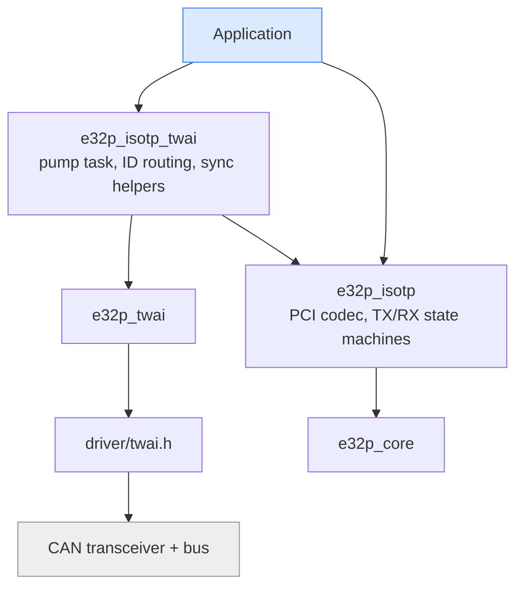

# Automotive Diagnostics Stack — ISO-TP + OBD-II + UDS

> Adds the diagnostic side of automotive CAN to the platform: the ISO 15765-2
> transport, then OBD-II and UDS on top of it. Three new components, three new
> examples, HIL coverage, and independent verification against PC diagnostic
> tools over the CANables.

| | |
|---|---|
| **Status** | Phase 1: slices 1.0–1.8 done and verified on hardware. Phase 2: slices 2.0–2.6 done — OBD-II verified two-board, from the PC over `can-isotp`, and in both the 11-bit and 29-bit sweeps (2026-10-05). Phase 3: **done 2026-10-07** (slices 3.0–3.9) — the UDS server with every service, the bus glue, example 33 walked by udsoncan, the two-board HIL lane with a real ECU reset, udsoncan through a CANable against the companion, `0x78` repeats included, a real reflash of example 33 at 1 Mbit (A-12), and the 11-bit and 29-bit sweeps (76 passed, 4 skipped, twice each). **Not production-ready: the security audit in `docs/SECURITY_HARDENING.md` has not been done.** |
| **Updated** | 2026-10-05 |
| **Planned** | 2026-09-07, revised 2026-09-08 after external review |
| **Target SDK** | ESP-IDF v5.3.1 |
| **Bench** | ESP32-WROOM-32 DUT (COM5) ↔ ESP32-S3 companion (COM7), 2× SN65HVD230, 2×120 Ω |
| **PC tooling** | 2× MKS CANable V2.0 Pro (SavvyCAN / python-can), LA2016 16-ch 200 MHz |

---

## 1. Goal and shape

Let an ESP32 / ESP32-S3 act as a diagnostic ECU — an OBD-II responder and a UDS
server — verified two-board over real CAN *and* independently against
off-the-shelf PC diagnostic tools.

```
components/
  e32p_isotp/   ISO 15765-2 transport (SF/FF/CF/FC, up to 4095 B)   [Phase 1]
  e32p_obd2/    SAE J1979 / ISO 15765-4 OBD-II services            [Phase 2]
  e32p_uds/     ISO 14229-1 UDS services, server-first             [Phase 3]
examples/
  31_isotp_echo/   two-node segmented send + reassemble + echo
  32_obd2_ecu/     OBD-II ECU simulator (scan-tool responder)
  33_uds_server/   UDS server + a PC client for the reflash demo
tests/hil/agent/main/   hil_diag.{c,h}  (one group, all three protocols)
tests/hil/host/         test_isotp.py, test_obd2.py, test_uds.py
```

**ISO-TP is not J1939/TP.** `e32p_j1939tp` is the SAE J1939-21 BAM/CMDT
transport and is not reused here. ISO-TP is a different segmentation scheme
built directly on `e32p_twai` raw frames.

**Out of scope (v1):** CAN-FD; ISO-TP extended and mixed addressing; real
OTA-partition writes in the reflash (mock only); DoIP; full DTC snapshot and
extended-data records.

---

## 2. Decision log

### 2.1 Developer decisions

Settled with the developer before planning was finalised.

Every row carries its **source**. A row that contradicts the ticket is a record
that a decision was made — it is a signal to check provenance, never a defect to
"correct" back to the ticket. The ticket is the input; this table is the record of
where it was overridden.

| # | Question | Decision | Source |
|---|----------|----------|--------|
| 1 | CANable + LA2016 on the bench? | **Yes, both.** Nothing in Phase 1 is hardware-blocked. `WIRING.md` §2/§11 are stale and get corrected. | Developer, 2026-09-08 |
| 2 | Bitrate / addressing selection | **Compile-time**, via Kconfig choice blocks. 250k/500k/1M and 11-bit/29-bit. | Developer, 2026-09-08 |
| 3 | May `hil_can.c` (green code) be edited? | **Yes** — tests must stay green; tests may be edited but never weakened or deleted. | Developer, 2026-09-08 |
| 4 | Phase gating | **Phase 1 only.** Replan 2 and 3 once it lands. | Developer, 2026-09-08 |
| 5 | Deeper TWAI queues (needed for 1 Mbit) | **Yes**, as slice 1.0. Both RX and TX. Defaults stay 5. | Developer, 2026-09-08 |
| 6 | Build sweep width | **4 builds per target**, not the full 6-way cross-product. | Developer, 2026-09-08 |
| 7 | `needs_bitrate` skip marker on `test_can.py` | **Yes** — a skip in a non-gating session is not a coverage loss. | Developer, 2026-09-08 |
| 8 | TX padding byte | **`0xAA`** — **overrides the ticket's `0xCC`.** Alternating bits stress bit-stuffing on the LA trace and stay obvious in a capture. Per-instance via `e32p_isotp_config_t.pad_byte`; no Kconfig symbol. Two review cycles have queried this value; it is intentional, not a transcription error. | **Developer, 2026-09-08 — deliberate ticket override** |
| 9 | API shape | Pure engine **plus** a thin blocking wrapper. Both. **Overrides** the ticket's blocking-only `send/recv(timeout)` sketch — which still exists, one layer up. | Planner proposal, developer-accepted 2026-09-08 — **ticket override** |
| 10 | UDS server address | `0x7E1` → `0x7E9`, not `0x7E0`/`0x7E8`, so OBD and UDS can be armed simultaneously. **Overrides** the ticket's implied pair. | Planner proposal, developer-accepted 2026-09-08 — **ticket override** |
| 11 | HIL agent grouping | One `hil_diag.c`, three host test files. **Overrides** the ticket's three agent files (`hil_isotp/obd2/uds.c`); follows `hil_can.c`'s existing grouped convention. | Planner proposal, developer-accepted 2026-09-08 — **ticket override** |
| 12 | Diagnostics HIL bitrate | **250 k default**, sharing the bus with the green J1939 suite. The ticket notes 500 k is common for OBD — 500 k and 1 M are reachable as separate builds (§7), and the standalone examples default to 500 k. | Planner §1.2 analysis, developer-accepted 2026-09-08 — **partial ticket override** |
| 13 | `MAX_MSG_BYTES` default | **1024**, not the 4095 spec maximum. A default no deployment uses is a bad default; example 31 overrides to 4095 so the spec-max path still ships and is demonstrated. | External review 2, accepted 2026-09-08 |
| 14 | Bitrate Kconfig placement | `e32p_isotp/Kconfig`, not `e32p_twai`. Reasoning and the withdrawn blast-radius pillar are in §5. | Planner §5, unchallenged — see §3.7 for the corrected consumer count |

### 2.2 Design decisions

Appended as they are made. Each records what was rejected and why, not just what
was chosen.

> **D-01 — ISO-TP pump timing and tick-rate independence.** *2026-09-08.*
>
> **Context:** `CONFIG_FREERTOS_HZ=100` makes `pdMS_TO_TICKS(n<10)` evaluate to
> 0, so any sub-10 ms timeout is a busy-spin rather than a wait. With
> `ESP_TASK_WDT_CHECK_IDLE_TASK_CPU0/1=y` and `TIMEOUT_S=5`, a free-running pump
> task is a watchdog panic, not a performance note.
>
> **Rejected — TWAI alerts (event-driven pump).** No gain. `twai_receive`
> already blocks on `xQueueReceive` against a queue filled by
> `xQueueSendFromISR` (`twai.c:699`, `:130`); `twai_read_alerts` blocks on a
> semaphore given from the same ISR (`:269`, `:727`). RX latency is already
> sub-tick. Adds facade surface for nothing.
>
> **Rejected — accept 10 ms granularity.** Would quantize CF pacing to 10 ms
> and, combined with one-CF-per-wake, give a 5.9 s transfer for 4095 bytes.
>
> **Chosen — `CONFIG_FREERTOS_HZ=1000` on the HIL agent (both targets) and
> examples 31/32/33, plus three structural fixes.** An earlier revision rejected
> the tick change on an *asserted* blast radius of "13 green tests and every
> timing-sensitive assertion". Measured, it is **three call sites** —
> `hil_can.c:253`, `hil_can.c:380`, `hil_sys.c:38` — two of which are latent
> bugs the change repairs. Decisive factor: slice 1.0 raises TX queue depth
> 5 → 64, which breaks `bus_down()`'s yield-loop drain at HZ=100 and would
> re-open the 2026-08-28 dropped-last-frame bug. That site must be touched
> either way, so the tick change that makes it correct by construction beats
> patching one line and leaving the bug class alive. `CONFIG_PM_ENABLE` is unset
> on both targets, so there is no tickless-idle coupling.
>
> **The three fixes:** (1) the pump blocks `portTICK_PERIOD_MS`, guarded by
> `E32P_ASSERT_BLOCKING_MS`; (2) `poll()` batches CFs to TX-queue capacity
> rather than one per wake, so STmin=0 throughput is queue-bound not tick-bound;
> (3) `e32p_core` gains `E32P_MS_TO_TICKS_ATLEAST1()` and
> `E32P_ASSERT_BLOCKING_MS()` so a future tick-rate change **fails the build**
> instead of silently becoming a spin.
>
> **Consequences:** TX queue must be deepened alongside RX (slice 1.0).
> Sub-millisecond STmin (raw 0xF1–0xF9) still rounds up to 1 ms — spec-legal,
> documented. Regression gate is a **captured full-suite baseline on both
> targets** (`tests/hil/BASELINE.md`), taken before slice 1.0 touches anything.

> **D-02 — Concurrent TX and RX on one channel.** *2026-09-08.*
>
> **Contract:** a channel supports **one TX session and one RX session
> concurrently**. They are independent state machines on different CAN IDs
> (`tx_id` outbound, `rx_id` inbound) and their flow-control frames travel in
> opposite directions, so they never contend. **Not supported:** two concurrent
> TX sessions (`e32p_isotp_send` returns `ESP_ERR_INVALID_STATE`) or two
> concurrent RX sessions (a new FF during an active RX restarts it — unit
> case 19).
>
> **Why allowed rather than serialized:** the wire permits it — different IDs,
> opposite directions — so forbidding it would impose a restriction ISO 15765-2
> does not. Real stacks (`python-can-isotp`, `isotp-c`) do it, which makes slice
> 1.7's interop safer. And Phase 3 requires it: a 0x78 responsePending going out
> while the tester sends TesterPresent in. Mirrors `e32p_j1939tp`'s 1-TX + N-RX
> shape at N=1, so both transports tell one consistency story.
>
> **RAM cost: zero.** §4.3's table does not move — `tx_buf` and `rx_buf` were
> always allocated per channel; only the contract was unstated.

> **D-03 — Pump lifecycle and TWAI ownership.** *2026-09-08.*
>
> **`e32p_isotp_twai_stop()` hard-joins the pump before returning** — not a
> signalled flag, a join with a verified handshake (§4.4). **This is not
> optional:** `e32p_twai_deinit()` → `twai_driver_uninstall()` →
> `vQueueDeleteWithCaps(rx_queue)`, and a task still blocked in `xQueueReceive`
> on a deleted queue is undefined behaviour. Frame-stealing across sequentially
> run HIL tests is the *benign* failure mode here; the crash is the real one.
>
> **The application owns the TWAI lifecycle.** Required order:
> `e32p_twai_init()` → `e32p_twai_start()` → `e32p_isotp_twai_start()` →
> `_channel()`/`_attach()` → work → **`e32p_isotp_twai_stop()`** →
> `e32p_twai_stop()` → `e32p_twai_deinit()`. Mirrors `e32p_j1939`'s "requires
> e32p_twai to be already initialized and started".
>
> **Consequence for the bench:** every diagnostic test calls
> `e32p_isotp_twai_stop()` **before** `bus_down()`. A documented invariant
> (§10.2), not an implementation detail. Proven by HIL case `isotp_lifecycle`.

### 2.3 Implementation record

What changed from the plan while building it, and the defects found on the way. Each row
records its source so a later reader does not "correct" it back to the plan.

| # | Plan said | Done instead | Why | Source |
|---|-----------|--------------|-----|--------|
| 1 | HIL echo peer on `0x7E0` → `0x7E8` | test channels on `0x7E2`–`0x7E5` | keeps `0x7E0` for the Phase 2 OBD-II server and `0x7E1` for Phase 3 UDS on the companion | Implementation, 2026-09-15 |
| 2 | `needs_bitrate` skip marker on `test_can.py` | not added; `test_can.py` untouched | since slice 1.5 the J1939 tests and the companion follow `HIL_CAN_BITRATE`, so a sweep build runs them at the swept rate instead of making them impossible | Implementation, 2026-09-15 |
| 3 | un-static `bus_up_normal` / `bus_down` | prefixed wrappers `hil_can_bus_up_normal()` / `hil_can_bus_down()` | module prefix on public symbols (platform standard); the 13 existing call sites stay untouched | Implementation, 2026-09-14 |
| 4 | overlays `sdkconfig.rate500k` etc. | `sdkconfig.defaults.rate500k`, `.rate1m`, `.addrfixed` | a name starting `sdkconfig.` reads like a generated config; matches example 31's `sdkconfig.defaults.role_a` | Implementation, 2026-09-15 |
| 5 | tick macros in `e32p_core.h` | separate opt-in `e32p_core/include/e32p_time.h` | the macros need FreeRTOS, and `e32p_core.h` reaches every module | Implementation, 2026-09-09 |
| 6 | queue-depth symbols read directly | `#ifndef` fallbacks to 5 in `e32p_twai.c` | an existing project's generated `sdkconfig` did not pick up the new symbols, and example 14 failed to build | Implementation, 2026-09-09 |
| 7 | 29 Unity cases | 33 | added sink back-pressure, "timers armed before the first poll", and two STmin pacing cases, each for a bug below | Implementation, 2026-09-09 / 2026-09-15 |
| 8 | example 31 with `sdkconfig.defaults.esp32s3` | target-aware pin defaults in `Kconfig.projbuild` | the pattern example 30 already uses | Implementation, 2026-09-11 |

**Defects found and fixed during implementation:**

- **FC.WAIT deadlock (engine, slice 1.1).** After sending FC.WAIT the receiver never sent
  the CTS that releases the sender. Caught by running the Unity suite on the PC before any
  flash.
- **Unit runner printed no summary (pre-existing).** `unity_run_all_tests()` was never
  wrapped in `UNITY_BEGIN()` / `UNITY_END()`.
- **Companion bus-off recovery could strand it off the bus (pre-existing,
  `comp_can_keepalive`).** Found by the slice 1.5 root-cause analysis; not the cause of that
  gate failure, which was a CANable left at the wrong bitrate.
- **Timers armed before a channel's first poll expired at once (engine, slice 1.6).** Every
  multi-frame transfer on a channel created long after boot failed with `ESP_ERR_TIMEOUT`.
  Example 31 had escaped it only because it sent within 1 s of boot.
- **Destroying a channel after stopping the link leaked it (link, slice 1.6).**
- **STmin was not honoured on the wire (engine, found by the LA2016 capture, 2026-09-15).**
  At 250 kbit with STmin 1 ms, the first two Consecutive Frames of every block went out
  12 µs apart, in all 12 blocks and from both boards. Two causes: `handle_fc()` sent the
  first CF from `on_frame()` and paced the block from the previous poll's clock, and
  `now_ms` is truncated to whole milliseconds (the DUT's 2nd→3rd CF came 0.56–0.87 ms
  apart). Fix: CFs leave only from `poll()`, and the gap is STmin + 1 ms. Two Unity
  cases replay the capture and failed before the fix. The companion loop now reads its
  clock after the receive. Verified: unit runner 135/0, full HIL suite 57 passed /
  4 skipped with the CANable.

**Bench findings that change the plan's assumptions:**

- **A CANable left open at the wrong bitrate breaks the HIL bus** (2026-09-14). It answers
  traffic it cannot decode with error frames and knocks both boards into bus-off at random.
  This was the whole cause of the first slice 1.5 gate failure.
- **This CANable's slcan firmware passes no frames through in listen-only mode**
  (2026-09-15: 0 frames listen-only, 34 in normal mode for the same transfer). Wherever this
  plan says "listen-only sniffer", read "normal-mode capture". During ordinary HIL runs the
  adapter's port must be closed, or the adapter unplugged. A truly passive capture needs
  candleLight (gs_usb) firmware on the CANable.
- **Every TWAI bring-up held the bus dominant for ~8 ms (pre-existing, `e32p_twai`;
  found by the LA2016 capture, 2026-09-15).** At each test start the DUT's GPIO21 went low
  for 7.95 ms, and the companion answered with an error flag. Cause, proven with a
  scratch diagnostic build: IDF 5.3.1's `twai_driver_install()` makes the TX pin a plain
  GPIO output and prints an INFO log line before it connects the TWAI controller to the
  pin (`twai.c:298-299`, `gpio.c:385` then `:404`). The pin drives its output register
  bit, which is 0 (dominant), and the log line waits ~7.4 ms for UART FIFO space. With the
  bit preset to 1 the bus stayed recessive through the whole install; set back to 0, the
  dominant window returned. Fixed with the developer's approval: `e32p_twai_init()` presets
  the bit to 1 before the install, and a Unity case checks it. Verified: unit runner 136/0,
  full HIL suite 57 passed / 4 skipped with the CANable.
- **"Bus dominant after a DUT reset" was the analyzer, not the firmware (closed,
  2026-09-16).** Both captures showed the bus dominant for 2.1–2.3 s after every DUT
  reset, until `e32p_twai_init()`. An A/B test from the DUT itself, same wiring and same
  firmware, settled it: with KingstVIS **closed**, 10 of 10 resets read recessive; with it
  **open**, 10 of 10 read dominant — whether a capture was armed or stopped. Running the
  software is enough, because it loads the analyzer's firmware and sets the 1.65 V
  threshold on connect; GPIO21 floats from chip reset until the driver configures it, so
  the transceiver read the biased line as dominant. What remains true is that the pin is
  undriven in that window, so the agent now parks it recessive at the top of `app_main`
  (verified with KingstVIS open: 10 resets recessive from ~1 ms after app start, where they
  used to stay dominant for seconds). That leaves the ROM and bootloader window; a pull-up
  on the transceiver's D line would cover it, recorded as a TODO in `docs/TEST_PLAN.md`.
  See `WIRING.md` §12.4.

---

# Phase 1 — `e32p_isotp`

Edit-complexity grade **E5** — must be sliced. Nine slices, `idf.py build`
green after each.

## 3. Findings that shaped the design

All verified by reading the code, not assumed. Each invalidated part of an
earlier draft. 3.5 and 3.6 came out of the external review.

### 3.1 `e32p_j1939_receive` consumes and discards 11-bit frames

```c
/* components/e32p_j1939/src/e32p_j1939.c */
esp_err_t err = e32p_twai_receive(&rx, timeout_ms);
if (err != ESP_OK) return err;
/* Non-J1939 (standard 11-bit) frames are not decodable as J1939. */
E32P_RETURN_ON_FALSE(rx.extended, ESP_ERR_INVALID_RESPONSE, TAG, "not a 29-bit frame");
```

The frame is dequeued from TWAI and *then* rejected, with a log line each.
`hil_can.c:companion_task` calls exactly this. So without a change, every ISO-TP
frame would be silently eaten by the companion and a 100-byte transfer would
emit ~16 error logs that stall the loop — the precise failure its own
`@EVT`-suppression comment already warns about.

**Consequence:** slice 1.5 must switch the companion to raw
`e32p_twai_receive` + explicit `e32p_j1939_id_decode`. Mandatory, not stylistic.

### 3.2 The PF byte is a safe router discriminator, and is standards-correct

PGNs actually present in `components/e32p_j1939*`, the HIL agent, and examples
17/18/19/30:

| PGN | Hex | PF byte |
|-----|-----|---------|
| 59904 REQUEST | 0xEA00 | 0xEA |
| 60160 TP.DT | 0xEB00 | 0xEB |
| 60416 TP.CM | 0xEC00 | 0xEC |
| 60928 ADDR_CLAIMED | 0xEE00 | 0xEE |
| 61444 EEC1 | 0xF004 | 0xF0 |
| 65259 / 65260 / 65262 | 0xFEEB / 0xFEEC / 0xFEEE | 0xFE |

ISO-TP normal-fixed composes PF **0xDA** (physical) / **0xDB** (functional) —
disjoint from all six. Not a coincidence: SAE J1939-73 reserves PGN 55808
(0xDA00) for exactly ISO 15765-2 diagnostic data transfer. The router
implements the standard rather than working around it.

### 3.3 Example 18 is a single-board loopback

`examples/18_j1939tp_bam` runs both transport engines in one app over an
in-process queue (sender SA 0x80, receiver SA 0x21, local `pump()`). There is no
two-node role mechanism to copy, so example 31 defines one.

### 3.4 1 Mbit overruns the default TWAI RX queue

`CONFIG_FREERTOS_HZ=100` on both agent builds; the IDF default is
`rx_queue_len = 5`.

| Bitrate | 8-byte 11-bit frame | 5-slot queue holds |
|---------|--------------------|--------------------|
| 250 k | 444 µs (520 µs worst-case stuffing) | 2.2 – 2.6 ms — comfortable |
| 500 k | 222 / 260 µs | 1.1 – 1.3 ms — adequate |
| 1 M | 111 / 130 µs | **0.55 – 0.65 ms — insufficient** |

Our advertised `rx_stmin_ms = 1` defends against a compliant peer but not
against a tool that ignores STmin — and the CANable is on the bench, so that
case is real. Hence slice 1.0.

### 3.5 Exactly three sub-tick call sites exist in the HIL agent

Every `pdMS_TO_TICKS(N)` literal and every raw millisecond timeout in
`tests/hil/agent/main/*.c`, by value:

```
pdMS_TO_TICKS:  5 x2 | 10 | 20 | 30 | 60 | 100 x3 | 300 x2 | 350 | 700
raw API arg:    5    | 10 | 20 | 50 x3 | 100 x4 | 200 | 400 x2 | 500 x2
```

Only **three** sit below one 10 ms tick, and all three currently misbehave
because of it:

| Site | What it is | Behaviour at HZ=100 |
|------|-----------|---------------------|
| `hil_can.c:253` | `bus_down()` TX drain, `for (i<60) vTaskDelay(pdMS_TO_TICKS(5))`, commented `/* up to ~300 ms */` | `vTaskDelay(0)` — 60 bare yields, **no wall-clock budget at all**. Works today only because a 5-deep TX queue drains in ~2.2 ms at 250 kbit. |
| `hil_can.c:380` | TP hand-pump `e32p_j1939_receive(&m, 5)` | Non-blocking poll; a 6-second CPU spin bounded by a deadline. |
| `hil_sys.c:38` | `vTaskDelay(pdMS_TO_TICKS(5))` awaiting event dispatch | A bare yield, not a wait. |

Everything else is >= 10 ms, already >= 1 tick, and only becomes *more* precise
at a higher tick rate. There is no site where raising the tick makes behaviour
coarser.

**Consequence:** this is what reversed D-01. `bus_down()` must be fixed
regardless, because slice 1.0 raises TX depth to 64 — roughly 28 ms of queued
wire time at 250 kbit, which 60 yields cannot cover. Left alone it would abort
queued frames on `e32p_twai_stop()` and re-open the 2026-08-28 dropped-last-frame
bug.

### 3.6 No power-management coupling

`# CONFIG_PM_ENABLE is not set` on both agent targets (`sdkconfig:879`,
`sdkconfig.esp32s3:1003`). Tickless idle and DFS are off, so `hil_pm.c` exercises
`esp_sleep_*` (RTC / esp_timer based) rather than tick-based paths. Raising
`CONFIG_FREERTOS_HZ` has no interaction there.

### 3.7 `e32p_twai` has 7 consumers, not 30

Source files including `e32p_twai.h`, excluding the component itself:
`components/e32p_j1939/src/e32p_j1939.c`, its Unity test, `examples/14_twai_loopback`,
`examples/17_j1939_send`, `examples/29_edge_gateway/main/gw_source.c`,
`examples/30_j1939_ecu_sim`, and `tests/hil/agent/main/hil_can.c`. Nine to eleven
`CMakeLists.txt` reference the component.

An earlier revision of this plan claimed "30 existing consumers" in §5's
blast-radius argument and in slice 1.0's exit criteria. **30 is the number of
components in `components/`, not the number of consumers.** It was repeated
without being resolved. §5's placement argument is re-derived on the pillars that
survive; slice 1.0's exit criterion now says 7.

### 3.8 The bench bus helpers are file-static and take no bitrate

`bus_up_normal()` is `static esp_err_t` at `hil_can.c:229` — **no parameters**,
with `CAN_BITRATE` baked into its body at `:233`. `bus_down()` is `static void`
at `:240`. Neither appears in any header. Call sites: 5 and 8 respectively.

§10.2's DUT pattern originally read `bus_up_normal(bitrate)` from `hil_diag.c`,
which is impossible twice over — wrong linkage *and* wrong arity. The arity half
dissolves once slice 1.5 replaces `CAN_BITRATE` with `HIL_CAN_BITRATE`: §7's
design is one binary, one compile-time bitrate, so there is no bitrate to pass.
The call is `bus_up_normal()`.

Fix is four lines — un-static both, declare both in `hil_can.h` — and it lands in
slice 1.5, under the gate already built for green-code edits.

There is **no `bus_up_noack()` helper** to share; the NO_ACK sites (`:33`, `:50`)
build their config inline. `hil_diag.c` writes its own four-line NO_ACK init for
`isotp_self`. That duplication is acceptable because the up-path has no subtle
logic — only `bus_down()`'s drain does, and that one is shared.

### 3.9 The BAM risk, quantified

§13 flagged `hil_can.c:380` as the site to watch when its 6 s loop stops being a
spin. Computed rather than left as a worry:

`TP_BAM_PACE_MS = 50` (`e32p_j1939tp.c:40`, applied at `:438`). `can_tp_bam`
sends 250 B = **36 packets** × 50 ms = **1.80 s**, or ~1.98 s allowing 5 ms of
poll drift per packet — against a **6 s** budget. **3× margin.** `can_tp_cmdt`
emits whole bursts per poll and is unaffected.

---

## 4. Architecture

Two layers, both inside the component.

| Layer | File | Shape | Consumers |
|-------|------|-------|-----------|
| **Engine** | `src/e32p_isotp.c` | Injected TX sink + `on_frame()` + `poll(now_ms)`. No TWAI, no FreeRTOS, no clock. ~800 lines. | Unity tests; the OBD-II and UDS servers in later phases. |
| **Link** | `src/e32p_isotp_twai.c` | One pump task, ID-based routing to N channels, blocking `send_sync`/`recv_sync`. ~250 lines. | Examples; `hil_diag.c` DUT-side tests. |

The engine carries 100% of the protocol logic and is fully testable headless —
the same shape `e32p_j1939tp` already proves on both targets. HIL handlers are
synchronous (`hil_verdict_t fn(char *detail, size_t n)`), so they use the
blocking wrapper; servers are event handlers, so they use the engine directly.

Two config fields worth calling out, both with direct precedent in
`e32p_j1939_config_t`:

- **`bool self_reception`** — mirrors `e32p_j1939_config_t.self_reception`
  (`e32p_j1939.h:52`, used at `hil_can.c:283`). The TX sink sets `msg.self` from
  it. Required by `isotp_self`; without it the engine cannot request
  self-reception at all.
- **Concurrency** — one TX plus one RX session per channel, concurrent and
  independent (D-02). Stated in the `e32p_isotp_handle_t` doc comment so a
  caller does not have to infer it.



### 4.1 Pump loop

Poll first, then deliver — the same timing contract documented in
`e32p_j1939tp/DESIGN.md` §8.

```c
#define E32P_ISOTP_PUMP_BLOCK_MS (portTICK_PERIOD_MS)   /* 1 ms at HZ=1000 */
E32P_ASSERT_BLOCKING_MS(E32P_ISOTP_PUMP_BLOCK_MS);      /* never 0 ticks */

for (;;) {
    uint32_t now = esp_timer_get_time() / 1000;
    for (int i = 0; i < n_ch; i++) e32p_isotp_poll(ch[i], now);
    if (e32p_twai_receive(&m, block_ms) == ESP_OK) {     /* >= 1 tick, blocks */
        route(&m);
        /* Drain the burst, but BOUNDED - an unbounded drain on a saturated
           1 Mbit bus never returns to poll(), which is what sends FC and
           services N_Bs/N_Cr. poll() must run at least once per wake. */
        for (int k = 0; k < CONFIG_E32P_TWAI_RX_QUEUE_LEN
                        && e32p_twai_receive(&m, 0) == ESP_OK; k++) route(&m);
    }
}
```

Defaults: `block_ms = portTICK_PERIOD_MS`, priority 10, stack 4096. The config
field is clamped at init via `E32P_MS_TO_TICKS_ATLEAST1()`, with a warning, so a
caller cannot configure a spin.

**The link reads one Kconfig symbol, and that is deliberate.** The drain bound
above is `CONFIG_E32P_TWAI_RX_QUEUE_LEN`. §5 makes a point of proving the
*engine* reads no Kconfig symbol; the *link* legitimately may — it is named
`_twai` and exists to bind to that driver — but it is stated here rather than
left to be discovered in a code sample.

**The block time is not an RX-latency limit.** `twai_receive` blocks on a queue
fed by `xQueueSendFromISR`, so the pump wakes on the interrupt the moment a frame
lands. The block time bounds only how long an *idle* pump sleeps before servicing
timers.

### 4.1.1 `poll()` batches CFs — never one per invocation

Each `poll()` emits as many consecutive frames as the peer's BlockSize, its
STmin, and TX-queue capacity currently allow:

```c
while (cf_due(now) && bs_credit_remaining()) {
    if (emit_next_cf() != ESP_OK) break;   /* TX queue full — resume next wake */
}
```

`e32p_twai_transmit(msg, 0)` returning non-OK is the natural back-pressure
signal. This decouples STmin=0 throughput — the common case, and what most PC
testers request — from the tick rate entirely. One CF per wake would give a
5.9-second 4095-byte transfer at 10 ms granularity; an implementer reading
“poll paces CFs” would write exactly that, which is why it is spelled out here.

Wire duty cycle, frames queued per wake × frame time:

| Bitrate | 8-byte frame | Frames per 10 ms of wire | TX depth 5 | TX depth 64 |
|---------|-------------|--------------------------|-----------|-------------|
| 250 k | 444 µs | 22 | 22% | saturated |
| 500 k | 222 µs | 45 | 11% | saturated |
| 1 M | 111 µs | 90 | 5.5% | 71% |

TX depth 5 caps throughput near 350 B/s regardless of bitrate, which would make
the multi-bitrate feature cosmetic. Hence slice 1.0 deepens **both** queues.

**Shared TX queue in the 29-bit build.** There, J1939 broadcasts and ISO-TP CF
bursts share one TX queue from separate tasks. STmin pacing plus depth 64 give
ample headroom, but it is the one configuration where the two stacks contend for
a driver resource rather than just the wire.

**Re-entrancy rule** — stated in the header and `DESIGN.md` §7: `on_rx` fires
inside the pump task. Calling `e32p_isotp_send()` there is safe (it only arms a
session). Calling `e32p_isotp_twai_send_sync()` there self-deadlocks; it asserts.

### 4.2 Known limitation

Sub-millisecond STmin (raw `0xF1`–`0xF9`, 100–900 µs) rounds **up** to one
tick period — 1 ms at the `CONFIG_FREERTOS_HZ=1000` the agent and examples 31/32/33
set (D-01). Sending slower than the peer asked is always spec-legal, but it is
the honest consequence of a poll-tick design and is documented rather than buried.

Granularity follows `portTICK_PERIOD_MS`, so it is a project setting rather than
a component limit: a build at HZ=100 would quantize to 10 ms instead, which is
why `E32P_ASSERT_BLOCKING_MS` fails the build rather than letting it degrade
silently. **STmin=0 is unaffected either way** — that path is TX-queue-bound, not
tick-bound (§4.1.1).

### 4.3 RAM budget

Two buffers per channel, sized by `max_msg_bytes`; channel struct ~140 B.

| Deployment | Config | Cost |
|------------|--------|------|
| HIL agent (both targets) | 1024 | `ch_phys` 2 KB + `ch_func` 1 KB ≈ **3 KB** |
| Example 31 | 4095 per-instance | **8.2 KB** — proves the spec limit |

These figures already cover full duplex: `tx_buf` and `rx_buf` are both
allocated per channel, so D-02's concurrent TX+RX contract changes no number
here.

For scale, `e32p_j1939tp` already carries 1 TX + 2 RX × 1785 B = 5.4 KB on the
same agent and passes. `hil_agent.c:cmd_run` prints `heap=%+d` per test, so any
leak surfaces immediately.

### 4.4 Link lifecycle

`e32p_isotp_twai_stop()` **hard-joins** the pump. The last three lines of the
task are the contract:

```c
for (;;) {
    if (s_link.stop_req) break;
    /* poll all channels, blocking receive, bounded drain, route */
}
s_link.task = NULL;
xSemaphoreGive(s_link.done);   /* LAST action; nothing TWAI-related after this */
vTaskDelete(NULL);
```

```c
esp_err_t e32p_isotp_twai_stop(void)
{
    if (s_link.task == NULL) return ESP_OK;            /* idempotent */
    s_link.stop_req = true;
    if (xSemaphoreTake(s_link.done, pdMS_TO_TICKS(100)) != pdTRUE) {
        return ESP_ERR_TIMEOUT;   /* HARD error — caller must NOT deinit TWAI */
    }
    detach_all_channels();
    return ESP_OK;
}
```

**What makes the join fast:** the pump's maximum block is `portTICK_PERIOD_MS`
(1 ms at HZ=1000), so it observes `stop_req` within one loop pass. A 100 ms
budget is ~50× headroom. The give is the last action and touches no TWAI state,
so the window between it and `vTaskDelete(NULL)` is safe even if the caller
proceeds immediately.

**Ownership contract.** The application owns the TWAI lifecycle:

```
e32p_twai_init() -> e32p_twai_start() -> e32p_isotp_twai_start()
  -> _channel() / _attach() -> work
  -> e32p_isotp_twai_stop() -> e32p_twai_stop() -> e32p_twai_deinit()
```

| Call | Condition | Returns |
|------|-----------|---------|
| `_start()` | TWAI not installed | `ESP_ERR_E32P_NOT_INIT` |
| `_start()` | called twice | `ESP_ERR_INVALID_STATE` (matches `e32p_twai_init`) |
| `_stop()` | stopped or never started | `ESP_OK` (matches `e32p_twai_deinit`) |
| `_stop()` | pump did not join in 100 ms | `ESP_ERR_TIMEOUT` — do **not** deinit TWAI |

The start/stop asymmetry is deliberate and matches the platform's existing
convention. **Calling `e32p_twai_deinit()` while a link is running is a
programming error**, not a recoverable state — `_stop()` is the only safe
teardown path.

---

## 5. Compile-time selection

Both knobs live in `components/e32p_isotp/Kconfig`. **The engine reads neither
symbol** — they are defaults consumed by app and test code, and every field of
`e32p_isotp_config_t` stays overridable at runtime.

```
menu "e32p: isotp"

    config E32P_ISOTP_ENABLE
        bool "Enable e32p_isotp (ISO 15765-2 transport)"
        depends on SOC_TWAI_SUPPORTED
        select E32P_TWAI_ENABLE
        default n

    choice E32P_ISOTP_BITRATE
        prompt "Default CAN bitrate for ISO-TP apps"
        depends on E32P_ISOTP_ENABLE
        default E32P_ISOTP_BITRATE_250K
        help
            A CAN bus is a single-bitrate domain: EVERY node must match,
            including a CANable sniffer. Changing this needs a rebuild and a
            reflash of every node.
        config E32P_ISOTP_BITRATE_250K
            bool "250 kbit/s  (this bench's J1939 default)"
        config E32P_ISOTP_BITRATE_500K
            bool "500 kbit/s  (typical OBD-II / ISO 15765-4)"
        config E32P_ISOTP_BITRATE_1M
            bool "1 Mbit/s    (needs E32P_TWAI_RX_QUEUE_LEN >= 32)"
    endchoice

    config E32P_ISOTP_BITRATE_BPS
        int
        depends on E32P_ISOTP_ENABLE
        default 250000  if E32P_ISOTP_BITRATE_250K
        default 500000  if E32P_ISOTP_BITRATE_500K
        default 1000000 if E32P_ISOTP_BITRATE_1M

    choice E32P_ISOTP_ADDRESSING
        prompt "Default ISO-TP addressing"
        depends on E32P_ISOTP_ENABLE
        default E32P_ISOTP_ADDRESSING_NORMAL_11
        config E32P_ISOTP_ADDRESSING_NORMAL_11
            bool "Normal, 11-bit"
        config E32P_ISOTP_ADDRESSING_NORMAL_FIXED
            bool "Normal fixed, 29-bit"
    endchoice

    config E32P_ISOTP_MAX_MSG_BYTES
        int "Max ISO-TP payload (bytes)"
        depends on E32P_ISOTP_ENABLE
        range 8 4095
        default 1024
        help
            Bounds BOTH buffers of every channel: RAM = 2 x this per channel.
            1024 matches the reference deployment; example 31 overrides to
            4095 to demonstrate the spec maximum.

    config E32P_ISOTP_MAX_CHANNELS
        int "Channels the TWAI link can route to"
        depends on E32P_ISOTP_ENABLE
        range 1 8
        default 4

endmenu
```

*An earlier revision carried an `E32P_ISOTP_BLOCKING_API` option gating
`send_sync`/`recv_sync`. It was **removed**: every consumer in the repo — the HIL
agent and all three examples — uses those helpers, so an option each of them must
turn on is a trap rather than a choice, and `e32p_j1939tp` has no comparable
sub-option. If binary size ever justifies it, it returns with a real
`depends on`.*

Surfaced in the header as `E32P_ISOTP_DEFAULT_BITRATE` and
`E32P_ISOTP_DEFAULT_ADDR_MODE`, plus a helper so no call site repeats the `#if`:

```c
e32p_isotp_config_t c;
e32p_isotp_config_defaults(&c, 0x7E0, 0x7E8, /*sa*/0xF1, /*ta*/0x10, false);
c.on_rx = echo_cb;  c.max_msg_bytes = 1024;      /* per-instance overrides */
```

**The coupling this creates, named rather than discovered.** The first consumer
of `CONFIG_E32P_ISOTP_BITRATE_BPS` is J1939 bench code: `hil_can.c` hardcodes
`CAN_BITRATE 250000`, and the sweep builds are meaningless unless the companion
and the J1939 tests come up at the swept rate. That is absorbed by a new
`HIL_CAN_BITRATE` in `hil_pins.h`, defaulting to the Kconfig symbol and consumed
by both `hil_can.c` and `hil_diag.c`. The dependency is expressed once, in bench
code, where a bench-wide bus property belongs. `DESIGN.md` §2 records it so it is
not a surprise. This is a bench coupling, not a component one — `e32p_isotp`
never reads it.

**Why here and not in `e32p_twai`:** bitrate is genuinely a TWAI property, so
purity argues for that menu. This argument originally rested on three pillars.
One is withdrawn:

- ~~Blast radius across 30 consumers~~ — **withdrawn.** The real count is 7
  source files (§3.7). The number was never resolved before being used.
- **Semantic change — stands.** Every existing caller passes bitrate explicitly
  in `e32p_twai_config_t`. Adding a default there gives a shipped transport
  facade an opinion about bitrate it has never had. A default nobody reads is
  dead weight; one callers start reading is new coupling.
- **Knob adjacency — stands, and is now the primary reason.** Addressing mode is
  unambiguously an ISO-TP concept and must live here. Splitting bitrate into a
  different menu would turn the developer's one compile-time knob into two
  locations, which is the opposite of what was asked for.

A bench-owned symbol (agent and each example carrying its own choice block) was
considered and rejected: architecturally cleaner, but it duplicates a 12-line
block four times and scatters the knob. `DESIGN.md` §2 records this as a
decision, not an accident.

---

## 6. Router discriminator

Discriminate on the ISO-TP address space, not on ID width, so it survives the
11↔29-bit switch.

```c
/* tests/hil/agent/main/hil_diag.h */
static inline bool hil_diag_is_isotp_frame(const e32p_twai_message_t *m)
{
    if (!m->extended) return true;              /* J1939 is 29-bit only */
    const uint8_t pf = (uint8_t)((m->id >> 16) & 0xFFu);
    return pf == 0xDAu || pf == 0xDBu;          /* ISO-TP normal-fixed */
}
```

Normal-fixed mode always composes 0xDA/0xDB, so the addressing switch can never
create a collision. The only way to break the router is to hand-write a raw
29-bit `rx_id` in `NORMAL_11` mode whose PF lands in the J1939 set — a config
misuse, not a reachable state. Guarded twice:

- **Build time** — `_Static_assert` in `hil_diag.c` that compiled-in diagnostic
  IDs are 11-bit or decode to PF 0xDA/0xDB.
- **Run time** — `hil_diag_attach()` rejects a 29-bit channel whose PF is
  outside {0xDA, 0xDB}, logs `ESP_LOGE`, returns `HIL_FAIL` rather than
  mis-routing silently.

This is bench-router logic. It stays in `hil_diag.h`; `e32p_isotp` knows nothing
about J1939.

---

## 7. Build matrix and run procedure

**A compile-time bitrate means one binary equals one bitrate.** A single pytest
session cannot mix rates. The rate is therefore a build, not a test — there is
no `isotp_rate_500k` test ID.

| Build dir | Rate | Addressing | J1939 tests | Diagnostic tests | Role |
|-----------|------|-----------|-------------|------------------|------|
| `build/`, `build_esp32s3/` | 250 k | 11-bit | **all 13 run** | all run | **Everyday gating suite** |
| `build_500k/`, `build_s3_500k/` | 500 k | 11-bit | skipped by marker | all run | Rate sweep |
| `build_1m/`, `build_s3_1m/` | 1 M | 11-bit | skipped by marker | all run | Rate sweep |
| `build_nf/`, `build_s3_nf/` | 250 k | 29-bit fixed | **all 13 run** | all run | **Proves the router** |

The 29-bit build is the most valuable extra: it is the only configuration where
both stacks are 29-bit on one live bus at once.

The agent appends the compiled settings to every diagnostic verdict:

```
@RSP RUN isotp_mf PASS heap=<delta> t=<ms> detail=len=100 rate=250000 addr=norm11
```
*(shape only — placeholder values, not measured output)*

New pytest options `--can-bitrate` (default 250000) and `--isotp-addr` (default
`norm11`) assert them, so a wrong-binary run fails loudly on the first test
instead of silently proving nothing.

### Overlay files

```
tests/hil/agent/sdkconfig.defaults      CONFIG_E32P_ISOTP_BITRATE_250K=y
                                        CONFIG_E32P_TWAI_RX_QUEUE_LEN=32
                                        CONFIG_E32P_TWAI_TX_QUEUE_LEN=64
tests/hil/agent/sdkconfig.defaults.esp32s3   same two queue-depth lines
tests/hil/agent/sdkconfig.defaults.rate500k   CONFIG_E32P_ISOTP_BITRATE_500K=y
tests/hil/agent/sdkconfig.defaults.rate1m     CONFIG_E32P_ISOTP_BITRATE_1M=y
tests/hil/agent/sdkconfig.defaults.addrfixed  CONFIG_E32P_ISOTP_ADDRESSING_NORMAL_FIXED=y
```

```powershell
idf.py -C tests\hil\agent -B tests\hil\agent\build_500k `
  -D SDKCONFIG=sdkconfig.sweep_500k -D SDKCONFIG_DEFAULTS="sdkconfig.defaults;sdkconfig.defaults.rate500k" build
```

Every sweep build reflashes **both** boards *and* rebuilds the J1939 bitrate,
since `HIL_CAN_BITRATE` follows the Kconfig symbol (§5). That is why the 13
J1939 cases are skipped by marker in the 500 k and 1 M sessions — they cannot
pass on a bus running at another rate.

---

## 8. Slices

| # | Intent | Owns | Depends | Exit criteria |
|---|--------|------|---------|---------------|
| **1.0** | **Foundation: tick-rate independence + TWAI queue depths** | `e32p_core.h` (2 macros), `e32p_twai/Kconfig` (RX+TX depth), `src/e32p_twai.c` (+2 lines), `e32p_twai/README.md`, agent `sdkconfig.defaults` ×2 and examples 31/32/33 (`CONFIG_FREERTOS_HZ=1000`) | — | **Same pass/skip set as the captured baseline** (`tests/hil/BASELINE.md`, taken in step 0) on both targets, assertions unmodified. Queue defaults stay 5 so all **7** source consumers are bit-identical. Examples 31/32/33 and the agent set RX=32 / **TX=64** via overlay. |
| **1.1** | Pure engine + Unity suite | `e32p_isotp.h`, `.c`, `Kconfig`, `CMakeLists.txt`, `test/*`, `unit_runner` ×2 | 1.0 | **29** Unity cases pass. Grep proves the engine references no TWAI/FreeRTOS symbol **and** neither `E32P_ISOTP_BITRATE` nor `E32P_ISOTP_ADDRESSING` — keeping §5's "the engine reads neither" claim tested, not asserted. |
| **1.2** | TWAI link + config helper | `e32p_isotp_twai.h`, `.c`, `e32p_isotp_config_defaults()` | 1.1, **D-01 logged** | Builds both targets. Pump blocks ≥ 1 tick (`E32P_ASSERT_BLOCKING_MS`). `poll()` batches CFs. `send_sync` from a callback trips its assert. **D-03 verified: `_stop()` hard-joins; `_start()` twice → `ESP_ERR_INVALID_STATE`; `_stop()` twice → `ESP_OK`.** |
| **1.3** | Component docs | `README.md`, `DESIGN.md` (9 sections) | 1.2 | §2 records the Kconfig trade-off; §7 the STmin round-up + re-entrancy rule. |
| **1.4** | Example 31 + workspace | `examples/31_isotp_echo/*`, `main.code-workspace` (one file, two edits: folders entry + task-picker option) | 1.2 | All three roles build for esp32 + esp32s3. Loopback passes on a bare board. Example sets `MAX_MSG_BYTES=4095` and `CONFIG_FREERTOS_HZ=1000`. |
| **1.5** | Companion router — **touches green code** | `hil_diag.h` (real inline discriminator + declarations), stub `hil_diag.c` (no-op `_on_frame`/`_poll`), `hil_can.c` (~15 lines + `HIL_CAN_BITRATE` + un-static two helpers), **`hil_can.h` (+2 declarations)**, `hil_pins.h`, `hil_sys.c` (assert), `test_can.py` (marker only) | 1.2, 1.0 | See §9. |
| **1.6** | HIL group + host tests | **Replaces 1.5's `hil_diag.c` stubs** with the real ISO-TP peer; `hil_agent.c`, `main.c`, agent CMake + 4 overlays, `test_isotp.py`, `conftest.py`, `pytest.ini` (`needs_bitrate`) | 1.5 | Default 250 k session green. Rate + addressing reported and asserted. **`isotp_lifecycle` proves no pump leaks between tests.** |
| **1.7** | CANable automation + bench docs | `test_isotp_canable.py`, `requirements.txt`, `pytest.ini` (`needs_canable`), `WIRING.md` **§12** + §2/§11 corrections | 1.6 | Two automated CANable tests pass; two manual captures filed. Cross-reference grep for §9–§11 clean. |
| **1.8** | Platform docs | `ARCHITECTURE.md`, `TEST_PLAN.md`, `TEST_MATRIX.md`, root `README.md` | 1.7 | A-01 bumped 29 → 30 modules. New B-27, I-33, A-09. |

---

## 9. Slice 1.5 — the hard gate

The edit:

```c
/* was */
e32p_j1939_message_t m;
if (e32p_j1939_receive(&m, 50) == ESP_OK) { ...TP vs non-TP branch... }

/* becomes */
e32p_twai_message_t raw;
if (e32p_twai_receive(&raw, 5) == ESP_OK) {
    if (hil_diag_is_isotp_frame(&raw)) {
        hil_diag_companion_on_frame(&raw);
    } else {
        e32p_j1939_message_t m;
        e32p_j1939_id_decode(raw.id, &m.priority, &m.pgn, &m.src_addr, &m.dst_addr);
        m.len = (raw.len <= 8u) ? raw.len : 8u;
        memcpy(m.data, raw.data, m.len);
        /* existing TP vs non-TP branch, byte-identical */
    }
}
e32p_j1939tp_poll(s_comp_tp, now);
hil_diag_companion_poll(now);
```

**Four edits to green code, each forced:**

1. **Raw receive + explicit decode** — required by §3.1. The decode is a straight
   inline of what `e32p_j1939_receive` already does after its `rx.extended` check.
2. **Timeout 50 ms → 5 ms** — required for STmin pacing. At
   `CONFIG_FREERTOS_HZ=1000` (D-01) this is a genuine 5 ms block, so the idle
   loop runs at 200 Hz and `comp_can_keepalive()`'s `twai_get_status_info()`
   goes 20 → 200 Hz. A register read, but watch companion idle heap and CPU.
   **At HZ=100 the same line would be a zero-tick spin at thousands of Hz** —
   which is why slice 1.0 lands first and why `E32P_ASSERT_BLOCKING_MS(5)` is
   placed here.
3. **`CAN_BITRATE` → `HIL_CAN_BITRATE`** — moved to `hil_pins.h` and driven by
   `CONFIG_E32P_ISOTP_BITRATE_BPS` (§5), so the sweep builds actually change the
   bus rate.
4. **`bus_up_normal()` / `bus_down()` un-static'd**, declared in `hil_can.h`, so
   `hil_diag.c` can share them (§3.8). Four lines. `bus_down()`'s drain is the
   2026-08-28 dropped-frame fix and must not be duplicated — the ISO-TP path
   needs it most, since every FC frame and every final CF hits exactly it.

**Exit criteria — green is not bought with coverage:**

- All 13 `test_can.py` cases pass **with assertions unchanged**. Target: zero
  test edits.
- If any test must change shape, the slice produces a **per-test before/after
  assertion table**, and the replacement asserts at least as much. No deletion,
  no weakened assertion, no widened timeout papering over a regression.
- The only permitted edit is the `needs_bitrate` skip marker for non-250k
  builds — a skip in a non-gating session. All 13 still run in full in both
  gating sessions (250 k and 29-bit).
- `@EVT J1939` and `@EVT TP` output formats stay byte-identical; host regexes
  depend on them.
- The response-only 400 ms broadcast policy is preserved exactly — load-bearing
  for bus-off avoidance.
- Companion idle heap unchanged within noise.
- Reviewed by a **fresh** reviewer, not by whoever wrote it.

### Slice 1.0 abort procedure

Slice 1.0 changes the tick rate on both targets, raises both queue depths, and
adds core macros — and it deliberately invalidates the assumption `bus_down()`
currently relies on. It gets the same treatment as 1.5. If the post-1.0 run does
not match `tests/hil/BASELINE.md`:

1. **Stop.** Do not proceed to 1.1.
2. Capture the differing cases and both boards' serial output.
3. Spawn `root-cause-analyst`. **CONFIRMED** before any fix is planned.
4. If the tick change is implicated, revert `CONFIG_FREERTOS_HZ` to 100 and
   re-run — it is the reversible half, and D-01 can be re-decided with evidence.
5. If the **queue depths** are implicated, do not revert them; the likely cause
   is `bus_down()`'s drain being too short for a 64-deep TX queue, which is a
   fix in `bus_down()`, not a reason to keep the queue shallow.
6. Report to the developer before resuming either way.

### Why slice 1.5 lands stubs

`hil_diag.h` carries the **real** inline `hil_diag_is_isotp_frame()` — that is
the thing under test — while `_on_frame()` and `_poll()` are no-ops until 1.6.
This is not just to make 1.5 compile. With inert stubs the 13-case run isolates
the **routing restructure** (raw receive, explicit decode, the 5 ms timeout) from
any diagnostics behaviour, and it still proves the discriminator does not
mis-divert J1939: a frame wrongly claimed by `hil_diag_is_isotp_frame()` would
vanish into a no-op and fail a test. The stub version is a sharper experiment
than the full one.

### Abort procedure

If any of the 13 is not green after the router edit:

1. **Stop.** Do not touch the test. Do not proceed to 1.6.
2. Capture the failing case name, the agent's `@RSP` / `@EVT` lines, and the
   companion's serial output.
3. Spawn `root-cause-analyst` on the regression. It must return **CONFIRMED**
   before any fix is planned.
4. If the root cause is the timeout change, revert to 50 ms and re-measure —
   5 ms is an optimization, the router split is the requirement.
5. If the root cause is the raw-receive switch, that is load-bearing and cannot
   be reverted; replan slice 1.5 rather than patching.
6. Report to the developer before resuming either way.

---

## 10. Tests

### 10.1 Unity — `test/test_e32p_isotp.c`, tag `[e32p_isotp]` (29 cases)

Harness mirrors `test_e32p_j1939tp.c`: two engines A (tester) / B (ECU), a
512-slot in-process frame queue, `pump()`, a virtual clock. Zero hardware, and
tick-independent by construction — which is why `tests/unit_runner` stays at the
default `CONFIG_FREERTOS_HZ`.

1. SF encodes length in the low nibble and pads to 8 **with `0xAA`** — asserts
   the configured `pad_byte` value, not merely that padding occurred
2. SF with DLC 8 and SF_DL 3 ignores the padding bytes
3. FF 12-bit length decodes across 8..4095
4. FF with FF_DL 0 (32-bit escape) is rejected, not misparsed
5. CF sequence number wraps 15 → 0
6. FC decodes CTS / WAIT / OVFLW, BS and STmin
7. STmin 0xF1..0xF9 decode to 100..900 µs; reserved decodes to 127 ms
8. Normal-fixed 29-bit IDs compose to 0x18DAxxyy / 0x18DBxxyy
9. A 6-byte payload goes out as exactly one SF
10. 100-byte round-trip is byte-identical
11. 4095-byte round-trip is byte-identical
12. Sender honours peer BS=4 and waits for FC every 4 CFs
13. Sender honours peer STmin and paces CFs
14. Receiver emits FC.WAIT up to wft_max then aborts
15. FC.OVFLW aborts the sender with `ESP_ERR_NO_MEM`
16. N_Bs expiry (no FC) fails with `ESP_ERR_TIMEOUT`
17. N_Cr expiry (missing CF) discards the RX session
18. Out-of-order CF aborts the RX session
19. A new FF during an active RX session restarts it
20. Frames with a foreign CAN ID are ignored
21. Send longer than `max_msg_bytes` returns `ESP_ERR_INVALID_ARG`
22. Reference vector: FF/FC/CF byte sequence matches ISO 15765-2
23. **BS = 0** — sender emits all remaining CFs with no further FC (what most
    PC stacks actually send; the exact path slice 1.7's interop test hits)
24. **STmin = 0** — CFs emitted back-to-back, throughput bound by TX queue
    depth rather than the tick
25. **A peer's unpadded SF/CF is accepted** — DLC equal to actual length, not
    padded to 8. Interop against implementations we did not write
26. **`poll()` emits multiple CFs in one invocation** when BS and STmin credit
    allow — guards against the one-CF-per-tick implementation (§4.1.1)
27. **Receiver emits FC.CTS with its own configured BS and STmin** at each block
    boundary — cases 12–14 are all sender-side; this is the half a PC tester
    exercises in `test_canable_isotp_peer`
28. **Receiver emits no further FC after the final block**
29. **Concurrent TX and RX sessions on one channel do not interfere** (D-02) —
    decided now because Phase 3's 0x78 responsePending pattern depends on it

### 10.2 HIL — `hil_diag.c`, registered in `hil_agent.c:s_tests[]`

| Test id | Type | Proves | Matrix id |
|---------|------|--------|-----------|
| `isotp_self` | single board + **transceiver**, NO_ACK | Engine + link over real TWAI with no peer. Needs `self_reception` and a return path: the standard rig's transceiver loops TX → bus → RX naturally. A bare board needs a TX↔RX jumper (WIRING §12). Marker `needs_xcvr`, **not** `two_board`. | `isotp_l4_func0` |
| `isotp_sf` | two-board | 6-byte payload, one SF, byte-exact | `isotp_l4_func1` |
| `isotp_mf` | two-board | 100 bytes, FF→FC→CF, byte-exact, count in the verdict | `isotp_l4_func2` |
| `isotp_big` | two-board | 1024 bytes, ≥2 FC blocks | `isotp_l4_bound1` |
| `isotp_fcwait` | two-board | Companion issues FC.WAIT; DUT honours it and completes | `isotp_l4_func3` |
| `isotp_ncr` | two-board, negative | Companion stops mid-transfer; DUT returns `ESP_ERR_TIMEOUT` cleanly | `isotp_l4_neg1` |
| `isotp_lifecycle` | single board + transceiver | **Proves no pump leaks between sequentially-run tests (D-03).** Cycles `bus_up → link start → attach → link stop → bus_down` three times, then runs a normal SF transfer — **if a pump leaked it steals that frame and this fails.** Also asserts free heap returned to within noise and `uxTaskGetNumberOfTasks()` matches the pre-cycle count. HIL rather than Unity because the defect is task lifetime, not protocol. | `isotp_l4_par1` |

DUT pattern per test, matching `hil_can.c:bus_up_normal`/`bus_down`:

```
bus_up_normal()            /* no bitrate arg - HIL_CAN_BITRATE is compile-time */
  -> e32p_isotp_twai_start()
  -> e32p_isotp_twai_channel(tester cfg)
  -> e32p_isotp_twai_send_sync(payload)
  -> e32p_isotp_twai_recv_sync(echo)
  -> memcmp
  -> e32p_isotp_twai_stop()   /* MUST precede bus_down() - see below */
bus_down()   /* drains msgs_to_tx before stop/deinit — the last CF and every FC
                hit exactly the queue-drain bug that killed earlier CAN cases */
```

**Invariant, not an implementation detail:** `e32p_isotp_twai_stop()` always runs
**before** `bus_down()`. `bus_down()` calls `e32p_twai_deinit()`, which deletes
the RX queue; a pump still blocked on it is undefined behaviour, not merely a
leak (D-03). `bus_up_normal()` / `bus_down()` are shared from `hil_can.c` via
`hil_can.h` (§3.8); `isotp_self` needs NO_ACK and writes its own four-line inline
config, since no `bus_up_noack()` helper exists to share.

### 10.3 CANable — `test_isotp_canable.py`, marker `needs_canable`

**Automated:**

- `test_canable_sniffs_ff_fc_cf` — python-can in listen-only, sniffing a
  DUT↔companion transfer. Asserts FF → FC → CF×N, correct PCI nibbles, a
  monotonic wrapping SN, and the FF length field matching the payload.
- `test_canable_isotp_peer` — the **PC acts as an ISO-TP peer itself**, sends
  100 bytes to the ESP32 and verifies the echo. This is the one that matters
  most: it proves interop against an implementation we did not write.

**Manual by design** — a GUI screenshot is a portfolio artifact, not an
assertion:

- SavvyCAN capture of FF → FC → CF.
- LA2016 across CANH/CANL at 250 k and 500 k, showing bit timing and sample
  point.

---

## 11. Acceptance criteria

Nothing is blocked — with the CANables and LA2016 on the bench, all 13 are
runnable this phase.

| Criterion | Needs | Slice |
|-----------|-------|-------|
| Unity: SF/FF/CF/FC, reassembly, FC emission, timers, BS=0, interop and concurrency vectors (29 cases) | One board | 1.1 |
| Example 31 loopback role | One board, no transceiver | 1.4 |
| Example 31 two-node echo, 100 B byte-exact | 2 boards + 2 transceivers | 1.4 |
| `isotp_self` single-board NO_ACK over real TWAI | One board **+ transceiver** (or a TX↔RX jumper) | 1.6 |
| `isotp_lifecycle` — no pump leaks across sequential tests | One board + transceiver | 1.6 |
| HIL two-board: SF, MF, 1024 B, FC.WAIT, N_Cr | 2 boards + transceivers | 1.6 |
| 13 `test_can.py` still green after the router edit | Same | **1.5 — hard gate** |
| 500 kbit run | Reflash both from `build_500k` | 1.6 |
| 1 Mbit run | Reflash both from `build_1m` | 1.0 + 1.6 |
| 29-bit run — J1939 + diagnostics together | Reflash both from `build_nf` | 1.6 |
| CANable sniff asserts FF→FC→CF and PCI nibbles | CANable | 1.7 |
| CANable acts as an independent ISO-TP peer | CANable | 1.7 |
| SavvyCAN screenshot in the example README | CANable | 1.7 |
| LA2016 bit timing / sample point at 250 k and 500 k — **done 2026-09-15** (`WIRING.md` §12.4; the sample point is not visible on a logic analyzer, 80 % by preset) | LA2016 | 1.7 |

---

## 12. Documentation edits

| File | Edit |
|------|------|
| `tests/hil/WIRING.md` §2 | Move "Logic analyzer" and "CANable (PC CAN dongle)" from "Still missing" to "On hand" (2× CANable V2.0 Pro). |
| `tests/hil/WIRING.md` §11 | Drop the stale "Scope-based checks … once a logic analyzer is on hand" and "CANable interop … once the dongle arrives" bullets. |
| `tests/hil/WIRING.md` new **§12** | CANable #1 as a listen-only SavvyCAN sniffer; CANable #2 as the PC-side ISO-TP peer; LA2016 across CANH/CANL and TX/RX; the bitrate-domain warning. **Append after §11 — do NOT insert at §9.** §9 is "Flagship gateway real-J1939 bench" and `examples/30_j1939_ecu_sim/main/main.c:12,25` reference it by number; inserting would silently break both. Grep for §9/§10/§11 cross-references before and after. |
| `docs/ARCHITECTURE.md` §3 | Catalog row: `e32p_isotp` / "CAN transport" / selects `E32P_TWAI_ENABLE`. |
| `docs/ARCHITECTURE.md` new §5.4 | "CAN diagnostics stack" Mermaid, sitting *beside* §5.1's J1939 chain. Both reach the same `e32p_twai`; the shared bus is the story worth drawing. |
| `docs/TEST_PLAN.md` | New B-27 (ISO-TP unit suite), I-33 (two-board over real CAN), A-09 (CANable independent-peer interop). **Bump A-01 from 29 to 30 modules.** |
| `tests/hil/TEST_MATRIX.md` | New "Diagnostics" feature-group section; add the row to "Implemented test IDs" with bench status. |
| `README.md` | Retitle the CAN module line to "CAN / J1939 / diagnostics"; add `e32p_isotp`. |
| `components/e32p_twai/README.md` | Document `E32P_TWAI_RX_QUEUE_LEN` and `E32P_TWAI_TX_QUEUE_LEN` (slice 1.0). |
| `components/e32p_core/README.md` | Document `E32P_MS_TO_TICKS_ATLEAST1()` and `E32P_ASSERT_BLOCKING_MS()` (slice 1.0). |
| `tests/hil/BASELINE.md` | **New file.** The captured full-suite run from slice 1.0 step 0, both targets, with pass/skip per test. The tick-rate regression gate compares against this rather than a remembered number. |
| `tests/hil/WIRING.md` §12 | Also documents the `isotp_self` TX↔RX jumper as the bare-board alternative to a transceiver. |

---

## 13. Bench procedure

Every build is done by the agent; every flash, wire and capture is done by the
developer. Nine reflash events across the phase.

1. **Before 1.0 — capture the baseline.** Flash the **current** agent to both
   boards and run the full suite. Save the output to `tests/hil/BASELINE.md`.
   Nothing has been edited at this point; this is the reference the tick-rate
   change is measured against. Doing it this way means it does not matter
   whether the expected number is 48 or 47 — the gate is differential.
2. **After 1.0** — flash both agents, run the full suite again on both targets.
   Gate: **the same pass/skip set as the baseline.** A failure here is isolated,
   because no ISO-TP code exists yet. The site to look at first if it goes red is
   `hil_can.c:380` — the only one of the three where the change makes a loop
   slower (6 s spin → 200 Hz). §3.9 computes the margin there as 3×, so it should
   hold; `can_tp_bam` / `can_tp_cmdt` cover it directly either way. **If the run
   does not match the baseline, follow slice 1.0's abort procedure in §9 — do
   not proceed to 1.1.**
3. **After 1.1** — build the unit runner, then flash and monitor.
   **`fullclean`, not `clean build`** — `TEST_COMPONENTS` is a `CACHE STRING`
   and the old list stays frozen otherwise.
   ```powershell
   idf.py -C tests\unit_runner fullclean build
   ```
4. **After 1.4** — flash example 31 loopback to one board; then role A → WROOM
   (COM5), role B → S3 (COM7). Confirm WIRING.md §7.1: 2×120 Ω, common ground,
   **VP230 RS pin tied to GND**.
5. **After 1.5** — flash both agents, run the full `test_can.py`. **This is the
   gate. If any of the 13 is not green, stop.**
6. **After 1.6** — default 250 k session, from `tests\hil\host` with the venv
   python. Pass an explicit file or a trailing `.` or conftest never loads.
   ```powershell
   .venv\Scripts\python.exe -m pytest . --port COM5 --companion-port COM7
   ```
7. **Rate sweep** — reflash both boards from `build_500k`, and set the CANable to
   500 k or unplug it. A node at the wrong bitrate floods the bus with error
   frames and takes the whole bus down. Repeat for 1 M.
   ```powershell
   .venv\Scripts\python.exe -m pytest test_isotp.py . --can-bitrate 500000
   ```
8. **Addressing run** — reflash both from `build_nf`, run the **whole** suite.
   J1939 and diagnostics share the bus in 29-bit here; this is the router proof.
   ```powershell
   .venv\Scripts\python.exe -m pytest . --isotp-addr normfixed
   ```
9. **After 1.7** — CANable #1 on the bus, run the interop tests. Then the two
   manual captures into `examples/31_isotp_echo/README.md`.
   ```powershell
   .venv\Scripts\python.exe -m pytest test_isotp_canable.py . --canable <iface>
   ```

---

## 14. Effort

~1300 lines of component C (engine ~800, link ~250, headers), ~700 Unity
(29 cases at the ~42 lines/case the existing suite actually runs), ~400 HIL C,
~200 Python, ~750 docs.
**5–6 implementer sessions plus 2–3 review rounds each; roughly 4–5 days
including bench time.** Slice 1.1 is over half the code; slice 1.5 carries
nearly all the risk.

---

# Phase 2 — `e32p_obd2` + `32_obd2_ecu`

Planned 2026-09-16, after Phase 1 landed. Edit-complexity grade **E4** — six
slices, `idf.py build` green after each.

## P2.1 Goal and shape

The ESP32 answers a scan tool like an OBD-II ECU: live data, diagnostic trouble
codes that survive a power cycle, and vehicle information. It runs on the
Phase 1 transport, and it is verified two-board over real CAN *and* from the PC
with a transport implementation we did not write.

```
components/e32p_obd2/
  include/e32p_obd2.h       pure service API: one request in, one response out
  src/e32p_obd2.c           services, PID table, NRC rules
  src/e32p_obd2_dtc.c       DTC store (NVS-backed)
  src/e32p_obd2_isotp.c     glue: two ISO-TP channels -> one server
examples/32_obd2_ecu/       ECU simulator with drifting RPM / coolant / speed
tests/hil/agent/main/hil_diag.c   companion runs the server, DUT is the tester
tests/hil/host/test_obd2.py       two-board tests
tests/hil/host/test_obd2_canable.py  PC as the tester over can-isotp
```

## P2.2 Decision log

### Developer decisions (2026-09-16)

| # | Question | Answer |
|---|----------|--------|
| 1 | How does the PC verify the server, since python-OBD needs an ELM327 and the bench has none? | **Build the `can-isotp` lane now** (third-party transport, J1979 bytes asserted against the standard). Plan an ELM327 lane as well and run it if a ~$10 USB adapter is bought later. |
| 2 | Which services? | **0x01, 0x02, 0x03, 0x04, 0x07, 0x09** — the sketch's set plus pending DTCs and freeze frame. |
| 3 | Do stored DTCs survive a reset? | **Yes, NVS-backed.** `0x04` really erases them. |
| 4 | Which addressing? | **Both 11-bit and 29-bit**, reusing Phase 1's compile-time switch and sweep builds. |

### Design decisions

- **D-04: the service layer is pure and has no clock.** `e32p_obd2_request()`
  takes a request buffer and fills a response buffer, returning *answer*,
  *stay silent* or *negative response*. No timers: the `0x78` response-pending
  pattern belongs to UDS, in Phase 3. Every service is therefore testable on the
  Unity runner with no CAN and no bus.
- **D-05: two ISO-TP channels, one server.** Functional (`0x7DF`) and physical
  (`0x7E0`) are separate channels with their own reassembly buffers, because a
  functional and a physical request can interleave. Both answer on the ECU's
  **physical** response ID (`0x7E8`), which is what ISO 15765-4 requires.
- **D-06: a functional request for something unsupported gets no answer at all;
  a physical one gets a negative response.** That asymmetry is in ISO 15765-4 so
  that a broadcast to many ECUs is not answered by every ECU with an error. It
  is a test case in its own right.
- **D-07: the supported-PID bitmasks are computed from the PID table**, never
  hand-written. Adding a PID cannot desync `0x00` / `0x20`, and `0x20` is only
  reported as supported when a PID above it exists. A Unity case checks the
  bitmask against the table.
- **D-08: live values come from the application**, through a small provider
  callback the server calls when a PID is read. The example drives drifting
  values; the HIL tests drive fixed ones so assertions are exact.
- **D-09: the DTC store is small and flat** — up to 10 codes, each with a
  pending / confirmed flag, written to NVS as one short string (`"0133,0420"`).
  Written only when a code is set or cleared, so the flash sees a handful of
  writes, not a stream.
- **D-10: the freeze frame is captured when the first DTC is set**, frame `0x00`
  only. It stores the same PID values mode `0x01` would have returned at that
  moment, plus `0x02` (the DTC that caused it).
- **D-11: the OBD channels use small ISO-TP buffers.** *Revised in slice 2.2:* the
  longest response is not the VIN (20 bytes) but a full trouble-code list — `0x43`,
  a count, and two bytes per code, which is 66 bytes at the largest store the
  Kconfig allows. `E32P_OBD2_RESP_MAX` is therefore 68, and the glue should use
  `max_msg_bytes` of 128 — two channels for 512 bytes of RAM, not 4 KB. The companion then runs 5 engine channels
  (3 Phase 1 peers + 2 OBD) inside a sensible budget.
- **D-12: five channels on the companion is fine, and is not the same limit as
  `CONFIG_E32P_ISOTP_MAX_CHANNELS`.** That symbol (default 4) sizes the *link's*
  channel array. The companion drives the engine directly — `e32p_isotp_init()`
  per channel, fed from its own CAN loop — so it is not bounded by it. The DUT
  side does use the link, and needs at most 2 channels for these tests. Do not
  "fix" the companion by raising the symbol.
- **D-13: the DTC tests seed the ECU through the companion's own command port.**
  OBD-II has no service that *sets* a DTC (that is UDS routine control, Phase 3),
  and a canned DTC planted at boot would make the tests order-dependent and
  un-repeatable after the first clear. The companion runs the same agent
  firmware, which dispatches `@CMD` on any board, so `test_obd2.py` sends
  `@CMD RUN obd2_dtc_seed` to the companion, then tests from the DUT. The seed
  test writes a known code (`P0133`) plus a freeze frame, and reports it.
- **D-14: the companion's router needs no change.** `hil_diag_is_isotp_frame()`
  already routes every 11-bit frame, and 29-bit frames with PF `0xDA`/`0xDB`, to
  the diagnostics side — which covers `0x7DF`, `0x7E0`, `0x18DB33F1` and
  `0x18DA10F1`. Only the per-channel fan-out gains two entries.

## P2.3 Services and encodings

| Service | Request | Response | Notes |
|---------|---------|----------|-------|
| `0x01` current data | `01 <PID>` | `41 <PID> <data>` | PID table below |
| `0x02` freeze frame | `02 <PID> <frame>` | `42 <PID> <frame> <data>` | frame `0x00` only; PID `0x02` returns the DTC that set it |
| `0x03` stored DTCs | `03` | `43 <count> <2 bytes per DTC>` | count byte is the CAN form |
| `0x04` clear | `04` | `44` | erases stored + pending + freeze frame, in NVS too |
| `0x07` pending DTCs | `07` | `47 <count> <pairs>` | same encoder as `0x03`, pending flag |
| `0x09` vehicle info | `09 <PID>` | `49 <PID> <count> <data>` | PID `0x02` = VIN, 17 ASCII bytes, multi-frame |

PID table for mode `0x01` (mode `0x02` reuses it):

| PID | Meaning | Bytes | Encoding |
|-----|---------|-------|----------|
| `0x00` | supported PIDs `0x01`–`0x20` | 4 | computed from the table (D-07) |
| `0x05` | coolant temperature | 1 | `A − 40` °C |
| `0x0C` | engine RPM | 2 | `(256A + B) / 4` |
| `0x0D` | vehicle speed | 1 | `A` km/h |
| `0x1C` | OBD standard | 1 | `0x06` (EOBD), configurable |

DTCs are the standard two bytes: the top two bits select the letter
(P / C / B / U), the next two the first digit, and the remaining twelve bits are
three hex digits — `P0133` is `0x01 0x33`.

**Negative response codes** are `7F <service> <NRC>`: `0x11` for an unknown
service, `0x12` for an unsupported PID, `0x13` for a malformed request length.
Whether an unsupported PID should answer `0x12` or `0x31` differs between ECUs
in the field; the implementer confirms it against J1979 and records the choice
in §2.3.

## P2.4 Addressing

| Mode | Functional request | Physical request | Response |
|------|--------------------|------------------|----------|
| 11-bit | `0x7DF` | `0x7E0` | `0x7E8` |
| 29-bit normal-fixed | `0x18DB33F1` | `0x18DA10F1` | `0x18DAF110` |

The 29-bit IDs come from Phase 1's `e32p_isotp_id_normal_fixed()` with the ECU
at `0x10` and the tester at `0xF1`, so no new addressing code is needed.

## P2.5 Slices

| Slice | What lands | Gate |
|-------|------------|------|
| 2.0 | Component skeleton, Kconfig (`E32P_OBD2_ENABLE` selecting ISO-TP), README and DESIGN stubs | builds for both targets — **done 2026-09-16** |
| 2.1 | Pure service engine: PID table, modes `0x01`/`0x09`, NRC rules, silence rule (D-06) + Unity | host shim + unit runner green — **done 2026-09-16** |
| 2.2 | DTC store with NVS, modes `0x03`/`0x04`/`0x07`, freeze frame `0x02` + Unity | unit runner green, including a re-open-after-write case — **done 2026-09-16** |
| 2.3 | ISO-TP glue (two channels) + example 32, roles **ECU** and **TESTER** | two boards: the tester reads and prints live PIDs from the ECU — **done 2026-09-18** |
| 2.4 | HIL: companion serves, DUT tests, `test_obd2.py` | full suite green — **done 2026-10-02** |
| 2.5 | CANable lane: PC as tester over `can-isotp` (`test_obd2_canable.py`) | 2 new tests pass — **done 2026-10-02** |
| 2.6 | Docs, the 11-bit and 29-bit sweep runs, BASELINE entry | both sweeps green — **done 2026-10-05** |

**Slice 2.0 record (2026-09-16).** `components/e32p_obd2/` created: CMakeLists with
conditional `SRCS`, Kconfig (`E32P_OBD2_ENABLE` selecting ISO-TP, `E32P_OBD2_MAX_DTC`
default 10), the public header, a service skeleton that answers "service not
supported" through the real dispatch and silence rules, a DTC file whose entry points
refuse rather than pretend, README and DESIGN. Built for `esp32` and `esp32s3` with the
symbol on, both compiling `e32p_obd2.c` and `e32p_obd2_dtc.c` and linking
`libe32p_obd2.a`, no warnings. The first two attempts at that gate were *false passes*:
a PowerShell-written Kconfig overlay carried a UTF-8 BOM, so the symbol never got set
and the component built with empty `SRCS` — and the retry then hit the stale-sdkconfig
trap below. A build that compiles none of your files still says "Project build
complete": check that your objects appear.

**Slice 2.1 record (2026-09-16).** Modes `0x01` and `0x09` implemented: derived
supported-PID bitmasks for any block (`0x00`, `0x20`, …) with the "next block exists"
bit, the value provider, `0x1C` answered from the configuration rather than the
application, one PID per request (J1979 allows six; more gets `0x13` rather than a
partial answer), a provider that refuses answered as unsupported rather than with a
zeroed value, and the silence-versus-negative rule. 16 Unity cases: **host shim 16/0,
unit runner 152 Tests 0 Failures** (136 before), all 16 cases confirmed present in the
run log. Bench put back on the agent image: 57 passed / 4 skipped.

Two harness bugs found on the way, both mine, neither in the component: the test file's
`g_fail` flag collided with the host runner's own failure counter, so the provider never
refused *and* the run reported a phantom extra failure; and test helpers that return a
value cannot use assert macros that expand to a bare `return`, so both helpers now take
an out-parameter.

**Slice 2.2 record (2026-09-16).** Trouble codes and freeze frame implemented: a
flat store of up to `E32P_OBD2_MAX_DTC` codes with a pending / confirmed flag, written
to one NVS string (`"0133C,0420P"`) only when a code is set or the store is cleared,
and reloaded at init. Modes `0x03`, `0x07` (same encoder, different flag), `0x04`
(clears codes, pending codes and the freeze frame, and reports a failed write rather
than claiming success) and `0x02` (frame 0 only, PID `0x02` returns the code that froze
it). **The freeze frame is deliberately not persisted** — it holds live sensor values,
and restoring them after a reset would be inventing history; mode `0x02` answers "not
supported" until a new code appears, and a Unity case pins that down. A damaged NVS
string costs the codes, not the boot: parsing stops at the first bad entry and keeps
what came before. 10 more Unity cases (26 total): **host 26/0, unit runner 162 Tests 0
Failures** (152 before), bench back at 57 passed / 4 skipped. `E32P_OBD2_RESP_MAX` grew
to 68 — see the revision in D-11.

**Slice 2.3 record (2026-09-18).** `e32p_obd2_isotp` puts a server on the bus: two
ISO-TP channels (physical and functional) on the standard OBD IDs, both feeding one
server. **Only the physical channel transmits** — a functional request is answered by
sending on the physical channel, which is exactly "answer from the ECU's own response
ID" (D-05) with no second transmit path and no 11-/29-bit special case. The Phase 1
engine needed no change: in 29-bit mode it derives a channel's IDs from its addresses,
so a receive-only functional channel was the clean way to get the right response ID. A
response that finds the transmitter still busy is dropped and counted
(`e32p_obd2_isotp_dropped()`), not queued: the tester that overlapped requests has
already stopped waiting. Example 32 has ECU and TESTER roles; the ECU stores P0217 the
first time the simulated coolant passes 92 °C. **Gate passed on the two-board bus at
500 kbit:** the tester read `supported 08 18 00 10` (the derived bitmask), drifting
coolant / RPM / speed, the VIN (a 20-byte multi-frame response), and P0217, which the
ECU had reloaded from NVS at boot — persistence across a reflash on real hardware.

Getting there took a detour through the bench, recorded in `tests/hil/BASELINE.md`: a
disconnected 120 Ω terminator put the companion into a crash loop, and the DUT browns
out when its radio starts. Neither was the new code, and one wrong guess of mine — that
flashing example 32's single-app partition table had corrupted `phy_init` — was ruled
out before acting on it (the agent never reads that partition).

**Two traps this platform has already sprung once each.** Adding `e32p_obd2` to
`tests/unit_runner` changes `TEST_COMPONENTS`, which is a CMake *cache* variable:
that needs `fullclean`, not `build`, or the new suite silently does not run. And a
new Kconfig symbol does not appear in an already-generated `sdkconfig`, so the
agent and example configs must be refreshed (Phase 1 §2.3 row 6 — example 14 failed
to build over exactly this).

**Slice 2.4 record (2026-10-02).** The OBD-II HIL lane. The companion carries an
OBD-II server with fixed values (90 °C, 1726 rpm, 88 km/h, VIN `E32PHIL0000000001`) on
two peers, `PEER_OBD_PHYS` and `PEER_OBD_FUNC`, so the DUT's checks are exact. OBD-II
has no service that *stores* a trouble code, so a DTC test first sends
`RUN obd2_dtc_seed` to the companion (`hil_diag_obd2_seed()`), which clears its store
and stores P0133 — that also freezes the frame. Each DTC test seeds for itself, so the
tests run in any order and repeat cleanly. The DUT plays the scan tool:
`obd2_pid_phys`, `obd2_pid_func`, `obd2_unsupported`, `obd2_vin`, `obd2_dtc_cycle`,
`obd2_freeze`, with the host cases in `tests/hil/host/test_obd2.py`. **Gate: 6/6 passed
on the first run; the full suite is 61 passed, 5 skipped (27.6 s)** on the two-board bus
at 250 kbit, 11-bit normal addressing.

The slice sat finished-but-unflashed for two weeks because the DUT would only flash
with the BOOT button held. That turned out to be a reset-timing margin, not firmware:
the cross-coupled DTR/RTS pair releases `EN` whenever both lines are asserted, the
Windows driver takes ~2 ms between those two line changes, and `EN` rose through its
threshold in under 6 µs inside that window. 10 µF from `EN` to `GND` fixes it —
measurements in `tests/hil/WIRING.md` §13, the elimination trail in
`tests/hil/BASELINE.md`. Swapping the DUT board in the process also moved the BMP280's
SDA onto GPIO12 (a strapping pin); back on GPIO13 the sensor test passes again.

**Slice 2.5 record (2026-10-02).** `tests/hil/host/test_obd2_canable.py`: the PC is
the scan tool, python-can drives the CANable and `can-isotp` carries the requests, so
the companion's server is judged end to end by a transport we did not write. Two tests
— a physical pair (`01 0C` -> 1726 rpm, then `09 02` -> the 20-byte VIN, which forces
the other implementation to reassemble a First Frame, send its own Flow Control and
collect the Consecutive Frames), and a broadcast pair (an unsupported PID answered
`7F 01 12` physically to prove the path is alive, then `01 0D` -> 88 km/h on 0x7DF
answered from the ECU's own 0x7E8 per D-05, then the same unsupported PID on 0x7DF
drawing nothing for a full second per D-06). **Both passed on the first run; the full
suite is 65 passed, 4 skipped.**

The 29-bit functional case cannot use `NormalFixed`: the request goes to 0x18DB33F1 but
the answer arrives on 0x18DAF110, so the tester's two directions are not symmetric and
the address is built as `Normal_29bits` with explicit ids. That asymmetry is D-05 seen
from the other side of the bus.

Two harness changes went in first, after a single unreproducible failure in which the
companion rejected a command with `@ERR expected @CMD prefix`. The agent now reports
the offending line (escaped) instead of discarding it, so a recurrence diagnoses
itself; and the host's `flush()` now terminates any partial line in the board's console
buffer before clearing, which removes the failure mode whether or not it was the cause.
It did not reproduce in 9 runs before the change and has not since.

**Slice 2.6 record (2026-10-05).** Both sweeps green and **identical**: 11-bit normal and
29-bit normal-fixed each give 65 passed, 4 skipped, OBD-II included. The 29-bit run is the
valuable one — the only configuration where J1939 and the diagnostics stack are both
29-bit on one live bus — and it exercises the slice 2.3 glue fix end to end. Both boards
were returned to the default 11-bit images and re-gated green afterwards.

Docs landed: `e32p_obd2` added to the root README module list and to `ARCHITECTURE.md`
(module table, the §5.4 diagram, and the silence/own-response-ID rule written out); the
stale "OBD-II and UDS **will** sit on `e32p_isotp`" sentence corrected now that Phase 2 is
done; `TEST_PLAN.md` gained **I-34** (OBD-II two-board HIL) and **A-11** (the PC as a scan
tool over `can-isotp`), and A-10 records the 29-bit result; `WIRING.md` §12.3 lists the two
new CANable tests and warns that a missing `python-can` / `can-isotp` makes them *skip*
rather than fail. `tests/hil/TEST_MATRIX.md` gained the OBD-II rows as layer L5 (six HIL
ids and the two CANable tests). *(Corrected the same day: this record first said that file
did not exist — it was looked for under `docs/` instead of `tests/hil/`.)*

The sweep first returned 19 failures that proved to be three stacked bench faults, not
code: disconnected terminators, a floating transceiver `Rs` that held the DUT's SN65HVD230
in **standby**, and swapped CANH/CANL on the CANable. The decisive measurement was that
the single-board `isotp_self` also failed on a binary that had just passed, and that the
analyzer showed the DUT's TX pin busy with retries while its RX pin sat flat — MCU
transmitting, nothing driving the bus. Details and the `Rs` rule are now in `WIRING.md`
§7.1 and `tests/hil/BASELINE.md`.

## P2.6 Tests

**Unity, ~22 cases, no hardware:** supported-PID bitmask matches the table and
omits `0x20`; each PID's encoding; unsupported PID physically answered with a
negative response but functionally ignored; unknown service; short request;
response buffer too small; `0x03` with zero, one and ten DTCs; the count byte;
`0x04` clears all three stores; `0x07` returns only pending codes; freeze frame
contents and its `0x02` PID; VIN framing; and a store that survives a close and
re-open of NVS. The NVS case runs on the target against real flash, so it erases
its own key at the end — a Unity suite that leaves state behind stops being
repeatable.

**HIL, 6 cases** (companion runs the server, DUT is the tester, both addressing
modes): read a PID physically; the same PID functionally, answered on `0x7E8`;
an unsupported PID (negative response physically, silence functionally); the
VIN, which is multi-frame and so re-exercises ISO-TP; seed-read-clear-read on
DTCs (seeded per D-13); and freeze frame after a DTC is set.

The silence case needs a deadline, not an assertion on a missing message: the
test waits out one N_Bs window and fails if *anything* comes back on the response
ID. Without that it would pass even if the ECU were dead.

DTC persistence is proven in a Unity case on the target (real NVS, store closed
and re-opened) rather than by rebooting a board mid-suite, which would break the
session.

**CANable, 2 tests:** the PC sends J1979 requests through `can-isotp` and checks
the response bytes against the standard — a live PID, and the VIN, whose
multi-frame reassembly is done by an implementation we did not write. *(An ELM327
lane was planned here; it was not written, because the bench has no ELM327 — P2.2
decision 1 chose the `can-isotp` lane for exactly that reason. It can be added if an
adapter joins the bench.)*

## P2.7 Acceptance criteria

| Criterion | Needs |
|-----------|-------|
| Unity suite green on the runner, ~22 new cases | One board |
| Example 32 answers a PID request from the companion | 2 boards + transceivers |
| HIL: all 6 `test_obd2.py` cases, 11-bit | 2 boards |
| HIL: the same 6 in a 29-bit build | 2 boards, sweep image |
| PC reads a live PID and the VIN over `can-isotp` | CANable |
| DTCs survive a power cycle (Unity, real NVS) | One board |
| No regression: the whole HIL suite still 57 passed / 4 skipped | Bench |
| Docs: README, DESIGN, ARCHITECTURE, TEST_PLAN, TEST_MATRIX, WIRING §12.3 | — |

## P2.8 Effort

~600 lines of component C, ~700 Unity, ~250 HIL C, ~200 Python, ~500 docs.
**3–4 implementer sessions plus review rounds.** Slice 2.1 is the bulk of the
code; slice 2.2 carries the only new hardware dependency (NVS); slice 2.4 is
where two-board timing bugs would show up, and Phase 1's harness already covers
that ground.

---

# Phase 3 — `e32p_uds` + `33_uds_server`

> Replanned 2026-10-05, after Phase 2 closed. Replaces the sketch. **Status: decisions
> taken 2026-10-05 (P3.2); slice 3.0 next.**

## P3.1 Goal and shape

The ESP32 answers a UDS tester like a real ECU: diagnostic sessions that time out,
security access with a lockout, data identifiers that can only be written under the
right conditions, trouble codes in ISO 14229 form, routines — and a reflash that
**writes a new firmware image over CAN and boots it**. It runs on the Phase 1 transport
beside the Phase 2 OBD-II server, and is verified two-board over real CAN and from the
PC with `udsoncan`, a UDS client we did not write.

The reflash is what lifts this above a codec. `e32p_ota_begin()` erases a whole 1.5 MB
slot, which takes seconds — far past the 50 ms a UDS server has to answer — so the
`0x78` responsePending pattern is needed for real, not staged for a test.

```
components/e32p_uds/
  include/e32p_uds.h          pure server API: request in, response out, poll(now_ms)
  src/e32p_uds.c              dispatch, precondition chain, sessions, S3, P2 / P2*, 0x78
  src/e32p_uds_security.c     0x27: seed/key through callbacks, attempts, delay timer
  src/e32p_uds_transfer.c     0x34 / 0x36 / 0x37: block counter, sizes, sink interface
  src/e32p_uds_isotp.c        glue: physical 0x7E1 -> 0x7E9, functional 0x7DF
  src/e32p_uds_ota.c          sink adapter onto e32p_ota (the real reflash)
examples/33_uds_server/       an ECU with a real reflash path
  tools/uds_client.py         udsoncan over a CANable: session, security, DID, DTC, reflash
tests/hil/agent/main/hil_diag.c     companion serves UDS (RAM sink), DUT is the tester
tests/hil/host/test_uds.py          two-board tests
tests/hil/host/test_uds_canable.py  PC as the tester over udsoncan
```

## P3.2 Decision log

### Developer decisions (2026-10-05)

| # | Question | Answer |
|---|----------|--------|
| 1 | Is the reflash real — example 33 writes the image to the other OTA slot over CAN and boots it, with rollback — or a mock? | **Real in example 33, mock in HIL** — as recommended. A full 1.2 MB image takes minutes over ISO-TP, too slow for the everyday suite, so HIL runs the identical protocol into a RAM sink with a 4 KB image; the real reflash is its own acceptance test. |
| 2 | Where does the security-access secret come from? The house rules forbid keys in source. | **Callback, secret in NVS** — as recommended. Example 33 uses HMAC-SHA256(secret, seed) cut to 4 bytes, with the secret provisioned by `uds_client.py` **over the USB serial console** (decided 2026-10-06 — it cannot be over CAN, since writing it would itself need security). Physical access to the USB port is the trust boundary, so this is item 1 of the required security audit in `docs/SECURITY_HARDENING.md`, which must not be skipped. HIL uses a fixed test secret the companion writes at boot — a test fixture, never a product key, and the file says so. |
| 3 | Do UDS and OBD-II see the same trouble codes? | **Shared — one ECU, two views** — as recommended, through a small DTC-provider interface so neither component depends on the other. Clearing with `0x14` clears what OBD `0x03` reports, as in a real vehicle. |
| 4 | The PC lane needs `udsoncan` — a Python environment change. | **Installed 2026-10-06, into the main Python** (udsoncan 1.26.1), at slice 3.5 rather than 3.7: the 3.5 gate already needs `uds_client.py`, which is udsoncan. |
| 5 | `0x11` ECUReset during HIL: reset the companion or not? | **Really reset the companion, if the suite stays green; otherwise the callback.** Feasible: the S3's console runs through the separate CH343 bridge, so a software reset does not drop the harness's serial connection; the companion's role is in NVS and its RAM state is re-created at boot or seeded per test (D-13). The reset test waits for the companion's ready events before finishing, then proves what a callback cannot: session back to default, security locked again. The `51 01` response leaves the wire before the restart, as ISO 14229-1 requires. **Gate: full suite green twice with the reset test in it**; the slice 3.6 record states which way it went. |

### Design decisions

- **D-15: the server is pure, and time arrives through `poll(now_ms)`.** No task, no
  FreeRTOS, no clock: the S3 session timeout, the security delay and the `0x78` cadence
  all run off the time the caller passes in, so every timing rule is provable on the
  Unity runner with a virtual clock. The same shape as the ISO-TP engine.
- **D-16: long work is asynchronous, and `0x78` is the engine's job.** A handler that
  cannot finish inside `P2` returns *pending*. The engine sends `7F <sid> 78` before `P2`
  runs out and repeats it inside `P2*`, until the application finishes the request with
  `e32p_uds_complete()`. One request may be pending at a time; another meanwhile gets
  `0x21 busyRepeatRequest`.
- **D-17: one table-driven precondition chain runs before every handler,** in the order
  of ISO 14229-1:2013 Figure 5: service supported (`0x11`), supported in this session
  (`0x7F`), service-level security (`0x33`), minimum length (`0x13`), sub-function
  supported (`0x12`), sub-function supported in this session (`0x7E`), sub-function
  security (`0x33`). Handlers never re-check. A Unity case per step pins the order,
  because the order is what a tester observes. *(Corrected in slice 3.1: the plan first
  put the length check before security and security last; the standard checks
  service-level security right after the session.)*
- **D-18: functional requests suppress the "not supported / out of range" NRCs** — `0x11`,
  `0x12`, `0x31`, `0x7E`, `0x7F` — the UDS form of D-06. `suppressPosRspMsgIndicationBit`
  suppresses a positive response, **except after a `0x78`**: once the tester has been told
  to wait, it gets the final answer.
- **D-19: UDS gets its own functional channel; nothing is shared with OBD-II.** Both
  servers listen on `0x7DF`. That is safe without a dispatcher: functional requests are
  single frames, so neither channel ever sends flow control, and each server ignores the
  other's service ids because both standards answer an unsupported functional request
  with silence. The OBD-II code stays untouched. *(Revised in slice 3.5: the Phase 1
  ISO-TP link allows only one channel per receive ID, so on one link only one server can
  own `0x7DF`. The UDS glue therefore has a `no_functional` option. Example 33 is UDS-only
  and unaffected, and the HIL companion drives the engine directly and can fan one frame
  out to both servers; an ECU running both servers on the link needs a fan-out — open,
  see the slice 3.5 record.)*
- **D-20: data identifiers are a table** of DID, length, sessions it can be read and
  written in, whether writing needs security, and read/write callbacks. `0xF190` VIN,
  `0xF18C` serial number, `0xF195` software version, plus one writable DID persisted in
  NVS. A DID cannot be added without stating its preconditions.
- **D-21: the transfer sink is an interface** — `begin(size)`, `write(block)`, `end()`,
  `abort()` — with a RAM sink that keeps a CRC (tests), and `e32p_uds_ota.c` onto
  `e32p_ota` (the real reflash). The engine owns the block sequence counter (starts at
  `0x01`, wraps `0xFF` to `0x00`), the byte accounting and NRCs `0x24` / `0x73`; the sink
  only stores bytes.
- **D-22: the maximum block length is 1026** — SID, counter and 1024 data bytes — reported
  in the `0x74` response. It sits well inside ISO-TP's 4095-byte limit and keeps the UDS
  channel's reassembly buffer near 1 KB instead of 4 KB.

## P3.3 Services, NRCs and timing

| SID | Service | Scope |
|-----|---------|-------|
| `0x10` | DiagnosticSessionControl | default `01`, programming `02`, extended `03`; the response carries `P2` and `P2*` |
| `0x11` | ECUReset | hard reset `01`, through a callback |
| `0x14` | ClearDiagnosticInformation | group `0xFFFFFF` (all) |
| `0x19` | ReadDTCInformation | `01` count by status mask, `02` list by status mask, `0A` supported DTCs |
| `0x22` | ReadDataByIdentifier | one or more DIDs per request |
| `0x27` | SecurityAccess | level 1: `01` seed, `02` key |
| `0x2E` | WriteDataByIdentifier | extended session and security |
| `0x31` | RoutineControl | `01` start, `03` results; `0xFF00` erase, `0xFF01` check, and one test routine that injects a DTC |
| `0x34` `0x36` `0x37` | RequestDownload, TransferData, RequestTransferExit | programming session; `0x34` needs security, which then covers the rest (slice 3.4 record) |
| `0x3E` | TesterPresent | `00`, and `80` (no response) |

**Timing**, from the ISO 14229-2 defaults: `P2` = 50 ms, `P2*` = 5000 ms, `S3` = 5000 ms. A
non-default session drops back to default after `S3` with no request; `3E 80` keeps it
alive silently.

**Security:** a wrong key answers `0x35`; the third wrong key answers `0x36` and starts a
10 s delay, during which a seed request answers `0x37`. A seed request while already
unlocked returns an all-zero seed. A seed answers exactly one key, right or wrong. Any
session change locks again — but **keeps the wrong-key count and the lockout**, or
switching sessions between tries would reset a brute-force attempt.

## P3.4 Addressing and coexistence with OBD-II

| | 11-bit | 29-bit normal-fixed |
|---|---|---|
| UDS physical, request → response | `0x7E1` → `0x7E9` (Phase 1 decision 10) | `0x18DA11F1` → `0x18DAF111` |
| Functional, both servers (D-19) | `0x7DF` | `0x18DB33F1` |
| OBD-II physical, unchanged | `0x7E0` → `0x7E8` | `0x18DA10F1` → `0x18DAF110` |

The companion then runs 7 ISO-TP engine channels: 3 Phase 1 peers, 2 OBD-II, 2 UDS. D-12
still applies — the companion drives the engine directly, so it is not bounded by
`CONFIG_E32P_ISOTP_MAX_CHANNELS`, and that symbol must not be raised to "fix" it.

## P3.5 The reflash flow

```
10 02              programming session          -> 50 02 <P2> <P2*>
27 01 / 27 02      seed, then key               -> 67 01 <seed> / 67 02
31 01 FF00         erase the inactive slot      -> 7F 31 78 (repeated) ... 71 01 FF 00
34 00 44 <a> <n>   request download             -> 74 20 04 02   (max block 1026)
36 01 <1024 B>     ... 36 02 ... FF -> 00 ...   -> 76 <counter>
37                 exit: validate the image     -> 7F 37 78 ... 77
31 01 FF01         check: image valid, boot set -> 71 01 FF 01 00
11 01              hard reset                   -> 51 01, then the new image boots
```

`0x34` before the erase routine has finished answers `0x22 conditionsNotCorrect`; the
address is relative to the inactive slot and a size larger than the slot answers `0x70`.
After the reset, the new image calls `e32p_ota_mark_valid()` once healthy; if it never
does, the bootloader rolls back. **A deliberately corrupted image must end at `0x37` with
`0x72 generalProgrammingFailure`, and the old image must still boot** — that is the
negative acceptance test, and the reason the risk below is acceptable.

## P3.6 Slices

| Slice | What lands | Gate |
|-------|------------|------|
| 3.0 | Skeleton, Kconfig (`E32P_UDS_ENABLE` selecting ISO-TP), README and DESIGN stubs | builds for both targets — **done 2026-10-05** |
| 3.1 | Core: dispatch, the D-17 chain, sessions and `S3`, `0x10`, `0x3E`, `0x11` callback, `0x22` / `0x2E` with the DID table, the D-18 rules + Unity with a virtual clock | host shim and unit runner green — **done 2026-10-05** |
| 3.2 | `0x27`: seed/key callbacks, attempt counter, delay timer, re-lock on session change + Unity | unit runner green — **done 2026-10-05** |
| 3.3 | `0x19` / `0x14` over the DTC-provider interface; `0x31` routine table, answering at once + Unity *(re-split 2026-10-06: asynchronous routines moved to 3.4, with the engine that makes them possible)* | unit runner green — **done 2026-10-06** |
| 3.4 | The `0x78` engine (`P2` / `P2*`), which lets routines, DID writes and the download services finish later; `0x34` / `0x36` / `0x37` with the block counter; RAM sink + Unity | unit runner green, including the wrap and a corrupted-image case — **done 2026-10-06** |
| 3.5 | ISO-TP glue (D-19), OTA sink adapter, example 33 and `tools/uds_client.py` | two boards: the client walks the flow against example 33 with the RAM sink — **done 2026-10-06** |
| 3.6 | HIL: companion serves UDS, DUT tests, `test_uds.py` | full suite green — **done 2026-10-06** |
| 3.7 | CANable lane: `udsoncan` walks the flow (`test_uds_canable.py`) | the new tests pass — **done 2026-10-06** |
| 3.8 | **Real reflash on hardware**: example 33, OTA sink, 1 Mbit — the good image boots; the corrupted one is refused and the old one still boots | both acceptance runs pass — **done 2026-10-07** |
| 3.9 | Docs, the 11-bit and 29-bit sweeps, BASELINE, TEST_PLAN, TEST_MATRIX | both sweeps green — **done 2026-10-07** |

**Slice 3.0 record (2026-10-05).** `components/e32p_uds/` created: CMakeLists with
conditional `SRCS`, Kconfig (`E32P_UDS_ENABLE` selecting ISO-TP, no BOM), the full public
header — config, NRC enum, DID / routine / DTC-provider / sink interfaces, and
`init` / `deinit` / `request` / `poll` / `complete` / `session` — a private context struct,
README and DESIGN. Every service is switched on by supplying its callback or table and
answers "not supported" until then, so later slices grow the server without changing
the contract. The skeleton answers every request `7F <sid> 11` physically and with
silence functionally, through the real D-18 rule.

Gate: a scratch project that pulls in **only** `e32p_uds` built for `esp32` and
`esp32s3`, compiling all three sources and linking `libe32p_uds.a`, zero warnings. The
skeleton's behaviour was also run on the host with the PC's gcc and `-Wall -Wextra`:
11/11 checks, including the physical NRC and the functional silence.

**A trap worth writing down.** The first regression build of the HIL agent passed — and
proved nothing: ESP-IDF discovers components only at *configure* time, so an incremental
build never saw the new directory, and the symbol was missing from the agent's config.
`idf.py reconfigure build` did see it: the agent lists `e32p_uds` on both targets, builds
with zero warnings, and records `# CONFIG_E32P_UDS_ENABLE is not set`. **After adding a
component, reconfigure before trusting a build.**

**Slice 3.1 record (2026-10-05).** The core: one service table carries each service's
sessions, security and sub-functions, and `preconditions()` walks the D-17 chain against
it before any handler runs. Sessions and the S3 fallback (checked in `poll()` *and* at the
start of every request, so a request arriving after the timeout is answered in the
default session even if `poll()` was late); `0x10` with `P2` / `P2*` in the response;
`0x3E` including the silent `80`; `0x11` that sends `51 01` first, then returns the server
to the default session, then calls the reset callback; `0x22` with several DIDs per
request, skipping DIDs not served and answering `0x31` only when none is left; `0x2E`
checking writability, then security, then the exact length, in ISO order. Every session
change — into the same session included — locks security again. A callback that returns
PENDING is refused with `0x10` until the `0x78` engine lands in 3.4; DID reads are
synchronous by contract.

**26 Unity cases, virtual clock.** Host: **26/0** with the *real* Unity from ESP-IDF, built
with the PC's gcc (a stand-in `TEST_CASE` registers each case; a deliberately failing
canary proved the runner reports failures and keeps going). Target: unit runner
**188 tests, 1 failure** — all 26 new cases pass; the failure is
`e32p_gpio: output set/get round-trip`, which reads GPIO2 back as 0 in open-drain mode with
only the internal pull-up. That suite was 162/0 on the previous DUT board; the DUT was
swapped on 2026-10-02. Unrelated to UDS. **Resolved the same day, by measurement:** a
diagnostic firmware read GPIO2 as 0 with only the internal pull-up and saw it never rise
after an open-drain release, while GPIO4 read 1 and rose in 2–3 µs — the new board pulls
GPIO2 down (no LED: a 1 Hz push-pull blink lit nothing). It also showed a latent bug: even
on GPIO4 an *immediate* read after release returns 0, so the test had only ever passed on
wrapper overhead. Fix, keeping the same coverage: the open-drain round-trip moves to
GPIO4 and waits 100 µs (50x the measured rise) before reading. Unit runner **188/0**. HIL after restoring the
agent: 65 passed, 4 skipped.

The host runner is now checked in at `tests/host_unity/` (`run_host_tests.py`), at the
developer's request — Phase 2's scratch shim had been lost between sessions. It runs the
real Unity, brings the OBD-II suite back alongside UDS (26/0 each), and a throwaway
failing component proved the script itself exits non-zero on a failure.

The chain's two session steps (`0x7F`, `0x7E`) are not exercised yet: no 3.1 service is
session-restricted. `0x27` is (ISO 14229-1 forbids it in the default session), so those
cases arrive with slice 3.2.

**Slice 3.2 record (2026-10-05).** `0x27` SecurityAccess, level 1, in
`e32p_uds_security.c`. Seed and key are 4 bytes and come from the application's `on_seed`
and `on_key` — no algorithm and no secret in the component. An unlocked server answers a
seed request with an all-zero seed; a seed answers one key, right or wrong, and a key
with no seed outstanding is `0x24`; a wrong key is `0x35`, the third in a row is `0x36` and
starts a 10 s lockout during which seed requests are `0x37`; a right key clears the count;
a malformed request (`0x13`) changes nothing, so it cannot spend a seed. The service is
restricted to the non-default sessions, which made the chain's `0x7F` step testable.

**One deliberate deviation from the plan's wording.** The plan said any session change
locks again. It does — but if it also cleared the wrong-key count and the lockout, a
tester could brute-force the key by switching sessions between tries. Both survive a
session change; only the unlock and any outstanding seed are dropped.
`uds_security_reset()` became `uds_security_lock()` to say so.

**`0x7E` is unreachable in this server.** No sub-function in its service set is
session-restricted — `0x27` is restricted at the *service* level, which is `0x7F`. The
check stays (it is the standard's order and three lines), but it is recorded as not
covered rather than claimed.

**14 new Unity cases, 40 in all.** Host: 40/0 (OBD-II 26/0 alongside). The two
anti-bypass cases were checked against a planted mutant — a copy of the component whose
session change clears the count and the lockout: exactly those two failed, the locked-out
server handing out a seed and the third wrong key coming back `0x35`. Target: unit runner
**202/0**. HIL after restoring the agent: 65 passed, 4 skipped.

**Slice 3.3 record (2026-10-06).** `0x19` ReadDTCInformation (`01` count by status mask,
`02` list by status mask, `0A` all supported codes) and `0x14` ClearDiagnosticInformation
(group `FFFFFF` only, anything else `0x31`) in `e32p_uds_dtc.c`; `0x31` RoutineControl
(`01` start, `03` results; `02` stop is not offered) in `e32p_uds_routine.c`, each routine
checking its session (`0x31`) then its security (`0x33`), with the option record passed to
the application and its status record returned. Routines answer at once for now.

**Re-split with 3.4.** The plan gave 3.3 "asynchronous routines", but finishing later needs
the `0x78` engine, which is 3.4. Routines, DID writes and the download services all become
able to finish later in 3.4 — one mechanism, built and tested once.

**The DTC-provider contract changed before anything used it.** The 3.0 interface had the
application filter by status mask (`count(mask)`, `at(index, mask)`). That put ISO's
matching rule in every application, and could not express `19 0A`, which must list codes
whose status is 0. Now the provider only enumerates (`count()`, `at(index)`), and the server
applies the rule itself: status AND request mask AND availability mask non-zero. Reported
status bytes are masked with the availability mask too, so a code can neither be matched
on nor shown with a bit the ECU disowns. A `format` field states the DTC format in the
`19 01` answer — `E32P_UDS_DTC_FORMAT_ISO15031` for the OBD-style codes the 3.5/3.6 bridge
will carry.

**19 new Unity cases, 59 in all.** Host: 59/0 (OBD-II 26/0). The matching rule was checked
against a planted mutant that dropped the availability term: exactly the test written for
it failed. Target: unit runner **221/0**, both new sources visibly compiled. HIL: 65
passed, 4 skipped.

**Slice 3.4 record (2026-10-06).** The `0x78` engine and the download services.

*Finishing later (D-16).* A callback that answers PENDING leaves its response echo in
the buffer; the engine sends `7F <sid> 78` at once, repeats it from `poll()` at 80 % of
`P2*` (4 s at the default 5 s, so a poll that runs late still lands inside `P2*`),
answers every other request `0x21` meanwhile — a silent `3E 80` excepted — and holds S3,
which restarts when the answer goes out. `e32p_uds_complete()` sends the final answer
always, even under suppressPosRsp. Routines, DID writes, `0x14` clears and all three
download steps can now finish later; reads and seeds still answer at once.

*One design rule carries the slice: state commits only when the outcome is known.* Each
handler names a finish step, which the engine runs with the outcome — right away, or at
`complete()` — so a flash write that fails later never advances the block counter. A
planted mutant that committed regardless was caught by exactly the test written for it;
a second, which dropped the final answer under suppressPosRsp, was caught by six.

*Beyond the plan: a pending cap.* Without one, an application that never calls
`complete()` keeps a tester waiting forever. Past `pending_max_ms` (default 60 s, far
above any erase on these parts) the server answers `0x10` and lets go — the same idea
as AUTOSAR's maximum response-pending count — aborting the sink if it was a download.
`0x78`s are now built in a buffer of their own, never in the response buffer that may
hold a pending echo, and `send` is documented to copy its data before returning.

*Download.* `0x34` — programming session, security, data format `0x00`, 1-4 address and
size bytes, address 0, size not zero (`0x31`); one at a time (`0x22`); bigger than the
sink `0x70`; the answer advertises the 1026-byte block. `0x36` — counter from `0x01`,
wrapping `FF` to `00`; a repeat of the last accepted block is acknowledged without a
second write; skipped counter `0x73`; more than announced `0x71`; over 1026 bytes `0x13`;
no download `0x24`. `0x37` — before every byte `0x24`; an image the sink rejects ends the
download with an abort and the sink's NRC. A session change, S3 expiry, reset or the
pending cap all abort a download that reached the sink. *Deviation from the P3.3 table:*
`0x36` / `0x37` are not individually secured — a download exists only after a secured
`0x34`, and every way of losing security also abandons the download, so a locked tester
gets `0x24`, as ISO 14229-1 lists for these services, rather than `0x33`.

**24 new Unity cases, 83 in all,** with a RAM sink that validates the image by CRC-32.
Host: 83/0 (OBD-II 26/0). Target: unit runner **245/0**. HIL: 65 passed, 4 skipped.

**Slice 3.5 record (2026-10-06).** The server on the bus.

*Glue (`e32p_uds_isotp.c`).* Unlike the OBD-II glue, it owns the server in a task of its
own: the UDS server needs `poll()` on a steady beat and `complete()` from other tasks,
but the ISO-TP link has no periodic hook and serialises its engine with a lock it does
not export. So the pump only copies each request into a small queue; the glue task feeds
the server, polls it every 5 ms, delivers completions posted from any task
(`e32p_uds_isotp_complete()`), and sends answers with `e32p_isotp_twai_send_sync()` — the
one send that is safe outside the pump. Because that send returns only once the
transfer is done, an answer has left the transport before the reset callback runs.

*OTA adapter (`e32p_uds_ota.c`).* A sink and the `FF00` / `FF01` routines on top of
`e32p_ota`: erase and image validation run in short-lived workers while the server
answers `0x78`; `0x34` before a finished erase is `0x22`. Built only with
`CONFIG_E32P_OTA_ENABLE`; the dependency is unconditional (build time, not binary size).
Exercised for real in slice 3.8.

*Example 33* — a UDS ECU with DIDs, HMAC-SHA256 security access (secret provisioned over
the USB console, never printed, constant-time key check), trouble codes, routines, and a
RAM or OTA sink; 500 kbit by default with a `bench250k` overlay; added to
`main.code-workspace`. *`tools/uds_client.py`* — `provision` over USB serial, and `flow`,
which walks the whole sequence through a CANable with udsoncan.

**Gate: passed.** Example 33 on the WROOM at 250 kbit, udsoncan through the CANable: all
16 steps — sessions, DID read, security access, DID write and read-back, a trouble code
stored, read and cleared, programming session, security again, the 2-second erase
answered with `0x78` and waited out by udsoncan, a 4 KB download in 1024-byte blocks,
transfer exit, and the check routine reporting a CRC-32 match. With `--bad-crc` the ECU
reports a mismatch. Two bugs on the way were both in the client, not the server:
udsoncan's struct codecs return a tuple, and `can-isotp` must send blocking or udsoncan's
50 ms P2 timer runs out while a 1026-byte request is still on the wire.

**Measured: 3.6 kB/s** through the CANable — a full 1.2 MB image would take over five
minutes, far slower than the P3.9 estimate. To be measured and understood in slice 3.8
(slcan's per-frame USB overhead and our flow-control settings are the suspects).

**Open: D-19 on the link.** See the D-19 revision: an ECU running OBD-II and UDS on one
link needs a fan-out for `0x7DF`. Options: let the link fan a frame out to every
receive-only channel on that ID (a change to Phase 1 code), or an application-level
dispatcher. Not needed by anything built so far; to decide before such an example exists.

Unit runner rebuilt with the glue and adapter compiled in: 245/0. HIL: 65 passed,
4 skipped. *One near miss, recorded so it is not repeated:* an `idf.py flash` without
`-p` made esptool probe every port; it put the S3 companion into its bootloader and
stopped only because the chip type did not match. Always pass the port.

**Slice 3.6 record (2026-10-06).** UDS on the HIL bench.

*Companion.* A UDS server on ECU `0x11` (`0x7E1` in, `0x7E9` out, broadcasts on `0x7DF`)
in `tests/hil/agent/main/hil_diag.c`, beside the OBD-II server. Like that one, it runs
inside the companion's CAN loop on the bare ISO-TP engine, not through the glue: the loop
already owns the receive queue, and it polls the server every pass, so the 2-second
erase finishes there too (`e32p_uds_complete()` from the loop, no worker task). It offers
`F190` (the same VIN OBD-II reports), `0100` (a 4-byte setting kept in RAM; writable in
the extended session, unlocked), security access with HMAC-SHA256, the routines `0201`
(store P0217), `FF00` (erase, answered with `0x78`) and `FF01` (CRC-32 check), a 4 KB RAM
download sink, and `0x11`.

*The security secret* is a fixed **HIL TEST SECRET**, in source and labelled as such so
the DUT can compute keys. The companion writes it to NVS at boot and reads it back, the
path a product's secret takes (decision 2). Item 4 of the security audit lists it.

*One trouble-code store, two views (decision 3).* The UDS DTC provider reads the OBD-II
server's store: a code is reported as `<J2012 code> 00` in the ISO 15031-6 format, with
status `0x08` (confirmed) or `0x04` (pending), the only two states that store knows, so
the availability mask is `0x0C`. Listing the store needed one addition to Phase 2 code:
`e32p_obd2_dtc_get()`, a read-only getter by position, with its own Unity case (host
27/0; unit runner **246/0**). Nothing else in `e32p_obd2` changed.

*D-19 on the companion.* Both servers listen on `0x7DF`: the router offers every frame to
every channel, and each server stays silent on the other's services. `uds_functional`
shows a broadcast `3E 00` answered from `0x7E9` and a broadcast `3E 80` and unknown
service left unanswered, while the OBD-II broadcast tests stay green beside it.

*Decision 5: the reset is real.* On `11 01` the server answers `51 01`; 100 ms later the
CAN loop calls `esp_restart()`. The host watches the companion's console go
(`@EVT UDS reset: restarting`) and come back (`@EVT READY`, then `@EVT UDS server
ready`, 0.72 s after the DUT's verdict), and only then has the DUT check what only a
reboot can explain: the setting written just before the reset is back at its boot value,
the session is default, and security is locked. **Gate passed, so the callback fallback
was not needed:** the full suite with the reset test in it, 70 passed / 8 skipped twice
without the CANable and **74 passed / 4 skipped** twice with it (the 4 skips are the two
deferred companion drivers and the two Wi-Fi tests), and once more after the unit runner
had been on the DUT.

*DUT tests* — ten ids, nine pytest tests in `tests/hil/host/test_uds.py`: `uds_session`
(`3E 80` keeps extended alive past 5 s, then `S3` drops it), `uds_functional`,
`uds_security` (wrong key `0x35`, a spent seed `0x24` even with the right key, unlock,
zero seed, relock on a session change), `uds_did_write` (`0x31` in default, `0x33` while
locked, then written and read back; the 20-byte VIN as a multi-frame answer), `uds_dtc`,
`uds_erase`, `uds_download`, `uds_lockout` (third wrong key `0x36`, `0x37` across a
session change, unlocked again after 10.3 s), `uds_reset` + `uds_after_reset`.

**Measured** (250 kbit, 11-bit): the `0x78` arrives 1 ms after the erase request, a
request sent meanwhile gets `0x21`, and the result comes after 2002 ms. A 4096-byte
download in four 1026-byte `0x36` requests takes 1100 ms — **3.7 kB/s, board to board,
with no CANable involved**. Slice 3.5 measured 3.6 kB/s through the CANable, so the
CANable is probably not what limits throughput; the receiver's flow control (STmin 1 ms,
block size 8, the engine defaults) is now the first suspect for slice 3.8.

*Heap.* The per-test `heap=` field shows −4444 bytes after most UDS tests. Not a leak:
the absolute free heap was 260 300 bytes before and 260 212 after 30 more runs, six of
them downloads (−88 bytes, once). The figure matches a deleted pump task whose stack the
idle task has not freed yet at the moment the agent measures; this explains the
"per-test heap noise" open item for these tests, not proven for every other one.

**Slice 3.7 record (2026-10-06).** udsoncan against the companion, through a CANable.

`tests/hil/host/test_uds_canable.py`, two tests. udsoncan runs with
`use_server_timing`, so from the first `10 xx` on it holds our server to the `P2` (50 ms)
and `P2*` (5 s) the server itself announces.

- `test_uds_canable_full_flow` — extended session, the VIN (multi-frame), security access,
  `0100` written and read back, P0217 stored by routine and listed by `19 01` (count 1,
  format ISO 15031-6) and `19 02` (`021700`, confirmed), cleared by `14`, programming
  session, security again, the 2-second erase behind a `0x78`, a 4 KB download in
  1024-byte blocks, transfer exit, `FF01` with the right CRC (`00`) and a wrong one
  (`01`), and `11 01`: udsoncan accepts the `51 01`, the companion restarts, and the
  setting reads back at its boot value.
- `test_uds_canable_follows_response_pending` — **the third-party proof of D-16.** The
  erase is asked to take 7 s, longer than `P2*`. udsoncan restarts its 5 s wait at each
  `0x78`, so it only gets through if the first one comes inside `P2` and the server
  repeats it before `P2*` runs out; otherwise udsoncan raises its own timeout. A listener
  on the same bus notes each `7F 31 78`.

*One change to the HIL companion:* `FF00` takes an optional one-byte option, the erase
time in seconds (1–20); without it the erase still takes 2 s, so `test_uds.py` is
unaffected.

**Gate: passed.** The new tests 2/2 on three separate runs (16 s each). Measured on the
host, adapter included: the first `0x78` 1.5 ms after the request starts, the repeat
4001–4006 ms later (80 % of `P2*`), the result at 7001–7006 ms. Full suite with
`--canable`: **76 passed, 4 skipped, twice** (87.5 s; the companion now really restarts
twice per run).

*A trap on the way, recorded so it is not repeated:* on this PC, Python 3.12's
`time.monotonic()` is `GetTickCount64()` with 15.6 ms resolution — the first run printed
the `0x78` "at 0 ms". Host-side timing must use `time.perf_counter()`
(`QueryPerformanceCounter`, 0.1 µs).

**Slice 3.8 record (2026-10-07).** A real reflash of example 33 at 1 Mbit (A-12).

*Set-up.* Image A (`33-0.1.0`) flashed over USB into `ota_0`; image B is the same
firmware built as `33-0.2.0` (`sdkconfig.defaults.version_b`), 293 680 bytes, downloaded
by udsoncan through the CANable with `uds_client.py flow --sink ota`. Both use the new
`sdkconfig.defaults.ota1m` (1 Mbit, OTA sink). Example 33 now reports the running image's
version in DID `F195` and in its `@EX33 READY` line, so the PC can tell over UDS which
image runs. `uds_client.py` gained `--corrupt` (flip one byte mid-image, expect `0x72` at
transfer exit), `--expect-version` (read `F195` after the reset) and `--stmin-override`
(measurement only).

**Gate: both acceptance runs passed.**
- *Corrupted image:* 287 blocks in 76.8 s; transfer exit refused with `0x72` (the DUT:
  `esp_image: Checksum failed`, `ESP_ERR_OTA_VALIDATE_FAILED`); `FF01` reports it
  rejected; after `11 01` the DUT boots `ota_0`, and udsoncan reads `33-0.1.0` back.
- *Good image:* 287 blocks in 76.7 s; transfer exit accepted after 247 ms (validation
  behind a `0x78`); `FF01` "accepted, set to boot"; after `11 01` the bootloader loads
  `0x1a0000` (`ota_1`), the app logs `new image confirmed`, and udsoncan reads
  `33-0.2.0`. A second, plain reset still boots `ota_1` with no second confirmation:
  the image marked itself valid, so rollback did not take it back. It validated over
  the corrupted image's bytes, so the erase really cleared the slot — although the
  erase answers in 74 ms, far faster than erasing 1.5 MB of NOR flash normally takes.
  Not explained; noted.

*What it proves and what it does not.* The image check catches corruption — integrity.
It does not check who built the image: a well-formed image from anyone is accepted.
That is item 3 of the security audit (signed images), still open.

**A real defect found on the way: example 33 had no bus-off recovery.** The first
attempts died part-way through the download, after which the ECU answered nothing until
it was reset. Example 33 now logs its error counters and recovers from bus-off, as
example 31 always did; its log then showed the cause: from the first download frames,
both counters climbing (TEC and REC) to bus-off within 3 s. **The bus errors came from
the companion, parked in its ROM bootloader to keep it off a 1 Mbit bus:** there its CAN
TX pin is undriven, the transceiver's input floats, and under traffic it corrupts frames.
A/B, same bus, same images: companion parked — errors and bus-off on every attempt;
companion running an image that drives its TX pin (the Phase 1 1 Mbit agent, which has no
server on `0x7E1`) — zero bus errors over two full downloads. The pull-up on the
transceiver's D line (TEST_PLAN TODO) would close this for good; until then, a board on
the bus must run firmware that drives its TX pin, or be unplugged (WIRING §12.5).

**Download speed explained.** 3.7 kB/s at 1 Mbit, the same as at 250 kbit, so the wire
was never the limit. The sniffer showed the PC sending one Consecutive Frame every ~1.75 ms:
the ECU's flow control asks for STmin 1 ms (the ISO-TP engine's default), and the PC
needs a little more. With `--stmin-override 0` the same 293 680-byte download took
9.8 s — **29.2 kB/s, 8× faster**, the image validated, no bus errors. So the ECU takes
back-to-back frames at 1 Mbit and STmin is the whole story; the CANable and USB are not
the bottleneck the slice 3.5 record suspected.

**Decided by the developer (2026-10-07): a setting, defaulting to no gap.** The bus glue
gained `rx_stmin_ms` in `e32p_uds_isotp_config_t`: its physical channel's Flow Control
asks for that STmin, and 0 — the zero-initialised default — means back to back; values
above 127 ms are refused at start. A new on-target Unity file
(`test_e32p_uds_isotp.c`, not built by the host runner) checks that range before the
glue touches the bus; the pass-through itself needs a running link, so it is proven on
hardware, and the engine's own cases already pin how Flow Control encodes STmin. Unit
runner **247/0**, host 83/0. **A-12 repeated with the new default, no override:** all
5 452 Flow Control frames read `30 08 00`, both downloads took 9.8 s (**29.4 kB/s**),
the damaged image was refused with `0x72` and the old one booted, the good one booted
from `ota_1`, confirmed itself and stayed after another reset. The HIL companion's UDS
server is on the bare engine, not the glue, and keeps the engine default of 1 ms.

*Bench notes.* The DUT's CP2102 came up this morning with Windows error code 10 ("cannot
start"); unplugging and replugging the USB cable fixed it. The bench was put back on the
HIL agent afterwards: full suite **76 passed, 4 skipped**.

**Slice 3.9 record (2026-10-07).** The sweeps, the docs, and Phase 3 closed.

| Build (DUT / companion) | Addressing | Full suite with `--canable COM8` |
|-------------------------|-----------|----------------------------------|
| `build` / `build_esp32s3` | 11-bit normal | **76 passed, 4 skipped**, twice (87.8 s) |
| `build_nf` / `build_s3_nf` | 29-bit normal-fixed | **76 passed, 4 skipped**, twice (87.5 s) |

Identical sets, UDS and the udsoncan lane included; every DUT verdict names the addressing
it ran with and the host asserts it. The 4 skips are the two deferred companion drivers
and the two Wi-Fi tests. The 29-bit builds were reconfigured first (their saved
`sdkconfig.sweep_nf*` files predate `e32p_uds`; with no UDS line in them the defaults
turned it on — checked in the generated `sdkconfig.h`). Both boards are back on the
11-bit images.

*Docs:* `e32p_uds` added to the root README, to ARCHITECTURE (module table, §5.4 text and
diagram), and to WIRING §12.3 (the udsoncan tests); TEST_PLAN I-35, A-13 and A-10,
TEST_MATRIX and BASELINE carry the 29-bit results.

**The P3.8 acceptance criteria, against the evidence:**

| Criterion | Status |
|-----------|--------|
| Unity suite green, ~35 new cases | **Met** — 84 `e32p_uds` cases (83 also on the host runner); unit runner 247/0 |
| Example 33 completes the flow with `uds_client.py` (RAM sink) | **Met** — slice 3.5, all 16 steps |
| HIL: all `test_uds.py` cases, 11-bit and 29-bit | **Met** — both sweeps above |
| The PC walks the flow with udsoncan, `0x78` included | **Met** — slice 3.7, and both sweeps; the `0x78` repeat proven by a 7 s erase |
| Real reflash: the good image boots; a corrupted image is refused and the old one boots | **Met** — slice 3.8, A-12, repeated with the STmin 0 default |
| No regression: the whole HIL suite still green | **Met** — 76 passed, 4 skipped (the 65 of Phase 2 plus 11 UDS tests) |
| Docs: README, DESIGN, ARCHITECTURE, TEST_PLAN, TEST_MATRIX, WIRING §12.3 | **Met** — this slice |

**Still open after Phase 3** — none of them blocks it, all are recorded:
- **The security audit (`docs/SECURITY_HARDENING.md`) is NOT DONE.** Item 1, the secret
  provisioned over the USB console, must not be skipped; item 3, unsigned images, is the
  one the reflash makes concrete.
- **D-19 on the link:** an ECU running OBD-II and UDS on one ISO-TP link needs a `0x7DF`
  fan-out; the HIL companion shows both servers sharing it on the bare engine.
- **The pull-up on the transceiver's D line** (TEST_PLAN TODO), now with the slice 3.8
  evidence that a parked board corrupts a 1 Mbit bus.
- The 74 ms erase of a 1.5 MB slot — functionally proven, not explained.

## P3.7 Tests

**Unity, ~35 cases, virtual clock:** each reachable step of the D-17 order (`0x7E` is not:
no sub-function in this server is session-restricted — see the slice 3.2 record); the `S3` fallback and its
reset by any request; `3E 80` silence; `0x50` carries `P2` and `P2*`; functional
suppression of each of the five NRCs; positive-response suppression and its exception
after `0x78`; `0x78` sent before `P2` and repeated inside `P2*`; `0x21` for a second
request while one is pending; seed/key happy path, the all-zero seed when unlocked, `0x35`,
`0x36` on the third attempt, `0x37` during the delay, re-lock on session change; DID
read/write preconditions and multi-DID reads; `0x19` count and list by mask; `0x14`
through the provider; `0x31` start and results, and an unknown routine; the transfer
counter's wrap, a skipped counter (`0x73`), a repeated last block (accepted, as ISO
14229-1 allows), too many bytes, and `0x37` before all bytes arrived (`0x24`).

**HIL, ~8 cases** (companion serves, DUT tests, both addressing modes): session change and
`S3` fallback; tester present keeps a session alive; security happy path and lockout; a
DID write needs session and security; a DTC injected by routine, read with `0x19`, cleared
with `0x14` — and the same code seen through OBD-II `0x03` (decision 3); the erase routine
answered with `0x78` then success; a 4 KB download into the RAM sink with its CRC
checked; ECU reset reaching its callback.

**CANable, 2 tests (udsoncan):** the full flow against the companion; and udsoncan's own
handling of our `0x78` during the erase — a third-party client accepting our timing is
the real proof of D-16.

**Acceptance, manual (A-12):** a real reflash of example 33 at 1 Mbit — the good image
boots and marks itself valid; a corrupted image is refused at `0x37` with `0x72`, and the
old image boots.

## P3.8 Acceptance criteria

| Criterion | Needs |
|-----------|-------|
| Unity suite green, ~35 new cases | One board |
| Example 33 completes the flow with `uds_client.py` (RAM sink) | 2 boards, or a CANable |
| HIL: all `test_uds.py` cases, 11-bit and 29-bit | 2 boards |
| The PC walks the flow with udsoncan, `0x78` included | CANable |
| Real reflash: the good image boots; a corrupted image is refused and the old one boots | CANable + one board |
| No regression: the whole HIL suite still green (65 passed, 4 skipped today) | Bench |
| Docs: README, DESIGN, ARCHITECTURE, TEST_PLAN, TEST_MATRIX, WIRING §12.3 | — |

## P3.9 Effort and risks

**5–6 implementer sessions plus review rounds** — more than the sketch's 3–4, because the
real reflash and the `0x78` engine were not in it.

| Risk | Mitigation |
|------|------------|
| A reflash bricks the board | `e32p_ota` writes the *other* slot, and the bootloader rolls back unless the new image marks itself valid; the corrupted-image test proves the old image survives. USB flashing always remains possible. |
| Throughput: 1.2 MB over ISO-TP | Measured in slice 3.8, not assumed; roughly 25–60 s at 1 Mbit depending on `STmin`. HIL never moves a full image. |
| The erase blocks the task that serves CAN | The OTA sink runs `begin()` in a worker task; D-16 keeps the server answering `0x78` meanwhile. |
| The companion's RAM with 7 channels | UDS physical buffer about 1.1 KB, functional 64 B; measured in slice 3.6 against the heap baseline. |
| Our reading of ISO 14229 timing or NRC order is wrong | udsoncan, written by someone else, is the referee in slice 3.7 — the role can-isotp played in Phase 2. |

---

## 15. References

ISO 15765-2 (ISO-TP) · ISO 15765-4 (OBD over CAN) · SAE J1979 (OBD-II PIDs and
modes) · SAE J1939-73 (PGN 55808 reservation) · ISO 14229-1 (UDS services and
NRCs). PC tools: python-can, python-obd, udsoncan, SavvyCAN.
