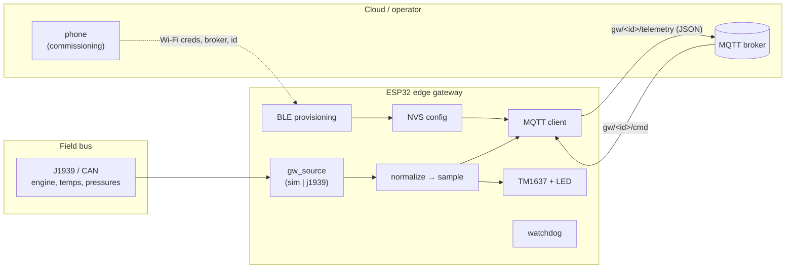

# 29_edge_gateway — industrial edge gateway (flagship)

> **Demo only. Not for a product or a network you do not control.** This example has
> open trust gaps (see [Open trust gaps](#open-trust-gaps-demo-only)). The build
> stops with `#error` when `CONFIG_E32P_BENCH_FORBIDDEN` is set (a product build, Secure
> Boot or Flash Encryption).

A complete little product, not a driver demo. This example turns an ESP32 into an
**industrial edge gateway**: it reads a J1939/CAN field bus, normalizes the
signals, and streams them to an MQTT cloud — while also being commissioned over
Bluetooth and controlled from the cloud. It composes about
**fourteen** `e32p_*` modules into one device with a real lifecycle:

> **provision → acquire → report → be controlled → repeat**



## Modules it ties together

`e32p_wifi` · `e32p_mqtt` · `e32p_ble` · `e32p_nvs` · `e32p_ota` · `e32p_twai` ·
`e32p_j1939` · `e32p_tm1637` · `e32p_gpio` · `e32p_wdt` · `e32p_sysinfo` ·
`e32p_core` / `e32p_event` (pulled in by Wi-Fi).

## How it behaves

The gateway decides its mode at boot from what's stored in NVS:

| State | Mode | What runs |
|-------|------|-----------|
| No SSID/broker saved | **Provisioning** | BLE only — advertise `e32p-gateway`, accept config, save, reboot |
| Config present | **Normal** | Wi-Fi + MQTT + field acquisition + local UI |

BLE and Wi-Fi run in **separate boots** (a reboot sits between commissioning and
normal operation), so the two radios never fight for RAM at the same time — a
deliberate, memory-safe design choice for the WROOM-32.

### 1. Provisioning (BLE)

On a fresh device, it advertises a GATT service (`0xFF00`). Connect with nRF
Connect / LightBlue and write the fields, then trigger apply. The link uses BLE
"Just Works" pairing: there is no passkey and no authentication, so anyone in radio
range can write the fields while the device is unprovisioned.

| Characteristic | Meaning | Example |
|----------------|---------|---------|
| `0xFF01` | Wi-Fi SSID | `MyNetwork` |
| `0xFF02` | Wi-Fi password | `secret` |
| `0xFF03` | MQTT broker URI | `mqtt://192.168.1.10:1883` |
| `0xFF04` | Gateway id | `gw-01` |
| `0xFF05` | **apply** (write any byte) | → saves to NVS + reboots |
| `0xFF06` | status (read/notify) | `waiting` / `saved` |

With BLE commissioning the credentials arrive **over the air** and are saved in NVS
(plaintext, not encrypted). The fallback credentials from the bench path below are
different: they are compiled into the firmware image and into the generated `sdkconfig`.

### 2. Telemetry (MQTT uplink)

Once connected it publishes normalized JSON to `gw/<id>/telemetry` every
*interval* seconds:

```json
{
  "gw": "gw-01",
  "up_ms": 123456,
  "heap": 210148,
  "rssi": -58,
  "src": "sim",
  "signals": [
    {"pgn": 61444, "name": "engine_speed", "value": 1420.5, "unit": "rpm"},
    {"pgn": 65262, "name": "coolant_temp", "value": 82.0,   "unit": "degC"},
    {"pgn": 65263, "name": "oil_pressure", "value": 331.0,  "unit": "kPa"},
    {"pgn": 65276, "name": "fuel_level",   "value": 78.0,   "unit": "pct"}
  ]
}
```

It also publishes a lifecycle event (`online`) to `gw/<id>/evt`.

### 3. Commands (MQTT downlink)

Publish a plain-text command to `gw/<id>/cmd`:

| Command | Effect |
|---------|--------|
| `identify` | Blink the status LED (find this unit on a bench of many) |
| `interval <sec>` | Change the telemetry period and persist it |
| `reboot` | Restart |

There is no sender check. The broker connection is plaintext and anonymous, so any
client that can reach the broker and knows the gateway id can send these commands.
The `ota <url>` and `reset` commands were removed for that reason.
Retained commands (`mosquitto_pub -r`) are ignored, so a retained `reboot` cannot
restart the gateway at every connect.

```bash
mosquitto_pub -h 192.168.1.10 -t gw/gw-01/cmd -m "interval 2"
mosquitto_pub -h 192.168.1.10 -t gw/gw-01/cmd -m "identify"
```

### 4. No over-the-air update

This example has no update path. The gateway only confirms a freshly updated image
(`mark_valid`) so that the bootloader does not roll it back. A command that pulled an
image from a URL was removed: the image was not signed and the command was open to
anyone. See `28_secure_ota` for a signed update and
[`docs/SECURITY_HARDENING.md`](../../docs/SECURITY_HARDENING.md) for the hardening
status.

## Open trust gaps (demo only)

| Gap | Effect |
|-----|--------|
| MQTT is plaintext (`mqtt://`) and anonymous | Anyone on the path can read telemetry; anyone who can reach the broker can publish commands |
| No sender or topic check on commands | `identify`, `interval <s>` and `reboot` run for any client; `interval` also saves the whole config to NVS when the value changes |
| BLE onboarding is Just Works | No authentication; anyone in range can provision an unprovisioned device |
| Wi-Fi creds in NVS are plaintext | NVS encryption is not enabled |
| Fallback Wi-Fi creds are compiled in | If set in `menuconfig` they sit in the image and in `sdkconfig` |
| Flashed images are not checked | Secure Boot is off, so the chip runs whatever image is flashed |

A product would need: MQTT over TLS with broker authentication (username and password or
client certificates) and a per-device topic ACL; BLE onboarding with protocomm security
2 and a per-device proof-of-possession; signed OTA with Secure Boot and Flash
Encryption; and no fallback credentials in the image.

In plain words: "protocomm security 2" is ESP-IDF's secure onboarding protocol. The phone
and the device agree on a session key from a shared per-device secret (the proof of
possession), so an eavesdropper or a stranger in range cannot provision the device. An
"ACL" (access control list) is a list that says which client may publish or read which
topic on the broker.

### 5. Local UI + robustness

The onboard LED is **solid when the cloud is connected**; the optional TM1637
shows the headline signal (engine speed). A task **watchdog** guards the main
loop. System health (`heap`, `rssi`,
`uptime`) rides along in every telemetry message.

## The swappable field source — works today, real bus later

The gateway reads its data through a small `gw_source` interface with two
backends, chosen at build time:

| Backend | Needs hardware? | Use |
|---------|-----------------|-----|
| **sim** (default) | No | A built-in simulator emits four J1939-shaped signals that drift over time — the entire cloud / provisioning path is demonstrable now. |
| **j1939** | Yes — an SN65HVD230-class CAN transceiver | Reads a live bus in `LISTEN_ONLY` mode (a gateway must never disturb the bus it taps) and decodes real PGNs. |

Flip to the real bus in `menuconfig → 29_edge_gateway → Read a real J1939/CAN
bus`. Everything downstream of the source is identical, so no other code changes.

## Verified now vs hardware-pending

| Path | Status |
|------|--------|
| BLE provisioning → NVS → reboot | verifiable now (phone + BLE) |
| Wi-Fi + MQTT telemetry (JSON) | verifiable now (broker on your LAN) |
| Commands (identify/interval/reboot) | verifiable now |
| Local LED status | verifiable now (onboard GPIO2) |
| TM1637 display | when the display is wired (optional; degrades gracefully) |
| **Real J1939 bus read** | **when the SN65HVD230 transceiver arrives** |

## Build & run

```powershell
idf.py -C C:\Users\aleks\Work\esp32_platform\examples\29_edge_gateway set-target esp32
idf.py -C C:\Users\aleks\Work\esp32_platform\examples\29_edge_gateway -p COM5 build flash monitor
```

**Fast bench path (skip the phone):** set the fallback credentials in
`menuconfig → 29_edge_gateway → Fallback Wi-Fi SSID / password / broker`. When
BLE provisioning hasn't stored a config yet, the gateway uses those so you can
exercise the whole cloud pipeline without commissioning over BLE first. The values
end up in the firmware image and in the generated `sdkconfig`: use a throwaway network
and do not commit that `sdkconfig`. To try real provisioning instead, leave them empty
and use a BLE app.

## Pin map (defaults, all configurable in menuconfig)

| Function | GPIO | Note |
|----------|------|------|
| Status LED | 2 | Onboard DevKit LED (no wiring) |
| TM1637 CLK / DIO | 18 / 19 | Optional display |
| CAN TX / RX | 5 / 4 | Only used with the `j1939` source + a transceiver |

## Files

| File | Role |
|------|------|
| `main/main.c` | Mode decision + the normal-mode orchestration loop |
| `main/gw_config.[ch]` | NVS-backed configuration |
| `main/gw_source.[ch]` | The `sim` / `j1939` field-source backends |
| `main/gw_provision.[ch]` | BLE-GATT provisioning |
